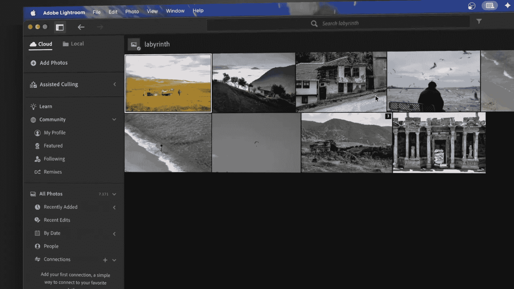
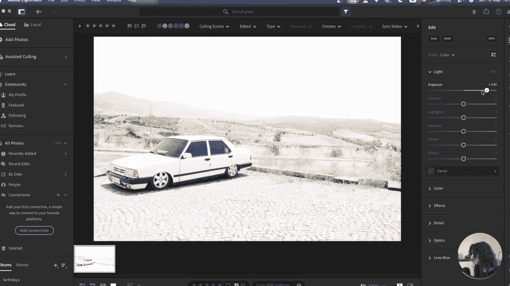
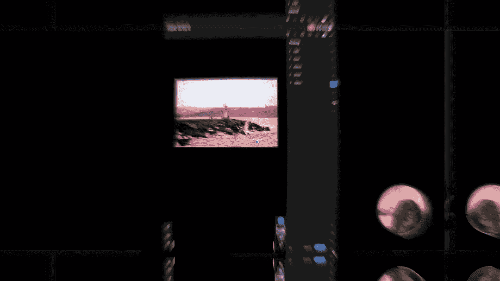
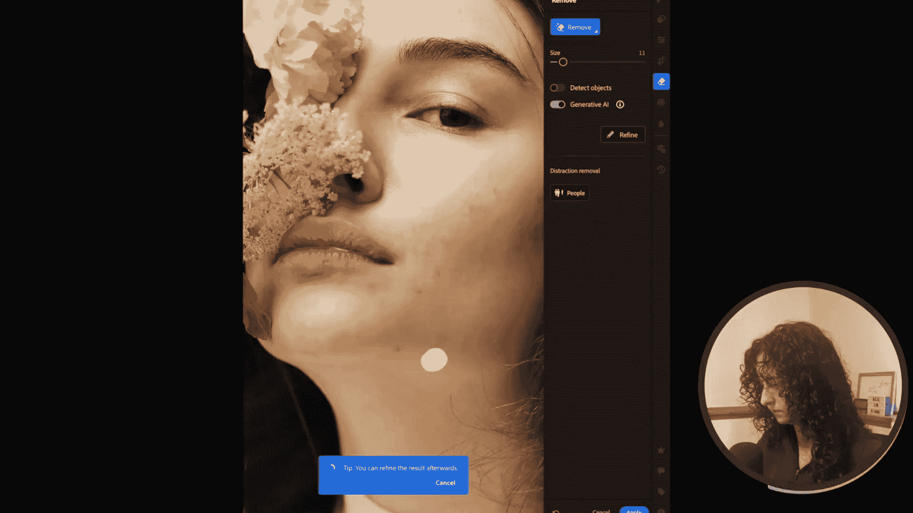
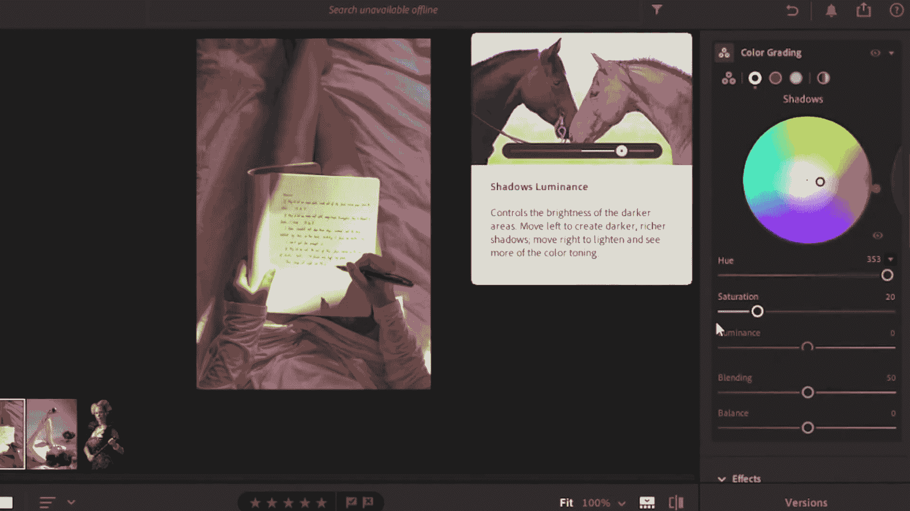
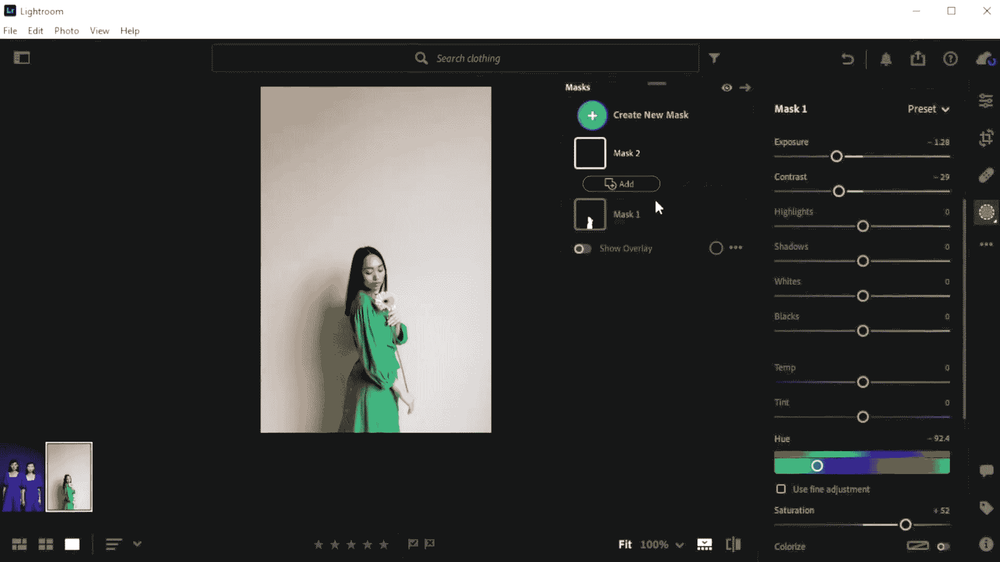

# 🖼️ Adobe Lightroom 零基础到精通全教程：01：欢迎来到课程


在本节课中我们将要学习Adobe Lightroom的基础知识，了解这门完整课程的整体结构，并且明确从零开始学习照片编辑需要具备哪些核心技能。通过这节欢迎课，你可以快速了解讲师是谁，课程会教什么，以及学完之后你能达到什么样的编辑水平，为后续的系统学习做好心理准备。


接下来先进入课程的欢迎环节，让你对整个学习旅程有直观的认识。


大家好，欢迎来到Adobe Lightroom超级大课。无论你是对Lightroom完全没有经验的新手，还是已经使用过这个工具并有一定基础的学习者，这门课程的设计目标都是带你从初学者成长为一位经验丰富、充满自信的照片编辑者。我们将通过大量实际项目来完成这个目标，让你在每个项目中都能亲手参与，把一张照片从头到尾完整地编辑一遍。我叫Hosniki Chei，我是一名专业的照片编辑和数字内容创作者，多年来我使用Adobe Lightroom编辑了成千上万张照片，今天非常高兴能和大家分享这些工作流。


讲师自我介绍完毕后，我们继续来看看学习照片编辑时需要掌握的核心概念。


在学习过程中你将接触到的核心概念可以用下面这个公式来理解：




```text
照片编辑质量 = 光线控制 + 色彩管理 + 构图把握 + 细节处理
```






这个公式告诉我们，一张好看的照片并不只是靠拍摄时的运气，更多取决于后期编辑中对光线、色彩、构图和细节的处理。你可以把它当作编辑时的检查清单，每调整一张照片都可以对照这四个方面来检查，这样就不会遗漏重要的编辑步骤。




掌握了核心概念之后，下面是本课程将要讲解的主要模块和知识点：


- Lightroom基础操作与界面介绍
- Lightroom移动端应用的使用方法
- Lightroom Classic高级功能与深度工作流
- 日常照片编辑可以直接应用的额外工作流
- 照片素材库的整理与管理方法
- 预设的创建与使用技巧
- RAW原始文件的处理流程
- 蒙版与选区编辑的实用方法
- 高效编辑工作流的搭建与个性化调整


完成课程大纲的学习后，你会明白专业摄影师在编辑时为什么会做出某些特定的选择。这些选择背后隐藏着对光线构图、色彩搭配和细节呈现的深度理解。当你掌握这些原理之后，下次再编辑照片时，你会更加清楚自己应该关注哪些方面。除此之外，课程中我们还会编辑多种不同类型的照片，这样你就能根据照片的构图特点，选择出最合适的编辑技巧。


理论介绍到这里就告一段落，如果你已经准备好挖掘照片的全部潜力，那么现在就让我们开始学习吧。







本节课中我们一起学习了Adobe Lightroom超级大课的欢迎内容，了解了课程适合的人群，认识了讲师Hosniki Chei，并且梳理了课程将要涵盖的从基础到高级的完整知识体系，为接下来的照片编辑学习打下了基础。
