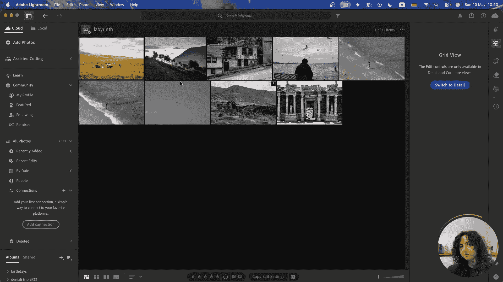
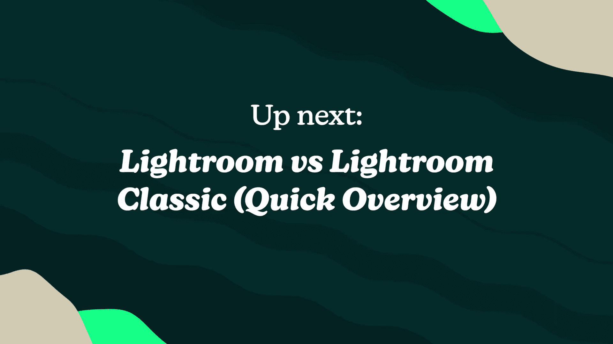

📸 Complete Adobe Lightroom Megacourse：02-02：入门课程：你将学到什么


在本节课中，我们将一起学习Adobe Lightroom入门课程的核心内容，包括如何导入照片、如何进行基础编辑，以及如何导出成品。此外，我们还会聊聊如何整理照片素材，如何从相机或手机里挑选出最好看的照片，让你对整个软件的运作逻辑有个整体了解。


本节课首先会先带你快速浏览一下整个课程会讲哪些知识点，方便你心里有数。以下是这门入门课程的主要内容：

- 如何把照片导入Adobe Lightroom
- 如何在软件里进行基础照片编辑
- 如何把编辑好的照片导出
- 如何整理和管理你的照片素材
- 如何从相机或手机里选出最佳照片


说完了课程大纲，接下来我们来具体说说Adobe Lightroom到底是什么，以及它为什么适合新手使用。


Adobe Lightroom 是一款照片编辑工具，它的特点是非常容易上手，而且可以在不同的设备上使用。具体来说，它有手机版、电脑桌面版和iPad版本。如果你习惯用Apple Pencil来修图，Adobe也提供了相应的支持。它既支持云端存储，也支持本地存储，这意味着你可以把照片保存在多个地方，甚至可以和别人一起协作编辑。总而言之，这是一个非常实用的软件，如果你刚开始接触摄影，学习它是个非常好的起点。


软件支持的设备可以用下面这个简单的方式来理解：

```
设备类型 = 手机版 + 桌面版 + iPad版
```

存储方式也可以用公式表示：

```
照片保存 = 云端存储 + 本地存储
```

了解完Lightroom的基本定义之后，你可能会问，手机里不自带修图功能吗，为什么还要专门学这个软件呢？


的确，现在的手机都自带一些简单的调整工具，你可以用来做基础的修图。不过，如果你想让照片效果更上一层楼，进行更深入的编辑，Adobe Lightroom就是一个很好的选择。比如，有些照片里会出现红眼现象，很多手机自带的修图工具并没有提供去除红眼的功能，而Lightroom可以帮你轻松搞定这种问题。也就是说，你可以把手机自带的工具和Lightroom结合起来使用，发挥它们各自的优势。


常见的修图需求对比如下：

```
手机自带工具 = 基础调整
Adobe Lightroom = 基础调整 + 进阶修复（如去除红眼）
```

好了，关于入门课程你会学到什么，以及Lightroom的基本情况，我们先聊到这里。这门课会非常有趣，让我们赶紧进入下一节课。下一节课我们将讨论Adobe Lightroom和Adobe Lightroom Classic之间的区别。






本节课中，我们一起学习了Adobe Lightroom入门课程的主要内容，了解了它的基本定义、支持的设备、存储方式，以及为什么初学者适合从它开始学摄影后期。


