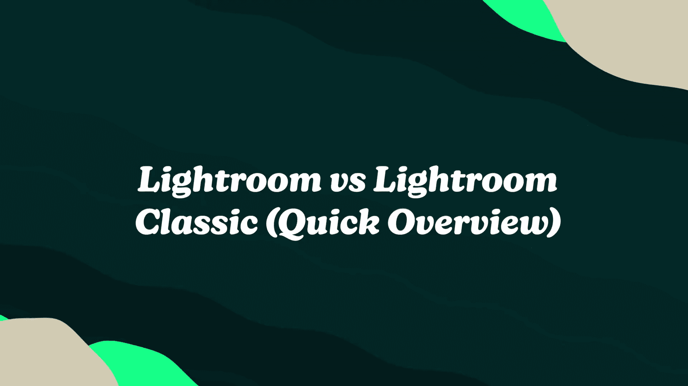
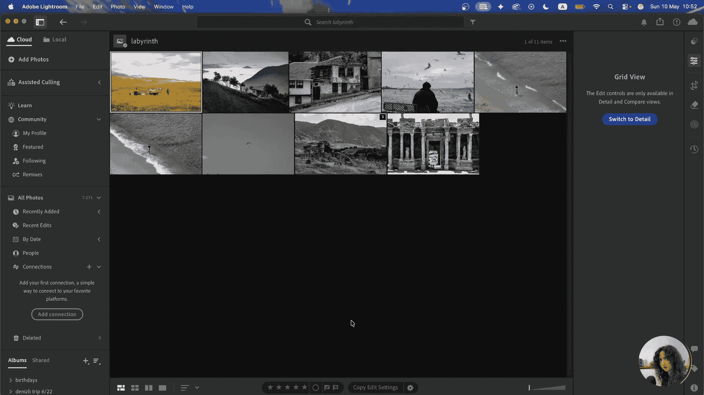
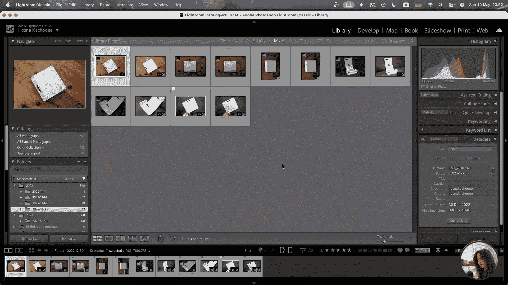
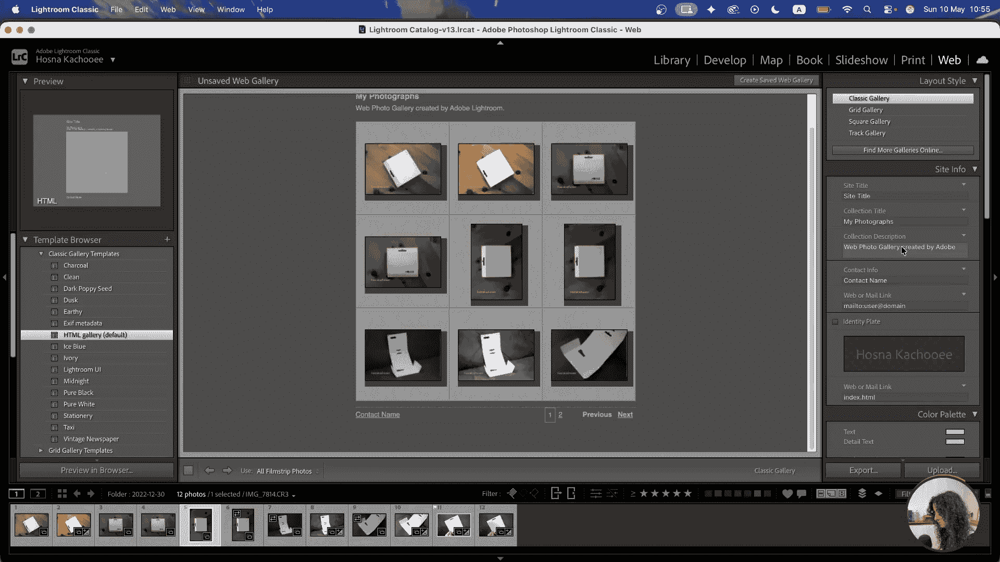
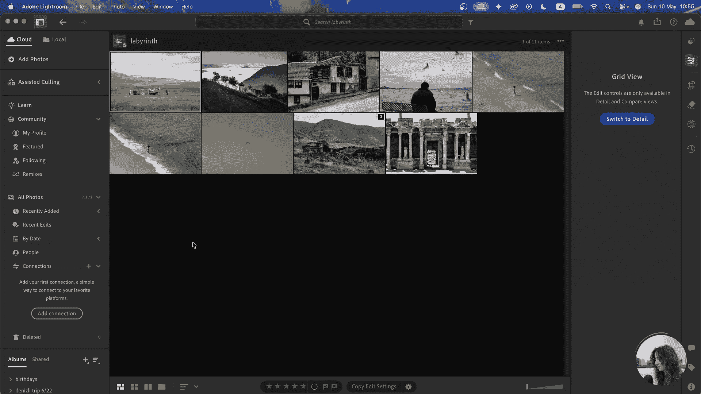
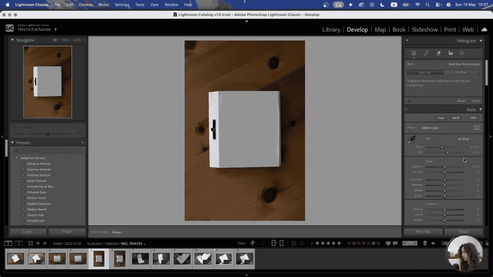

# Complete Adobe Lightroom Megacourse：Beginner to Expert Photo Editing：03-03：Lightroom vs Lightroom Classic 快速概览 📸


在本节课中，我们将要学习 Adobe 提供的两个 Lightroom 版本之间的核心区别，并弄清楚我们究竟该使用哪一个。很多人在从 Adobe 下载 Lightroom 之后，都会发现还有一个带有“Classic”字样的经典版本，这时候自然会产生疑问，这两个版本到底有什么不同，初学者又该如何选择。为了让大家不再困惑，本节课会对两者的界面、功能、适用场景做一次完整的梳理，并且解释清楚为什么本课程后续内容会专注于普通版 Lightroom，而不是 Classic 版本。接下来，我们先从这两个程序的基本外观和定位说起。







当你打开电脑上的 Adobe Lightroom 时，你看到的就是本课程将要贯穿始终的主程序，也就是普通版 Lightroom。与此同时，Adobe 还提供另一个名为 Lightroom Classic 的版本，它的界面看起来和普通版完全不同，整体设计更偏向旧式风格，给人的第一印象就是一个比较传统的桌面软件。虽然两者在视觉上差别很大，但就实际可用的编辑工具而言，它们其实拥有完全相同的功能集合，都是强大的后期处理程序，允许你对图片进行远超简单颜色和光线调整的操作。如果用一个简单的公式来表达两者的工具关系，可以理解为：

```
Lightroom 编辑工具 = Lightroom Classic 编辑工具
```

也就是说，无论你用哪一个，基础的修图能力是没有区别的。不过，两者真正的主要差别在于对照片数量的处理能力。Lightroom Classic 拥有非常出色的海量照片管理方式，因此很多专业摄影工作室更倾向于使用这个版本来应对大量图片的归档和分类工作。下一节我们来具体看看 Classic 版本多出来的一些输出和共享功能。


在 Lightroom Classic 的顶部菜单栏中，你可以看到 Library、Develop、Map、Book、Slideshow、Print 以及 Web 等不同的模块，这些模块是普通版 Lightroom所没有的。以下是 Lightroom Classic 中常见的输出模块列表：

- Library：用于整理和浏览照片库
- Develop：用于图像编辑和色彩调整
- Map：用于根据地理位置对照片进行标记
- Book：用于将照片制作成实体或电子相册
- Slideshow：用于制作照片幻灯片展示
- Print：用于设置打印尺寸、数量和页面布局
- Web：用于将照片托管为简单的网页展示

举例来说，假设有个客户拍了婚礼，你拍摄了大约一百张照片，客户希望把这些照片做成一本写真书。在 Lightroom Classic 里，你可以直接把所有照片整合到 Book 模块中，一键排版成书。同样地，Slideshow 模块让你制作幻灯片，还可以在角落添加自己的 Logo、调整整体外观、插入背景音乐并设置播放选项。Print 模块则允许你设定打印照片的尺寸、数量、边距、参考线以及页面布局，调整好之后直接发送到打印机。Web 模块则可以把照片放在一个简易的网页上展示，你可以为页面命名、列出所有照片、修改站点信息，甚至添加外部链接，最后选择通过电子邮件发送、本地托管或服务器托管。这些功能在给客户交付作品时非常实用，但如果你只是处理自己的私人照片，其实用不上这么复杂的共享选项。


回到我们本课程将要使用的普通版 Lightroom，你会发现它在共享和输出方面的选项要少得多。当然，我们依然可以导出照片，也可以通过云端进行分享，但是不提供相册制作、网站搭建或幻灯片生成等高级选项。它的逻辑非常直白，你编辑完一张照片，如果想分享，就通过现有的选项发送出去，事情就到此为止。以下是普通版 Lightroom 与 Lightroom Classic 在共享能力上的对比表现：





- 普通版 Lightroom：支持导出，支持云端分享，不支持相册、网站和幻灯片制作
- Lightroom Classic：支持导出，支持云端分享，支持相册、网站、幻灯片和打印布局

另一个需要注意的重要区别是云端功能。普通版 Lightroom 内置云端服务，这意味着你可以在不同设备之间共享照片，并且在不同设备或不同账号上继续编辑同一张图片，实现跨平台协作。而 Lightroom Classic 则专注于桌面端，安装在哪台电脑上就只能在那台设备上使用，跨设备协作和跨平台共享的空间非常有限。两者的云端差异可以用简单的伪代码表示：

```
普通版 Lightroom：设备 A ↔ 云端 ↔ 设备 B，可同步编辑
Lightroom Classic：仅限单台桌面设备，无跨设备同步
```

除此之外，两者的编辑工具依然是一致的。无论是在普通版还是 Classic 版本中，你都能找到光线、颜色、效果、曲线调整、裁剪、去除不需要的物体、修复红眼等所有基础和进阶修图功能。在 Classic 版本中，这些工具集中在 Develop 标签页里。既然两者的编辑能力几乎一样，为什么本课程不选择 Classic 呢？


之所以本课程决定专注于普通版 Adobe Lightroom 而不是 Classic，是因为大多数刚开始学习摄影后期的朋友，日常生活中使用手机拍照的机会非常多，同时也希望能在手机上进行编辑。普通版 Lightroom 支持移动端，并且可以在手机和电脑之间进行互相编辑，也就是说，你在电脑上调好的参数，可以在手机上继续修改，反之亦然。相比之下，普通版 Lightroom 的操作逻辑更加用户友好，它让你只需要专注于“如何把一张照片编辑好”，而不需要花太多精力去研究如何制作幻灯片、搭建网站或排版相册。既然我们已经了解了两个版本的区别，也清楚为什么选择普通版 Lightroom，那么接下来就可以开始正式学习如何从头到尾操作这个平台了。





在本节课中，我们一起学习了 Lightroom 和 Lightroom Classic 之间的主要区别。我们了解到，虽然两者拥有相同的编辑工具，但 Lightroom Classic 更适合专业工作室处理海量照片，并提供相册、幻灯片、打印和网页托管等丰富的输出模块；而普通版 Lightroom 更加轻量，侧重于云端同步和跨设备编辑，非常适合初学者和移动端用户。基于这些原因，本课程后续内容将围绕普通版 Lightroom 展开，帮助大家从最基础的操作开始，逐步掌握照片编辑的核心技巧。

