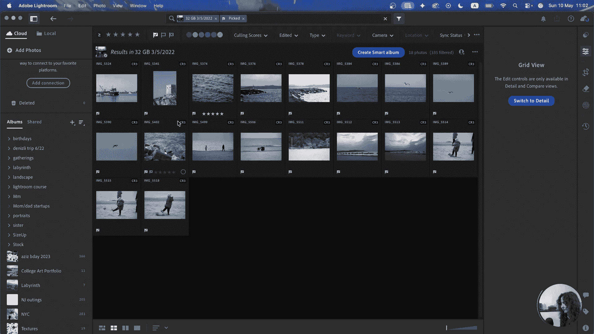
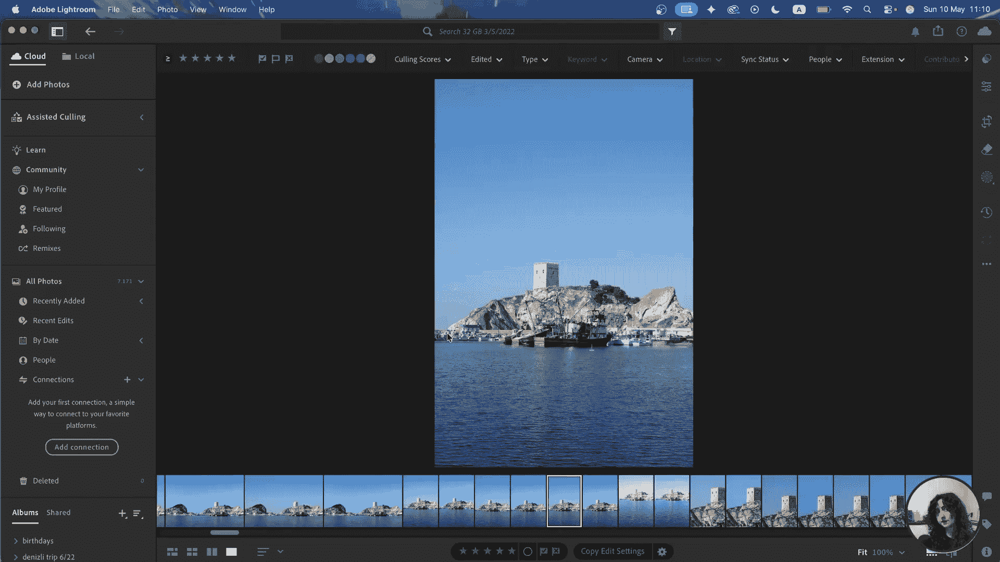

Complete Adobe Lightroom Megacourse： Beginner to Expert Photo Editing：part1 p04 04：Setting Up Lightroom & Navigating the Interface 🖼️


在本节课中我们将要学习如何下载并安装 Adobe Lightroom，熟悉软件启动后的界面布局，掌握照片导入与筛选的基本方法，并详细了解左右两侧编辑面板的主要功能。


下载与安装 Lightroom


首先，你需要从 Adobe 套件中下载 Lightroom。Adobe 提供不同的订阅方案，如果你之前没有使用过 Adobe 产品，可以根据自身需求选择对应的订阅计划。Lightroom 和 Photoshop 包含在摄影类捆绑包中，购买该订阅后，你可以轻松下载 Lightroom。初始的几个界面主要用于同步账户信息，流程非常简单，这里就不再赘述。


账户同步与云端设置


进入软件后，如果你是第一次使用，界面中暂时还没有任何照片。如果在下载过程中遇到问题，可能是因为账户尚未同步完成。有些用户会尝试从 Adobe 官方以外的平台下载 Lightroom，这种做法不够安全，建议避免。所有与账户相关的设置都会出现在这个云朵形状的图标处，你也可以选择购买额外的云端存储空间，这一步是可选的，但如果你打算进行大量编辑工作，我比较推荐开通。


存储空间计算示例如下：

```text
剩余存储空间 = 总存储空间 - 已用存储空间
```


Lightroom 多端支持与订阅信息


在界面下方，你可以看到 Lightroom 移动端和 Lightroom 网页端也已就绪。点击查看方案，系统会显示你当前正在支付的订阅内容。在顶部区域，则可以查看剩余的存储空间。


导入照片与挑选编辑对象


假设一切运行正常，你接下来要做的第一件事就是添加照片。关于如何导入和导出照片，我们将在下一节课中详细介绍。一旦照片出现在 Lightroom 中，你就需要从中挑选出想要编辑的图片。例如，假设你刚刚将相机中的所有照片导入，其中显然有一些并不适合编辑，可能是模糊不清，也可能拍摄对象不正确。


评分与标记系统


当前页面就是用来进行照片筛选的。在底部区域，你可以选择图片的查看方式。点击其中某个选项，可以一次只查看一张图片。接着，你可以通过星级、选中标记和拒绝标记来给照片评分。根据这些标记，你可以保留部分照片用于后续编辑，其余照片则继续留在 Lightroom 中。


以下是常用的照片标记方式：

- `★`：选中标记，表示该照片需要进入编辑流程
- `✖`：拒绝标记，表示该照片暂不需要编辑


快捷键操作与筛选视图


假设你想要编辑某张照片，可以点击底部的选中标记完成选择。你也可以直接按键盘上的 Z 键快速选中它。如果你不想编辑某张照片，可以按 X 键将其标记为拒绝，或者点击带有 X 符号的小旗帜图标。


当你切换回较大的视图时，只需确认刚才的选择没有遗漏。我挑选了几张照片，这些照片会在视图中显示出来。当你点击上方相册搜索区域，可以点击筛选按钮，让 Lightroom 只显示你已选中的照片。这样一来，你将只能看到被接受或准备进入下一阶段编辑的图片，当前看到的照片数量会大幅减少。


进入编辑模式与侧边栏工具


筛选完成后，双击其中一张照片，就可以开始使用右侧的工具进行编辑了。我点击这张图片，你就能看到当前的编辑界面。如果你希望使用预设来编辑，可以直接应用预设中的所有编辑工具。再次点击该选项，侧边栏就会折叠。这些就是经典的编辑工具，涵盖色彩、曝光等内容。


图像几何编辑




下一部分工具用于处理图像的几何结构。这里你可以进行裁剪、矫正等操作。如果你需要删除或调整图像的某些部分，可以使用相应的删除功能。


遮罩与局部调整


点击右侧的遮罩标签，可以对图像的特定区域进行调整，而不影响整张照片。Lightroom 实际上会自动识别图像中的某些元素。例如，如果照片中有人像，点击一次该选项，软件就会确定人物位置并生成遮罩。天空检测的原理相同。优点在于，选择区域后你可以反转遮罩，然后处理除了天空以外的所有部分。点击后你可以看到，软件已经比较准确地识别了天空，虽然可能遗漏了一些部分，但反转遮罩后，你就可以处理除天空之外的所有区域了。


遮罩反转逻辑示例如下：

```text
反转遮罩 = 全图区域 - 当前选中区域
```


历史版本面板


右侧这个面板是历史记录面板，记录了你制作的所有版本，并会根据时间自动保存。如果你想保留某个版本，可以在这里为其命名。比如，你创建了一个黑白版本，之后又创建了一个色彩鲜艳的版本，稍后可以决定导出哪一个。


AI 状态与额外功能


最后，我们还有一些 AI 状态功能。每当 Lightroom 使用人工智能时，都会在界面上显示使用位置。就像我们刚才进行天空识别时，软件会在下方记录这一操作。


此外，你可以将编辑设置复制到其他照片，查看原图对比，并使用侧边栏的快捷键。如果需要，还可以将照片导出到 Photoshop 进行进一步处理。


评论、关键词与图片信息


如果你通过云端与他人分享照片，对方可以在评论区留下意见，这适合合作或向上司展示作品。你也可以为照片添加关键词，这些关键词在导出时会嵌入到照片文件中。


导出时关键词嵌入规则如下：

```text
导出照片 = 原始照片 + 添加的关键词
```


右侧还有一个眼睛形状的图标，点击后可以查看所有拍摄信息，包括相机型号、镜头、拍摄日期、文件名，以及你添加的其他信息。这些数据会加密到该图片文件中。


左侧组织面板：相册与文件夹


右侧完成编辑后，左侧用于进行所有组织操作。导入照片后，你可以在这里创建相册，或者在相册中创建子文件夹。你可以与他人分享照片，也可以直接从这里查看内容。


你刚刚导入的所有照片都会出现在这个文件夹中，最近编辑过的照片也会出现在这里。你可以按日期、按人物搜索，还可以直接分享到各个平台。例如，如果你有 Behance 账号或 Instagram 账号，可以在这里添加账号信息。最后，已删除的文件也会暂时存放在这里，30 天后会被永久删除。


已删除文件处理规则如下：

```text
放入废纸篓后 30 天 = 永久删除
```


分享与社区功能


你可以直接分享到 Behance 或 Instagram 等平台。如果你想学习更多内容，可以进入社区板块查看。这是你的个人资料页面，这里展示了 Beh 平台上不同用户的精选照片。Beh 是 Adobe 的平台，你可以从中获取灵感，或了解其他人如何应对各种编辑挑战。你可以关注其他用户，也可以对他们的照片进行重新创作。


如果你看到一张非常喜欢的照片，但想尝试不同的风格，可以通知摄影师你已经对其图片进行了编辑，对方或许会关注你回馈。你可以直接从这里下载预设，也可以对当前看到的内容进行筛选。例如，进入精选页面后，如果主题是动物，你只会看到动物照片。


这个功能的好处在于，你不仅可以编辑照片，还可以在程序内直接访问不同的网页，无需额外操作即可分享照片或参与社区互动。


云端与本地存储


这就是云端区域，软件中还存在本地区域。本地区域用于在当前电脑的桌面上进行操作，内容不会同步到其他地方，所有处理都在本地完成。根据你的需求选择即可，但通常人们更倾向于使用云端，因为这样以后可以随时访问。


存储模式对比如下：

```text
云端模式 = 跨设备同步 | 本地模式 = 仅当前电脑
```


标签筛选与 AI 筛选


在标签方面，除了我提到的星级和地图外，你还可以使用颜色标记照片。如果你安装了最新版本的 Lightroom，还有一个新加入的功能，会使用人工智能。当你选择想要筛选的内容时，软件会自动为你完成筛选，无需逐张查看从相机导入的所有图片。


你可以要求 Lightroom 只保留主体对焦的照片，或者只保留睁眼的人像照片。我当前的选择中并没有人像主体，但你可以看到它只保留了视频，你也可以在这里导入视频。


AI 筛选条件示例如下：

```text
保留照片 = 主体对焦 ∧ 人物睁眼
```


现在你可以查看刚才进行的所有筛选操作，我将撤销该筛选，恢复到之前的状态。你可以浏览已编辑或未编辑的照片，按照片类型、相机型号（如果你有多台相机）、同步状态进行筛选。如果照片中有特定人物，你也可以在这里筛选。


此外，还可以筛选文件扩展名、评论过或点赞过的照片。如果你与他人协作，可以在这里查看相关内容。如果你想在某个相册中搜索任何项目，可以在上方搜索框进行操作，也可以按人物搜索。


课程总结与下节预告


这就是 Adobe Lightroom 界面的快速概览。正如你所见，软件非常用户友好。在接下来的章节中，我们将深入学习如何实际编辑照片、分享作品，并开始一个真实项目。





现在让我们继续学习如何在 Adobe Lightroom 中导入和导出照片。


