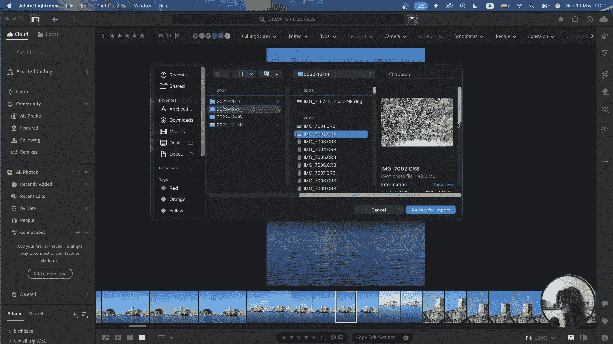
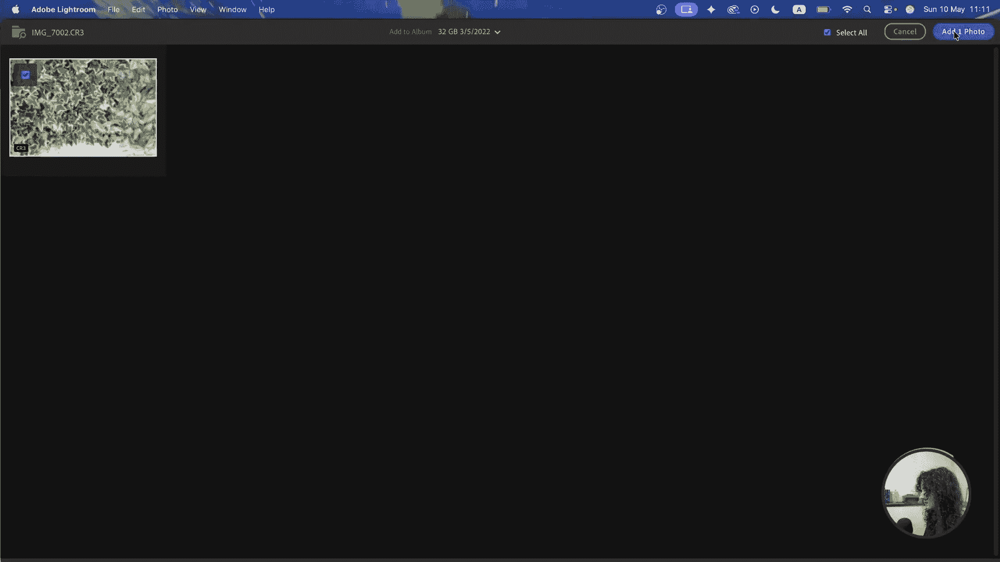
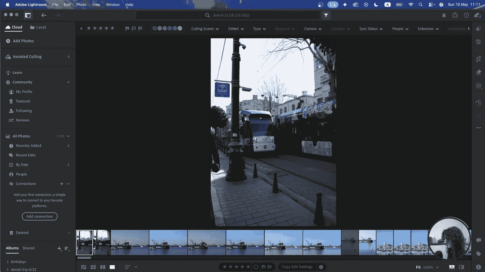
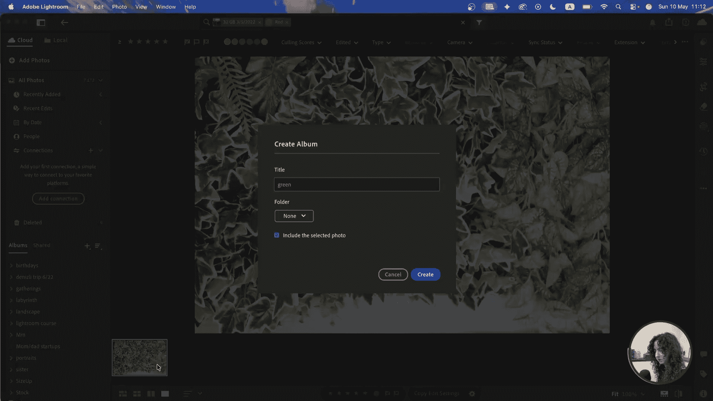

# Complete Adobe Lightroom Megacourse： Beginner to Expert Photo Editing：第05章：导入和整理你的照片 📸

在本节课中我们将要学习如何在 Adobe Lightroom 中把照片导入软件，如何给照片打标签，如何创建和管理相册，以及如何把编辑好的照片导出到电脑里。这些操作是使用 Lightroom 的基础，掌握后你就可以开始管理自己的照片库，为后续的照片编辑打下坚实的基础。

接下来我们先来看看如何把照片导入 Lightroom。导入照片是使用这款软件的第一步，在界面中有一个很明显的“添加照片”按钮，点击它就可以把电脑里的图片带入到 Lightroom 中进行管理。

以下是导入照片的具体步骤：

- 打开你存放照片的文件夹，选中想要导入的一张或多张图片。
- 点击“导入前预览”按钮，软件会把你选中的照片显示在界面上。
- 如果你一次选择了多张照片，它们都会在这里一起显示出来。
- 你可以勾选想要导入的照片，不想导入的照片直接取消勾选。
- 确认选择后，点击“添加一张照片”，图片就会出现在你当前所在的相册里。

核心导入流程可以用这个简单的公式来表示：

`打开文件夹` → `选择照片` → `预览并勾选` → `添加到相册`

你也可以把从网上下载的配置文件和预设一起导入，方法和导入照片类似，直接把文件带入软件即可。

导入照片之后，我们还需要让照片更容易被找到，下面看看如何给照片打标签。标签就像是给照片贴的便签，帮你在大量图片中快速筛选出想要的那一张。

以下是打标签的常见做法：

- 在照片属性或工具栏中选择一个标签颜色，比如红色标签。
- 当你以后查找带有红色标签的照片时，打过这个标签的图片就会出现在搜索结果里。
- 这样即使照片库里有成百上千张图片，你也能通过标签快速定位目标图片。

打好标签后，还可以把照片放到相册里进行分类管理。相册可以帮你把照片按主题、时间或其他标准分类保存，避免所有图片堆在一起找不到。

以下是创建和管理相册的步骤：

- 点击界面上的加号按钮，选择“创建相册”。
- 给相册起一个名字，比如“绿色”。
- 你可以选择把相册放在文件夹里，也可以直接放在外面，这里我们暂时不放入文件夹。
- 把选中的照片加入这个相册，然后点击创建按钮。
- 创建完成后，相册封面或列表里会显示包含的照片数量。

你还可以对已有的相册进行重命名、分享，或者将它设置为目标相册。设置为目标相册以后，你后来导入的照片会自动放进这个相册里。如果你以后不需要这个相册，也可以删除它，或者把它移到其他文件夹里，随时根据需要调整整理方式。

照片整理好并编辑完成后，就可以把照片导出到电脑中了，方便分享、打印或上传到网络。Lightroom 的导出功能也很简单，只需要几个步骤就能完成。

以下是导出照片的操作流程：

- 在菜单栏点击“文件”，然后选择导出选项，或者直接使用快捷键 `Shift + E`。
- 弹出的窗口里，你可以选择要导出的图片格式。
- 你可以调整导出质量，决定图片的清晰度和文件大小。
- 如果需要，可以添加水印，水印内容可以是你的名字、公司名称，或者其他文字，你可以自由调整水印的样子。
- 设置完成后，点击“完成”。
- 在导出设置里，你可以选择图片里包含的元数据信息。

核心导出设置包括以下几项：

- 元数据：可以选择嵌入所有信息，也可以只嵌入版权信息，用公式表示就是 `元数据 = 所有信息` 或 `元数据 = 仅版权信息`。
- 文件名：可以使用默认名称，也可以自定义名称，并选择常见的文件命名格式。
- 锐化：可以针对不同的输出用途对图片进行锐化处理。
- 色彩空间：可以根据需要更改图片的色彩空间。

在点击导出之前，建议先检查一遍所有设置，确保没有问题。确认无误后，点击“导出一张照片”，软件会让你选择保存文件的位置，选好文件夹后照片就会被导出到电脑里。

通过这些设置，你可以控制别人能否从照片里看到拍摄城市、所使用的相机型号等信息，保护自己的拍摄隐私。

导入、整理和导出的基本流程就介绍到这里，下面简单看看下一节课的内容。下一节课我们将学习右侧面板里的编辑工具。那里有很多功能可以调整照片的光影、色彩和细节，我们将一起看看那些工具具体怎么用，敬请期待。

## 总结

本节课中我们一起学习了如何在 Adobe Lightroom 中导入照片、给照片打标签、创建和管理相册，以及如何导出照片并设置水印、元数据和文件格式。希望这些内容能帮你建立起对 Lightroom 的初步认识，为后续的照片编辑工作打下基础。
