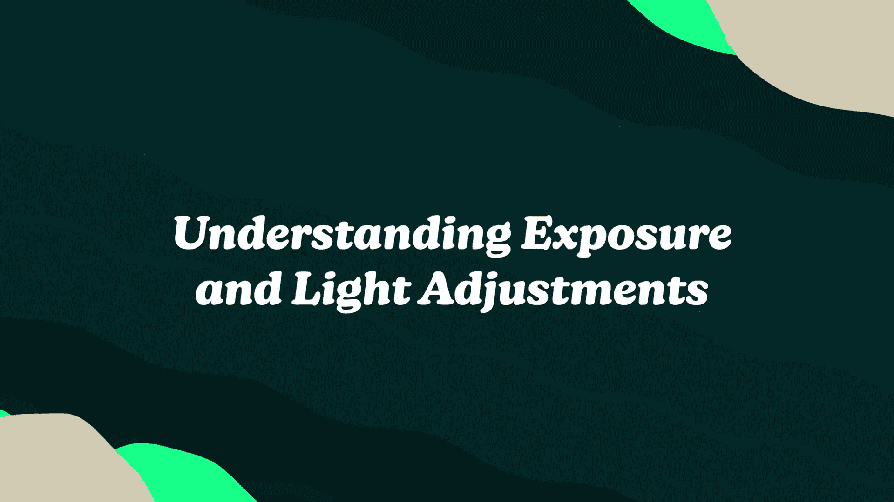
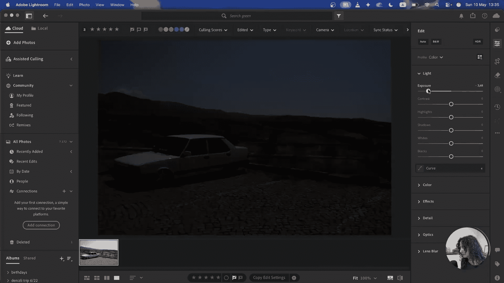
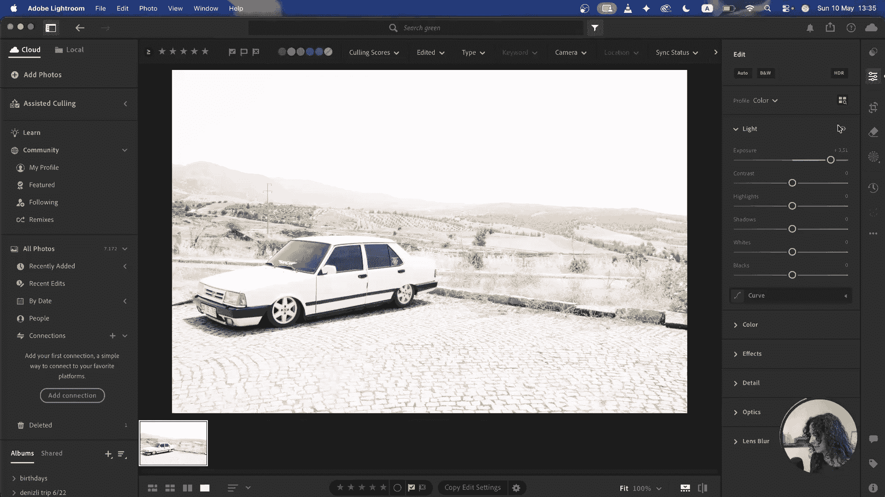
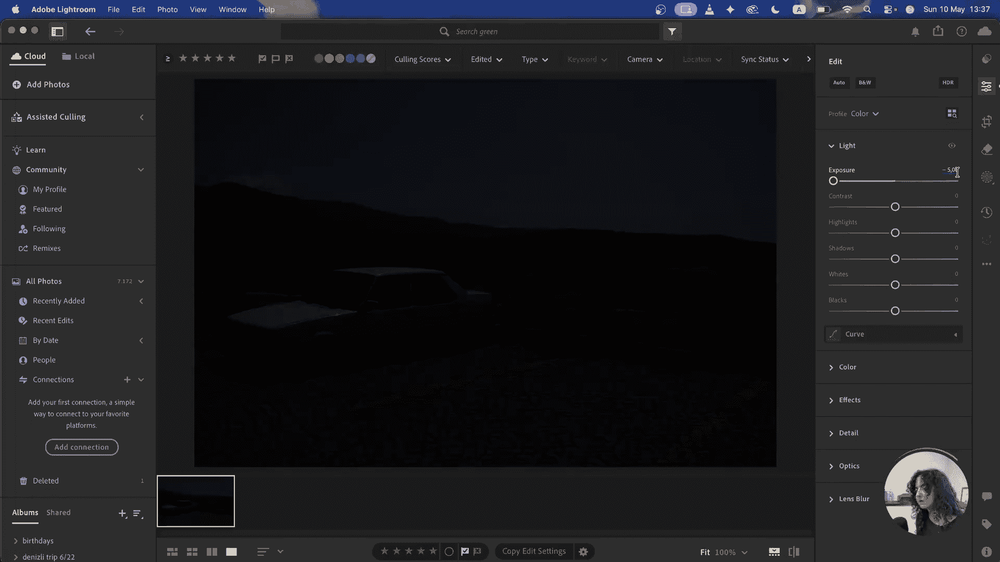
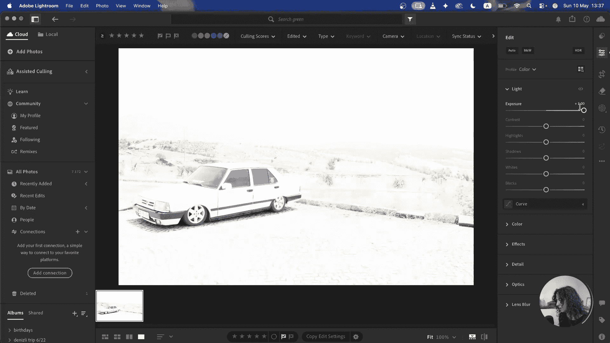
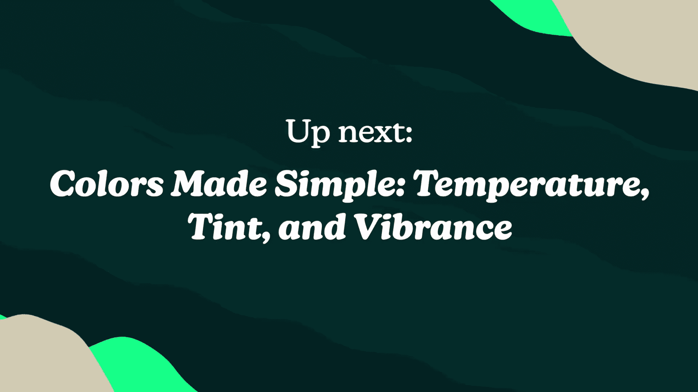

# Complete Adobe Lightroom Megacourse：Beginner to Expert Photo Editing part1：p06 01：理解曝光与光线调整 💡

在本节课中，我们将一起学习如何在 Adobe Lightroom 中编辑一张照片，同时掌握照片编辑的最基本原理。这张练习图片已经放在资源包里供下载，你可以先把它导入 Lightroom，导入的方式和我们上一节课学习的完全一样。导入完成之后，我们将把重点放在“光线”这一部分上，因为光线是照片中最重要的要素，如果光线不足，你就看不清颜色，也看不清细节，颜色和细节都看不清，基本就没法进行任何后期操作了。

要开始编辑，你只需要点击右侧的按钮，激活编辑侧边栏。侧边栏弹出来之后，你会看到一个编辑面板，里面包含下面这些类别：
- 光线
- 颜色
- 效果
- 细节
- 光学
- 镜头模糊

本节课我们先讲光线，然后再继续往后，因为光线真的非常重要。如果光线不够，你就无法看清颜色，也无法看清细节，颜色和细节都看不清，就无法进行任何后期调整。所以点击这个小三角形，就能进入光线调整部分。

下面是滑块的基本使用方式，请记住以下几点：
- 所有滑块都通过那个小球来增加或减少数值
- 双击滑块名称，可以把设置重置回原始状态
- 按住眼睛图标不放，可以查看没有光线效果时的样子，也就是之前和之后的对比

在 Lightroom 里，你并不一定非要手动完成所有调整。你可以选择让 Lightroom 自动编辑，比如一键把照片变成黑白，然后从这里选择一个配置文件，或者换另一个配置文件。不过在本节课和后面的章节里，我们会专注于手动编辑，因为手动编辑给你的灵活性空间会大得多。

第一个选项是曝光。曝光决定的是你的整张图片在亮度方面的整体表现。它的取值范围如下：
`曝光范围：-5 到 +5`

负五是最暗的可能，正五是最亮的可能。如果你把滑块向右移动，就会增加亮度；向左移动，图片就会变暗。注意，当你移动滑块时，数值的增量非常小，因为这是一个非常强大的滑块。你希望一点一点地给图片增加亮度，直到自己满意为止。我可以用滑块来操作，也可以直接点击这里输入具体数值，但通常建议用滑块慢慢添加。调整完成后，你会发现图片里的光线更加突出，同时各种纹理和颜色都被保留了下来。如果你觉得对比度或者阴影部分受到了影响，也不必担心，因为还有其他滑块可以为你的图片增加层次感。

下面是对比度选项。对比度的作用可以用下面这个公式表达：
`对比度 = 图片最亮部分 - 图片最暗部分`

你只需要把鼠标悬停在名称上，就能看到对比度的定义。如果降低对比度，你会发现图片变得很平淡，一切看起来都有些暗淡，不够清新真实；如果调到另一端，你会看到图片亮部和暗部之间有非常清晰的分界。这就是对比度带来的明暗区分。重置之后，你就能看到调整前的正常效果。所以如果你想给图片增加更多立体感，或者让阴影部分更突出，可以轻松添加一些对比度。

接下来是高光。高光控制的是图片中较亮的部分，通常是天空，或者任何反光区域，都可以通过这个滑块来控制。如果你减少高光，你会发现主要在处理天空，还有一点车身，因为车身也是白色的。你可以根据需要增加或减少。有时候天空只是一片平白或平蓝，这时候你可能想利用高光滑块来把颜色展现出来，让画面有更多的氛围感，而不是之前的一片白。我这里设置为负二十三。

阴影的原理也是类似的，它控制的是图片中较暗的部分，通常是除了天空以外的所有区域。如果你把阴影调暗，你会看到天空下方的所有区域都受到了影响；如果你调到另一端，同样是影响那些区域，但这次是让所有东西都变亮了。所以如果某个地方太暗，你可以直接用滑块把它提上来。不过要注意不要做得太过度，否则就会丢失对比度，而对比度就是我们前面刚刚处理的内容。给一个合理的数值就好。

下一步是白点和黑点。白点指的是你图片中最亮的那部分，在我的例子里就是这里的车。你可以围绕这个效果进行调整。如果你增加白点，你会发现主要作用在天空和车身本身，对其他部分影响不大。通常根据你的图片亮度，不需要添加太多，但你可以利用这两个滑块来设定白点和黑点。黑点方面，主要影响的是山脉和车身的黑色边缘，你也可以把这些地方调暗。

如果你不想逐个调整这些滑块，也可以切换到曲线面板。点击那个小三角形，你会得到这个曲线图，这里可以完成和上面同样的操作，不过是通过控制点来实现的。这样你能获得更精细的控制。如果你觉得用曲线比较有压力，那就做非常小的改动就好。

这里讲的是图片的整体光线，但你也可以精准地锁定照片中的某些颜色，把色调拉向红色，或者引入相反的颜色来抵消红色。同样的原理也适用于绿色、品红、蓝色和黄色。你也可以在这里调整高光、阴影、白点和黑点，当你经过每一项时，下方会显示相应的变化。如果你喜欢，也可以使用曲线来做这些操作，但并不是必须的。我现在按 Command 或 Control Z 撤销刚才在曲线里做的操作，只保留滑块的调整。

好了，这就是关于曝光和光线的全部内容了。下面是没有光线效果的样子，这是应用了光线效果后的样子。下一节课将会专注于颜色调整。

本节课中我们一起学习了如何在 Lightroom 中激活编辑面板，掌握了曝光、对比度、高光、阴影、白点和黑点等基础光线滑块的使用方法，还初步了解了曲线面板和颜色通道的微调思路。希望这些内容能帮助你更好地理解照片的光线结构，为后续的颜色编辑打下基础。

