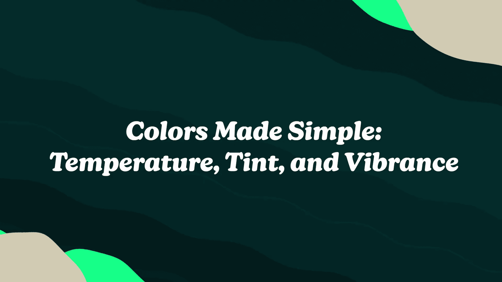
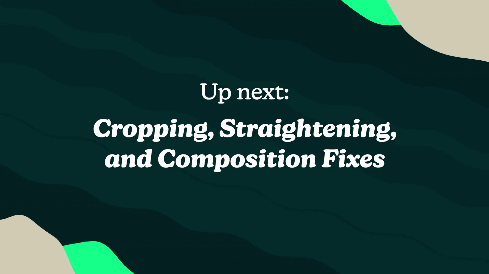

# Adobe Lightroom 完整教程：第07章第02节：色彩基础——色温、色调与自然饱和度 🎨



在本节课中我们将要学习如何在 Adobe Lightroom 中处理图片的颜色。我们会从色温、色调、自然饱和度和饱和度这些基础设置开始，再进入颜色混合器、点彩色以及色彩分级等进阶功能。无论你是刚接触后期处理的新手，还是希望让照片色彩更出众的学习者，本节课都会用大白话把每个滑块的作用讲清楚，让你掌握从整体调色到精准抠色的完整流程。

## 先处理光线，再调整颜色

上一节课我们已经修好了光线，本节我们来看看颜色。如果没有合适的光线，就无法从原图中获得正确的颜色，这可能会导致颜色出现失真。比如红色可能太亮或太暗。因此务必先修好光线，再进行颜色调整。

在 Lightroom 的颜色面板里，我们可以先折叠所有常规滑块，重点看白平衡。这里面有一些像地图一样的选项，类似于之前提到的曲线调整，它是给我们更多控制权的工具，但要入门的话，可以先从白平衡开始。

## 白平衡与色温

白平衡决定了图片中的白点位置。如果你选择自动模式，软件可能会把画面偏向暖色方向，如果你不希望软件自动处理，可以保持“原始拍摄”设置。面板里还有一个吸管工具，你可以用它点击图片中中性色的区域，从而设定中性色参考。比如说天空颜色太蓝，点击之后整张图都会变成偏黄的颜色，这时候可以撤销操作，恢复原来的鼠标指针。

色温控制的是图片是冷色调还是暖色调。向蓝色方向拉，画面就会变冷；向黄色方向拉，画面就会变暖。默认情况下，我们可以用它来修复光线带来的颜色偏差。

```
色温向蓝 = 冷色调
色温向黄 = 暖色调
```

假设你在一个装有黄色灯泡的房间里拍照，整张照片都会显得很黄。这时候可以加入一些蓝色来抵消黄色。因为今天拍摄的是晴天场景，我会稍微加入一点黄色，大约五个点，不要调得太过激烈。

## 色调

色温调整完成之后，我们接着看色调。色调的思路和色温类似，你可以引入品红色或绿色。任意一种颜色都可以用来抵消图片中已有的颜色。如果图片显得太紫，就可以加入一些绿色，反之亦然。我会给自己的图片加上九个点的色调调整。

## 自然饱和度与饱和度

接下来是自然饱和度和饱和度这两个容易混淆的选项。以下是两者的主要区别。

- 自然饱和度：主要针对本来就不太丰富的颜色，比如山脉、地面。可以通过它给这些区域添加一些颜色。即使把自然饱和度拉到最低，画面里可能仍然带有一些黄色，但山脉可能会变成黑白。这时候拉高自然饱和度，就能给山脉带回一些色彩。
- 饱和度：针对本来就有颜色的物体，比如黄色线条、绿色草地。可以用它让颜色更鲜艳，或者拉低来去掉颜色。我大约会加上六个点。

```
饱和度提升 = 颜色更鲜艳
饱和度降低 = 颜色更淡
```

调整完这些基础滑块之后，我已经改变了图片的色彩不少，我们可以查看调整前后的对比效果。

## 颜色混合器

基础滑块调整完成之后，我们进入更精细的颜色混合器面板。颜色混合器可以锁定图片中的某一种单独颜色。你可以选择颜色，也可以进一步调整它的色相、饱和度或明度，或者直接调整该颜色的综合表现，也就是这三个参数的组合。

以下是常见的操作示例。

- 如果不满意绿色的效果，可以抓取绿色并改变色相，这样只改变绿色的外观，不会影响图片里的其他部分。
- 同样的方法也可以用于饱和度和明度，明度决定该颜色的亮暗程度。
- 点击滑块一次可以重置设置。你也可以尝试蓝色，或者使用吸管工具点击画面中想要调整的区域，比如远处的田野，按住并向左右拖动来微调颜色。
- 这样你可以把颜色往绿色或红色方向偏移。右侧面板会显示你锁定的两三种颜色，同样的方法也可以用在天空上，同时处理紫色和深蓝色。

## 点彩色

如果你想对某一种特定颜色有更多控制，可以使用点彩色功能。点彩色目前是关闭状态，因为还没有选中颜色。它不处理颜色组合，而是只处理你选中的那一种颜色。比如说选中地面颜色，先用吸管工具拾取该区域颜色，然后就可以改变它的色相、饱和度和明度。我会把它调成灰色调，并稍微增加自然饱和度。

## 色彩分级

最后是色彩分级，这个功能不考虑具体的颜色，而是针对画面的不同亮度区域。你可以分别锁定中间调、阴影和高亮。比如说选中高亮，那么画面中更亮的部分都会受到你选定颜色的影响。色彩分级的公式可以简单理解为：

```
色彩分级 = 高亮颜色 + 中间调颜色 + 阴影颜色
```

以下是两个辅助滑块的作用。

- 混合滑块和平衡滑块可以把高亮、中间调和阴影这三个区域融合在一起。
- 如果你想分开查看，可以只看阴影、中间调或高亮中的任意一种。
- 还可以进行全局色彩分级，让整张照片呈现红色、黄色或其他你喜欢的色调。为了营造夏日感觉，我会选择黄色。如果你不想使用色轮，也可以用滑块进一步微调这些颜色。

## 小结与下节预告

至此，颜色部分就讲完了。我们把图片从调色前的状态变成了调色后的状态。颜色调整有很多选择，色轮或滑块都可以，根据个人偏好使用即可。下一节课我们将进入图片的构图部分，主要涉及裁剪和整体几何结构。

## 总结



本节课中我们一起学习了 Lightroom 中的颜色调整流程。我们先强调了先修光再调色的重要性，然后依次讲解了白平衡、色温、色调、自然饱和度与饱和度，接着深入了解了颜色混合器、点彩色以及色彩分级。希望这些内容能帮助你更好地掌握照片后期的色彩控制。
