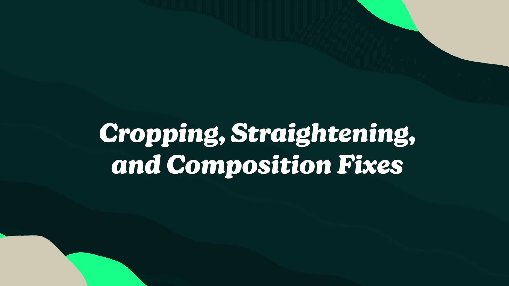
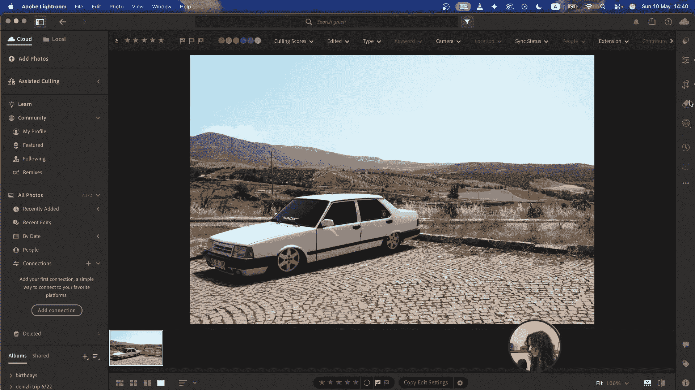
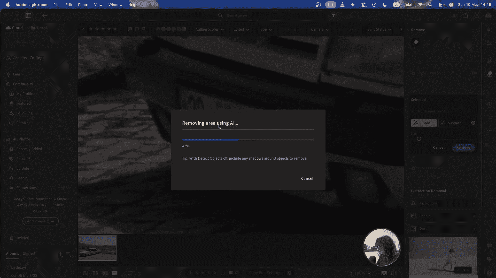
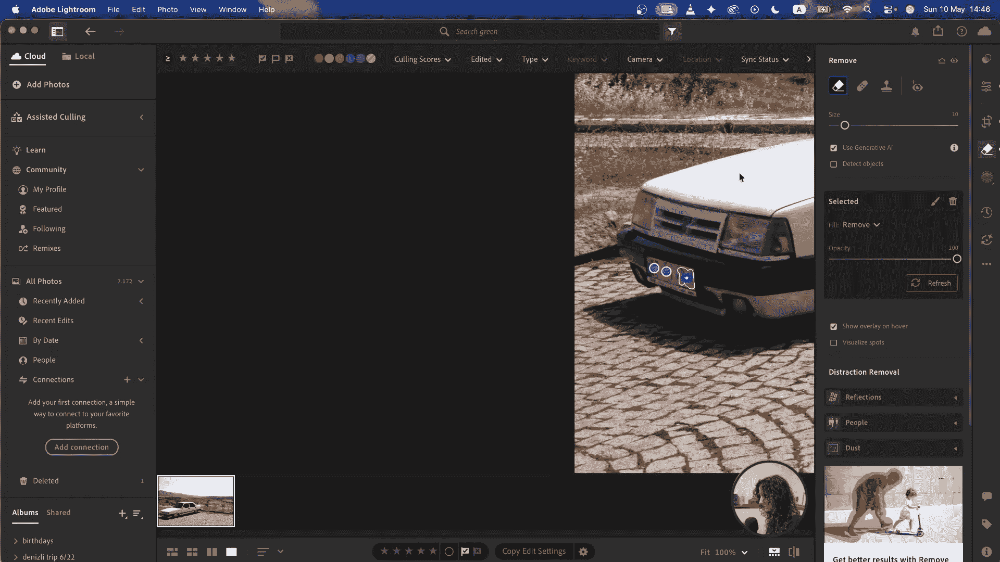
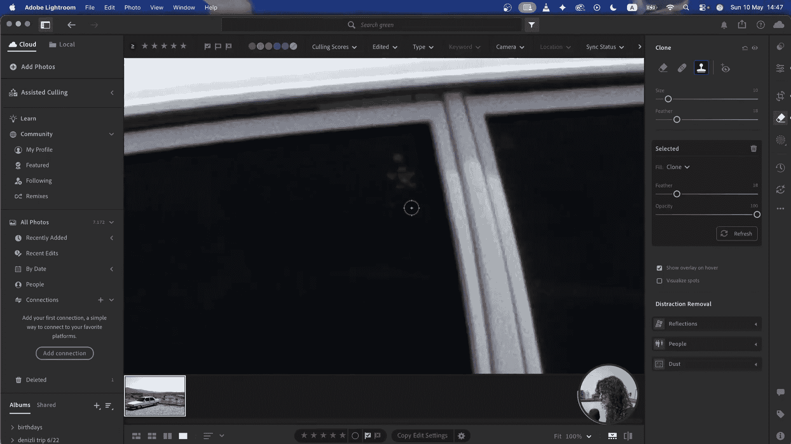

🖼️ Complete Adobe Lightroom Megacourse：Beginner to Expert Photo Editing part1：08-03：裁剪、矫正与构图修复




在本节课中我们将要学习如何在Adobe Lightroom里对照片进行裁剪、矫正和构图修复，还会讲解如何去除车身上的贴纸、瑕疵和多余文字，让图片看起来更干净、更专业。


## 第一步：裁剪图片

上一节我们介绍了基础的光线和色彩调整，本节中我们先来看看裁剪工具。裁剪可以帮你把不需要的部分去掉，也可以改变照片的形状，让主体更突出。

在操作面板时，你可能会注意到右侧出现一个半圆点，这表示当前面板还有更多选项可以展开，你可以用它来确认是否已经完成了调整。这里我们要讲的是裁剪和几何调整相关的操作，首先我们可以直接对图片进行裁剪。

裁剪的核心概念是宽高比，也就是图片的宽和高之间的关系。

```text
aspect_ratio = width / height
```

以下是裁剪时常见的宽高比选项：
- 原始比例：保持图片最初拍摄时的形状
- 正方形：适合社交媒体头像或动态
- 人像比例：适合手机壁纸或竖构图
- A5 / A4：适合打印文档或相册

你可以根据需要自由选择，也可以选择"拍摄时"来保持原来的比例不变。选定宽高比之后，建议先把它锁定，这样在拖动边缘时就不会把图片挤压变形。

```text
lock_aspect_ratio = true  // 不允许任意拉伸，保持比例一致
lock_aspect_ratio = false // 允许自由拉伸，宽高可以分别调整
```

锁定宽高比后，抓住图片边缘拖动，就可以把画面框到你想要的位置。比如把车子放在画面中心的交叉点上，这样构图会更平衡。如果你解锁了宽高比，就可以随意拉伸，甚至翻转方向，但通常我们会保持锁定状态，避免画面出现不自然的变形。调整完位置后，你可以直接按回车键查看裁剪后的效果，也可以先保留当前设置，稍后再决定是否应用。


## 第二步：矫正图片与几何调整

在裁剪完成之后，我们可以继续看看如何让图片变直，以及进行更精细的几何调整。这一步主要解决照片歪斜、透景不正的问题。

Lightroom提供了自动矫正功能，程序会根据图片里的某条直线，比如地平线或建筑边缘，来自动让画面变直。

```text
auto_straighten = 使用图片中检测到的参考线进行自动矫正
```



不过自动矫正并不总是准确，有时候它选中的参考线并不合适，画面看起来还是歪的。这时候你可以手动选择一条清晰的直线作为参考，让程序按照这条线来矫正。

以下是几何调整面板里常用的操作：
- 引导模式：提供更多网格线，方便你精准定位参考线
- 自动校正：一键让图片变直，适合有明显地平线的照片
- 旋转：手动转动画面，让特定边缘变成水平或垂直
- 约束裁剪：放大图片直到看不到透明的空白区域

除了旋转，几何面板里还有变形选项。变形是指根据镜头拍摄时的中心和透景关系，把画面向内或向外推拉。

```text
distortion = 内推 / 外推
vertical_distortion = 上下方向的变形程度
```

你可以用Control或Command键配合滚轮来调整，比如把车子稍微往我们这边拉，或者让它远离一些。水平方向也可以调整，把画面压扁或者变宽。通常我们会把变形数值设为零，除非你有特殊的创意需求。调整完成后，还可以改变偏移量。X偏移量控制左右移动，Y偏移量控制上下移动，这样可以让主体正好落在画面中央。

```text
X_offset = 左 / 右
Y_offset = 上 / 下
```

全部调整好之后按回车键，你就可以用之前和之后对比按钮，查看裁剪和矫正前后的差别。这时候你会发现，仅凭几个滑块就能让照片看起来完全不同。




## 第三步：去除瑕疵与多余元素

有时候图片里有些东西你想去掉，比如车身上的贴纸、划痕、文字或者车牌号码。这时候就需要用到移除、修复和克隆工具了。



以下是三个工具的主要区别：
- 移除工具：尝试自动分析周围像素，把选中的部分替换掉
- 修复工具：试图把选中的区域与周围环境融合在一起
- 克隆工具：直接复制图片某一部分，原样粘贴到目标位置，不做混合处理

你可以用Command或Control配合滚轮来改变笔刷大小，按住空格键可以移动画布，方便在照片的不同区域之间切换。如果你想要最干净的效果，可以使用生成式AI来移除元素，但也可以选择不使用AI，完全手动处理，这取决于你的喜好。

涂抹贴纸时，要注意不要覆盖到你想保留的部分。松手后程序会进行分析，生成替代效果。如果第一次效果不理想，可以点击刷新重新尝试，或者换用克隆工具。克隆工具适合处理车牌、大面积文字或者边缘比较简单的区域，因为它直接复制现有的像素，不会试图混合，边缘会更硬一些。你可以先用移除或修复工具处理大部分区域，然后用克隆工具来修补边缘或细节。添加羽化可以让笔刷边缘变软，修补痕迹不容易被发现。涂抹多次后，你会在画面上看到一些形状，那些只是你之前的调整痕迹，不用担心。



对于车牌这种没有太多可用作参考区域的地方，可能需要在不同工具之间切换，先用AI移除大部分，再用克隆工具修边，直到效果令人满意。


## 第四步：处理细小瑕疵与边缘修补

在大部分贴纸和车牌处理完毕之后，你可能还会发现车身上有一些小瑕疵，比如红色的污渍或者轻微的划痕。这时候可以继续使用克隆工具，一点一点地把这些痕迹去掉。

放大到300%左右，使用较大的笔刷加上羽化，涂抹有瑕疵的区域。如果还有残留，可以缩小笔刷，再次涂抹，直到红色污渍完全消失。处理完所有需要清理的地方之后，车身看起来会干净很多。当然，如果你追求完全去除车牌号码，也可以导出照片在Photoshop中进一步编辑，但在Lightroom里已经能达到不错的效果了。至此，我们已经完成了图像的几何结构调整，并修复了车身上的划痕和痕迹。如果你有任何想要移除的痕迹，都可以使用这个面板里的工具来处理。


## 本节课总结


本节课中我们一起学习了如何在Adobe Lightroom里裁剪图片、调整宽高比、矫正歪斜的画面、进行几何变形和偏移调整，还学习了如何使用移除、修复和克隆工具去除车身上的贴纸、车牌号码和其他瑕疵。下一节课我们将重点介绍纹理和细节处理，可以在细节面板中通用调整，也可以使用蒙版针对特定部分进行优化，我们将在下一节课中继续学习。
