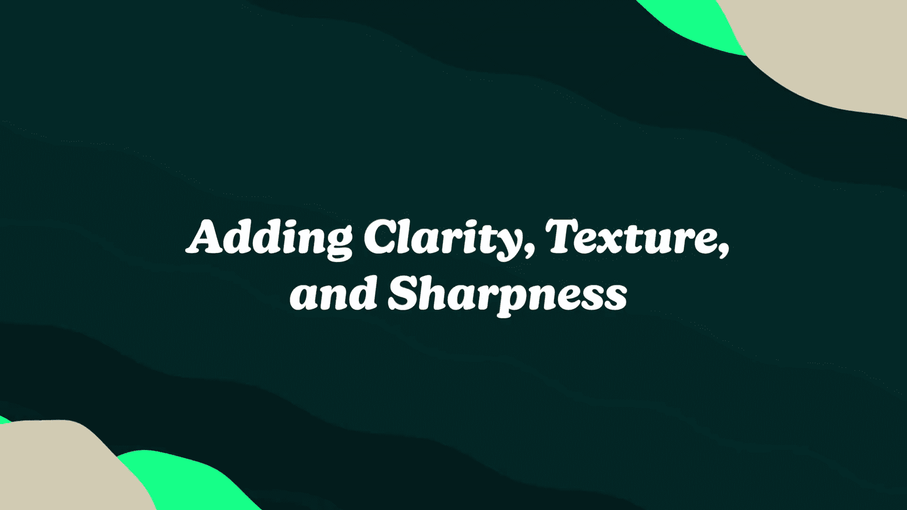
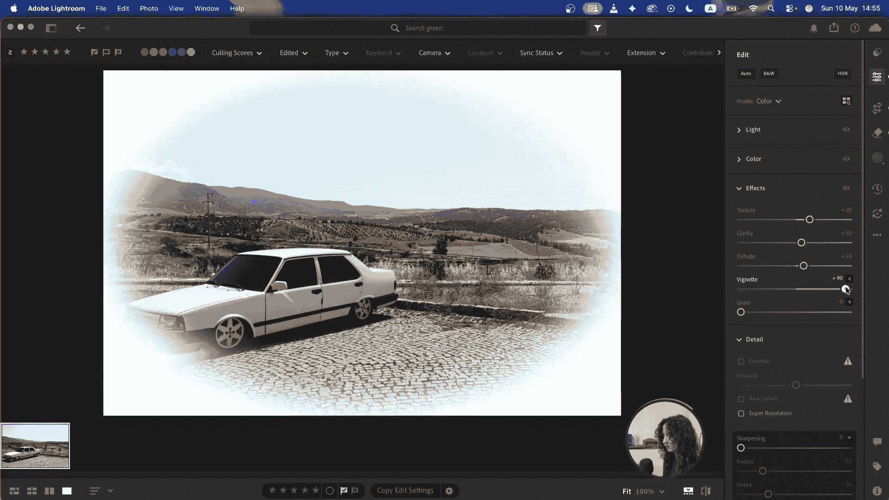
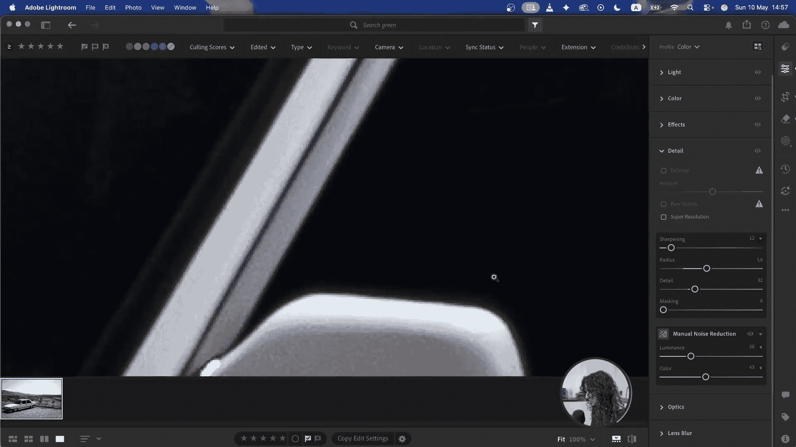
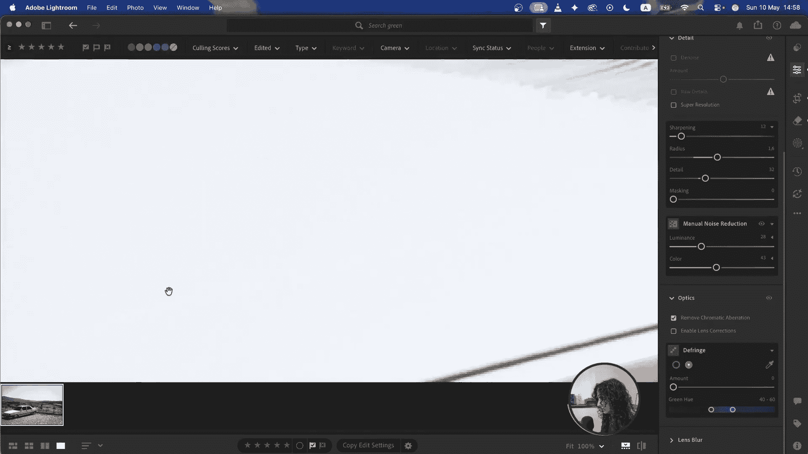
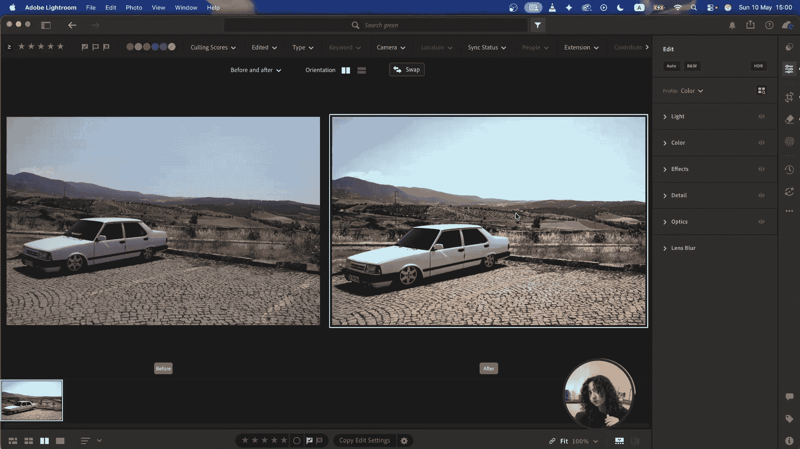
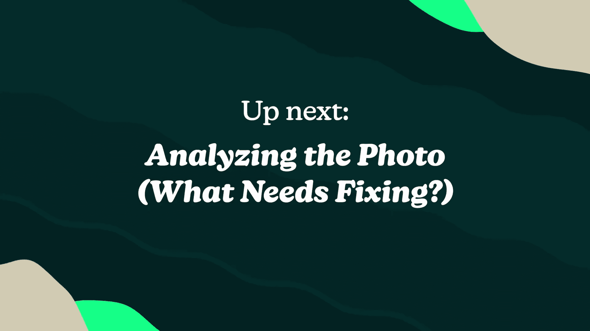

Complete Adobe Lightroom Megacourse： Beginner to Expert Photo Editing part1 p09 04：01：效果面板与细节面板概述🖼️

在本节课中，我们将学习 Adobe Lightroom 中的效果面板和细节面板。这两个面板主要用于给照片增加纹理、增强细节，并提升整体照片的清晰度。我们会逐一介绍每一个滑块的作用，让你明白如何通过简单的拖动让照片看起来更专业。

效果面板和细节面板位于色彩面板的下方。这两个面板的功能非常接近，都用于处理图像的表面细节和整体锐度。效果面板通常包含纹理、清晰度、去雾和颗粒等选项，而细节面板则更侧重于锐化和降噪。理解这两个面板的区别，是后续调整照片质量的基础。

Complete Adobe Lightroom Megacourse： Beginner to Expert Photo Editing part1 p09 04：02：纹理调节🌿

上一节我们介绍了效果面板和细节面板的基本位置与用途。本节中，我们来看看纹理滑块的具体使用方法，它是效果面板中的第一个选项。

纹理调节的作用非常直白，就是增强或减少图像中的表面纹理。如果你拍摄的是植物、石头或织物等具有明显细节的主体，纹理滑块可以让这些细节更加突出，也可以让画面显得更柔和。

`最终纹理 = 原始纹理 + 纹理滑块数值`

以下是纹理滑块的调节效果：

- 向右拖动滑块，图像中的细小边缘和粗糙表面会变得更明显，例如植物叶片上的尖锐边缘会更清晰。
- 向左拖动滑块，这些细节会变得模糊，整体画面看起来更平滑。
- 适当增加纹理可以让植物等主体在画面中更加突出，而过度调整可能会让图像看起来不自然。

在实际操作中，建议先对照具体的植物或物体来调整，观察细节是否变得更清晰，然后根据需要决定数值大小。

Complete Adobe Lightroom Megacourse： Beginner to Expert Photo Editing part1 p09 04：03：清晰度调节🔍

上一节我们学习了如何使用纹理滑块调整表面细节。本节中，我们继续看效果面板中的下一个选项，即清晰度滑块。

清晰度滑块的作用是增强主体边缘周围的对比度。简单来说，它会让照片中物体的轮廓更加分明，从而让主体在画面中更加突出。

`清晰度 = 主体边缘对比度增强量`

以下是清晰度滑块的具体表现：

- 向右拖动时，物体边缘的对比度会增加，边缘看起来更锐利、更强烈。
- 向左拖动时，边缘会变得模糊，主体与背景之间的分界感会减弱。
- 清晰度调整同时也会增加整体对比度，因此数值不要设置得过高，否则画面可能会显得生硬。

当你面对汽车、建筑或人物等具有明确轮廓的拍摄对象时，适当提升清晰度可以让主体更加抓人眼球。

Complete Adobe Lightroom Megacourse： Beginner to Expert Photo Editing part1 p09 04：04：去雾与颗粒🌫️

上一节我们介绍了清晰度滑块的作用和注意事项。本节中，我们来看看去雾滑块和颗粒滑块，它们分别用于处理画面中的雾霾感和胶片颗粒效果。

去雾滑块可以为图像增加或去除雾气。向左拖动会让画面变得更模糊、更有雾感，而向右拖动则能让图像变得更清晰、更透亮。这给了你一定的创作空间，可以根据想要的氛围来添加或移除雾度。

`雾度调节 = 原始雾度 ± 去雾滑块数值`

颗粒滑块则是向图像中添加小的像素点或噪点。它可以让数码照片看起来像胶片拍摄，或者营造复古风格。

`颗粒效果 = 原始图像 + 随机分布的噪点像素`

以下是这两个滑块的使用建议：

- 去雾滑块向左拖动会增加雾气，适合营造梦幻或朦胧的氛围；向右拖动则能让画面更清晰，适合需要高透明度的场景。
- 颗粒滑块默认通常为零，向右拖动会在图像中添加均匀分布的小点，模拟胶片质感。如果你不需要这种效果，可以将其保持为零。
- 两个滑块都建议适度使用，避免画面出现不自然的伪影。

Complete Adobe Lightroom Megacourse： Beginner to Expert Photo Editing part1 p09 04：05：细节面板锐化与降噪✨

上一节我们完成了去雾和颗粒的讲解。本节中，我们转到细节面板，重点学习锐化和降噪这两个功能。

锐化功能用于让模糊的图像变得更清晰。当照片因为对焦不准或拍摄条件限制而显得模糊时，你可以通过锐化滑块来增强边缘，使图像看起来更锐利。

`锐化后图像 = 原始图像 + 边缘增强 - 引入的噪声`

以下是锐化调整的相关选项：

- 锐化数值：控制增强的幅度，数值越高边缘越明显。
- 锐化半径：决定边缘增强作用的范围，半径越大影响的区域越宽。
- 细节保留：控制锐化过程中保留的细节量，避免过度处理导致画面失真。

需要注意的是，锐化会同时给图像增加一定的噪声，因此不要将数值调得过高，否则会引入不必要的杂点。

紧接着是降噪功能，它用于去除图像中的小点和杂色。图像噪点通常分为两种：色度噪点表现为紫色或绿色的线条，亮度噪点表现为小的形状或亮斑。

`干净图像 = 原始图像 - 色度噪点 - 亮度噪点`

以下是降噪滑块的使用方式：

- 色度降噪滑块用于去除紫色和绿色等彩色噪点。
- 亮度降噪滑块用于去除亮度上的小点和形状。
- 两个滑块都建议适度添加，不要过度使用，否则图像会显得平淡且失去细节。

对比处理前后的效果，你会发现降噪后画面明显更干净，细节也更纯净。

Complete Adobe Lightroom Megacourse： Beginner to Expert Photo Editing part1 p09 04：06：光学校正与镜头模糊📷

上一节我们讲解了细节面板中的锐化与降噪。本节中，我们来介绍最后一个部分，即光学面板，它主要用于修复相机镜头在拍摄时引入的问题。

光学校正的第一项是色差去除。色差是指镜头对不同波长光线折射率不同，导致图像边缘出现细小的彩色边框，通常表现为紫色或绿色的线条。

`色差 = 镜头对不同波长光线折射率不同导致的色边`

以下是光学面板的主要功能：

- 色差去除：启用后可以自动检测并移除画面边缘的彩色边框，让图像更干净。
- 镜头配置文件：你可以从下方的配置文件中选择使用的镜头型号，Lightroom 会根据该镜头的特性修正画面的畸变和边角暗角。
- 色彩去除：如果画面中仍残留少量紫色，可以添加相反的绿色来中和，也可以使用吸管工具精确选取需要去除的颜色。

最后是镜头模糊功能，用于对图像进行模糊或锐化处理。如果你想模糊背景以突出主体，或者对整体画面应用模糊效果，都可以在这里完成。本示例中不应用该效果，但你可以根据实际拍摄需求自行尝试。

在本节课中，我们一起学习了效果面板和细节面板的全部核心工具，包括纹理、清晰度、去雾、颗粒、锐化、降噪、色差去除、镜头配置文件以及镜头模糊。你现在已经了解每个滑块的具体作用和适用场景，可以在实际编辑照片时根据需要进行调整，让作品呈现出理想的视觉效果。
