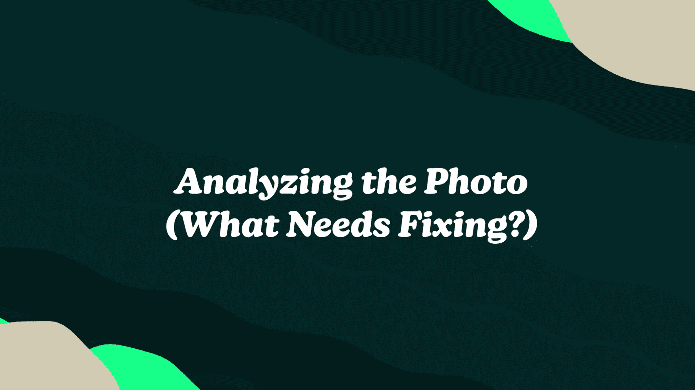
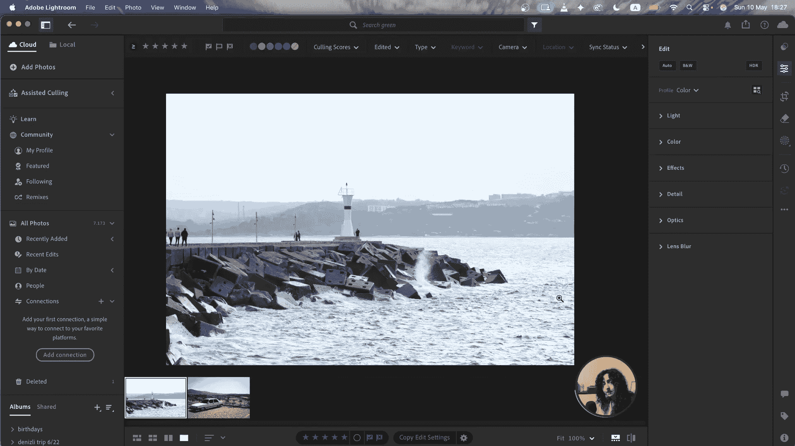

Complete Adobe Lightroom Megacourse：Part1 P10 05：分析照片（需要修复什么）📷



在本节课中我们将要学习如何分析一张照片，找出其中存在的问题，为后续的光线和色彩修正做好准备。我们现在要一起编辑这张照片，这将是整个章节的重点内容。你可以先在资源包里下载这张图片，然后导入到 Adobe Lightroom 中，跟着操作一遍。在正式动手修图之前，我们需要先看看照片里到底有哪些问题，只有先搞清楚问题是什么，才能知道该怎么解决。

接下来我们先来准备好这张图片。以下是操作步骤：

- 下载资源包中的图片文件
- 将图片导入 Adobe Lightroom
- 在库模块中找到这张照片并打开

图片准备好了以后，我们就可以开始分析它的问题了。

首先我们要看的是光线问题。以下是照片中出现的光线问题：

- 整体曝光过高，画面亮度偏亮
- 天空中的颜色被过度曝光而丢失
- 背景部分的细节也因为亮度过高而模糊不清

针对这些光线问题，核心处理思路可以用这个公式表示：

`需要降低亮度 = 曝光过高 - 合适曝光值`

也就是说，我们在光线方面需要把画面的亮度调低一些，才能把丢失的颜色和细节找回来。

光线问题分析完之后，我们再看看颜色方面的表现。

接下来检查一下照片里的颜色情况。以下是颜色方面的问题：

- 水域部分看起来像白色，缺乏正常的水色
- 天空部分看起来也是白色，没有丰富的蓝色层次
- 画面中的绿色部分不均匀，缺乏自然的过渡

我们可以用一段简单的代码来描述这个颜色状态：

```
可见颜色 ≈ 0
水域颜色 ≈ 白色
天空颜色 ≈ 白色
绿色分布 = 不均匀
```

这说明照片里的颜色信息非常匮乏，很多地方都失去了本该有的颜色。

颜色问题看清楚了，接下来我们要放大图片，仔细看看细节和噪点。

我们可以把图片先缩小一点，然后再放大到某个局部区域，仔细观察。以下是细节和噪点方面的问题：

- 画面整体显得模糊，缺乏锐利的边缘
- 主体周围出现明显的晕圈现象
- 在平坦的区域里，可以看到颜色噪点，比如绿色和紫色的色斑

噪点问题可以用这个公式简单概括：

`总噪点 = 色彩噪点 + 亮度噪点`

这里的色彩噪点表现为绿色和紫色的杂色点，这会影响画面的清净度。

除了光线、颜色和噪点，我们还要看看照片的主体表现。

最后我们来分析一下照片的主体和构图。以下是这方面的问题：

- 照片的主体是灯塔，但它看起来只是背景里的一个元素
- 灯塔没有聚焦在焦点上，显得不够清晰
- 灯塔周围缺乏足够的对比度
- 灯塔的摆放位置并不理想

主体表现不佳可以用这个代码片段表示：

```
主体对象 = 灯塔
主体状态 = 背景元素
焦点状态 = 未对焦
对比度 = 低
构图位置 = 不理想
```

现在我们已经把这张照片的主要问题都列出来了，接下来该怎么办呢？

处理任何一张照片，第一件事永远是要先明白照片里的问题是什么。只要搞清楚了问题，我们就知道该怎么用之前学过的知识去解决它们。在本节课中，我们找出了曝光过高、颜色丢失、细节不足、噪点干扰以及主体不突出等问题。



既然已经知道了图片里需要修复的内容，接下来我们就可以开始调整光线和颜色了。具体的调整操作，我们将放在下一节课中讲解。


本节课中我们一起学习了如何分析一张照片，找出其中需要修复的问题，包括光线过亮、颜色缺失、细节模糊、噪点干扰以及主体不突出等方面。希望你在实际操作中也能养成先分析问题、再动手修图的好习惯。

