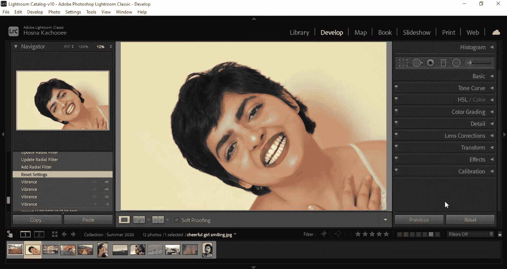

# 📷 Adobe Lightroom 零基础到专家照片编辑全教程：100：选择性调整

在本节课中，我们将学习 Adobe Lightroom 开发模块中的选择性调整功能。我们将从面板顶部的直方图开始，依次了解裁剪工具、斑点修复工具、红眼修正工具、渐变滤镜、径向滤镜以及画笔工具。这些工具的共同特点是，它们只针对图像的特定区域进行编辑，而不会对整张照片应用相同的调整。通过本节课的学习，你将掌握如何在不影响其他区域的前提下，精准修改照片的局部细节。


## 📊 直方图：观察图像的色调分布

上一节我们简单介绍了开发模块的界面，本节中我们先来看看面板最上方的直方图工具。直方图本质上是图像色彩、数值和色调的可视化表示，它能够帮助你快速判断照片的明暗分布情况。直方图还会显示一些拍摄信息，例如焦距等相关参数。

在直方图中，你可以看到黑色、阴影、曝光、高光和白色这几个关键区域。核心概念可以用下面这个公式来理解：

```
直方图 = 黑色 + 阴影 + 曝光 + 高光 + 白色
```

在编辑照片时，观察直方图非常有用，因为它能让你清楚地知道图像当前的色调状态。我们希望避免图像的色调过于暗沉或过于亮白，因此始终关注直方图是一个很好的习惯。判断图像是否色调平衡的方法，就是查看直方图的形状。

以下是判断图像是否平衡的方法：

- 如果所有颜色在直方图的相似位置出现峰值，说明图像是中性的或色调平衡的。
- 如果某些颜色集中在一边，例如蓝色峰值偏向某一侧，则说明该颜色需要进一步调整。

当前示例图像中，蓝色出现了侧偏的峰值，这意味着蓝色部分需要进一步调整，不过其他颜色至少位于同一区域。在编辑过程中，我们需要时刻留意直方图，确保颜色和色调都保持良好的平衡状态。为了给其他工具腾出空间，我们现在先暂时关闭直方图显示。


## ✂️ 裁剪与校正：调整图像构图

我们刚刚了解了直方图的作用，接下来我们来看看如何使用裁剪工具调整图像构图。面板下方的第一组工具就是用于对图像局部进行编辑而不影响其他区域的功能，其中最基础的是裁剪覆盖层工具。

以下是裁剪工具的具体操作步骤：

- 点击裁剪覆盖层工具，即可对图像进行裁剪，你可以自由选择想要保留的区域。
- 如果需要精确控制，可以在设置中输入自定义尺寸，也可以选择预设的裁剪比例。
- 裁剪工具还允许你调整图像的旋转角度，按照你的需求将图像倾斜或扶正。
- 完成调整后，双击可以重置所有设置，恢复到初始状态。

除了常规裁剪，这里还包含一个校正工具。校正工具的作用是根据图像中的参考线来旋转和扶正照片。例如，如果图像中有墙壁或梯子等明显的直线结构，你可以沿着这些线条绘制一条辅助线，图像就会根据你画出的线条自动旋转并扶正。如果图像中没有合适的参考线，随意画一条线无法保证照片会根据图像中的实际结构保持水平，因此这种工具最适合用于有墙壁、梯子等明确线条的场景。使用完成后，你可以重置此处的所有调整，然后点击完成按钮结束操作。


## 🩹 斑点修复：去除图像上的瑕疵

裁剪工具介绍完毕后，我们继续向下看下一个工具，即斑点修复功能。这个工具专门用于去除图像上的某些小瑕疵，例如人像上的痣或皮肤上的污渍。

核心概念可以用下面这个公式来描述：

```
修复效果 = 来源区域 + 羽化边缘 + 不透明度
```

以下是斑点修复工具的使用方法：

- 首先点击斑点修复工具，会打开一个新的设置面板。
- 在这里你可以调整修复区域的大小，根据需要将其设置得大一些或小一些。
- 羽化参数非常重要，它决定了新生成的区域与图像其他部分融合的程度。羽化越高，边缘过渡越平滑。
- 你还可以调整新选区的不透明度，如果只是想要轻微覆盖，可以降低不透明度；如果需要完全遮盖瑕疵，则应将其设置为 100%。

在实际操作中，点击图像上的目标区域后，Lightroom 会自动寻找色调和光线相似的位置作为修复来源。不过自动选择的区域不一定完全合适，比如修复嘴唇上的痣时，如果 Lightroom 选取了皮肤区域作为来源，修复后的质感与嘴唇就会不一致，这时需要手动调整来源位置。如果去除了羽化，修复边缘将无法与周围区域融合，因此必须保留适当的羽化值。操作完成后，你可以放大图像检查效果，确保修复部分没有明显的不平整之处。最终，通过适当的大小、羽化和不透明度设置，就可以成功去除图像上的痣或其他小瑕疵了。


## 👁️ 红眼修正：修复人像红眼问题

斑点修复工具讲解结束后，我们来看看下一个功能，即红眼修正工具。从名称就可以看出，这个工具专门用于修复照片中的红眼现象，它包含两种模式，分别是宠物眼睛模式和人眼红眼模式。

以下是红眼修正工具的选项说明：

- 人眼模式会对人类眼睛进行专门的调整处理。
- 宠物眼睛模式则针对动物眼睛进行不同的参数调整。

即使当前图像中并没有红眼问题，你也可以点击眼睛区域来观察工具的工作原理。如果图像中确实没有红眼，工具可能会错误地检测到其他位置并进行不必要的调整。在这种情况下，你可以通过历史记录面板重置设置，恢复原始状态。红眼修正功能只有在原始照片中确实存在红眼问题时才有用，如果图像中本来就没有红眼，启用该工具并不会带来任何帮助。因此，如果没有红眼需要修复，我们可以直接点击完成，不启用此功能。


## 🌓 渐变滤镜：对图像局部进行渐变遮罩

红眼修正工具介绍完后，我们继续学习下一个选择性调整工具，即渐变滤镜。渐变滤镜的基本原理是，对图像的某一部分创建逐渐过渡的遮罩区域。

核心概念可以用下面这个公式来描述：

```
渐变遮罩 = 起点 → 终点，参数随距离逐渐过渡
```

以下是渐变滤镜的操作要点：

- 在图像上绘制一个过渡区域，滤镜会在这个区域内逐步应用你设置的参数。
- 你可以增加曝光值，观察到曝光调整会从过渡区域的一端逐渐作用到另一端。
- 除了曝光，你还可以添加粉色或绿色等色调，或者调整暗部、雾气、纹理和温度等参数。
- 在面板下方，还可以添加噪点，并使用范围掩模功能，通过采样图像来进一步细化遮罩范围。

渐变滤镜非常适合用于制作特殊效果，例如科幻风格的图像可以从画面角落添加蓝色色调，或者通过加深和降温来营造氛围。在使用范围掩模时，你可以采样图像中的特定区域，使颜色去饱和等效果逐渐应用。关闭范围掩模后，你就完成了渐变滤镜的基本使用。除了绘制渐变区域，你还可以配合画笔工具，在特定部分继续绘制，以进一步完善遮罩目标。不过，渐变滤镜主要适用于包含直线的场景，比如建筑摄影、风景摄影和产品摄影，而对于人像拍摄，通常更适合使用径向滤镜。


## 🎯 径向滤镜：对圆形区域进行局部调整

渐变滤镜适合处理带有直线的图像，而当我们拍摄人像时，人脸通常接近圆形或就是圆形，这时就需要使用径向滤镜了。径向滤镜与渐变滤镜类似，但它的遮罩形状是圆形。

核心概念可以用下面这个公式来描述：

```
径形遮罩 = 圆形区域 + 羽化 + 反转选项
```

以下是径向滤镜的具体用法：

- 在图像上绘制一个圆形，你可以调整圆形的大小，以及它的宽度和厚薄程度。
- 将圆形拖动到主体人脸位置，并进一步调整位置和旋转角度，以获得准确的遮罩范围。
- 完成圆形轮廓后，你可以使用右侧面板来调整圆形外部区域的参数，例如曝光、清晰度或色调。
- 如果只想对圆形内部区域进行调整，可以点击反转按钮，此时所有调整将只作用于圆形内部，而不影响外部区域。

羽化参数在径向滤镜中同样重要，它决定了调整区域与周围图像的融合程度。如果关闭羽化，调整边缘会非常生硬，看起来像一个普通的椭圆形状，与图像区域无法自然融合；如果羽化过高，调整效果则几乎看不出来。通常选择 50 左右的数值比较合适。你也可以为圆形外部添加特定颜色的色调效果，但如果不需要，可以将饱和度关闭。这就是径向滤镜的基本用法。此外，你还可以结合画笔工具，在圆形无法选中到的区域进行补充绘制，例如画出人物身体的其余部分，从而获得更完整的局部选择区域。最后撤销所有操作，即可完成径向滤镜的演示。


## 🖌️ 画笔工具：对微小区域进行精确修饰

径向滤镜讲解完毕后，我们来学习选择性调整工具的最后一部分，即画笔工具。画笔工具专门用于处理更小的区域，例如眼睛、嘴唇、鼻梁等非常具体且狭小的部位，这些区域只能用小画笔精确触及。当然，你也可以跳过这些细节，直接对整个图像进行绘制。

核心概念可以用下面这个公式来描述：

```
画笔调整 = 画笔大小 + 羽化 + 密度 + 参数数值
```

以下是画笔工具的详细操作说明：

- 打开导航器面板，将图像缩放到合适的比例，例如 100%，以便清晰看到眼睛等细节。
- 调整画笔大小和羽化参数，直到你对笔触效果满意为止。
- 在眼睛球体区域进行涂抹，你可以增加或降低曝光值，改变颜色，提高饱和度，或者应用任何你想要的图像调整。
- 如果不希望某个区域受到影响，可以使用擦除功能，从当前选择中移除该部分。

画笔工具还提供两组预设，分别称为画笔 A 和画笔 B，你可以为它们设置不同的大小。例如，将画笔 A 设置得和人物一样大，将画笔 B 设置得和雀斑一样小，然后在工作时随时在两者之间切换。通过滚动鼠标滚轮，你可以快速增减画笔大小。在实际应用中，你可以使用画笔工具为眼睛添加眼影效果，先降低雾气，再降低曝光值，为眼睛添加粉色色调，或者将其改为绿色。如果希望效果更自然融合，需要进一步提高画笔的羽化程度。密度参数控制调整的强度，密度越高，所选参数的效果越明显；密度越低，则只会产生轻微的调整。这就是画笔工具的使用方法。


## 📝 总结



本节课中，我们一起学习了 Lightroom 开发模块顶部的选择性调整工具。我们了解了如何通过直方图判断图像的色调平衡，如何使用裁剪和校正工具调整图像构图，如何利用斑点修复工具去除图像上的瑕疵，以及如何使用红眼修正工具处理人像红眼问题。接着，我们学习了渐变滤镜、径向滤镜和画笔工具，掌握了针对图像局部区域进行曝光、颜色、清晰度等参数调整的方法。在接下来的课程中，我们将继续探索基础调整、色调曲线、HSL、色彩分级、细节、镜头校正、变换、效果和校准等更多内容。

