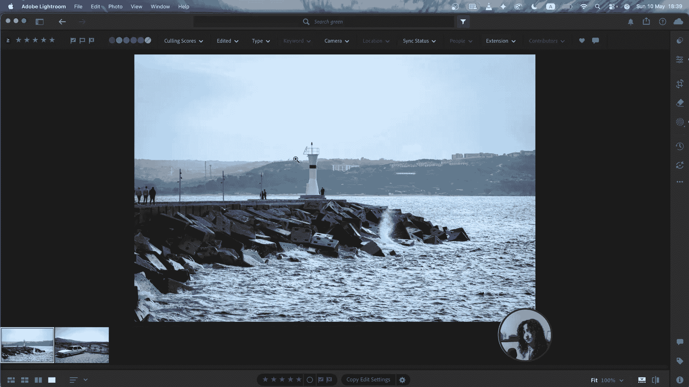

# Adobe Lightroom 零基础到专家级照片编辑全教程 📸：06：修正曝光与颜色


在本节课中我们将要学习如何在 Adobe Lightroom 中修正照片的曝光与颜色。本节内容适合初学者，会用大白话把每一步操作讲清楚，让你明白光线和色彩对照片的影响。我们会先整体调整曝光和对比度，再用色调曲线调节色温，接着用颜色混合器消除多余的色偏，最后通过遮罩工具对水面、山脉和天空分别进行局部调色。课程会保留原文的每一个操作含义，并且每一步都会说明原因，方便你跟着练习。


在开始具体调整之前，先来看看我们要处理的照片状况。根据上一节课的内容，我们已经知道这张图片整体太亮了，所以首先要降低曝光，把过亮的部分压下来。曝光是照片中最重要的部分，因为光线决定了图像的基础质量。


核心概念可以用下面的公式来描述：

```
修正后曝光 = 原始曝光 − 曝光调整值
```


以下是降低曝光后的基础调整步骤：

- 降低曝光数值，让画面整体变暗，同时能看到更多对比度。
- 提高对比度，让明暗区域分得更开。
- 降低高光，防止天空或亮部过曝失去细节。
- 加深阴影，把暗部的细节显露出来。
- 提高白点，让亮部更有层次感。
- 调整黑点，让暗部的岩石细节更清楚。

光线调整完成后，画面已经有了很大的改变，单靠光线就让照片看起来好很多了。岩石中的细节也开始显现，这说明曝光校正非常关键。


光线调好之后，我们可以继续用色调曲线来微调色温。色调曲线是一个更精细的控制工具，可以单独调节不同颜色通道的明暗和色调。


以下是色调曲线的具体操作：

- 切换到蓝色通道，向黄色方向移动，给中间调增加一些黄色。
- 观察画面变暖，不过变化幅度要比较轻微，不要过度调整。

曲线调整让画面温暖了一些，但色调还不够完美，接下来我们需要处理整体的颜色问题。


整体色彩方面，照片目前偏绿，不够温暖。为了让画面更符合我们想要的效果，需要引入洋红色来抵消绿色，因为洋红和绿色是互补色，能够相互中和。


核心概念可以用下面的公式来描述：

```
最终颜色 = 原始颜色 + 洋红色 − 绿色偏色
```


以下是颜色混合器的整体调色步骤：

- 增加洋红色，抵消画面中的绿色偏色。
- 提高自然饱和度，让颜色更鲜艳但不过度。
- 提高饱和度，让山丘和其他部分的颜色更突出。

完成这些调整后，颜色已经有了很大的改善，照片看起来更好了。不过我们还想让天空里的红色更突出，同时避免影响画面的其他部分。


针对特定颜色的调整，我们可以用颜色混合器来单独处理红色和天空区域，而不是去动整张图片的颜色。


以下是局部颜色调整的操作：

- 在颜色混合器中抓取天空区域，先调整色相。
- 提高该区域的饱和度，让红色更突出。

这样处理后，红色区域变得更加明显，而画面的其他部分保持不变。接下来我们可以进入效果面板，进一步增强画面质感。


效果面板主要用来增加照片的清晰度和质感，让细节更丰富。我们会放大图片来观察调整效果，确保不把细节调过头。


以下是效果面板的调整项目：

- 增加清晰度，让边缘和纹理更清晰。
- 增加纹理，强化底部岩石的表面细节。
- 加入少量自然晕影，让画面边缘变暗，不需要添加绿色晕影。

效果调整完成后，画面的细节和质感都提升了，接下来需要处理细节面板里的噪点和锐化问题。


细节面板用来降低图像噪点并增加锐化，让照片看起来更干净、更锐利。我们会以前面调整过的区域作为参考，逐步完成降噪和锐化。


以下是细节面板的调整步骤：

- 使用亮度降噪减少亮部噪点。
- 使用颜色降噪减少颜色噪点。
- 在主体对象上添加适量锐化，增强边缘清晰度。

细节处理完成后，整体调整就差不多好了。我们可以折叠所有面板，检查光学面板是否需要去除色差，不过这张照片不需要添加模糊效果。


完成主体调整之后，我们还想只给水面增加蓝色，并对天空做一些局部处理。这时候就需要用到遮罩功能了，遮罩可以让我们只对画面的某一部分进行编辑，而不用手动用画笔涂抹整个区域。


以下是使用遮罩调整水面的步骤：

- 打开遮罩功能，选择风景遮罩，让 Lightroom 自动识别画面中的不同元素。
- 点击水面区域，自动创建水面遮罩，不需要手动用画笔涂抹。
- 如果遮罩误触碰到岩石，选中该遮罩，使用减去画笔把岩石上的遮罩刷掉。
- 去掉溅射部分的遮罩，因为那些地方不需要变蓝。
- 在遮罩颜色设置中使用色相框，把色调调向蓝色，不要调得过于紫色。
- 提高饱和度，让水面变得更蓝。
- 在效果选项中增加清晰度，让波浪更清晰，并加入少量自然晕影。
- 根据需要调整色温，降低饱和度，或者增加对比度并降低高光。

遮罩调整完成后，点击眼睛图标可以查看调整前后的对比，水面的细节和颜色都明显提升了，画面更有戏剧性了。


接下来我们继续用同样的遮罩工具，给山脉区域单独添加绿色饱和度，天空处理留到之后再做。


以下是调整山脉和天空遮罩的步骤：

- 再次点击风景遮罩，选择山脉区域创建新遮罩。
- 提高山脉区域的饱和度，让原来苍白的绿色变得更鲜艳，不需要改变色相。
- 使用同一个风景遮罩创建天空遮罩。
- 降低天空的对比度，让色调稍微冷一些。

现在所有部分的颜色和光线都有了良好的基础，我们可以折叠遮罩面板，整张图片的整体效果已经很不错了。还有一个遮罩操作想在最后处理，不过现在我们先保持现状，因为接下来要做整体色彩分级，给照片增加一点风格。





本节课中我们一起学习了如何在 Lightroom 里修正曝光和颜色。我们先降低曝光、调整对比度、高光、阴影、白点和黑点，让光线回到合理范围；接着用色调曲线和颜色混合器调整整体色温，消除绿色偏色并提高饱和度；然后通过效果面板和细节面板增加清晰度、纹理并降低噪点；最后利用风景遮罩工具，分别对水面、山脉和天空进行了局部颜色和光线调整。这些步骤完成后，照片的整体色彩和光线已经有了很大改善，具备了进一步创作的基础。
