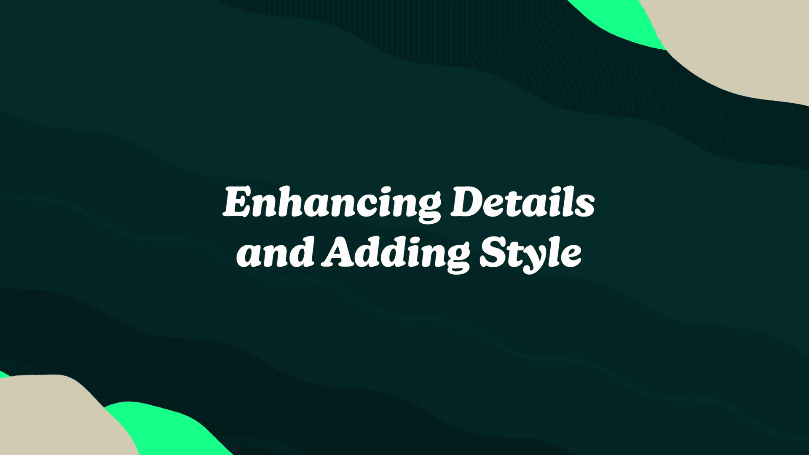
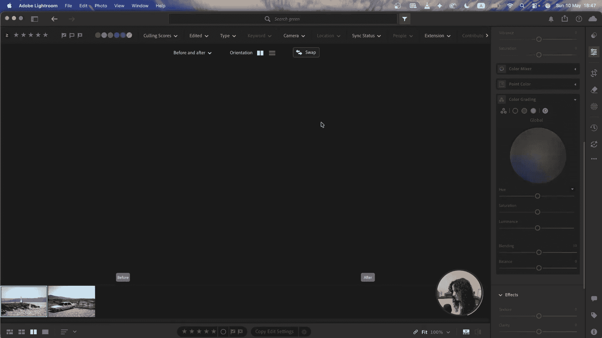
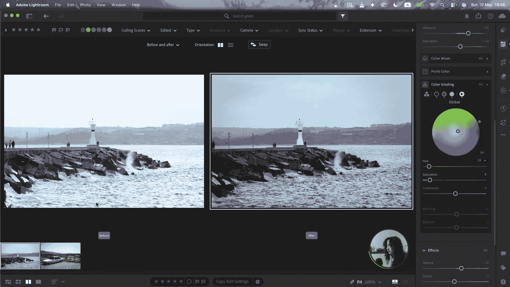

# 完整Adobe Lightroom大师课：初级到专家级照片编辑 Part1 P12：07：增强细节并添加风格 🎨



## 课程概述

在这一节课中，我们将一起学习如何在 Adobe Lightroom 里增强照片细节，并为图片添加个人风格。我们会先认识什么是照片风格，然后学习怎么用色彩分级面板来给阴影、高光和中间调上色。之后我们会调整裁剪和透视，再通过光影面板让画面更有质感。最后，我们会使用遮罩工具把灯塔这个主体突出出来，并对比修改前后的效果，最后导出最终图片。

## 什么是照片风格

在开始实际操作之前，我们先来聊聊什么是照片风格。简单来说，给照片添加风格，就是把几种不同的颜色组合在一起，然后把这个颜色组合覆盖到整张图片上面。这个过程和修正照片的错误不太一样，它更多跟个人的审美喜好有关。所以你看到屏幕上我做的操作，可以直接照着做，也可以根据自己的喜好尝试别的颜色组合。

以下是照片风格的核心公式：

```text
照片风格 = 不同颜色的组合 + 覆盖到整张图片
```

这个公式告诉我们，风格化处理的本质就是“上色”，而不是修复曝光或者锐化之类的修正工作。

## 使用色彩分级面板添加色调

上一节我们大概了解了风格的概念，本节中我们来看看怎么在 Lightroom 里把这个概念变成实际操作。我们要回到颜色选项卡，但这次不是用普通的颜色调整，而是打开色彩分级面板。这就是大部分风格化处理发生的地方。

在色彩分级面板里，你可以给画面中的三个亮度区域分别添加特定的色调。这三个区域分别是中间调、阴影和高光。具体选哪个区域，完全取决于你想要达到什么样的视觉效果。

以下是常见的三个调整区域：

- 中间调：照片中既不太亮也不太暗的部分，通常是主体的主要色调。
- 阴影：照片中比较暗的区域，适合加入暖色或冷色来改变氛围。
- 高光：照片中比较亮的区域，适合加入冷色调来营造清爽或电影感。

接下来我就演示怎么操作。先给阴影加一点暖色。你会看到原来暗沉的灰色变得偏棕色、偏暖色，画面立刻有了温度感。然后去调整高光，给它加一点冷色调。这样一来，原本比较宽泛、平淡的色调就变得有层次感，有点像下午阳光下的氛围。接着试一下中间调，我们可以尝试加一点红色。就这样，一个简单的复古风格就出来了。

仅靠色彩分级面板这一个工具，我就已经给照片加上了想要的风格。你也可以自己试试，找到自己喜欢的颜色组合。

## 调整裁剪与透视

有了色彩风格之后，接下来我们要处理图片的构图和形状。我们切换到裁剪面板，使用里面的直线工具来把图片修正得更平整。点击自动按钮，Lightroom 就会自动帮你把歪斜的线条扶正。你也可以试着把画面调成网格构图，这样更容易观察平衡度。

从变换的角度来看，现在的图片看起来已经比较均匀了。

但我还想稍微调整一下透视感。我们可以把画面向后扭曲，开启受限裁剪，然后做一些水平位移。调整完成后，按下回车键确认，这样画面的透视关系就会更符合我们的需求了。

## 微调光影与清晰度

构图调整好之后，我们进入光影面板进行细致的光影修饰。先稍微降低一点对比度，让整张照片看起来更淡雅一些，有一种胶片的褪色质感。

接着我们可以往画面里加入一点绿色，放大图片仔细看看效果。然后把清晰度调低，给照片增加一点柔和的光晕。不过不要调太多，比如设为负七就够了，这样就不会过度处理。

以下是光影调整的简单步骤：

- 降低对比度：让画面更淡，增加复古感。
- 添加绿色色调：丰富画面色彩，放大预览效果。
- 降低清晰度：增加光晕感，建议数值在负七左右。

## 突出主体：处理灯塔遮罩

最后，我们要让照片里的灯塔更突出，成为画面的主角。为了实现这个效果，我们需要把灯塔以外的部分变暗，或者只亮化灯塔本身。让我们回到景观模式来看看怎么操作。

首先，我尝试用对象遮罩工具把灯塔选出来。大致地在灯塔上刷一下，遮罩就会把灯塔从背景中分离出来。这时候，我们可以把高亮调得很高，这样就能清楚地看到遮罩的范围，方便修正边界。

接下来，把遮罩的顶部排除掉，这样就不会把上面不需要的白色区域也包进去。现在我们只处理灯塔的主体部分。

然后调整白色数值，可以再加一点对比度和曝光，让灯塔看起来更清晰可见。

为了让灯塔更突出，我们复制这个遮罩并把它反转。这样一来，选中的就是除了灯塔以外的所有部分。对这个反转遮罩稍微降低一点曝光，就不会太过分。你会发现，灯塔作为主体，在画面中确实更突出了。

再对曝光做一次微调，整体效果看起来就很好。

## 添加全局色彩分级与前后对比

现在图片的编辑工作已经做完了。为了进一步统一画面风格，我们可以再添加一次全局色彩分级，看看自己喜欢哪种颜色。比如说，选一点橙色，正好配合我们之前说的复古主题。调整完成后，整张照片看起来就很协调。

接下来我们来对比一下修改前和修改后的效果。这是我们一开始的样子，颜色比较平淡；这是现在的样子，颜色更丰富，而且我们还加入了风格化处理。



当然，这些颜色并不是一成不变的。如果你想要更冷的色调，完全可以自己去修改；甚至可以把照片变成黑白，随你个人喜好来决定。

## 导出最终图片

当我们把编辑工作都完成之后，最后一步就是导出图片了。你可以根据需要选择合适的文件格式和画质设置，把这张处理好的照片保存下来。

## 本节课总结




本节课中，我们一起学习了如何在 Adobe Lightroom 中增强细节并添加照片风格。我们认识了照片风格的核心公式，学习了使用色彩分级面板给阴影、高光和中间调上色，掌握了裁剪与透视修正的方法，了解了光影面板中对比度、绿色色调和清晰度的调整技巧，还学会了用遮罩工具突出灯塔这个主体，并添加了全局色彩分级来统一复古风格。最后，我们对比了修改前后的效果，并导出了最终图片。希望这些内容能帮助你更好地理解 Lightroom 的风格化编辑流程。

