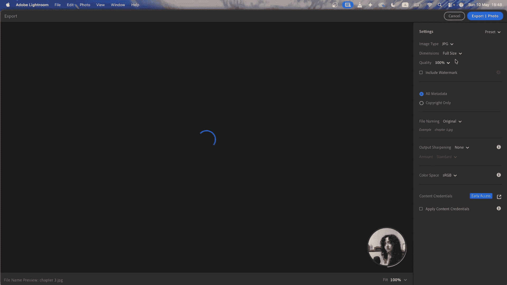
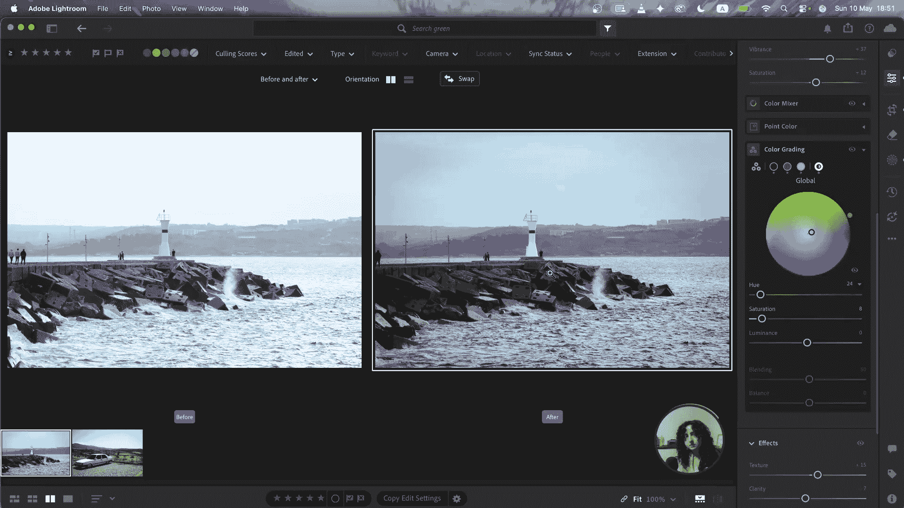
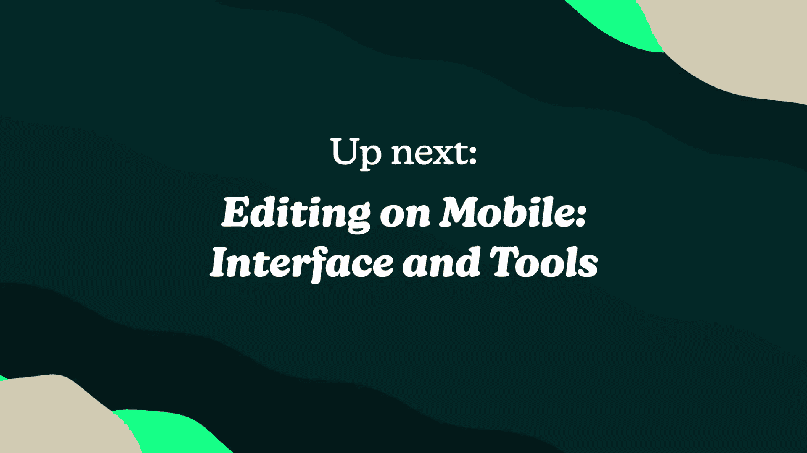

# Adobe Lightroom 从入门到专家级照片编辑：第13节：导出与分享最终图片 📤


在本节课中，我们将学习如何在 Adobe Lightroom 里把编辑好的照片导出来，并且分享给其他人。导出是整个编辑流程的最后一步，只有把图片导出，才能在电脑、手机或社交平台上使用它。我们会一起打开导出面板，了解里面的常用选项，学习如何选择图片格式、设置画质、给文件起名，最后把图片保存到桌面上。通过这节课的内容，你将掌握从编辑完成到拿到最终图片的完整操作流程。


## 导出图片的两种常见方式 🖱️


在 Lightroom 中把照片导出，主要有两种比较直接的方法。第一种方法是在图片上点击鼠标右键，然后直接选择导出，这样可以快速导出一张较小或较大的 JPEG 图片，适合对设置要求不高的情况。第二种方法是点击导出面板，进入更详细的设置界面，你可以在那里调整更多参数，适合需要精细控制导出效果的场景。以下是这两种导出路径的简单说明：

- 在图片上点击鼠标右键，选择“导出”，适合快速导出小尺寸或大尺寸的 JPEG 文件。
- 点击导出面板，进入详细设置界面，适合需要调整多个导出参数的场景。


## 配置详细的导出参数 🛠️


当你进入导出面板之后，需要逐项确认各项设置，确保导出出来的图片符合你的实际需求。我们先来看看最关键的几个选项。

首先是图片类型，建议选择 JPEG，因为它是目前最通用、兼容性最好的图片格式，几乎所有设备和软件都能打开。其次是图片尺寸，我们可以保持原图尺寸不变，不需要额外缩放。然后是图片质量，建议设置为 100%，这样能保留编辑后图片的最大细节。元数据信息建议保留，包含拍摄参数和版权信息。文件名称可以自定义，本示例中我们将图片命名为“lighthouse”，作为最终导出文件名。颜色空间保持默认设置即可，不需要额外更改。还有一些选项可以保持为“无”，不需要特别处理。

以下是导出设置的关键参数示例：

```
图片类型：JPEG
尺寸：保持原图尺寸
质量：100%
元数据：保留
文件名：lighthouse
颜色空间：默认
相关选项：保持为无
```

所有参数确认无误之后，点击“导出”按钮，然后选择保存位置，在这里我们把图片保存在桌面上。你可以在界面上方看到导出进度条，等待进度走完就可以了。




## 查看导出结果与前后对比 🔍


导出完成之后，打开保存在桌面上的图片，这就是我们经过所有编辑步骤后得到的最终效果。为了更直观地感受编辑带来的变化，可以切换回 Lightroom 中的“之前和之后”对比视图，把编辑前和编辑后的图片放在一起看。这样你就能清楚地看到，通过调整颜色、细节和光影，一张普通照片是如何被提升的。


## 编辑工具的组合使用 🎨


本章到这里就可以结束了，因为我们已经实现了这一节的目标。从整体来看，Lightroom 提供了非常多的编辑工具，虽然可选的工具比较多，但实际使用起来并不复杂。只要你了解每个工具具体负责什么，就可以把它们组合在一起使用，把一张普通照片转变成完全不同的视觉效果。以下是工具组合使用的核心思路：

```
最终效果 = 原始照片 + 工具A + 工具B + 工具C + ... + 工具N
```

每个工具负责改善图片的某个方面，多个工具协同工作，就能实现显著的照片提升效果。


## 相机 RAW 文件与移动端编辑 📱


如果你使用相机进行摄影，通常会拍摄大量 RAW 格式的原始文件，这类文件保留了最完整的颜色和细节信息。了解如何在 Lightroom 中提取颜色、增强细节，对处理这类文件非常有帮助。如果你是在手机端进行编辑，情况会有些不同，因为手机拍摄的照片颜色和细节通常已经经过内置处理，此时你更多是在已有基础上进行进一步增强。不过不管使用哪种设备，你使用的编辑工具本质上是一样的，操作逻辑也是相通的。


## 下一章预告 🔔


本节内容主要围绕 Lightroom 桌面版的导出与分享流程。在下一章中，我们将学习 Lightroom 移动版，了解它与桌面版的区别，掌握移动端界面的操作方式，以及如何在手机上编辑同一张照片。




## 本节总结 ✅




在本节课中，我们一起学习了如何在 Lightroom 中导出最终编辑好的图片。我们介绍了通过右键菜单和导出面板两种方式进行导出，详细设置了图片类型、尺寸、质量、元数据、文件名和颜色空间等参数，并完成了图片的保存与前后对比查看。我们还回顾了编辑工具的组合使用方法，并简要讨论了相机 RAW 文件与手机端编辑的区别。希望这些内容能帮助你顺利完成从编辑到导出的完整工作流。

