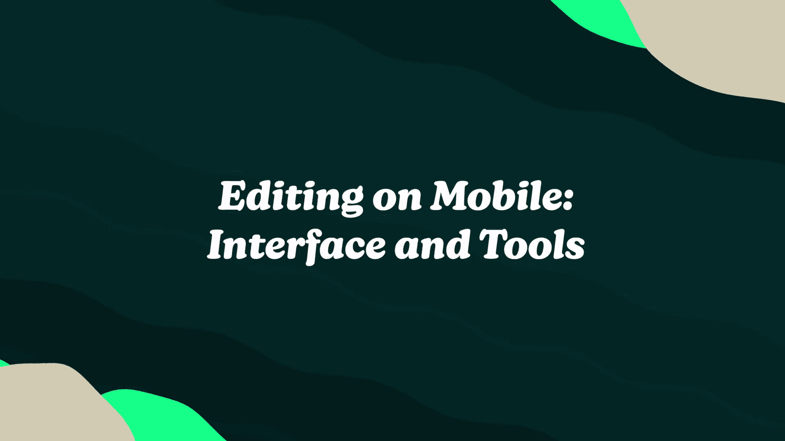
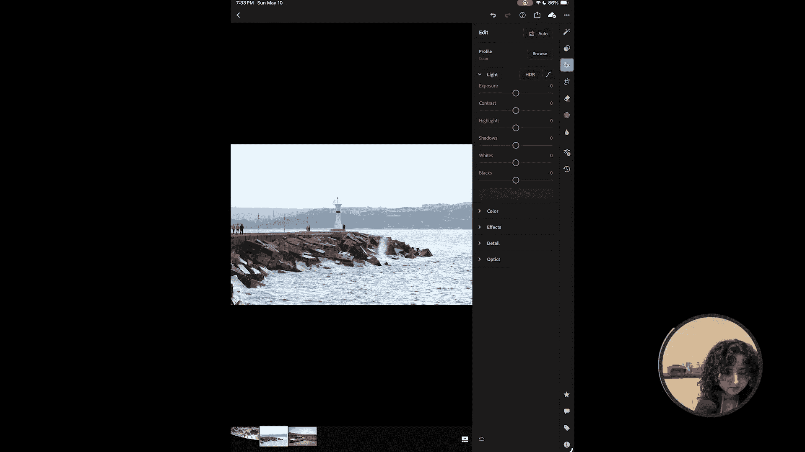
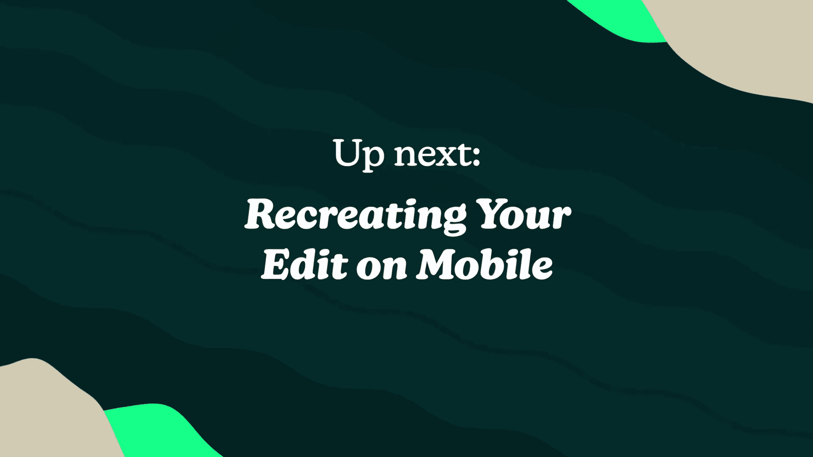

# 📱 完整Adobe Lightroom大师课：从初学者到专家级照片编辑：09：移动端界面和工具编辑

在本节课中，我们将要学习Adobe Lightroom移动端版本的界面布局和基础工具。很多朋友可能已经在电脑版上使用过Lightroom，但手机版的操作逻辑稍微有一点不同，不过核心功能基本是一样的。我们会一起看看怎么登录账户，怎么让电脑和手机的照片同步，怎么从相册导入图片，怎么使用社区里的预设，以及右侧工具栏里各个功能按钮分别是什么意思。另外，我们还会聊聊导出设置、手指缩放操作，还有前后对比预览的方法。学完这一节，你就能在手机上熟练地进行照片编辑了。

上一节我们介绍了桌面版的编辑流程，本节中我们来看看移动端的界面长什么样。

打开Lightroom手机应用之后，你会发现界面和电脑版挺像的，主要区别在于按钮的摆放位置，以及整体的显示风格。如果你已经连接了云端账户，那么手机上显示的相册名称，和你在桌面版上看到的完全一样，没有任何变化。刚下载这个软件时，你可以从应用商店或谷歌商店获取，只需要使用订阅时的同一个账号登录，所有内容就会自动同步。

同步过程可以用下面这个简单的公式表示：

```
登录同一账号 → 云端数据同步 → 相册列表一致
```

同步需要的时间取决于你照片的数量，图片越多，等待时间可能越长，但通常整个过程很顺畅。屏幕底部你会看到“设备”这个选项。

了解了同步机制之后，我们接着看怎么把手机里的照片导入Lightroom。

点击底部的“设备”，就会显示你的手机图库或照片库。如果你不希望Lightroom访问所有图片，可以在手机设置里修改权限，基本操作就是进去之后，挑选你想要的那张图片。

以下是导入照片的步骤：

- 进入手机相册
- 选中目标图片
- 点击底部的“导入”或“删除”
- 选择直接导入到Lightroom，或者新建一个相册

我刚才进入了一个照片相册，这些图片还不在Lightroom里，而是存在我手机本地。我可以直接把它们拖入Lightroom库中。假设我想添加这张图，我会点击它，然后你会看到底部有“导入”和“删除”两个按钮。

点击“导入”后，你可以直接把图片导入Lightroom，或者配合新建相册一起操作。我打算点击刚才建好的那个相册，图片就会被加入到之前创建的绿色相册里了。

刚才的操作已经完成，系统提示有重复图片，但没关系，点击“显示图片”依然可以查看。我们先返回上一级界面。

图片导入之后，我们还需要知道怎么管理这些相册。

你可以点击屏幕上的加号来新建相册，也能查看所有已有相册。除了新建，你还能给相册重命名，把它移动到其他位置，或者调整排序顺序。

以下是可对相册进行的操作：

- 新建相册
- 重命名相册
- 移动相册位置
- 更改排序顺序

相册管理掌握之后，我们来看看Lightroom移动版里的社区板块。

这就是第三个选项卡，点击进去之后，你就能看到Adobe社区里其他用户分享的作品。比如我点开其中一个，就能查看那个人使用了哪些编辑参数，甚至能看到他编辑过程的小预览。

底部有一个叫做“播放编辑”的功能，可以让你看到编辑步骤是怎么展示的。就像这样。

你可以给作品点赞，界面上有个爱心图标。我先停一下。有爱心图标，我可以点赞这个作品。

看到喜欢的编辑效果后，我们可以把它保存为预设，方便以后使用。

在社区板块里，你可以把这个效果保存为预设。不过当你自己分享图片到社区时，也可以轻松关闭这个功能，意味着其他人就不能把你的编辑风格当成预设来用了。

但如果对方允许别人使用，你就可以点击“保存为预设”。这样我们以后想快速编辑照片时，就能直接调用。

预设应用逻辑可以简单表示为：

```
选择喜欢的编辑 → 保存为预设 → 下次编辑时一键应用
```

预设保存好了之后，我们实际演示一下怎么把它应用到照片上。

我先把这个预设保存下来，因为它在编辑效果上会更显著一些。我还会展示怎么轻松添加预设，因为大多数人用手机版Lightroom，就是想要一种一键快速修图的方式。

我拿一张在上一节课里编辑过的照片来演示。往下滑到“版本”标签页，那里有个时钟图标，我就选“原始图片”。

点击底部的“原始”，然后点上方的“应用”，现在我们就从零开始了。

编辑面板上方会显示当前图片，这就是我们之前编辑过的版本。你可以从社区里获取素材。如果你进入你的预设列表，下一个选项卡是用户预设，然后是“从社区保存”的预设，我可以轻松找到刚才下载的那个。我觉得可能是这个，也可能是那个，不太确定到底是哪个了，我记得是黑白预设。

大体上就是这样，你就能把对方的全部编辑参数应用到自己的照片上。再次点击该预设，你可以调整它的强度。

预设强度调整可以理解为下面这个公式：

```
最终效果 = 基础预设参数 × 调整系数
```

你还可以用当前设置更新这个预设，这样下次使用时就会带着这个强度值。你可以给它重命名，导出成别的预设，或者直接删除。

知道了怎么管理单个预设，我们再看看系统自带的预设分类。

还有很多其他预设，我先点击顶部的撤销按钮，一直撤销直到图片恢复原样。好了，现在我还在“你的预设”里面，不同分类的显示方式差不多。

以下是你可以探索的预设分类：

- 色彩预设
- 黑白预设
- 付费高级预设
- 推荐预设

除了免费预设，还有一些高级预设，点击一下就能使用。你也可以去“推荐”页面，那是Lightroom分析你图片类型之后，告诉你应该考虑哪些预设的地方。它正在给我推荐很多蓝色调的预设，我可以慢慢看看，点击“更多类似”会出现更多选择。

这样我就能跳过所有手动编辑步骤，快速搞定一张照片。不过当然，我们随时可以回头使用Lightroom自带的各种工具。

我再去“版本”标签页点一下“原始图片”。

预设体验完之后，我们重点看看手机版右侧的编辑工具都有哪些。

在工具方面，按钮都在右侧边栏。我们有光线滑块、色彩效果、细节和光学、裁剪，还有所有几何设置。还有去除和修复工具，蒙版功能，甚至还有个镜头模糊标签页。在桌面版里，这些功能可能在细节标签页内，但现在被分开了，所以你可以给图片加一些模糊效果。

你可以选择虚化效果，或者让主体保持清晰。就像我们在用一盏灯做手动相机模糊一样。哎呀，刚才不小心点了取消，更改已丢弃。

编辑工具介绍完了，接下来看看怎么把照片导出来分享。

在这个界面里导出照片，方法是点击右上角。首先你可以确保始终保持同步，点击“恢复同步”。那个标签页旁边就是分享按钮，你可以把图片副本保存到设备里，分享到各种平台，还可以加上边框再分享。

点击“导出为”，会打开和桌面版一样的面板。你可以选择文件类型、图片尺寸、图片质量、水印，更多选项则涉及文件命名和元数据。我们先关闭这个面板。

导出设置了解之后，我们再看看撤销按钮和与其他软件的协作功能。

这里有撤销按钮，你还能把这张图片发送到手机版Photoshop或手机版Premiere Pro。下面可以邀请其他协作者，甚至可以分享你的编辑过程。

所以如果你把作品发布到社区，就会看到一个按钮，你也可以允许别人观看你的编辑过程。创建编辑回放功能，会生成一段小视频，其他人就能看到了。

除此之外，操作都很简单直接。

除了面板按钮，手机版还有一些独特的触控手势。

你可以用手指放大和缩小图片，这非常方便。按住屏幕还能查看之前和之后的对比，顶部会显示“之前”字样。松开手指就没东西了。如果我做了一些剧烈的调整，就能像这样看到前后对比。

双击滑块可以重置参数，和桌面版一样。

移动端优势可以概括为：

```
触控手势 + 社交媒体集成 = 更便捷的移动编辑体验
```

差不多就是这样，我们来总结一下移动端版本的情况。

这就是手机版的快速概览，你可以看出它并不复杂，只有少数按钮放在了不同的位置，但所有工具都在。我们在这里有一点优势，就是可以用手指操作，而且社交媒体协作功能更多，因为你手机里本来就装了各种社交App。

接下来我们将使用移动版来编辑这张照片，向你展示整个流程是非常相似的。通过这个工作流程，你会对移动版更加自信和熟悉。那么我们开始吧。





本节课中我们一起学习了Lightroom移动端的界面布局、云端同步原理、照片导入与相册管理、社区预设的使用方法、右侧工具面板的功能、导出与分享设置，以及手指缩放和前后对比等实用操作。通过这些内容，你应该已经能够在手机上熟练地打开Lightroom、导入图片、应用预设，并使用基础工具进行照片编辑了。下一节课我们将进入实际的移动端编辑演练。

