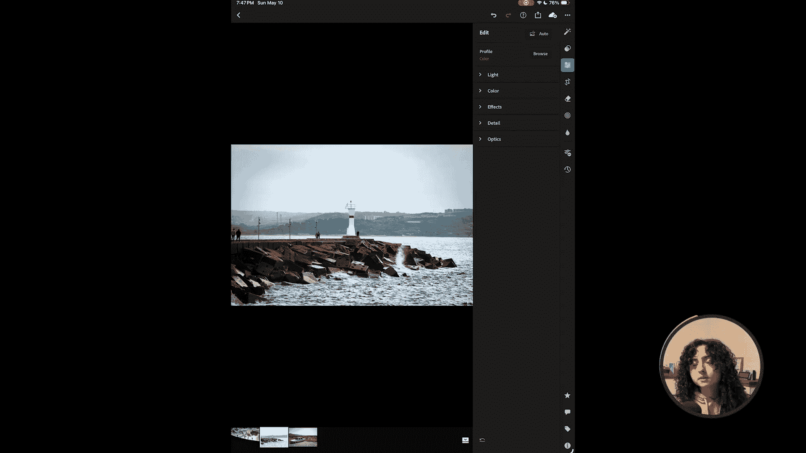

# Complete Adobe Lightroom Megacourse： Beginner to Expert Photo Editing part1 p15：10 - 在手机端重现你的编辑 📱


在本节课中，我们将学习如何在 Adobe Lightroom 手机版上，把之前在电脑桌面端做过的照片编辑效果重新做一遍。整个过程会从把照片导入手机开始，一步步调整光线、颜色、细节，最后使用蒙板工具对局部区域做精细修整。无论你是完全没有基础的新手，还是已经拍过一些照片的爱好者，这节课都会用大白话把每一个滑块和按钮的作用讲清楚，让你在手机屏幕上也能做出专业级的后期效果。

首先，确保你的手机上已经安装并打开了 Adobe Lightroom 应用程序。把示例照片从资源包里保存到手机相册中，然后在 Lightroom 里把它打开。这个操作和在电脑上导入照片差不多，只不过屏幕变小了，所有的调整都要用手指点击和拖动来完成。

以下是导入照片的基本操作步骤。

- 打开手机上的 Lightroom 应用
- 点击导入按钮，从相册里选择目标照片
- 等待照片加载完成，进入编辑界面

上一节我们把照片导入到了手机里，本节中我们来看看怎么调整光线。

光线是决定照片好坏最关键的部分。这张原图整体偏亮，所以我们需要把曝光稍微拉低一点，避免画面过曝失去细节。紧接着，我们会提高对比度，让明暗对比更强烈，图像看起来更有层次感。高光部分可以适当提亮，阴影部分则需要压暗，白点和黑点也要分别调整，把亮部和暗部的细节都找回来。最后，如果觉得画面还是太亮，可以把曝光再微调回来一点点。

以下是光线调整的建议顺序和参数方向。

```
光线调整顺序：曝光 → 对比度 → 高光 → 阴影 → 白点 → 黑点
```

- 曝光：适当降低，防止画面太亮
- 对比度：增加，增强明暗层次
- 高光：适当提升，保留亮部细节
- 阴影：压暗，增加画面深度
- 白点：提升亮部的白色程度
- 黑点：压暗暗部的黑色程度

除了上面的基础面板，曲线工具也可以用来微调。我们重点操作中间调，让画面的明暗过渡更自然。另外，这张照片偏冷，我们把色温往暖色方向推一点，让整体色调更舒适。

光线调整完成后，对比一下调整前后的效果，你会发现光线部分已经处理得差不多了。接下来，我们进入颜色调整环节。

颜色调整主要是让照片的色调更符合我们的想法。这里我们要往画面里加入更多的黄色，增加温暖感。如果绿色显得太重，可以加入一点品红来抵消。自然饱和度和普通饱和度都要适当提高，让颜色更鲜艳，但不要调得太过，否则照片会看起来很假。

接下来切换到效果面板。这里可以增加纹理，让物体表面看起来更有细节；清晰度可以增强中间调的边缘；去雾可以去掉画面里的雾蒙蒙感觉。最后，晕暗效果需要把滑块往左拖，让照片四周变暗，把观众的视线吸引到画面中央。

以下是颜色和效果面板的常用设置方向。

- 色温：偏暖
- 色调：加入黄色，适当加入品红抵消绿色
- 自然饱和度：适度提升
- 饱和度：适度提升
- 纹理：增加
- 清晰度：增加
- 去雾：适当调整
- 晕暗：滑块向左，边角变暗

颜色和效果都调整好之后，整体效果已经接近完成了。接下来我们处理细节、光学和裁剪。

细节面板主要是处理噪点，我们放大图片仔细看看有没有明显的颗粒感，如果有就适当降噪。光学面板里，色差移除和镜头校正要打开，这样可以修正镜头带来的变形和色边。然后是裁剪面板，这里要根据你要发布的平台来选择纵横比，比如 Instagram、Facebook、X、YouTube 等等，不同平台喜欢的比例不一样。我们先把照片扶正，稍微倾斜的画面需要拉直，然后把灯塔放在画面中心。如果需要，还可以进入几何面板做一些畸变修正，比如水平倾斜。不过我们已经做过裁剪了，受限裁剪就不需要再用了。

以下是细节、光学和裁剪的关键操作。

- 细节：放大查看噪点，适当降噪
- 光学：开启色差移除和镜头校正
- 裁剪：选择平台纵横比，扶正照片，将主体居中
- 几何：如有需要可调整水平倾斜

基础面板都调完了，下面就是本课最重要的部分，也就是在手机上使用蒙板工具做局部调整。

蒙板工具允许我们只对照片的某一部分进行修改，而不影响其他地方。在手机版 Lightroom 里，点击底部的加号按钮就可以新建蒙板。桌面版有一些自动的风景蒙板之类的功能，手机版没有那么多自动化选区，但我们可以用画笔和颜色范围、亮度范围来手动选出想要的区域。虽然在手机上操作会花一点时间，但完全可以做到和桌面版差不多的效果。

以下是逐个蒙板的制作思路。

- 水面蒙板：使用亮度范围或颜色范围选出水面，用画笔减去山石和岩石，调整对比度、阴影、色相、清晰度和去雾，降低饱和度并加入蓝色调，让水看起来更像水
- 天空蒙板：选择天空，系统会自动识别，然后降低曝光，增加对比度，打造理想的天空效果
- 岩石蒙板：再次使用亮度范围选中较暗的岩石部分，用滑块控制蒙板范围，多余部分用画笔擦除，然后让岩石更暖、更生动，避免灰蒙蒙的颜色
- 背景绿色蒙板：新建另一个蒙板，选中后面的绿色植被，去除左边的人和岩石，用画笔保护山脉不被误删
- 灯塔蒙板：最后单独选中灯塔，去掉多余的岩石边缘，提高亮度，增加对比度，让灯塔在画面中更突出

每个蒙板调整完成后，记得点击应用按钮。这样一来，整张照片的质量就会有很大提升。

这一节的蒙板操作虽然在手机上有点繁琐，但只要耐心一点，效果会非常好。本课的主要内容到这里就差不多结束了。

在本节课中，我们一起学习了如何在 Adobe Lightroom 手机版上重现照片编辑效果。我们完成了图片导入、基础光线调整、颜色与效果优化、细节光学与裁剪修正，还掌握了针对水面、天空、岩石和灯塔的蒙板局部调整技巧。




在下一节课中，我们将为照片添加最终的风格化处理，并学习如何导出到社交媒体平台。
