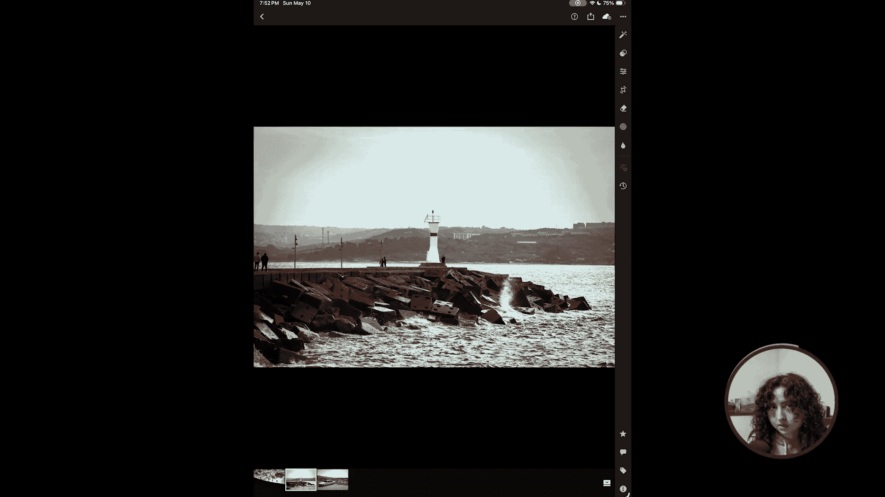
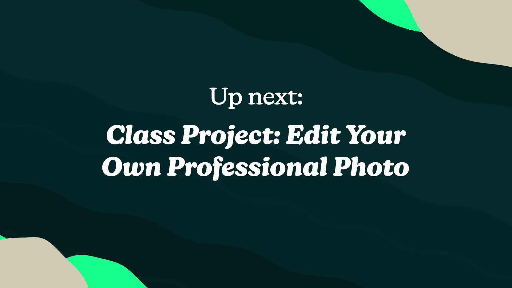

Adobe Lightroom 从入门到专家照片编辑：16：11 社交媒体导出 📤

在本节课中我们将要学习如何在手机端 Lightroom 中完成一张照片的后期处理，并把它导出到社交媒体平台。我们会先给图片添加整体的复古风格，再平衡颜色和调整曝光，接着给照片加上边框，最后导出成适合 Instagram 发布的 JPEG 文件。通过这一节，你会了解移动端编辑的基本流程，也能明白手机修图和电脑修图之间的区别。

### 给图片添加整体风格

首先，我们来看看如何为照片添加整体的色彩风格。打开 Lightroom 的主页面，进入颜色选项卡，然后选择色彩分级工具。色彩分级的意思就是给照片的不同亮度区域分别上色，让整张图片看起来更有统一的感觉。我们可以先从阴影开始，给阴影区域添加一点点黄色，营造出复古的老照片氛围。接下来处理高光，在高光部分同样加入一些黄色。最后处理中间调，也给中间调部分加上黄色。这样一来，阴影、高光和中间调都带上了暖色调，整张照片就会呈现出一种统一的复古风格。

阴影 + 黄色 = 复古风格
高光 + 黄色 = 复古风格
中间调 + 黄色 = 复古风格

### 平衡颜色并微调曝光

上一节我们介绍了如何给阴影、高光和中间调分别上色，本节中我们来看看如何平衡这些颜色，并对整体亮度进行微调。添加完颜色之后，我们需要检查一下颜色是否过重，因为有时候阴影或者中间调的饱和度可能太高了，这时就需要稍微降低一点，让颜色看起来更自然，而不是显得做作。除了颜色，我们还要调整曝光。在光线选项卡里，把曝光稍微调低一点，避免照片太亮失去细节。然后可以尝试使用曲线工具，进一步优化照片的明暗对比度。经过这些步骤，照片的后期处理就基本完成了，画面看起来既协调又舒服。

### 给照片添加边框

上一节我们介绍了颜色平衡和曝光微调，本节中我们来看看如何给照片添加边框，让它看起来更精致。导出之前，你可以给照片加上一个边框，让图片看起来更有设计感，也更适合发布到社交媒体上。打开边框设置，先选择边框的颜色，这里建议保持白色，因为白色边框比较百搭，不会抢走主体的风头。然后调整边框的粗细，把大小设置成 5 这个数值。你可以根据自己的喜好尝试不同的粗细，但保持简单通常是最好的选择。边框加上去之后，照片就会多出一个干净的白色边框，整体效果会更好看。

以下是边框的常见设置：
- 边框颜色：白色
- 边框大小：5

### 导出照片到社交媒体

上一节我们介绍了如何给照片添加白色边框，本节中我们来看看最后一步，也就是把编辑好的照片导出到社交媒体。点击分享按钮，进入导出界面。如果你是为了在社交媒体上发布，可以选择 Instagram 帖子这个预设，并且保持上下边框不变。颜色方面，你可以随意调整，但这里我们继续保持白色。接下来设置导出尺寸，选择原始尺寸，不要把图片缩小，这样能保留最高清晰度。文件格式选择 JPEG，图片质量设置为 100，也就是最高质量。最后点击分享，手机会弹出一个分享菜单，你可以通过短信、Instagram 或其他平台发送给朋友，或者直接保存到相册。你不需要额外处理，就像平时在设备上保存或分享文件一样。整个导出过程就完成了，你的照片就可以发布出去了。

以下是导出时需要设置的参数：
- 导出尺寸：原始
- 文件格式：JPEG
- 图片质量：100

### 移动端与桌面端的区别

上一节我们介绍了如何导出照片到社交媒体，本节中我们来看看在手机上编辑和在电脑上编辑有什么不同。其实手机版 Lightroom 和电脑版 Lightroom 的操作差别并不大，我们在手机上也能用同样的工具，做出同样好看的照片。当然，两者还是有一些细微的差别，比如界面布局和某些高级功能可能不完全一样。不过好处在于，你可以同时拥有这两个版本。如果你需要做更细致的修图，可以回到电脑上操作；如果你在外面跑步或者想快速处理一张照片，手机版就足够了。这样你就可以根据实际情况，灵活选择使用哪一台设备，不再受限于某一种工具。

本节课中我们一起学习了如何在手机端 Lightroom 中给照片添加复古风格的色彩分级，如何平衡颜色并微调曝光，如何给照片添加白色边框，以及如何把照片以原始尺寸、JPEG 格式和 100 质量导出到社交媒体。我们也对比了移动端和桌面端的使用场景。希望这节课能让你更熟悉手机版 Lightroom 的操作，并且在未来的修图工作中能够灵活运用这些技巧。
