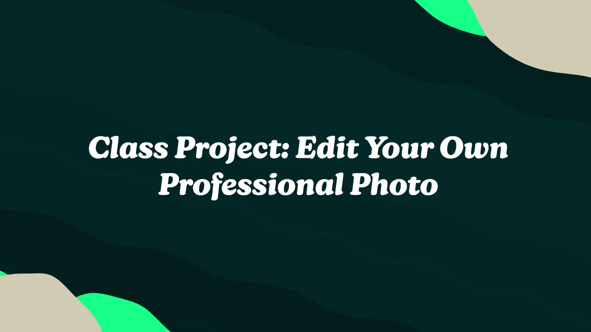

📸 Adobe Lightroom 从入门到专业照片编辑全攻略：12：课堂项目-编辑你自己的专业照片




在本节课中我们将要学习如何完成一堂课堂项目，也就是编辑你自己的第一张专业照片。你可以使用手机或者相机来拍摄一张照片，然后运用之前课程里已经学过的所有技巧和工具进行后期处理。整个过程不需要太复杂的设备，只要有一台能拍照的设备和安装好的 Adobe Lightroom 软件就可以开始。这节课的主要目的是让你把理论知识变成实际操作，通过亲手编辑一张照片来巩固对曝光、颜色、几何构图等基础概念的理解，最后导出成品并对比修改前后的效果，让学习更加扎实，也能更好地掌握后期编辑的完整流程。


接下来我们先来看看开始这个项目之前需要准备哪些东西，做好准备才能顺利进行后面的编辑工作，避免在过程中因为缺少工具而中断。


以下是你需要准备的事项：

- 一部手机或一台相机，用来拍摄原始照片
- 已经安装好的 Adobe Lightroom 软件
- 之前课程中学习过的编辑工具和操作步骤
- 一张待编辑的照片文件


上一节我们介绍了 Lightroom 的基础工具面板和常用调整参数，本节中我们来看看如何分析一张照片的质量，找出需要改进的地方。在动用任何编辑工具之前，你需要先仔细观察照片，看看曝光是否合适，颜色是否准确，细节是否清晰，整体构图是否合理。把发现的问题记下来，形成一个简单的改进清单，这样在后面编辑的时候才不会盲目调整，也能让每一个参数的改动都有明确的目的，避免反复试错浪费时间，让编辑过程更加高效。


核心分析清单可以用下面这个简单的方式表示：

```text
分析清单 = {曝光, 颜色, 细节, 构图}
待改进项目 = 原始照片 - 理想效果
```


有了分析清单之后，本节中我们接着看如何按照正确的顺序对照片进行编辑。我们总是先处理光线，再处理颜色，最后处理几何构图，一直持续调整直到达到理想的效果。这个顺序很重要，因为如果先调颜色再调曝光，可能会导致之前的颜色设置失效，需要重新修改，反而增加了工作量。具体的操作流程可以用下面这个简单公式来理解，帮助你记住每一步应该先做什么后做什么，不容易遗漏重要环节：

编辑流程 = 光线调整 → 颜色调整 → 几何调整 → 细节检查 → 最终确认


当你对编辑后的照片感到满意时，就可以导出文件了，把成品保存下来方便查看和分享。导出是把编辑好的照片保存为可分享的图片格式，方便在其他设备上查看或者上传到社交平台。如果你愿意，还可以把修改前和修改后的照片放在一起对比，让其他学生和我看到你是如何从原始图片一步步变成最终成品的。这个课堂项目的核心在于练习和探索不同的风格，不需要追求完美，只要多动手尝试就能进步，慢慢找到自己喜欢的视觉风格，提升审美能力。


本节课中我们一起学习了如何完成课堂项目，包括准备拍摄设备、分析照片质量、按照光线颜色几何的顺序进行编辑，以及导出和分享最终成果。希望你能通过这个项目把所学的 Lightroom 技巧全部用上，拍出属于自己的专业照片，为后续更高级的编辑打下坚实基础。

