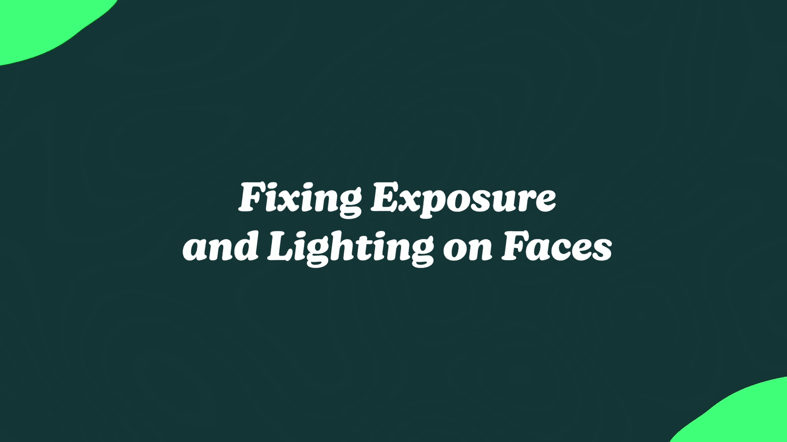
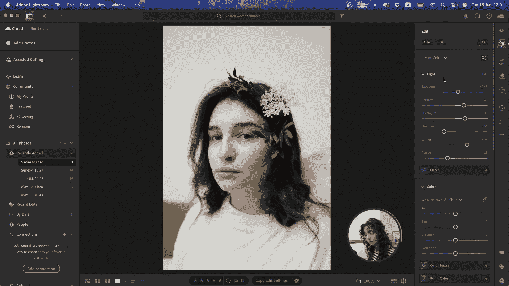

# Adobe Lightroom 完整教程：p18：13 人像曝光与光线修正 🖼️



在本节课中，我们将要学习 Adobe Lightroom 中人像修图的第一个核心步骤，也就是如何修正曝光和光线。人像摄影非常讲究细节，我们的目标是通过光线细节和对比度，把模特的独特特征展现出来。本节课会告诉你，在人像后期制作中，最重要的不是急着去调整颜色，而是先把光线打好，因为没有光线，你就无法看清图片的真实颜色和细节。接下来我们会逐步拆解每一个滑块的作用，避免新手常见的错误，为后续的色彩调整打下坚实基础。

在了解了人像修图的基本目标之后，我们进入第一个具体话题，来看看为什么光线修正应该排在所有调整的最前面。

## 一、人像修图为什么要先修光线

在拍摄人像时，每一个细节都决定了模特是否能在照片中脱颖而出。无论是发质、眼睛还是表情，都需要通过合适的光线来突出。人像修图的目标非常明确，就是利用光线细节和对比度，强调模特的独特之处。这就好比在暗房里观察一张照片，如果没有足够的光线，所有的颜色和纹理都会被掩盖，修图也就失去了意义。因此，在 Lightroom 处理人像时，第一件也是最重要的事情，就是先修好光线。

以下是人像修图中关于光线的几个基本原则：

- 光线决定了颜色的还原程度，没有光线就没有真实的颜色。
- 光线决定了细节的可见程度，暗部或过亮的部分都会丢失细节。
- 光线修正不能只靠一个滑块完成，需要多个参数配合使用。

在掌握了光线的重要性之后，我们来认识最基础的曝光滑块，这是整个光线修正的起点。

## 二、什么是曝光（Exposure）以及如何调整

曝光滑块的作用可以简单理解为，调整照射在主体身上的那盏灯泡的强度。如果你的原片太暗，就需要增加曝光数值；如果原片太亮，就需要降低曝光数值。在实际操作中，建议先双击曝光滑块将其重置为零，这样所有参数回到初始状态，方便你从零开始判断。曝光调整不宜一次性改动太多，建议每次只增加或减少几个点，因为哪怕是很小的变化，对整张图片的影响也非常明显。

```text
曝光 ≈ 照射在主体上的灯泡强度
调整后的亮度 = 原始亮度 + Exposure 数值
```

调整曝光时，你可以参考以下步骤：

- 双击曝光滑块，将数值重置为 0。
- 观察图片整体亮度，如果太暗则逐步增加，比如增加到 0.40 或 0.41 这样一个很小的数值。
- 确认整体亮度足以看清细节和颜色后，暂时不要急着继续调整其他参数。

需要注意的是，曝光只能解决整体亮暗问题，不能解决局部光影层次。调整完曝光后，图片可能已经足够明亮，但高光部分可能仍然偏暗，对比度也不够，这时候需要引入下一个概念。

在有了曝光作为基础之后，我们接下来讨论对比度，这是让人像更有层次感的关键参数。

## 三、什么是对比度（Contrast）以及为什么不能只靠它

对比度在照片编辑中使用频率很高，它的本质是图片中暗部与亮部之间的差异程度。差异越大，对比度越强；差异越小，图片显得越平淡。以本节示例图片为例，模特的头发是深棕色，而面部肤色较浅，这两个区域之间就存在明显的边界。背景中的深黄色和白色墙纸之间，也有一条清晰的分界线。修图时，我们希望保留并增强这种自然的统一感，让头发前的白色花朵、深棕色的眉毛以及蓝色的眼睛，都能通过对比度得到突出。

不过，初学者很容易犯一个错误，就是试图只用对比度滑块来解决所有对比度问题，调完之后就直接结束。这种做法虽然方便，但容易让修图痕迹过于明显，照片看起来不自然。更聪明的做法是，先对对比度滑块做少量调整，建立一个基础，然后再结合高光、阴影、白点和黑点这四个选项，共同来强调图片中的差异。

```
对比度 = 图片亮部区域亮度 - 图片暗部区域亮度
```

使用对比度滑块时，建议遵循以下原则：

- 只做小幅度调整，不要试图一次性修复所有问题。
- 观察修图前后的差异，避免过度编辑导致照片出现明显痕迹。
- 将对比度作为基础，留给后续的高光、阴影、白点和黑点来进一步细化。

对比度打好基础之后，我们需要更精细地控制图片中亮部和暗部的表现，这时候就要用到高光和阴影滑块了。

## 四、高光（Highlights）与阴影（Shadows）的区别和用法

高光滑块控制的是图片中较亮的部分，通常包括主体本身、背景，或者如果有天空的话，天空区域也属于高光范围。通过这个滑块，你可以调整高光区域的亮暗程度。在本节示例中，因为有一个光源照射在模特的脸上，我们希望在编辑过程中保留这种自然的光影效果，因此需要适当提升高光滑块的数值，让亮部更加清晰。

阴影滑块的逻辑与高光正好相反，它控制的是图片中较暗的部分。通过降低阴影数值，可以让暗部变得更深，从而营造出我们之前提到的对比感。在示例图片中，为了让模特的头发更有存在感，我们会适当降低阴影数值，这样头发的暗部会更加突出，整体对比度也会变得更加自然。

```text
高光调节：亮部亮度 = 原始亮部亮度 + Highlights 数值
阴影调节：暗部亮度 = 原始暗部亮度 - Shadows 数值（降低阴影会让暗部更暗）
```

高光与阴影滑块的常见应用场景如下：

- 提升高光：适用于人脸光源不足、背景天空过暗的情况。
- 降低阴影：适用于需要强调头发、衣服暗部细节，或增加整体立体感的情况。
- 两者配合：先调高光保留亮部细节，再调阴影增强暗部层次，避免只依赖对比度滑块。

高光和阴影解决了大面积的亮暗区域，但如果你想进一步精确控制图片中最亮和最暗的几个点，就需要用到白点和黑点滑块了。

## 五、白点（Whites）与黑点（Blacks）的精细调节

白点和黑点分别对应图片中真实的白色点和黑色点，属于更细致的调节范围。白点是图片中非常亮的微小区域，比如模特脸部的某些反光、花朵的亮面，或者背景中发光的部分。黑点则是图片中最暗的微小区域。通过这两个滑块，你可以在不影响整体亮度的前提下，精确提升或压暗这些特定点位。

在示例图片中，白点主要集中在模特脸部的某一部分、花朵以及背景上。我们可以适当增加白点数值，让这些区域更加明亮。与此同时，为了制造更强的对比感，我们会降低黑点数值，让图片中的最暗部分更深。这样仅靠光线调整，照片已经展现出相当不错的层次感和立体感。

```
最终亮部表现 = 曝光 + 对比度 + 高光 + 白点
最终暗部表现 = 曝光 + 对比度 + 阴影 + 黑点
```

白点与黑点滑块的调节建议总结如下：

- 白点：适度提升，让图片中最亮的细节更突出，但不要导致局部过曝。
- 黑点：适度降低，增加暗部深度，营造更强的画面对比。
- 配合使用：先用曝光定整体，再用对比度定基调，接着用高光阴影定区域，最后用白点黑点定细节。

至此，我们已经完成了人像光线修正的全部基础步骤，拥有了一个可以继续构建颜色的正确基础。

## 六、本节小结与下节预告

在本节课中，我们一起学习了如何在 Adobe Lightroom 中修正人像的曝光与光线。我们了解了曝光滑块相当于调节灯泡强度，对比度滑块用于控制暗部与亮部的差异，高光和阴影滑块分别针对亮部和暗部区域，而白点和黑点滑块则用于精细调节最亮和最暗的点位。修图的关键不在于一次性把一个滑块调到极致，而在于多个参数的小幅度叠加，让光影效果看起来自然、真实。

现在你已经掌握了光线修正的正确方法，也可以随时回到光线面板，根据实际效果再做微调。但目前我们已有了一个良好的基础，接下来的重点将转移到颜色调整上，那将是我们下一节课的学习内容。




本节课中我们一起学习了 Lightroom 人像修图中曝光与光线的修正方法，包括曝光、对比度、高光、阴影、白点和黑点的使用技巧，为后续的色彩调整奠定了基础。
