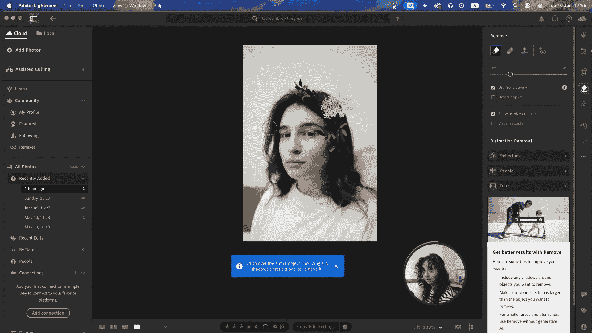
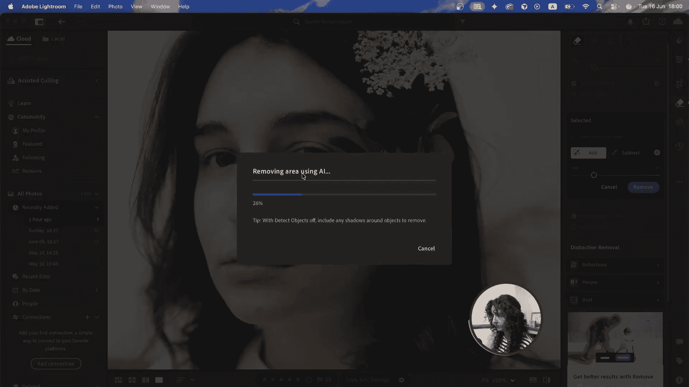

# Adobe Lightroom 零基础到专家级人像后期：14：自然修饰皮肤 🖼️

在本节课中我们将要学习如何在 Adobe Lightroom 中自然地修饰人像皮肤。上一节课我们已经完成了画面的基础光线调整，现在照片的整体亮度和对比度有了一个稳定的起点。本节课的重点是针对皮肤上的瑕疵进行局部修复，同时保留人物真实的肌肤质感，避免过度修图导致面部看起来不自然。我们会先使用去除工具清除明显的斑点，再通过蒙板柔和皮肤细节，让整体效果更像一张精致但依然真实的人像照片。

上一节我们介绍了如何在光线面板中移动滑块，完成了整体亮度和对比度的基础优化，本节中我们来看看如何针对皮肤瑕疵进行自然修饰。

修图的英文是 Retouching，简单来说就是对图片的某些部分进行修改。比如你想删除某个多余的物体，添加某个缺失的细节，或者遮盖掉不想要的痕迹，都属于修图的范围。在导出最终照片之前，很多摄影师都会花时间处理这些小细节，以便让被摄对象看起来更好。有时候只是面上的一颗小痣，或者是一点点涂抹不均匀的妆容，也需要在后期制作阶段处理掉，而不是重新拍摄一遍照片。

现在我们进入具体操作，先来看看 Lightroom 中的去除工具。你需要找到那个看起来像橡皮擦的工具，点击一次即可激活它。激活之后，右侧会出现几个不同的选项，供你决定如何处理被涂抹的区域。

以下是主要选项的说明：

- 删除：用于从图片中抹掉某个部分，Lightroom 会根据周围的皮肤细节和光线自动填充那块区域。
- 使用生成式 AI：勾选这个选项后，Lightroom 会使用人工智能重新生成被去除区域的纹理，效果通常更自然。如果你希望照片完全不含 AI 痕迹，可以取消勾选，让软件用传统的克隆方式处理。
- 检测对象：Lightroom 会自动识别图片中可以分离的物体并生成边界线。这个功能适合处理很多独立物体的场景，比如一张有二十张卡片的照片，每张卡片都会被识别为独立物体。对于人像修皮肤，通常不需要这个功能，可以直接关闭。

在实际使用时，建议将画笔大小调整到刚好能覆盖住那个瑕疵的程度，然后小心地涂抹在斑点上。松开鼠标之后，你会看到“添加”或“减去”的选项，这意味着在真正去除之前，你还可以对当前的选区进行增减，而不需要重新开始。

一个常见的初学者错误是试图把所有瑕疵都放在同一个选区里处理，尤其是当这些瑕疵所在区域的光线不一样的时候。这种方法有时候运气好可以成功，但更稳妥的做法是一次只针对一个区域，然后建立多个独立的选区。比如皮肤较暗的地方和较亮的地方，最好分别处理，这样每个选区都能根据周围相近的光线和纹理来重建，效果会更准确。

具体操作流程如下：

1. 放大图片，找到需要去除的斑点。
2. 用画笔涂抹该区域，松开鼠标后确认选区。
3. 点击“移除”，Lightroom 会使用 AI 重建皮肤纹理。
4. 如果第一个结果不满意，可以点击“下一个变体”查看不同的 AI 重建效果，或者调整该修改的不透明度，让修补痕迹更不明显。

去除完成之后，Lightroom 通常会提供几个不同的重建变体供你选择。你可以逐一查看，挑选边缘最自然、最干净的一个。如果某个变体的边缘看起来不够干净，尤其是在皮肤与背景交界的地方，可以再生成一次，或者降低该修改的不透明度，让效果更柔和。在我这里，第二个变体效果最好，所以就保留它，不再做额外调整。

处理完较暗区域之后，我们可以用同样的方法处理较亮区域，然后检查整体效果。使用相同的画笔和相同的工具，在想要去除的亮色皮肤区域画几个圆圈。如果你使用鼠标，也可以直接用光标改变画笔大小，这是另一种选择，只要把小选区都做出来就行。

再次确认变体选项，选择最适合你的那个，然后继续做更多选区或者退出菜单。如果你走到其他地方，会发现那些小圆圈已经消失了，这样你就能更清楚地看出还需要做哪些补充选区。对我来说，现在的效果已经足够好。我不会把每一个小凸起都去除干净，因为我希望保持尽可能自然的效果。人的脸本来就有凹凸，也有瑕疵。你不希望让被摄对象的脸变得完全平整，没有毛孔和皱纹，那样会非常明显地看出这张照片经过了大量修图。

皮肤瑕疵去除完成之后，接下来我们要进入蒙板面板，进一步柔化皮肤细节。我们要用到的是蒙板面板中的画笔工具，先在脸部做一个比较粗略的选区。如果选错了，可以使用命令或控制加 Z 进行撤销，然后重新来过。

设置画笔时需要注意以下几个参数：

- 画笔大小：根据需要进行调整，涂抹整个脸部时可以稍大一些。
- 羽化：画笔主圆圈外面的那个环就是羽化范围，它决定调整从强到弱过渡的柔和程度。处理人脸时一定要开启羽化，否则调整边缘会非常生硬，像贴了一个明显的补丁一样。
- 流量和密度：这两个参数决定调整作用在选区上的强度。建议都调低，避免效果过于极端，让模特的皮肤看起来自然一点。

调整强度可以用下面这个简单的公式来理解：

调整强度 = 流量 × 密度

用较大的画笔在脸部涂抹，注意观察蒙板显示的红色区域。这个红色区域就是蒙板，后续所有的调整都只会作用在这个红色范围内。你可以多次点击不同的区域，逐步叠加蒙板，让覆盖范围更完整。注意观察第一个选区和后来的选区，新做的选区颜色会更浅，画笔看起来也更软，这就是我们想要的效果。松开鼠标之后，还可以继续点击其他区域来叠加，画笔大小可以用光标或上方的滑块来更改。

在涂抹时，要避开眼睛、眉毛、嘴唇和鼻子等需要保留细节的部位。如果不小心涂到了这些地方，可以使用擦除工具从选区中移除。如果图片里有叶子或其他物体，也要让它们远离你正在处理的面部区域，不要把不相关的调整加到上面。

需要避开的部位如下：

- 眼睛细节
- 眉毛
- 嘴唇
- 鼻子轮廓
- 图片中需要保留的其他物体

蒙板选区完成之后，我们可以调整右侧面板中的参数。在蒙板面板向下滚动，找到“效果”选项。这里我们要降低“纹理”和“清晰度”。纹理去除得越多，皮肤看起来就越平滑，就像涂了一层粉底。但不要调得太低，否则皮肤会失去真实感，变得像塑料一样。

纹理控制皮肤表面的细小细节，降低后能让皮肤更柔和；清晰度控制中间色调的对比度，适当降低可以让皮肤看起来更细腻。皮肤柔和度可以用下面这个关系式来理解：

皮肤柔和度 ∝ 纹理降低量 + 清晰度降低量

调整之前，你能清楚地看到皮肤上的细小毛孔和细纹；调整之后，这些细节变得柔和，但凹凸感和线条感依然存在，整体呈现出一种自然的哑光效果。你可以把这想象成涂了一层薄薄的粉底，只是帮助去掉了一些极端的细节，但你仍然能看到一些凸起和皱纹。我并没有做很大的改动，只是稍微调整了一点，让模特的皮肤看起来更柔软一些。如果需要，你随时可以回去调整蒙板，向上滚动使用画笔给某个区域添加更多内容。

作为演示，你也可以用同样的画笔为头发创建新的蒙板。比如说你想让头发稍微暗一点，或者偏红一点，就可以轻松创建一个画笔蒙板，然后把颜色调成蓝色。你会发现头发变成了蓝色，甚至在调整滑块时会变成紫色，因为蒙板只作用在你选定的区域上。这个例子只是为了说明蒙板调整的原理，实际人像修图中我们通常保留第一个皮肤调整即可，不需要第二个蒙板，可以直接删除，只保留最初的皮肤柔和效果。

皮肤修饰部分到这里就结束了，整个流程非常直接，Lightroom 让这些操作变得很容易。你可以随时回到主编辑标签页，回来继续做进一步的调整。

本节课中我们一起学习了如何在 Lightroom 中自然地修饰人像皮肤。首先回顾了上一节的光线调整作为基础，然后使用去除工具配合生成式 AI 去除了皮肤上的斑点，并解释了不要一次性处理所有瑕疵、保留自然肌肤质感的重要性。接着我们创建了面部蒙板，通过画笔、羽化、流量和密度的设置，局部降低了纹理和清晰度，让皮肤呈现出柔和的粉底效果，同时避开了眼睛、眉毛、嘴唇等关键细节区域。下一节课我们将聚焦于图片的颜色和细节，完成这些之后就可以进行最后的调整，整个人像后期也就完成了。

