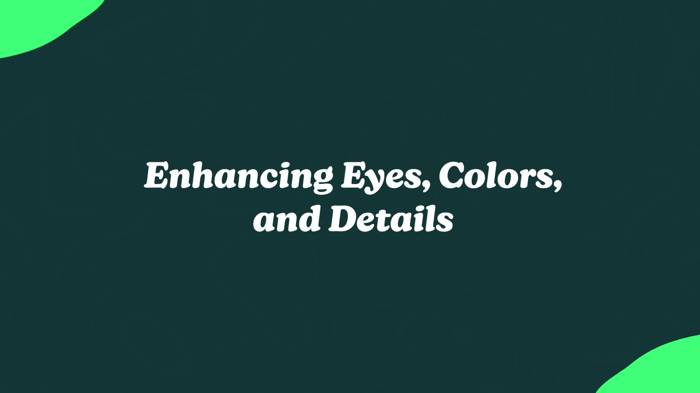
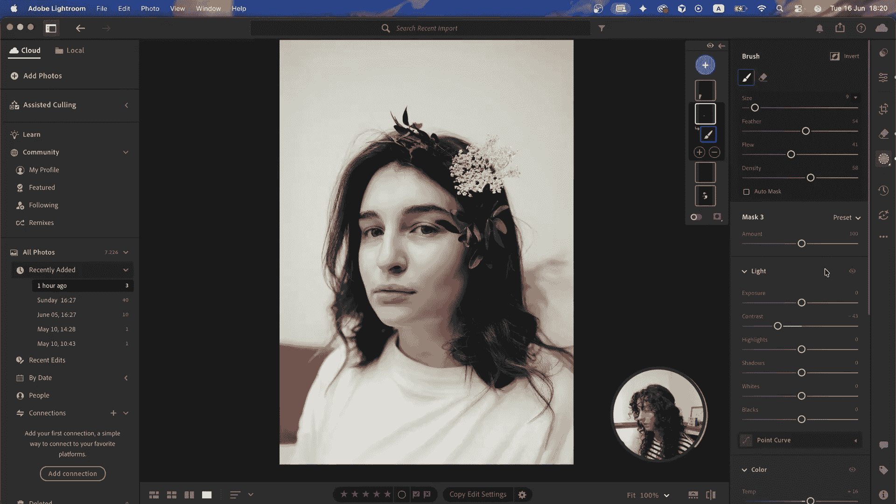

# 📸 完整Adobe Lightroom大师课：从新手到专家的照片编辑：15：增强眼睛、颜色和细节



在本节课中我们将要学习如何在Adobe Lightroom中提升人像照片的眼睛、颜色和细节。我们将继续之前的编辑进度，先整体调整色彩，再利用蒙版工具局部增强眼睛和嘴唇，最后进行细节锐化。无论你是刚接触后期的新手，还是想要提升人像修图水平的学习者，本节内容都会用大白话一步步讲解清楚，帮助你让照片中的人物更加生动突出。

上一节我们完成了光线调整，并让模特的面部更加平滑干净。我们之前已经完成了光线的基础调整，并且让模特的皮肤看起来更加细腻干净。这时候我们回到蒙版面板，去除了一些不需要的皮肤纹理，为接下来的颜色和细节增强打好基础。现在我们需要先确定想要改变什么颜色和细节，建议先从整体颜色开始，然后再用局部蒙版处理眼睛和嘴唇等部位。

接下来我们先看看如何调整照片的整体颜色。打开主面板，向下滚动找到颜色选项。这里建议优先使用自然鲜艳度滑块，也就是Vibrance。它的作用是提升那些本来饱和度不高的颜色，让画面看起来更自然。比如人脸的肤色不是单一的颜色，而是由很多不同深浅的色调组成，不能简单地变成蓝色或红色。使用自然鲜艳度可以带出被摄对象原本的自然肤色，让人物看起来更有生命力。

以下是自然鲜艳度和饱和度的主要区别：
- 自然鲜艳度（Vibrance）：主要提升低饱和区域，对已经很鲜艳的颜色影响较小，适合保护肤色。
- 饱和度（Saturation）：针对所有已有颜色的区域进行增强，容易让画面显得过于夸张。

如果我现在增加了一些自然鲜艳度，你会发现皮肤也在变化，但最明显的是背景中的黄色和树叶中的绿色变得更突出了。因为绿色本身看起来已经不错了，所以我只会稍微增加一点点饱和度，然后就可以进入颜色混合器了。

核心概念可以用下面这段简单的逻辑来理解：
```
整体颜色调整顺序：
1. 先用 Vibrance 提升未饱和颜色，保护肤色自然度
2. 再适度用 Saturation 增强已有颜色
```

整体颜色大致定下来之后，我们可以针对特定颜色进行精细调整。颜色混合器的作用是让你锁定图片中某一种特定的颜色，单独修改它的属性。在这个例子中，我想改变绿色的色相，让它显得更偏冷一些，而不是暖调的绿色。操作方法很简单，先选中绿色，再调整色相滑块，直到得到你想要的效果。完成整体色调后，我们暂时不急着做色彩分级，等整体外观都调好再回来处理，避免后面需要反复修正。

颜色部分暂时告一段落，接下来我们处理照片的纹理和细节。向下滚动找到纹理到效果这一组选项。我们可以适当增加清晰度和纹理，让照片的细节更明显。如果需要，还可以稍微去除雾霾效果，增加画面的通透感。对比一下调整前后的效果，你会发现细节更清晰了。不过要注意不要过度，比如去除雾霾不要调太多，数值设为2左右比较合适，画面会显得更柔和一些。

如果你觉得整张图片还是有点模糊，可以进入细节面板，进一步增加锐化。基础的整体调整到此就完成了。

整体调整完成后，我们开始用蒙版工具局部增强眼睛和嘴唇。这部分不是必须的，但很多时候我们对模特进行的局部修饰，最终都能体现在照片里。所以我们想要把这些细节增强出来。首先进入蒙版面板，新建一个蒙版，分别选中眼球和瞳孔，以及嘴唇区域。点击加号，使用画笔工具，放大图片，对眼睛进行调整。按住空格键可以切换到图片的另一边。调整完成后，眼睛看起来会像是发光的恶魔之眼，不过不用担心，接下来我们会把它调回自然状态。

以下是眼睛蒙版的调整重点：
- 曝光：增加光线，让自然眼颜色更明显
- 饱和度：提升眼部颜色，让眼睛更有神采

下拉菜单中增加曝光值，模特原本的眼部颜色会变得更加明显。你可以根据需要控制光线的多少，我觉得现在的效果不错。接着可以适当增加饱和度，这会让眼睛颜色更突出。如果被摄对象是黑眼睛，你可以用这种方式增加一些亮点；如果是有颜色的眼睛，就可以把那个颜色带出来，让它更吸引人。

眼睛处理完成后，下一个蒙版是专门针对嘴唇的。新建一个画笔蒙版，放大嘴唇区域。关于嘴唇，有两个问题需要解决：第一是嘴唇有点干裂，第二是缺乏颜色。首先使用画笔，尺寸和羽化等参数保持和之前一样，我就在嘴唇区域涂抹一下，就像是在给她涂口红一样。涂完之后，换用橡皮擦，选择更小的画笔，把中间部分擦干净，因为那部分不应该被模糊处理。

完成这些之后，向下滚动，降低纹理和清晰度，这样嘴唇看起来会更柔和一些。对比前后效果，柔和度明显提升。接下来增加颜色，你可以使用色相选项卡或者任意一种色调，完全取决于你自己的喜好。比如加入一点品红色，就会得到柔和的粉色。也可以增加饱和度，或者完全改变嘴唇的色相。我打算先用三个滑块尝试出一个效果，再考虑是否再加上色相调整。

现在我们得到了一种柔和的粉色。再次使用画笔，但是要把流量调低，在嘴唇边缘轻轻涂抹，避免出现生硬的线条，让效果看起来更自然。就这样，嘴唇的处理完成了。对比前后，东西正在逐个变得突出。如果你想，还可以把饱和度调低一点，得到深一点的粉色，这一步是可选的。到此为止，头发、眼睛、皮肤都已经处理好了。

基础的人像细节处理完成后，我们还可以对整体光线和某些局部颜色进行最后的微调。接下来你可以继续玩弄蒙版，让被摄对象更加突出。目前模特的面部还稍微有点暗，我可以回到刚才制作的蒙版，稍微增加一点曝光值，仅仅增加一点点就好。现在从光线和整体效果来看，看起来不错，颜色也已经设定好了。

我们还可以改变某些物体的颜色。我想把某个区域改成与肤色不太相近的颜色，这样更容易突出。新建一个蒙版，随便抓取那个区域，不需要非常精确，因为周围是白色背景。然后只需修改那个区域的色相，你就可以看到，我能把它切换成别的颜色。我觉得这个红色看起来不错，数值设为60。蒙版并没有涂到衬衫或背景上，尽管我的画笔很大，这是因为我们修改的是已有颜色的色相。就像我说的，Lightroom非常容易上手，对这种局部调整非常方便。

现在有了这个效果，我想再对嘴唇做一点微调。稍微降低一点对比度，这样会更柔和，这一步同样是可选的，你可以根据喜好让它变深、变粗或变软。

人像的细节处理工作已经完成，最后我们来看看构图和色彩分级。最后我们可能还需要调整一下图片的宽高比，裁剪掉不需要的部分，再考虑给图片添加什么样的色彩分级来表达我们想要的氛围。本节课就先到这里，我们将在下一节课中完成这张图片的最终润色。




本节课中我们一起学习了如何在Lightroom中提升人像照片的眼睛、颜色和细节。我们回顾了光线与皮肤调整，使用自然鲜艳度和饱和度调整整体颜色，通过颜色混合器锁定特定颜色，提升了纹理与清晰度，并利用蒙版分别增强了眼睛和嘴唇，最后还做了曝光和对比度的微调。希望这些内容能帮助你让人像照片更加生动突出。
