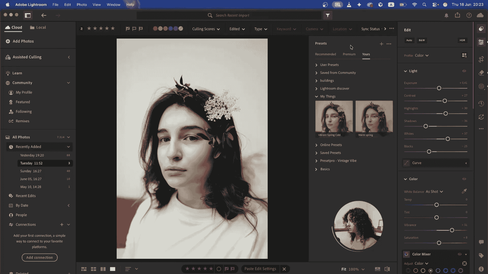
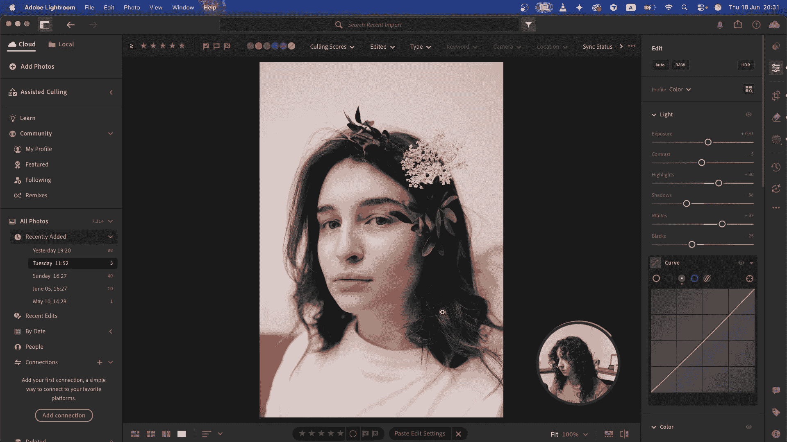

# Adobe Lightroom 零基础到精通照片编辑教程：21：最终润色 🖼️


在本节课中，我们将学习照片后期处理的最后阶段，也就是最终润色。这一节的主要目的是在已经完成基础修图之后，再做一些细节上的优化和润色，让照片看起来更专业、更好看。我们会先回顾修图前后的差别，然后调整图片的构图和角度，接着学习如何在休息之后用更客观的眼光检查自己的作品，最后通过色彩分级给照片增加特定的风格氛围。


现在我们来看看这张图片目前的修图状态。如果你想对比修图前和修图后的效果，可以把鼠标移到屏幕底部，然后按住不放。你也可以直接按键盘上的反斜杠键，这样就能快速切换查看之前的样子和现在的样子。回顾一下我们之前做过的工作，我们已经清理掉了图片上的瑕疵，让整体亮度提升了一些，把颜色表现得更鲜艳，甚至还在色彩方面做了一些特定的调整。这些都是为了让照片在进入最后阶段之前，先有一个不错的基础。




接下来我们要处理图片的整体几何结构和尺寸，也就是涉及裁剪和旋转这类操作。当你进行裁剪和旋转时，目标应该是让观众的视线第一时间落在主体上。在这个例子里，图片里只有一个主体，所以构图问题不大。但如果画面边缘有人的头之类的干扰物，你可以用裁剪工具把它去掉，或者用遮罩功能把它完全抹除。就我这次的操作来说，我只是稍微旋转一下图片，让主体和画面里的某条线对齐，大概是这样。


以下是裁剪时需要注意的几个关键点：
- 拉动图片边缘来调整裁剪范围。
- 按住 Alt 键（Windows）或 Option 键（Mac），可以让图片从中心向四周等比例缩放，而不是从角落开始缩放。
- 调整完成后按下回车键确认裁剪。

完成裁剪之后，你会发现主体比之前更加集中，画面看起来也更端正了。你可以根据自己的图片灵活调整，如果你是跟着教程一起操作，现在应该能看到画面里出现了一条笔直的线，主体看起来就像是正面对着镜头坐在那里，而不是侧着一个角度。做完前后对比之后，你就能清楚看到刚才做了哪些裁剪操作。


这里有一个非常重要的建议，就像写文章一样，你不希望一次性把所有修图工作都做完。你应该先完成基础编辑，然后休息一下，可以走动走动，或者第二天再回来看。用一双全新的眼睛重新审视照片，这样能帮你发现最初可能忽略的不足之处，也能让你意识到自己是否在某些设置上用力过猛。

为什么要这样做呢？因为当你长时间盯着同一张图片编辑时，你的眼睛会逐渐适应屏幕上的显示效果，你会逐渐丧失对什么是自然、什么是过度的判断能力。如果你用疲劳的眼睛去看最终作品，很可能会漏掉一些问题，而这些问题日后可能会成为麻烦。所以如果你之前这样做过，可能会发现自己在某些滑块上调得太过了。现在正是回去修正这些问题的时候。


就我自己的情况来说，我觉得对比度滑块调得有点太重了。我打算把它调低一些，让画面变得更柔和一点。除了对比度，我们还可以用曲线调整来微调整体色调。比如我现在看到的画面里有一点绿色偏色，我打算进入绿色通道，添加一点洋红色来抵消掉这个绿色，重点是在中间调部分，只加一点点就行。

如果你不想使用曲线调整，也可以直接用下面的滑块来达到类似效果。我还会稍微添加一点暖色调，但不会加太多，因为我打算回到色彩分级部分，为不同的光照区域添加特定的颜色。

```
# 对比度调整示例
最终对比度 = 当前对比度 × 0.8  # 调低一点，让画面更柔和
```


这里就是色彩分级的部分了，我们建议在色彩分级面板里进行风格化的着色，而不是单纯靠色温和色调滑块来完成。色温和色调更适合用来修正色偏，而不太适合用来营造风格。如果你想给照片增加个人风格，可以来到这里，这里能给你更多的控制权。

以下是色彩分级的具体操作：
- 中间调：选择一种暖色，比如橙色。
- 阴影：选择一种绿色，轻微营造复古风格。
- 高光：可以尝试一种红色，具体色调可以自己挑选。

我在高光部分没有加太多颜色，你可以看到中间的小圆圈，这个圆圈显示了你添加了多少颜色。圆圈越靠近中心，添加的颜色就越少；如果把圆圈移到最外边，那就是添加了完全浓度的颜色。调整完成后，你可以往下调整混合选项，把颜色融合得更自然，还可以平衡不同颜色的强度，避免某一种颜色盖过其他颜色。

下面是前后对比，你可以看到没有色彩分级时的样子，以及加上色彩分级之后的样子。我们去掉了那种不自然的绿色偏色，让画面变得更温暖，也更有复古的感觉。

```
# 色彩分级逻辑
最终颜色 = 基础颜色 + 中间调色调 + 阴影色调 + 高光色调
颜色强度 ∝ 色彩圆圈距离圆心的距离
```


色彩分级做完之后，我们可以放大图片检查一下细节。就细节表现来说，我觉得现在的效果已经不错了。至此，我们从头到尾完成了第一章的肖像修图工作。你已经学会了把一张普通照片转变成更具吸引力、看起来更专业的作品。


在本节课中，我们一起学习了最终润色的完整流程，包括查看前后对比、调整图像几何结构、休息后重新审视作品、细化对比度与色调，以及使用色彩分级增加画面风格。通过这些步骤，你的肖像照片已经具备了专业水准的视觉效果。

接下来的一章，我们将继续进行图片编辑，但对象将会是风景照片。风景照片和人像照片最大的区别在于，风景照片通常没有人体主体，或者即使有人出现在画面里，通常是背对着镜头，或者并不是视觉焦点。风景照片可以是一座山，也可以是一片瀑布或湖泊，关键在于画面里的所有元素需要同时突出，而不像人像照片只有一个主要的焦点，通常就是人像本身。




请先把你的人像照片修图完成，然后我们下一章再见，去看看如何处理风景图片吧。
