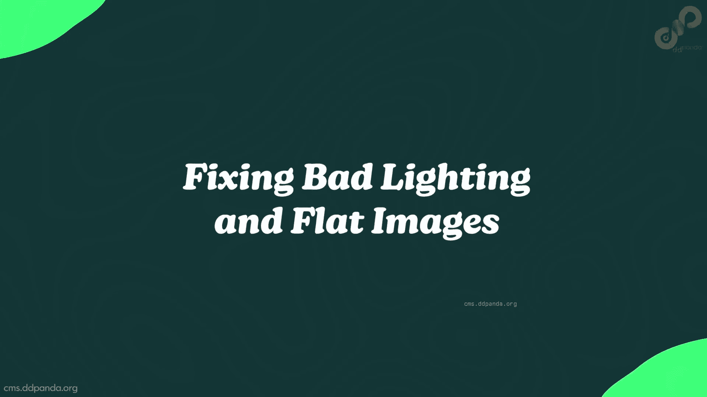
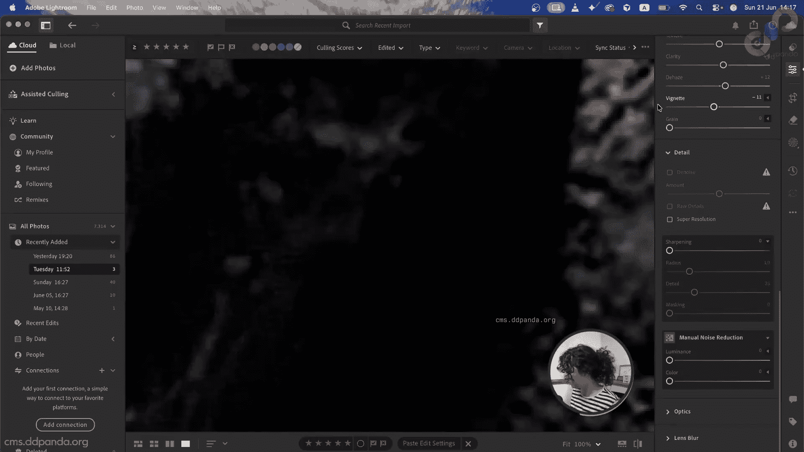
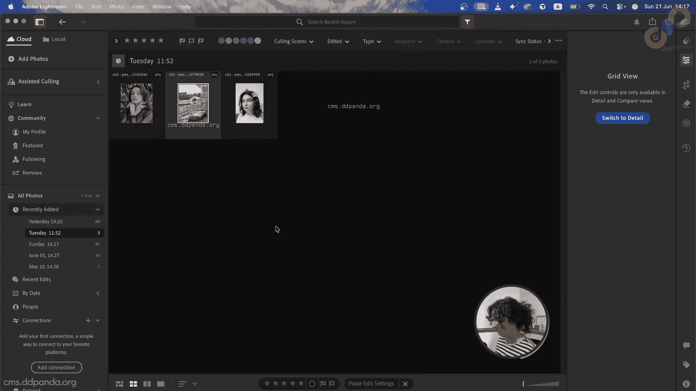

# Complete Adobe Lightroom Megacourse： Beginner to Expert Photo Editing part1：p22：17 - Fixing Bad Lighting and Flat Images 🌄

在本节课中我们将要学习如何在 Adobe Lightroom 中修复光线不佳、画面显得平淡的风景照片，让照片重新找回立体感和自然色彩。

我们先来聊聊风景照片的处理思路。其实跟修人像照片差不多，核心都要照顾好画面里的光线和颜色。不过跟人像不一样的是，人像通常只需要让人物主体亮起来，重点照顾眼睛、头发这些地方就行了。风景照片则不同，我们要的是整个场景都看得过去，不能只盯着桥而忘了花和草，也不能只顾着天空而忽略了湖面。简单来说，风景照就是一个完整的整体，各个部分都需要兼顾。当然，也有特殊情况，比如画面里有只特别漂亮的动物，那我们可能会希望动物比周围更突出一些。但在这张图里，各个元素地位差不多，我们的目标就是让整体看起来更好，把场景本来就有的自然色彩尽量表现出来。

好了，建议先把这张图片下载下来，然后导入到 Lightroom 里面。在本章节中，我们要把这张照片变成好看得多的样子。

首先，我们要弄清楚什么叫做“平淡的照片”，也就是英文里说的 flat image。一句话概括，就是照片缺乏立体感，或者立体感不够理想，看不出明显的层次。用公式来理解就是：

Flat Image = 低对比度 + 缺乏明暗层次 + 画面显得苍白

在这张图里，对比度不高，所有东西看起来都很淡，所以目前来说它就是一张平淡的照片。

修图的顺序通常是先处理光线，再处理颜色，最后做一些细节打磨。这一节我们只专注于第一个模块，也就是光线部分，不急着去删除画面里的东西，也不先调整构图方向。

以下是光线调整的具体步骤：

- 曝光（Exposure）：图片整体太亮，光源让草地看起来发白，失去了应有的绿色。我们把曝光滑块往下拉，直到能看到花朵的细节为止，这时候绿色就会明显变出来。
- 对比度（Contrast）：增加对比度来制造我们说的那种深度感。调完之后，绿色会更跳出来，树木和湖面上的小叶片细节也都能看清了。
- 高光（Highlights）：云层的细节不够明显，所以要把高光往下降，直到能看清云的样子。
- 白点（Whites）：针对画面里纯白的地方，比如桥和天空，适当往上加一点。
- 黑点（Blacks）：跟白点正相反，我们要把黑点往下压，让暗部保持深色。这样岩石和背景里的小树都会多一点立体感。

单单调光线，画面就已经好很多了。现在照片看起来更有 3D 感，也更有生命力了。

接下来看曲线面板，在风景摄影里尤其是当全图主色比较单一的时候，曲线工具非常有用。因为这张图有点偏绿，我们可以利用一条滑块加入相反的颜色来抵消掉多余的绿色。这里要注意，这样做并不是要把植物的绿色全去掉，只是想减少不该出现的绿色，比如石头、桥、天空这些地方。

曲线的位置含义可以用简单代码表示：

curves_position = 低位置（阴影/暗部） | 中间位置（中间调） | 高位置（高光/亮部）

对于这张图，高光部分我会加一点洋红来抵消绿色，阴影部分也加一点，但中间调不动，因为我们希望那些茂密的绿植保持绿色。调完之后，画面会稍微好看一点点。

为了进一步去掉还剩下的平淡感，我们要进入效果面板，用清晰度和去雾滑块来增加深度。以下是常用的效果参数：

- 清晰度（Clarity）：给画面里的物体增加细节。
- 去雾（Dehaze）：整体提升画面层次。
- 暗角（Vignette）：如果觉得四个角太亮或太暗，可以适当加一点。我会把边缘稍微暗一点，让视线更集中到画面中心。

这就是效果面板能帮我们做的事情。

如果照片太模糊，或者你觉得还需要更多细节，可以加一点锐化。不过对我而言，这张图不需要，所以我就不加了。😔

关于降噪，如果图片上有很多噪点，可以用降噪功能去掉。通常看噪点最好的地方是图片暗部。为了让你知道噪点长什么样，我特意加了一些噪点，你可以看见图片上全是小点点，这就跟大量噪点差不多。如果需要，就可以加降噪，但这张图我们没有这个问题。

光线部分的第一步就完成了。我们改变了光线。下面是修改前后的对比：

最初是什么样子，现在是什么样子。现在的图更有活力，对比度也更高，看起来更真实，不像一开始那样平淡了。😔

下一课我们将会更多地聚焦在删除画面里不需要的物体或主体上。举个例子，在这张图里，有些小东西会干扰视线，比如右边那个我也不知道是什么的东西，还有像纸巾一样的小白东西，花本身没问题，但水里也有一些小杂物。如果你愿意，也可以把画面里的人去掉。总之有几样东西得去掉，最重要的是要用最好的方式去除它们，不要在图片上留下明显的划痕，也不要让观众一眼就看出你改过。下一课我们会继续编辑这张图片。

本节课中我们一起学习了如何在 Lightroom 中修复平淡的风景照片，包括调整曝光、对比度、高光、白黑点，以及使用曲线、清晰度和去雾来提升画面的立体感和色彩表现。

