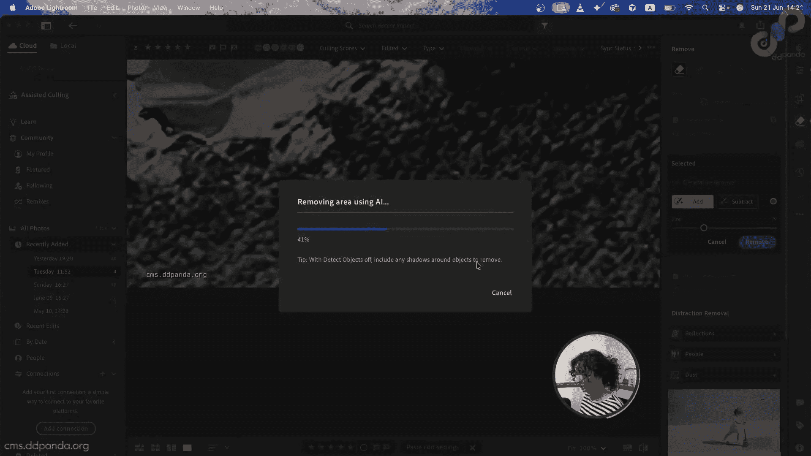
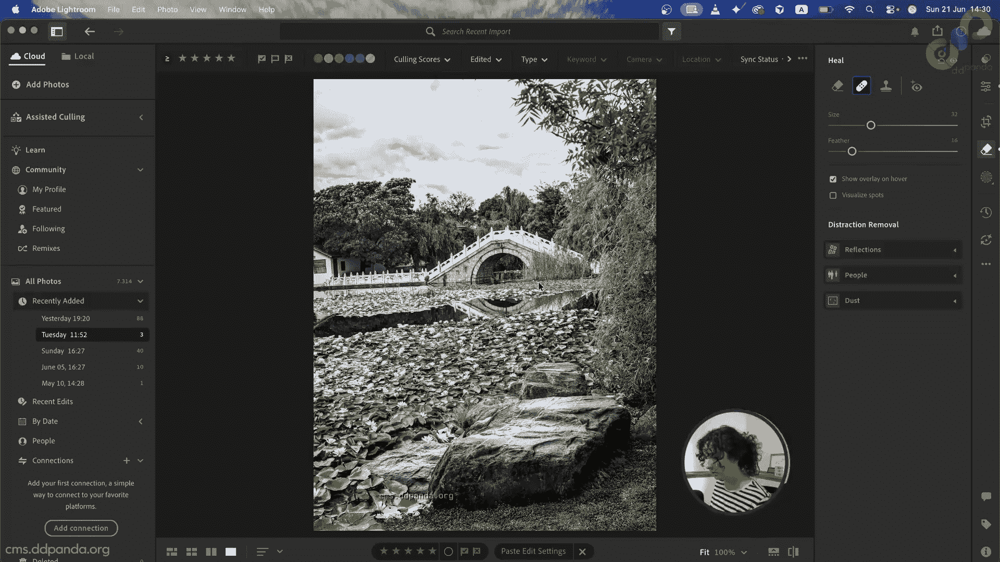

📸 完整 Adobe Lightroom 大师课：从初学者到专家照片编辑：18：移除干扰与不需要的元素


在本节课中我们将要学习如何在 Adobe Lightroom 中移除照片里的干扰元素和不需要的物体。你在之前的步骤中已经完成了光线与效果面板的基础调整，这时候画面的整体明暗和色调基础已经建立起来了。光线调整是摄影后期中最重要的部分，所以只有在完成所有基础曝光和光效设置之后，才应该开始进行物体移除工作。按照这个顺序操作，可以确保移除后的区域与整体光影保持一致，避免出现前后不协调的情况。


上一节我们介绍了光线与效果面板的调整方法，本节中我们来看看如何利用移除工具清理画面中的多余元素。

以下是移除工具的标准操作步骤：
- 进入 Lightroom 的移除面板，选择擦除画笔
- 调整画笔大小，使其能够完整覆盖想要移除的目标区域
- 根据需要决定是否启用 AI 自动填充，启用后通常能获得更自然的重建效果
- 在目标周围涂抹选择区域，同时留出足够的边框空间
- 点击 Remove 按钮，让 Lightroom 分析周围像素并重建该区域


核心操作顺序可以用下面的代码块来表示：
```
涂抹目标区域 → 留出足够边框 → 启用 AI 选项 → 点击 Remove → 检查生成结果
```


需要特别注意的是，涂抹时不要贴着物体边缘进行操作。如果画笔太靠近边缘，完成移除后容易出现光晕效应，也就是 halo effect。为 Lightroom 留出足够的周围区域，软件才有足够的像素素材进行合理的纹理重建，最终结果才会自然。


掌握了基本流程之后，我们先从一个非常明显的红色物体开始进行实际练习。



这个红色物体在画面中非常显眼，会严重分散观看者的注意力，属于典型的干扰元素。我们使用橡皮擦工具，调整合适的画笔大小，涂抹该红色区域。涂抹时要为 Lightroom 留出足够的操作空间，不要直接贴着物体边缘，否则移除后可能会出现不自然的光晕。涂抹完成后点击 Remove，Lightroom 会启用 AI 重新生成该区域的草地纹理，使移除后的部分与周围环境自然融合，最终得到一个非常干净的去除效果。


完成第一个红色物体的移除之后，我们来处理一些不太确定具体是什么的模糊物体。

画面中还有一些难以辨认的物体，可能是塑料袋或者其他杂物。这时可以把画笔调大一些，再次涂抹目标区域并点击 Remove。在这里有一个非常重要的原则：不要试图用一次选择框把所有东西全部移除。因为画面中不同区域的表面纹理和光照条件可能完全不同，如果强行把它们合并在一次操作中，很容易导致光影混乱，让某些部分变得过暗，而另一部分变得过亮。最稳妥的做法是逐个处理每个目标，确保每个移除区域的纹理和光照都与周围环境保持一致。


当多个干扰物位于同一个区域，并且纹理与光照条件相同时，我们可以将它们合并在一次操作中统一移除。

以下是可以合并移除的条件：
- 多个物体位于同一相邻区域
- 表面纹理基本一致
- 所处光照环境相同


满足这些条件时，可以一次性勾选多个目标，然后统一点击 Remove。Lightroom 会生成几个不同的处理变体，供你预览对比。你可以查看这些变体，选择最自然、最符合原画面的一个。如果当前结果不理想，也可以切换到其他变体进行替换。


大型干扰物处理完毕之后，我们需要仔细检查石头和水面上的细小瑕疵。

石头表面可能有一些小斑点，这些可能是蘑菇或者其他自然生长的元素。虽然它们本身属于自然景物，但在深色石头表面上非常显眼，很容易抢走观看者对花朵的注意力。因此，我们应该移除那些亮度过高、过于突兀的小斑点。使用“添加到选择”功能，可以继续往当前选择区域里增加更多目标，然后一次性移除。水面上的亮斑也是同样的道理，即使是自然元素，如果亮度过高造成视觉干扰，也可以选择移除，让观看者的目光集中在主体花朵上。


除了各种物体，我们还可能遇到画面中出现的人物，尤其是在户外风景摄影中。

如果画面里有路人拿着雨伞，显得格外突兀，可以使用同样的画笔工具涂抹该区域，让 Lightroom 的 AI 进行移除。记得在人物周围留出足够的边框，不要涂抹得太紧。移除完成后，检查 AI 生成的变体，选择效果最自然的一款。对于刚开始学摄影的朋友来说，如果你拍摄的是风景照片，最好尽量避免画面中出现陌生人的清晰面孔。万一对方发现自己的照片被发布并且感到不开心，可能会带来不必要的麻烦。除了直接在 Lightroom 中移除人物，另一种保护隐私的方法是模糊人脸，这样既能保护被摄者，也能让你的摄影作品更安全地分享。


人物移除之后，还需要处理可能遗留的反射问题。

移除人物后，可能会留下雨伞的反射残留。这时需要单独针对反射区域再次使用移除工具。完成所有移除操作后，你的照片应该已经没有明显的干扰物和随机人物了。你可以继续移除任何不喜欢的元素，直到画面完全干净，没有任何影响观感的杂物。


如果你需要进行更复杂的画面重构，Lightroom 可能不够理想。

Lightroom 并不像 Photoshop 那样拥有完整的图层系统，因此不适合进行大规模的画面合成操作。比如，你可能想用更多花朵填充水面区域，可以尝试使用仿制图章工具或修复画笔，但最终效果难以预料。对于这种重大修图需求，推荐的工作流程是：在 Lightroom 中点击“文件”菜单，选择“在 Photoshop 中编辑”选项，将图像同步到 Photoshop 进行重大修改，完成后再带回 Lightroom 继续后期处理。这样你就可以在两个程序之间编辑同一张图片，充分发挥各自的优势，Lightroom 负责整体调色，Photoshop 负责局部重构。


所有移除操作完成后，我们来看看处理前后的差异。

放大图像细节对比，你会发现原本画面中各种不需要的元素现在都不见了。红色物体、未知杂物、石头与水面上的小斑点、人物以及雨伞反射都被清理干净，画面变得更加简洁，观看者的注意力会自然地集中在花朵和自然景观上。


干扰元素移除阶段暂时结束，接下来我们将进入新的主题。

在下一节课中，我们将专注于构图与几何调整。如果你想要营造宁静的风景氛围，画面角度的微调非常重要。你可能需要根据地平线来矫正图像，或者直接裁剪掉某些部分。这些内容将在下一节课中详细讲解。





本节课中我们一起学习了如何在 Adobe Lightroom 中使用移除工具清理画面中的干扰元素。我们从基本的操作流程开始，逐步处理了明显的红色物体、未知杂物、石头与水面上的小瑕疵，以及画面中的人物和反射。同时，我们讨论了纹理与光照一致性的重要性，了解了避免光晕效应的方法，还学习了如何在需要重大修图时将图像同步到 Photoshop。希望这些内容能帮助你拍出更干净、更专业的风景照片。

