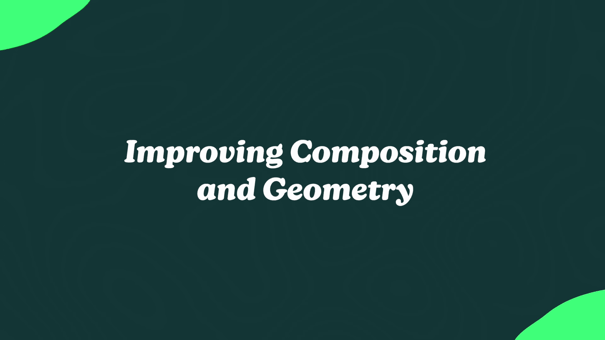
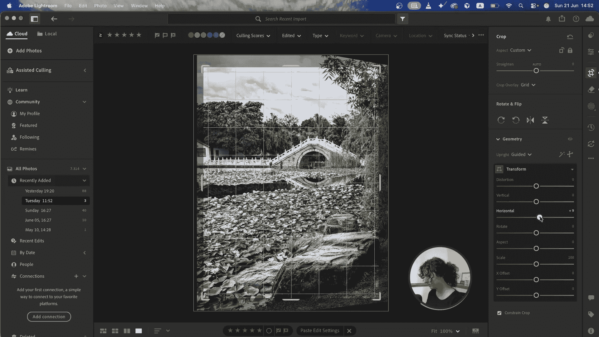

# Adobe Lightroom 零基础到专家摄影后期大师课：19：改善构图与几何 📐



在本节课中，我们将学习如何在 Adobe Lightroom 中调整照片的构图与几何结构，让画面看起来更平衡、更专业。我们会先认识构图面板里的各种滑块，了解哪些调整真正有必要，哪些可以暂时忽略。接着，我们会讲解如何用地平线来让图像变直，也会演示如何用两条参考线启动自动矩正功能。最后，我们会手动微调水平和倾斜度，让主体位置更合理，为下一节关于氛围调整的内容打好基础。


## 构图面板与初步调整

本节我们首先来看构图面板。打开 Lightroom 后，切换到构图选项卡，你会看到一排排滑块，乍看之下好像每个都要动一动才行。但实际上，对于这张照片来说，并不需要把每一个滑块都调整一遍，只需要针对画面中真正存在的问题进行修正即可。以下是常见的几种调整方向：

- 整体图像倾斜度修正
- 建筑线条几何校正
- 主体位置微调
- 边缘裁剪范围控制

以上这些选项可以根据实际拍摄效果来决定是否使用，不需要强求全部开启。


## 用地平线让图像变直

接下来，我们尝试用地平线功能来矫正图像方向。这一步是可选的，有些摄影师喜欢保留拍摄时的自然状态，不希望画面过于规整；而另一些摄影师则倾向于利用几何结构，把观看者的注意力引向画面中的某个特定部分。两种做法都可以，全凭你个人偏好。

在这次示例中，我会选择把图像变直。具体操作是使用地平线滑块，同时参考画面中的网格线，判断图像是否已经水平。你可以把这条线放在桥下方，作为判断依据。调整完成后按下回车键，图像就会被扭转到目标角度。这段过程可以用下面的公式来理解：

图像倾斜角度 = 原始拍摄角度 - 地平线修正值

如果你觉得效果不理想，也可以按下撤销键，回到上一步重新尝试。


## 使用两点参考线进行自动矩正

除了单纯地平线修正，Lightroom 还提供自动矩正工具，允许你用两点作为参考。当你启动这个功能时，光标会显示出参考点提示，帮助你确定落点位置。

以下是具体的操作步骤：

1. 在黑色线条起始位置点击一次，设定第一个参考点。
2. 按住鼠标拖动到桥的另一端，完成第一条参考线。
3. 以楼梯顶部为参考，再点击并拖动出第二条线。
4. 在左侧检查线条是否对齐，确认无误后松开鼠标。

自动矩正的核心逻辑可以用下面的代码表示：

```
第一条参考线 = 黑色线条起点 → 桥的另一端
第二条参考线 = 楼梯顶部 → 对应参考位置
两条参考线 → 图像自动矩正 → 勾选受限裁剪 → 画面整洁
```

完成之后，你会发现整张图像发生了位移，画面边缘出现了一些多余的空白区域。这时候，勾选受限裁剪选项，系统会自动裁掉多余部分，画面立刻变得整洁。此时图像不仅变直了，还修正了之前向右偏斜的问题。这就是使用引导式布局选项带来的效果。

如果你切换到自动模式，Lightroom 会使用自身的计算逻辑，不再完全依赖你刚才画的两条线。回到引导模式后，你可以在水平、垂直或完整三种模式中做选择。在这次教学中，我决定继续沿用最初设定的引导模式，然后按下回车键确认。


## 手动微调几何效果

确认引导矩正之后，如果还需要进一步微调，可以使用下方的滑块进行补充。例如，我可以调整水平滑块，让画面稍微朝我这边倾斜一点。大概调整八点左右的幅度，然后再次按下回车键。

调整完成后，画面看起来既朝向观察者，又保留了之前两条参考线带来的修正效果。对比修改前后，你会发现冰箱现在更加清晰可见，不再处于拍摄时那种随意歪斜的位置。这就是利用几何工具改变画面观感的过程。


## 进入氛围调整阶段

现在我们已经利用几何工具改变了图像的整体样子，接下来可以开始处理画面的氛围感。氛围调整将是本节几何内容的最后一部分，也会是下一节课的重点。


## 本节总结




本节课中，我们一起学习了如何在 Adobe Lightroom 中优化构图与几何结构。我们认识了构图面板里的滑块，明白了不需要对每一项都进行调整；掌握了用地平线让图像变直的方法；学会了用两条参考线启动自动矩正，并配合受限裁剪清理边缘；最后通过水平滑块进行了手动微调，让主体位置更合理。这些技巧能帮助你让照片的建筑线条更端正，画面更有秩序感，为后续的氛围调色打下基础。

