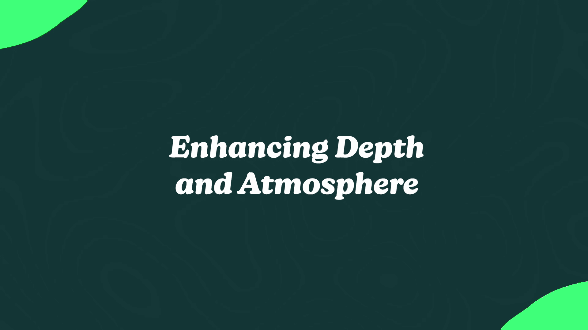
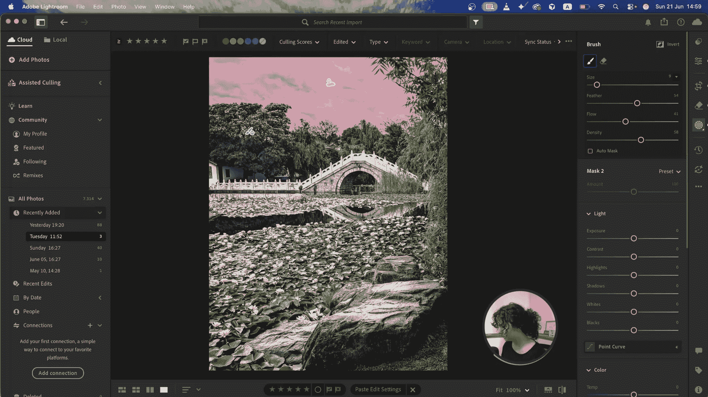

🌄 Adobe Lightroom 从新手到专家照片编辑：20：增强景深与氛围


在本节课中我们将要学习如何在 Adobe Lightroom 中提升图片的景深与整体氛围。我们会先从基础的颜色调整开始，然后利用颜色混合器来精准控制特定色调，接着通过蒙版工具对图片中的局部区域进行单独处理，最后使用色彩分级来统一画面的情绪。无论你是刚接触 Lightroom 的新手，还是已经掌握基本操作的学习者，本节内容都会用大白话逐步拆解每一步操作，确保你能够看懂并独立完成。


上一节我们介绍了光线与几何设置的基础用法，本节中我们来看看如何处理颜色与氛围。


### 第一步：基础颜色调整

以下是基础颜色调整的主要步骤，你可以依次操作每一个滑块。

- 振动度：只针对图片中还不够鲜艳的颜色进行提升，比如背景里的一些树木，绿色会立刻变得更加突出。
- 饱和度：在振动度的基础上再稍微增加，让整体的绿色看起来更加茂密。
- 色温：稍微偏向暖色方向，营造出春天阳光的感觉。
- 色调：加入一点品红色调，用来抵消画面中多余的绿色。

核心调整公式如下：

```
图片氛围 = 基础曝光 + 颜色去干扰 + 几何校正 + 颜色滑块组合
```


完成基础滑块调整之后，我们进入颜色混合器进行更细致的控制。


### 第二步：使用颜色混合器锁定特定颜色

以下是使用颜色混合器的具体方法，主要针对绿色和蓝色两个部分。

- 绿色：在颜色混合器中单独选择绿色，将色相向右拖动使其偏冷，适当增加饱和度，同时略微降低亮度，这样树木和桥梁周围的绿色会更加突出，而天空和其他区域保持不变。
- 蓝色：选择天空中的蓝色，将色相向右拖动，呈现出蓝紫色的混合效果，让天空颜色更加纯净深邃。



颜色混合器的操作逻辑可以用下面的代码块来理解：

```python
# 颜色混合器精准调整示例
目标颜色 = "绿色" 或 "蓝色"
色相 = 向右拖动使颜色更冷或更蓝
饱和度 = 适当提升
亮度 = 稍微降低以增加对比度
```

使用颜色混合器的好处在于，你可以只改变一种颜色，而不会影响图片中其他部分的色调。


接下来我们利用蒙版工具，对图片中的个别部分进行更精确的修正。


### 第三步：利用蒙版处理局部细节

以下是使用蒙版处理局部细节的流程，每一个对象都会单独建立蒙版。

- 岩石：使用对象画笔工具，沿着岩石边缘粗略涂抹，让 Lightroom 自动识别对象。由于岩石是画面中最暗的部分，本身不应该带有紫色，因此我们将该蒙版的饱和度完全降低，去掉不自然的紫色。
- 天空：使用风景蒙版自动检测天空区域，如果蒙版覆盖到了树木，就用减除画笔把树木部分清理掉。然后在天空蒙版上稍微降低色温并增加饱和度，让天空看起来更加生动。
- 花朵：用普通画笔给花朵区域加上柔和羽化，避开桥梁和中间不需要调整的部分，然后增加饱和度并将色调偏向品红，使花朵颜色更加鲜艳。
- 桥梁：单独建立蒙版选中桥梁，只调整高光而不触碰饱和度，因为蒙版边缘可能不够干净，避免影响后方树木的绿色，让桥梁看起来更加明亮。
- 树木：如果某棵树看起来一半有颜色一半没有，就再建一个蒙版把整棵树选中，统一色调，使画面更加协调。


处理完所有局部区域之后，我们可以使用色彩分级来进一步统一画面风格。


### 第四步：色彩分级设置

以下是色彩分级的设置思路，适用于阴影、中间调和高光三个部分。

- 阴影：可以根据个人喜好进行调整。
- 中间调：选择暖色，或者稍微偏向黄色，来描绘一个美好的春天白天场景。
- 高光：选择一种淡蓝色，为高光部分增加冷色调的点缀。

色彩分级的作用类似于给画面加上一层滤镜，你可以把这三个部分混合在一起，反复尝试直到对最终效果满意为止。


最后我们做一些最终微调，并对比修改前后的效果。


### 第五步：最终微调与前后对比

以下是完成后的最终检查与对比步骤。

- 曝光：在所有颜色都已经就位，干扰元素也已移除之后，你可以随时回到任意滑块做最后微调，比如稍微降低曝光。
- 对比：查看修改前和修改后的图片，你会发现风景照片和人像照片可以使用很多相同的核心工具，区别在于风景照片包含更多元素，颜色的重要性更高，而人像照片通常以肤色为主，肤色大约占据图片的百分之九十。


本节课中我们一起学习了如何在 Lightroom 中增强景深与氛围。我们掌握了基础颜色滑块的使用方法，学会了通过颜色混合器锁定单一颜色进行调整，了解了如何用蒙版对岩石、天空、花朵、桥梁和树木等局部区域进行独立处理，还尝试了色彩分级来为画面统一情绪基调。希望你能把这些方法应用到自己的风景照片中，在下一节课里我们将回到人像编辑，继续探索 Lightroom 的更多功能。

