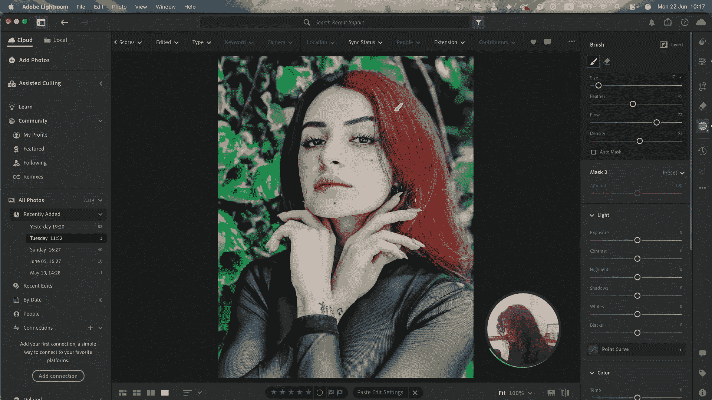
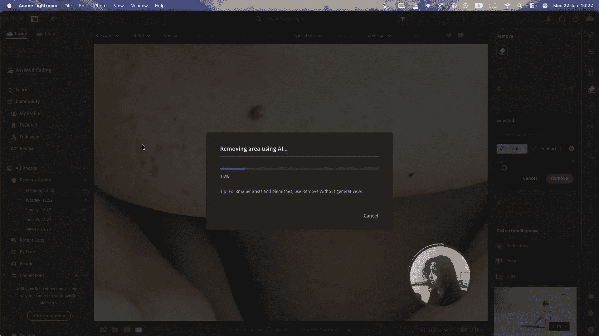
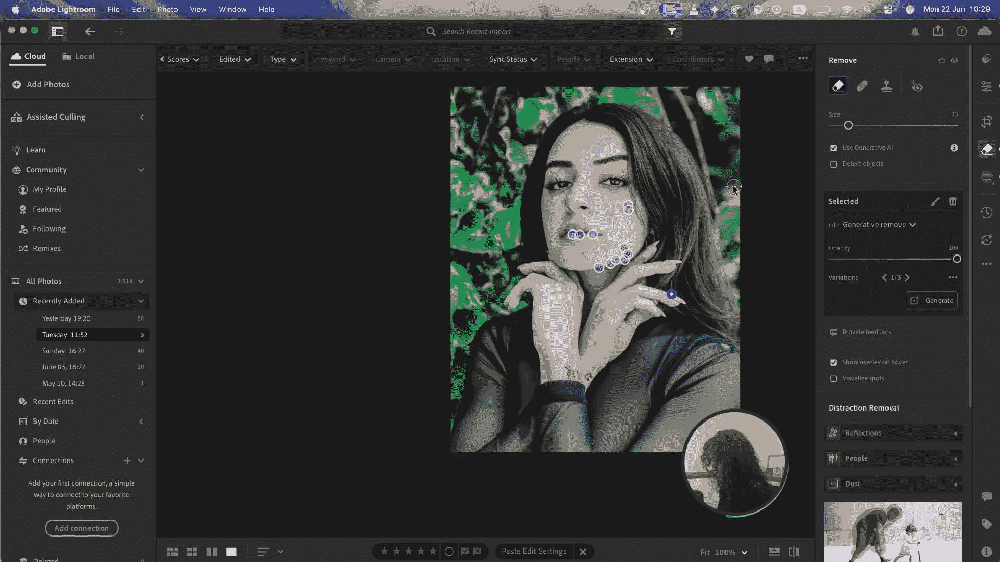

# 完整Adobe Lightroom mega课程：初学者到专家照片编辑：22：修正光线与皮肤 📸

在本节课中，我们将要学习如何在Adobe Lightroom中修正照片的光线与皮肤细节。本节内容适合刚接触后期处理的初学者，我们会一步一步地讲解从整体光线调整到局部修图的完整流程，包括如何使用蒙版、去除工具以及颜色滑块来改善人像照片。你不需要具备任何专业基础，只需要跟随操作步骤，就能让照片看起来更专业、更自然。

## 第一步：调整整体光线与对比度

首先，我们来看看如何处理照片的整体光线。在开始具体修图之前，建议你先仔细观察这张照片，找出需要改进的地方，并把想要做的调整记录下来。对于这张照片，我们的目标是让画面整体更明亮一些，并增加适当的对比度，避免图像显得过于平淡且缺乏层次感。

以下是整体光线调整的具体步骤：

- 调整亮度滑块，使整张照片的整体亮度提升。
- 增加对比度，通过加深黑部和提亮白部来增强画面的层次感。
- 使用基础面板中的现有滑块完成初步调整。

这是光线部分的第一版编辑效果。你可以随时回到这里进行微调，不需要一次就调整到完美。

## 第二步：修正肤色与绿色色调

上一节我们介绍了整体光线的调整方法，本节中我们来看看如何修正肤色。有时候照片会带有不自然的绿色色调，这会让皮肤看起来不够健康，甚至呈现出一种屏幕感。我们需要抵消这部分绿色，让肤色回归到更自然的红色调，使人物看起来更真实。

具体操作如下：

- 调整色调滑块，减少绿色，增加偏红的肤色效果。
- 提高自然饱和度，使画面色彩更鲜艳但不过度。
- 检查当前效果，确认肤色看起来自然，不再带有绿色色调。

## 第三步：使用蒙版提亮面部

上一节我们完成了肤色的初步修正，本节中我们来看看如何通过蒙版局部提亮面部。蒙版是Lightroom中非常实用的功能，它允许你只对照片的某一部分进行调整，而不影响其他区域。对于人像照片，面部通常是最重要的部分，因此我们优先处理脸部，让观众的注意力首先集中在人物的表情上。

以下是面部蒙版的调整步骤：

- 选择调整笔刷，在面部区域涂抹蒙版。
- 提高高光部分，让面部看起来更明亮。
- 适当加暗阴影部分，增加面部的立体感。
- 根据需要调整密度参数，控制效果的强弱。
- 对比调整前后的效果，确认面部已经提亮。

不需要把蒙版延伸到脖子，因为脖子本身就有阴影。至于手臂和手部，如果有明显的高光区域，比如手指部分，也可以适当添加一些效果，但要注意保持亮度层次的一致性。

如果觉得效果太重，可以撤销操作，先降低密度，再重新涂抹。这样可以保持编辑的自然顺序，避免局部过亮。

## 第四步：深化头发与眉毛颜色

上一节我们介绍了面部蒙版的使用方法，本节中我们来看看如何处理头发和眉毛。头发和眉毛的颜色通常比较深，适当加深可以让人像更有精神，也能让整体画面更有质感。我们需要创建第二个蒙版，专门针对头发区域。

具体操作如下：

- 创建新蒙版，使用调整笔刷涂抹头发和眉毛。
- 降低笔刷的流量和密度，使效果更柔和、更自然。
- 保持适当的羽化，让蒙版边缘过渡自然，避免出现生硬的痕迹。
- 不必过于担心笔刷是否触碰到面部，因为后面会使用针对暗部的滑块，亮部不会受到影响。
- 降低阴影滑块，使头发颜色更深邃。
- 增加对比度和黑色级别，让头发看起来更丰盈、更有质感。

## 第五步：润饰嘴唇颜色与质感

上一节我们完成了头发和眉毛的颜色深化，本节中我们来看看如何润饰嘴唇。嘴唇有时会出现干燥或颜色不均的情况，我们可以通过蒙版让嘴唇看起来更光滑、更有颜色，同时保持自然的质感。

以下是嘴唇修饰步骤：

- 创建新的笔刷蒙版，覆盖嘴唇区域。
- 调整密度和流量，控制效果的强度。
- 使用擦除工具去除嘴唇中间部分的蒙版，保持自然的光泽感。
- 提高对比度，让嘴唇轮廓更清晰。
- 在效果面板中降低清晰度和纹理，使嘴唇看起来更柔软。
- 调整饱和度，可适当添加紫色色调，但不要让效果过于明显。
- 只使用饱和度和色调，不使用色相，因为我们只是放大原本已有的颜色，而不是添加全新的颜色。

## 第六步：使用去除工具清除瑕疵

上一节我们介绍了嘴唇的润饰方法，本节中我们来看看如何清除皮肤上的瑕疵。即使肤色已经调整得不错，照片上可能仍然有一些小瑕疵，比如痘痘、睫毛膏晕染或其他不需要的痕迹。我们可以使用去除工具来处理这些问题，让皮肤看起来更干净。

以下是去除瑕疵的步骤：

- 切换到去除工具，调整笔刷大小以匹配瑕疵范围。
- 针对嘴唇上的干燥瑕疵进行去除，注意光线差异，分步处理。
- 检查面部其他区域，比如睫毛膏晕染的部分，也可以一并去除。
- 逐个区域检查，确认没有遗漏的化妆晕染或皮肤瑕疵。

## 第七步：让眼睛更有神采

上一节我们完成了瑕疵的清除工作，本节中我们来看看如何让眼睛更有光彩。眼睛是人像照片的灵魂所在，适当提亮瞳孔可以让人物看起来更有神采，也能增加照片的整体吸引力。

具体操作如下：

- 使用之前的调整笔刷，涂抹瞳孔区域。
- 保持流量和密度较低，避免效果过重导致不自然。
- 降低对比度，稍微增加曝光度，大约设为40左右。
- 让眼睛有一点点高光，但不要过于极端，保持自然状态。

## 第八步：修改指甲油颜色

上一节我们介绍了眼睛的提亮方法，本节中我们来看看这个可选步骤：修改指甲油颜色。如果照片中的人物涂了指甲油，我们可以尝试改变指甲油的颜色，这完全是可选的，但可以作为练习，帮助你更好地理解颜色调整的原理。

以下是指甲修改步骤：

- 在处理指甲之前，先使用去除工具清除指甲上的小瑕疵，比如水渍或杂物。
- 创建新蒙版，只涂抹指甲区域。
- 恢复流量和密度，保持足够的羽化，让边缘过渡自然。
- 如果使用鼠标，可以通过滚轮调整笔刷大小。
- 不需要追求完美的选区，因为我们主要调整的是自然饱和度。
- 先做一个大概的选区，然后使用擦除工具的侧边清理边缘不完美的地方。
- 降低到饱和度滑块，增加指甲原本的颜色。
- 使用色相滑块更改指甲油颜色，可以选择紫色、黄色或绿色等。
- 调整饱和度，直到颜色看起来合适。如果太深，可以降低饱和度。
- 逐个检查每个指甲，确保蒙版覆盖充分。
- 使用去除工具快速清除指甲上的水渍或其他杂物。

在本节课中，我们一起学习了如何在Lightroom中修正整体光线，如何使用蒙版局部调整面部、头发、嘴唇、眼睛和指甲，以及如何使用去除工具清除瑕疵。核心公式可以总结为：

- 整体对比度 = 亮部提升 + 暗部加深
- 蒙版调整 = 局部区域 + 笔刷涂抹 + 密度与流量控制
- 颜色增强 = 原有饱和度 + 色调微调

下一节课我们将继续处理更多细节，让你的照片编辑技巧更上一层楼。

