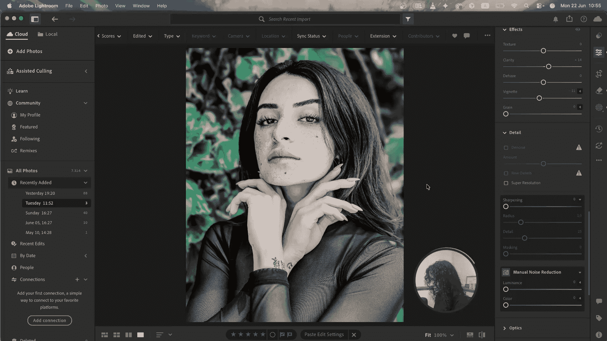
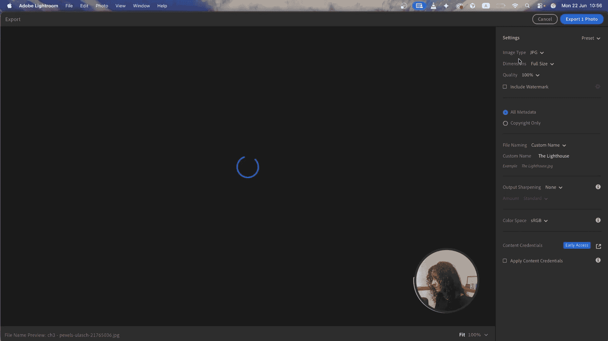
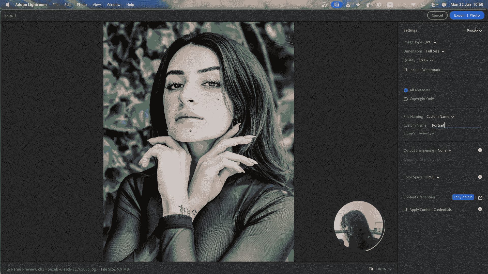

Complete Adobe Lightroom Megacourse： Beginner to Expert Photo Editing:23:精修细节与风格 📸


在本节课中，我们将学习如何在 Adobe Lightroom 中精修照片细节并提升整体风格。我们会继续调整色彩，处理人像面部的皮肤细节，添加镜头模糊效果，使用分级调色平衡冷暖色调，最后在图片四周添加暗角。编辑完成后，我们还会回顾之前制定的检查清单，并学习如何将照片导出到电脑中。这节课的目标是让你掌握从初步修图到最终输出的完整流程。


### 调整整体色彩与氛围

上一节我们完成了遮罩和瑕疵去除，本节中我们先来看看如何给画面上色。你可以直接套用色调分级预设来快速上色，也可以在编辑面板中手动调整。具体做法是返回编辑标签页，向下滚动到色彩面板，提升整体振幅。背景中的绿色通常显得过于不真实，因此需要适当降低饱和度，避免抢夺主体的注意力。你也可以把色相向暖色或冷色方向偏移，根据自己的喜好选择合适的色调。此外，也可以适当提升整个图片的清晰度，让画面更有锐度。

色彩调整可以用下面的公式来理解：

```
最终色彩 = 基础色调 + 振幅调整 + 饱和度修正 + 色相偏移
```


### 精修人像面部细节

接下来我们聚焦到人物面部。模特脸上有一些雀斑，这些细节可以通过局部调整来增强。以下是具体操作步骤：

- 启用画笔工具，在面部区域绘制遮罩。
- 避开眼睛、鼻子、嘴巴等需要保留原始细节的部位。
- 在开始前降低流量和密度数值，这样调整不会过于强烈。
- 使用去除工具清理不小心涂到的区域。
- 向下滚动面板，提升纹理并适当增加清晰度。

面部细节增强可以用下面的公式来表示：

```
细节呈现 = 画笔遮罩 × 低流量密度 + 纹理提升 + 清晰度微调
```

这样处理前后对比很明显，即使叠加较多调整，画面也不会看起来过度处理。你随时可以回到此处，在现有选区基础上继续添加遮罩，直到对效果满意为止。


### 添加镜头模糊效果

当人像主体的细节处理完毕，我们可以回到编辑标签页，进一步处理背景模糊。具体操作如下：

- 向下滚动直到找到镜头模糊选项。
- 点击应用按钮。
- Lightroom 会先分析图像，然后允许你调整模糊范围。

你可以根据需要进一步增加模糊量，或者减少模糊区域，也可以更改虚化效果。下方还有一些参数可以微调。由于原图已经具有一定模糊感，这里只需稍微增加一点，避免添加过多人工痕迹，让画面保持自然。


### 运用分级调色完成画面

模糊处理完成后，回到分级调色部分收尾。在阴影区域添加一点红色，同时用蓝色保持其余画面的冷色调，这样就能平衡整体色彩，形成统一的视觉效果。


### 添加暗角聚焦主体

最后一步是在图片四个角落添加暗角。暗角的作用是进一步将观众注意力引向主体。建议数值设定在负十一点左右，不要太重，以免影响整体自然感。



暗角设置可以用下面的代码表示：

```
暗角数值 = -11
```


### 检查编辑清单

编辑接近尾声时，建议回顾本章开始时制定的检查清单，看看哪些调整点已经应用。实际操作中，你可能做了一些最初没有写进清单的修改，这完全正常。你可以把这些新增的调整补充到清单中，对照分析自己的编辑思路，看看分析与实际操作是否匹配。


### 导出最终图片



如果你还不熟悉导出流程，可以点击文件菜单，选择导出。此时会出现导出面板。选择图片格式、尺寸等参数，默认设置通常已经足够。唯一建议做的是给图片命名，比如把这张照片命名为 portrait。其他选项保持不变，然后导出。图片就会保存到电脑中。

导出路径可以用下面的代码表示：

```
文件 > 导出 > 设置格式与尺寸 > 命名为 portrait > 导出
```


### 总结与下一步

本节课中我们一起学习了如何精修细节与风格，包括整体色彩调整、人像面部细节增强、镜头模糊效果、分级调色、添加暗角、检查清单以及导出图片。希望你对自己的修图结果感到满意。请随时保留检查清单，边练习边学习。你练习的人像照片越多，就越能掌握 Lightroom 的使用技巧。




在桌面版 Lightroom 的学习告一段落后，下一节我们将进入移动端版本，看看如何在不同设备上应用类似的修图效果。
