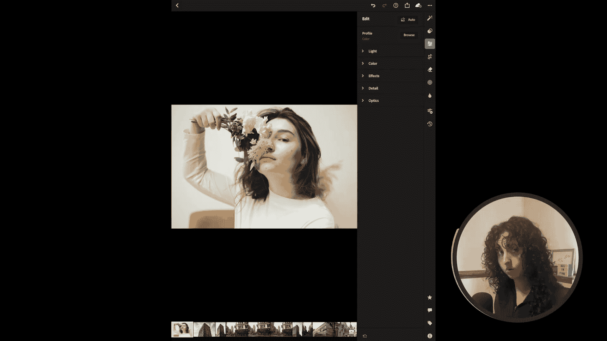

# Complete Adobe Lightroom Megacourse： Beginner to Expert Photo Editing：24：手机端快速修复 📱


在本节课中，我们将学习如何在 Lightroom 手机版上编辑照片。你可以先从素材包中下载这张图片，然后把它导入到手机设备里。我们会回顾在桌面版中学过的那些技巧，并看看如何把它们应用到手机端，让你了解两个版本之间的区别以及具体的操作流程。

手机端和桌面版的面板基本都在右侧，依然包括光线、颜色、效果、细节和光学这些选项卡，同时右侧也有蒙版和移除选项卡。主要区别在于，手机版在蒙版下方多了一个模糊面板，而在桌面版里，这个功能被放在了编辑选项卡中，也就是我们在上一节课中介绍过的内容。除此之外，界面上的主要差异就只有这么一点。

核心概念可以用下面的公式来描述：

```
界面差异 = 手机端蒙版下方模糊面板 - 桌面版编辑选项卡内的模糊功能
```

我们先要做的，就是再次观察这张图片，分析出哪些地方需要修改。这是任何后期处理的第一步，也是决定最终效果的关键所在。

使用手机端后期软件，最主要的原因通常就是想要快速修复，只需点击几下就能完成图片编辑。

以下是快速动作标签页的使用步骤：

- 在右侧找到像魔法棒一样的图标，点击它之后，Lightroom 会自动分析图片，并按照它认为合适的方式进行编辑。
- 快速动作标签页激活后，最上方会显示自动选项。点击自动，程序就会帮你自动完成所有调整。你可以点按并按住来查看修改前后的对比，通常会发现图片变暗了一些，色调也比之前更暖了一点。
- 自动选项下方是增强选项，这里会进一步强化图片细节，如果是风景照片，还可能涉及背景处理。这一部分包含主体、背景和植被三个选项，只针对当前图片生效。增加主体数值时，你可以看到只有主体部分被增强，因为 Lightroom 已经识别并隔离了主体，然后提供滑块来调整它的颜色、光线和细节。
- 背景选项在这里用处不大，但在风景照片中可以派上用场。植被选项指的是绿色植物部分，在我们这张图里就是花朵，如果是风景照，可能是山脉和草地。
- 我打算使用主体按钮，把主体稍微调暗一些。调整完成后，点击应用，此时只对主体做了修改。接着你可以进入主体标签页，添加一些预设，让主体更加突出，调整色温，尝试不同的选项。选好之后，还可以用强度滑块来降低效果强度，同时配合曝光、细节和饱和度进行微调。
- 最后，在右下角点击应用，确认这些更改。

接下来我们要讲的是修图润饰。所谓修图润饰，就是对原始图像进行局部操作。

以下是具体润饰项目：

- 皮肤：放大图片后，你可以看到一些瑕疵。点击皮肤选项，Lightroom 会自动帮你去除瑕疵，这些问题就完全消失了。
- 眼睛：放大后可以看到程序识别出了眼睛，你可以让眼睛变得更明亮。
- 头发：同样的道理，你可以让头发看起来更光滑，或者增加更多细节，全凭你的喜好。
- 衣物：模特现在穿着白色上衣。如果衣物上有很多图案，这个滑块会很有帮助。
- 调整完成后，记得点击应用。

快速动作标签页用完之后，我们还可以再看看背景选项。

以下是背景调整说明：

- 这张图的背景是纯色，本身没有太多细节可供处理。不过你依然可以来到这里，添加一些饱和度和曝光度，随意调整图片效果。
- 重要提示：调整完成后必须点击应用，因为如果你随便点击其他地方，之前的调整就会被取消。

如果你不想使用快速动作标签页，也可以通过其他标签页达到同样的效果。

以下是操作步骤：

- 找到模糊选项下方那个像时钟一样的图标，点击它可以回到原始图片。在操作之前，我先保存当前版本，选择命名创建版本，把它叫做快速编辑，然后点击创建。这样我既可以恢复到原始图片，也随时可以回到刚才保存的这个版本，找回之前的效果。
- 点击应用，然后我们就可以逐一手动调整图片。我会使用和桌面版类似的标签页，内容没有新东西，主要区别在于界面布局和位置放置。
- 关于这部分内容，我们将在下一节课中继续讲解。




本节课中，我们一起学习了在 Lightroom 手机端进行快速修复的方法。我们了解了手机版与桌面版的界面差异，掌握了快速动作标签页的自动编辑、主体增强和背景植被调整，学习了皮肤、眼睛、头发和衣物的修图润饰技巧，还知道了如何在不使用快速动作标签页时保存版本并手动调整。希望这些内容能帮助你在手机上快速上手照片编辑。
