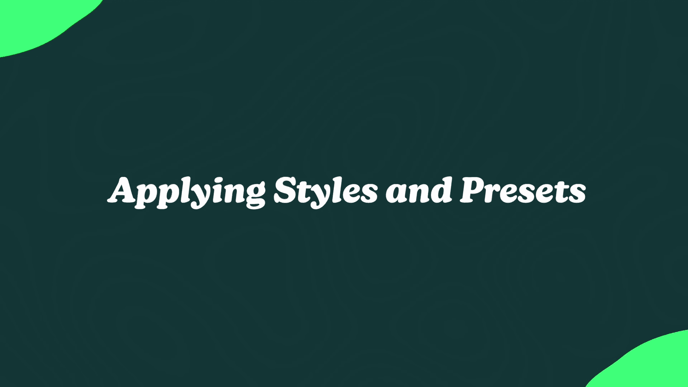
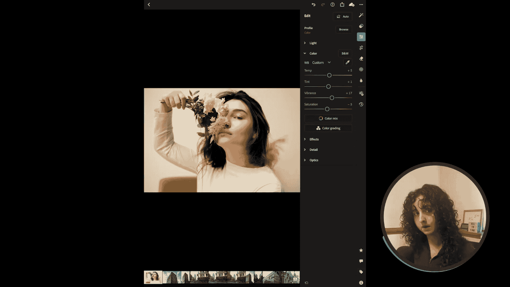
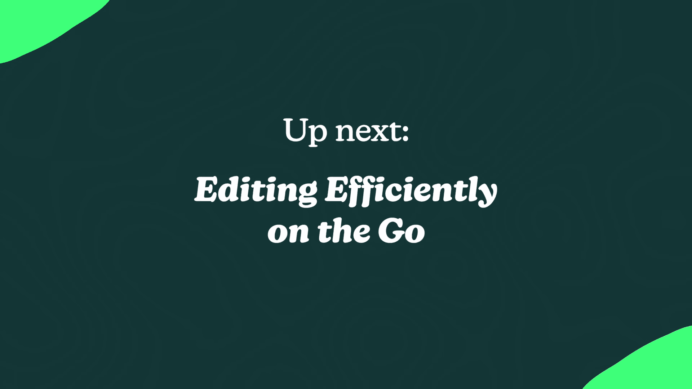

# Complete Adobe Lightroom Megacourse： Beginner to Expert Photo Editing：30：手动编辑图片与应用预设 📸

在本节课中，我们将一起学习如何在手机端的 Adobe Lightroom 里用更手动的方式来编辑图片。虽然软件里有很多自动按钮，但有时候我们需要亲自动手，把光线、颜色和皮肤细节都调整得恰到好处，这样照片才会更符合自己的想法。我们会从重置原图开始，一步步调整光线和色彩，然后用修复工具去掉瑕疵，接着通过遮罩让皮肤变得更光滑，最后还会对眼睛、嘴唇和头发做局部增强，再加一点色彩分级。跟着操作一下来，你就能掌握在移动设备上手动修图的基本流程了。

## 第一步：重置原图并调整光线 💡

在正式动手改之前，我们得先把图片还原成最初的样子，这样才能清楚看到每一步调整带来的变化。打开 Lightroom 之后，找到“之前”和“之后”的切换，回到“版本”里选择“原始”图片，然后点击主页按钮确认进入编辑界面。这时候你会看到一张没有任何修改过的照片，这就是我们的起点。

光线是修图的基础，我们总是从这里开始。这张原图看起来亮度有点过高了，整体感觉发白，缺乏一些立体感。接下来我们要把它变暗一点，增加对比度，再仔细处理高光部分，让图片的层次更分明。你可以把这个过程理解为给照片打地基，光线不舒服，后面调再多颜色也没用。

以下是光线调整的常用操作：

```text
最终亮度 = 原始亮度 - 降低曝光度 + 对比度增强
高光处理 = 避免亮部过度曝光
阴影处理 = 把暗部细节找回来
```

- 降低曝光度，让整体亮度变暗
- 提高对比度，让明暗差异更明显
- 调整高光，避免亮部过度曝光
- 调整阴影，把暗部的细节找回来

把光线调整好之后，我们的图片已经有了一个比较舒服的底子，这时候就可以进入色彩调整阶段了。

## 第二步：平衡色彩与色温 🎨

光线设定完成以后，接下来就是处理颜色了。色彩平衡的目的是让照片看起来更自然，或者按照你想要的风格来呈现。我们先把色温调暖一点，让画面多一些暖阳光的感觉，然后再稍微加一点色调，让整体色彩更协调。饱和度可以稍微降低一点，避免颜色过于刺眼，这样人像的肤色会显得更自然。

以下是色彩调整的关键参数：

```text
最终色彩 = 原始色彩 + 色温 + 色调 - 适当降低饱和度
```

- 色温：控制画面偏暖还是偏冷，数值越大越暖
- 色调：在绿色和品红之间做平衡，修正肤色偏差
- 饱和度：决定颜色的浓淡程度，适当降低会更自然
- 自然明度：增强暗部颜色，不过度影响亮部

色彩调整完成之后，照片的整体氛围已经出来了，接下来我们可以开始处理皮肤上的小瑕疵了。

## 第三步：使用修复工具去除瑕疵 🩹

这时候我们要用到修复工具，把脸上的痘痘、雀斑或者其他小瑕疵去掉。在 Lightroom 手机版里，修复、修复和克隆功能都集成在一个按钮里，你可以选择使用人工智能辅助，也可以手动操作。具体做法是选好笔刷大小，然后在想要去除的区域上画一下，松开手指后软件会自动处理，你也可以在细化标签页里对比不同的修复效果，选一个自己喜欢的。

以下是去除瑕疵的步骤：

```text
修复结果 = 笔刷大小 × AI 修复算法 × 单次笔画选区
```

- 点击修复工具按钮
- 选择 AI 模式或手动模式
- 调整笔刷大小，覆盖瑕疵区域
- 只画一笔，不要抬手中途停顿，否则选区会被锁定
- 逐个处理每个瑕疵点，直到皮肤干净

需要注意的是，如果几个瑕疵之间的光线比较接近，可以一次性选一个大区域，因为 AI 工具本身就很精准，不容易出错。用两个手指可以在画布上移动，方便找到需要处理的位置。最后一个要处理的是额头上的斑点，因为都在同一块区域，直接画一个大选区就行。全部处理完之后，点击右下角的应用按钮，所有修改就会一次性生效，瑕疵就全部去除了。

瑕疵去掉之后，皮肤虽然干净了，但可能还是显得有点粗糙，这时候就该用遮罩来磨皮了。

## 第四步：使用遮罩磨皮 🖌️

下一步我们要用遮罩功能让皮肤看起来更光滑。点击加号按钮，选择画笔遮罩，这时候流量可以设大一点，比如 76 左右，再调整笔刷大小和羽化程度。羽化是让选区边缘更自然，避免出现生硬的边界线。然后在皮肤区域轻轻刷一遍，给皮肤一个更细腻的质感，但要避开眼睛、嘴唇和眉毛这些需要保留细节的地方。

以下是磨皮遮罩的设置要点：

```text
羽化边缘 = 选区边界 + 模糊半径
纹理降低 = 原始纹理 - 调整值
```

- 流量：控制笔刷的覆盖强度，建议设为 76 左右
- 大小：根据皮肤区域调整笔刷范围
- 羽化：让选区边缘更柔和，避免痕迹明显
- 纹理：在效果面板里适当降低，让皮肤更平滑

如果不小心刷到了不该刷的地方，可以用画笔下面的橡皮擦图标，把多余的部分擦掉。全部涂抹完成之后，到右侧的效果面板，把纹理参数调低，这样皮肤就会呈现出一种柔滑的状态。对比之前和之后的效果，你会发现这是一个非常简单但很有效的修图小技巧。

皮肤处理完了，接下来我们可以给眼睛和嘴唇做一些局部的增强，让五官更有神采。

## 第五步：局部增强眼睛与嘴唇 👁️💋

和之前的做法类似，我们要为眼睛单独建一个遮罩。还是选用画笔工具，在眼睛区域画一个选区，然后进入光线面板，把阴影值调高一点，这样眼睛里的颜色会更突出，目光会更有神。接下来再建一个嘴唇的遮罩，同样用画笔涂抹嘴唇区域，用橡皮擦把边缘不规整的地方清理干净。

以下是眼睛和嘴唇的局部调整方法：

```text
眼睛增强 = 提高阴影值 + 让颜色更突出
嘴唇增强 = 提高自然唇色饱和度 + 调整色相
```

- 眼睛遮罩：进入光线面板，提高阴影，让眼神更有神采
- 嘴唇遮罩：进入色彩面板，提高自然唇色的饱和度
- 嘴唇色相：可以稍微调整色相，改变嘴唇的颜色偏向
- 嘴唇纹理：在效果面板里稍微降低纹理，让嘴唇更柔软

如果边缘看起来还是有点粗糙，可以用橡皮擦再仔细修一下，同时增加羽化值，在选区边缘周围多滑动几次，让过渡更自然。调整完成之后点击应用，眼睛和嘴唇的局部增强就都做好了。

除了人脸，头发部分也可以单独处理，最后再给整张图片加上色彩分级。

## 第六步：头发调整与色彩分级 💇‍♀️🌈

头发的处理方法跟前面差不多，先粗略地选一下头发区域，不需要非常精准，然后进入光线面板，点击黑色阶并把它调低。这样做的好处是只会影响到头发里的深色部分，不会不小心改变到皮肤或背景，因为我们只针对黑色调进行操作。调整完成之后点击应用，头发的效果就出来了。

以下是头发调整和色彩分级的核心步骤：

```text
头发黑色阶 = 降低黑色值，仅作用于头发深色部分
色彩分级 = 原始颜色 + 阴影色调 + 中间调色调 + 高光色调
```

- 头发遮罩：粗略选取头发区域
- 黑色阶：降低黑色值，只作用于头发深色部分
- 阴影色彩分级：给暗部添加特定颜色
- 中间调色彩分级：给中间亮度区域添加颜色
- 高光色彩分级：给亮部添加特定颜色

最后一步是给整张图片做色彩分级。思路跟之前一样，分别调整阴影、中间调和高光的颜色，这样照片就会有更统一的电影感或复古感。调整完成之后，整个手动编辑流程就结束了。你会发现，虽然是在手机上操作，但思路和桌面版的章节是完全一样的，只是界面显示方式不一样而已。

本节课中，我们一起学习了在 Lightroom 手机版里手动编辑图片的完整流程：从重置原图、调整光线、平衡色彩，到去除瑕疵、磨皮、局部增强眼睛和嘴唇、处理头发，最后再加上色彩分级。每一步都用大白话和实际操作演示了出来，希望对你有帮助。





下一节课，我会教你怎么制作预设并使用它们，这样你就有了另一种快速编辑图片的方法，不需要每次都从头开始调整参数。

