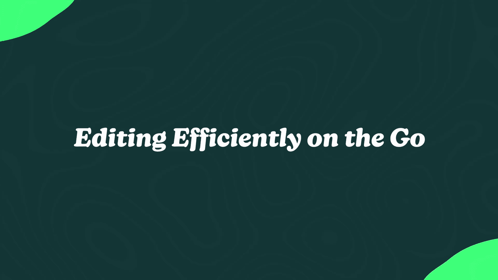
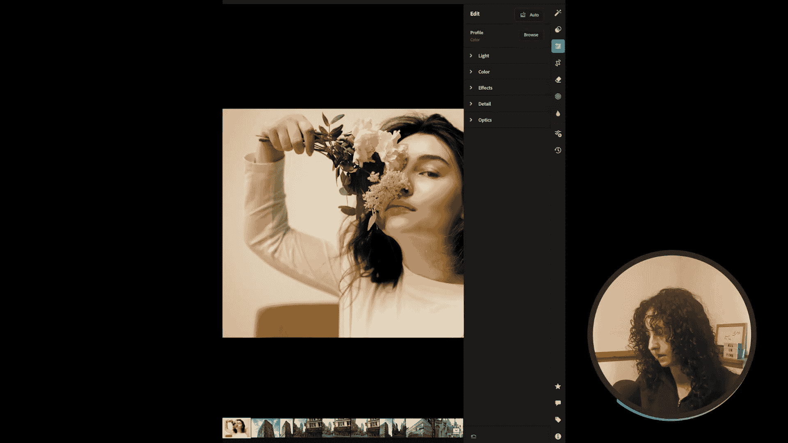
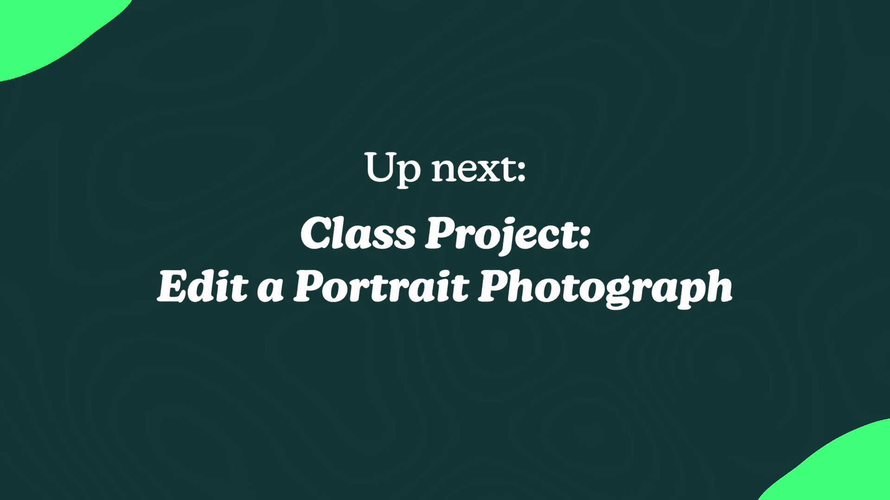

# Adobe Lightroom 从入门到专家：第 26 节：高效移动端修图 📱

在本节课中我们将要学习如何在手机上快速完成照片修图，把喜欢的色调保存成预设，再把预设套用到多张人像照片上，还会了解如何使用系统推荐预设和 AI 工具，让整个修图过程变得更加高效。

## 保存你的修图风格为预设

上一节我们介绍了如何给人像照片上色，本节中我们来看看如何把已经调好的风格保存下来，方便下次直接套用。当你修好一张照片，觉得这个色调很好，想要应用到多张人像照片上时，最好的办法就是把当前的所有调整参数保存成一个预设。这样你就不需要每次都从头开始调整光线和色彩，只需点击一下就能把同样的效果复制到其他照片里，省去大量重复劳动。

以下是创建预设的具体操作：

- 点击右上角的三个点，选择创建预设
- 给预设起一个名字，比如“暖色人像”
- 勾选默认选项，保存到“用户预设”组
- 点击对勾完成保存

**预设 = 当前所有调整参数（光线、色彩、效果等）保存为一个可复用文件**

保存完成后，你可以随时回到原图，进入预设面板，找到刚才新建的“暖色人像”，点击一次，同样的色彩分级就会立刻套用到照片上。

## 应用预设并注意局限性

保存好预设之后，我们需要知道怎么把它用到其他照片里，同时也要明白预设能做什么，不能做什么。当你把预设应用到一张新照片上时，色调会立刻变得和之前一样，但是预设不会清除皮肤上的瑕疵。这是因为去除瑕疵和蒙版属于单独的局部调整，每张照片的构图和人物位置都不同，所以无法直接把去瑕疵和蒙版效果复制到其他图片上，这些内容还是需要一张张单独处理。

即使如此，你仍然可以通过版本面板找回之前保存过的效果，点击应用后就能得到同样的色调版本，而你调整好的色彩分级会一直保存在用户预设里，方便以后反复使用。

## 管理和更新已保存的预设

有了预设以后，你可能还需要对它进行修改、重命名或者分享给别人。点击预设旁边的三个点，你可以用当前的设置来更新它，也可以给它改个新名字，导出给其他人使用，或者直接把它删除。你也可以把当前的修图版本另存为“暖色”，这样以后想要找回这个效果时，只需要在版本列表里选择它并点击应用即可，不需要重新调整。

## 使用系统推荐预设快速试色

如果你不确定自己的照片适合什么颜色风格，可以让 Lightroom 自动帮你推荐合适的预设。在预设标签页的最上方，有一个叫做“推荐”的选项，它会分析你的当前图片，然后列出一系列适合这张照片的预设供你尝试。你可以逐个点击这些预设来预览效果，觉得哪个更合适就点击底部的“应用”，不到一分钟就能完成整个色彩分级过程。

以下是使用推荐预设的步骤：

- 打开预设面板
- 点击顶部的“推荐”
- 浏览系统分析后给出的预设列表
- 点击喜欢的预设并点击应用

## 将预设与快速皮肤修复组合使用

只上色通常还不够，我们在修人像照片时，往往还需要去掉脸上的痘痘和瑕疵。这时候你不需要重新做一遍除瑕操作，可以直接进入修饰面板，选择皮肤选项，系统会自动帮你去掉大部分瑕疵，让皮肤看起来更干净。这时候你就把预设和自动快速修复这两个功能结合在一起了，既保留了喜欢的色调，又节省了大量手动修图的时间。

如果你想高效修图，强烈建议建立自己的一套预设库，然后配合这些自动工具，这样就可以快速批量处理大量照片了，修图速度会提升很多。

## 探索高级预设组合和 AI 效果

除了自己制作的预设，Lightroom 还内置了很多专业的预设组供你探索。在高级标签页里，有一个叫做“适配人像”的选项，它会使用 AI 技术分析你照片里的主体，把色调自动适应到人像上，从而给照片带来不一样的视觉效果。常见的 AI 人像预设包括美白牙齿、顺滑头发、深化胡须等等。如果你点击其中某个效果，可以再次点击它来调整强度，然后点击底部的“应用”来确定。

你可以读一下这些预设的标题，看看是否适合你当前的照片。比如你可以在皮肤修复的基础上，再叠加一个复古风格的预设，然后进入光线面板继续微调，直到自己满意为止。这些预设甚至会自动添加锐化和降噪，旁边还有磨皮选项可以进一步使用，让人像照片看起来更精致。

## 在不同照片之间复制完整设置

如果你想把一张照片上的全部调整直接搬到另一张照片上，可以使用复制设置功能。在 Lightroom 手机版右上角点击三个点，然后决定要复制哪些内容。建议取消勾选几何变换，只保留光线、色彩、效果等任何照片都能通用的参数，点击对勾之后，这些设置就会被复制到剪贴板。接下来打开一张还没有任何修图的随机照片，再次点击三个点，选择粘贴设置，这样第一张照片上的所有调整就会完整套用到第二张照片上。

**复制设置 = 勾选【光线、色彩、效果】，取消勾选【几何】 → 复制到剪贴板 → 粘贴到目标图片 → 根据新构图手动微调**

粘贴完成后，因为第二张照片的构图完全不同，你可能还需要回到调整面板做一些进一步的微调，让效果更合理，而不是盲目套用。

## 利用版本管理完成最终修图

修图的过程中如果你不喜欢当前的效果，可以随时回到之前保存过的版本。你可以回到之前的版本“暖色 2”并点击应用，这样就能完成最终的修图工作。这就是在手机 Lightroom 里高效修图的完整流程，我们学习了一些 AI 工具和非 AI 工具，大部分功能在桌面版本里也能找到，但在手机上操作更有趣，因为当你时间紧迫或者只是想随便试试的时候，只需要点击几个标签页就能完成很多操作，不需要复杂的步骤。

只要你把所有内容都保存在版本标签页里，或者保存成预设，就不用担心找不到满意的效果，随时可以回到自己喜欢的状态，在已有经验的基础上继续改进，不用担心修图走错路。

本节课中我们一起学习了如何保存预设、如何应用预设、如何使用系统推荐预设、如何把预设和皮肤修复结合起来、如何探索 AI 人像预设组、如何在不同照片之间复制设置，以及如何利用版本管理完成高效的移动端修图。希望你能跟着一起动手操作，也希望你享受 Lightroom 手机版提供的各种新工具。
