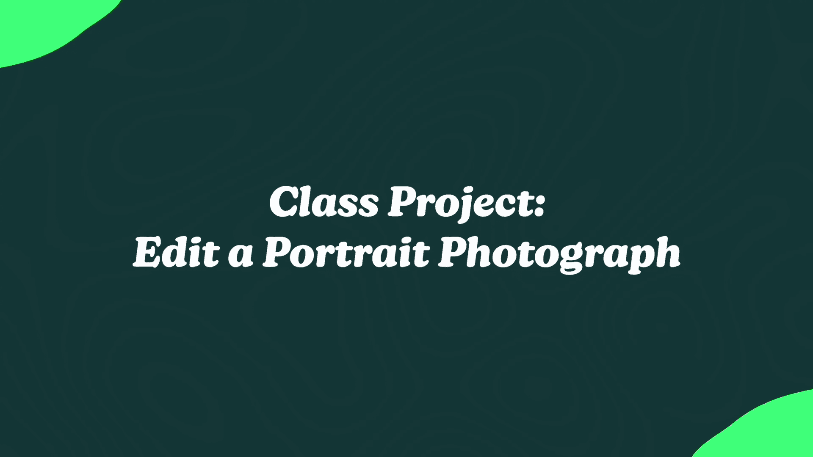
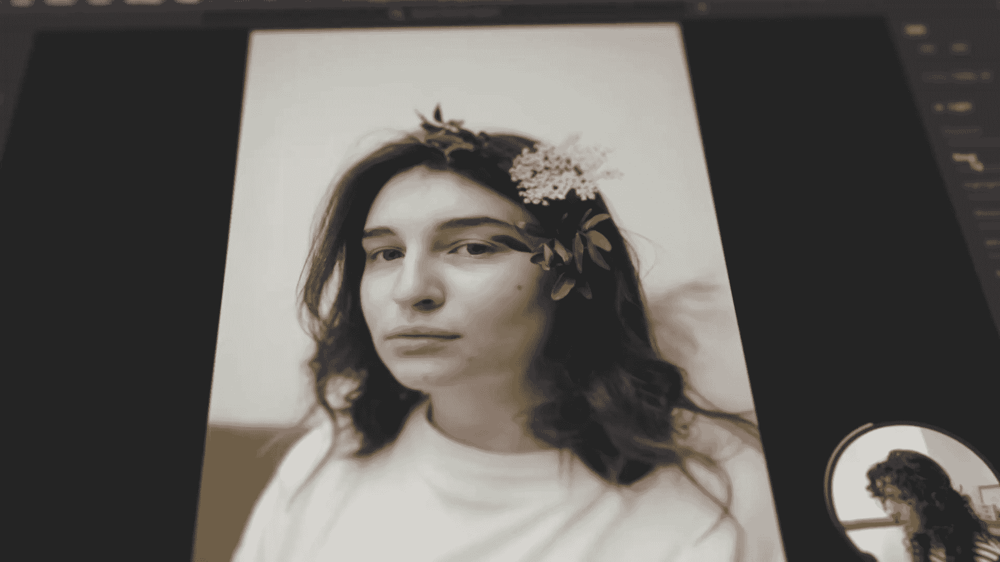
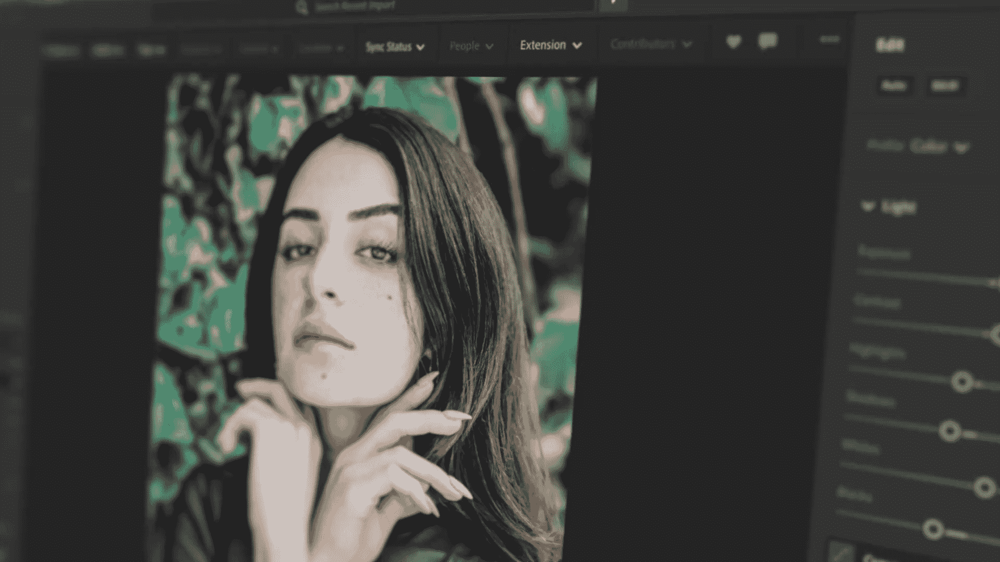
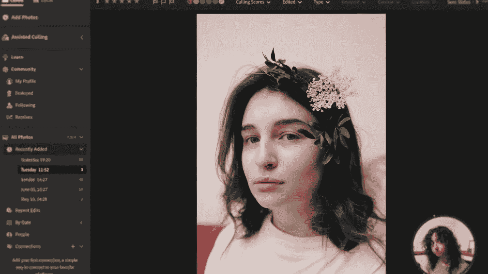

📸 Complete Adobe Lightroom Megacourse： Beginner to Expert Photo Editing：part1 p32 27：编辑人像照片（课堂项目）


## 课程概述


在本节课中，我们将学习如何使用 Adobe Lightroom 从头开始编辑一张人像照片。这是课堂项目环节，你需要把之前学过的所有照片编辑技能全部用上。我们会先分析图片，再确定需要改进什么，最后重点处理模特的眼睛、嘴唇、鼻子和头发，让拍摄对象在画面里更突出。


## 从零开始编辑人像照片


在了解了课程概述之后，接下来我们进入具体的编辑步骤。你将要从零开始编辑一张人像照片，使用到目前为止学到的所有技术。和往常一样，动手之前先分析你的图片。在你确切知道需要针对什么，需要改进或者改变什么之前，不要碰任何滑块。在分析的过程中，要特别留意光线、颜色，以及你可能漏掉的任何瑕疵，同时也要想想整张照片在风格和个人审美方面应该呈现什么样子。


## 人像照片的编辑重点


完成基础分析后，针对人像照片还有几个特别需要注意的地方。因为这是一张人像照片，你的核心任务是增强模特的细节和面部特征。你需要重点关注眼睛、嘴唇、鼻子、头发，并且要确保照片里最吸引人的地方是你的拍摄对象。


以下是人像编辑时需要重点处理的部位：


- 眼睛
- 嘴唇
- 鼻子
- 头发


人像照片编辑的核心逻辑可以用下面这段伪代码来描述：


```
人像编辑流程：
1. 分析原图（光线、颜色、瑕疵、整体风格）
2. 确定改进目标，不动任何滑块
3. 增强模特细节（眼睛、嘴唇、鼻子、头发）
4. 让拍摄对象在画面中突出
```


## 课堂项目的目的




掌握了具体的编辑重点后，我们再来看看这个课堂项目对你的学习意味着什么。这个项目是一个练习专业照片编辑的好机会，可以帮你把所学技能应用到实际操作中，同时也能让你更接近形成自己的个人编辑风格。祝大家好运，我非常期待看到你的作品。




## 本节总结




本节课中我们一起学习了如何从头开始编辑一张人像照片，包括先分析图片、不动滑块直到明确目标、关注光线颜色瑕疵和风格、增强模特面部细节以及让主体突出。希望你能通过这个课堂项目把所学技能用上，并逐渐发展出自己的编辑风格。

