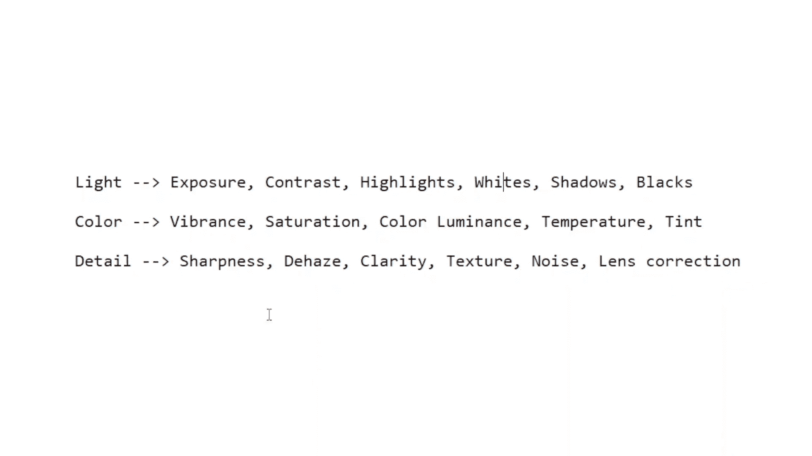

# Adobe Lightroom 从入门到精通照片编辑完整教程：第28节：Lightroom 简介与照片编辑三大核心要素 📸


在本节课中，我们将学习什么是经过正确编辑的图片，以及构成一张好照片的核心因素有哪些。我们会聚焦于后期编辑阶段需要关注的要素，而不是拍摄时使用的相机参数。核心因素非常简单，但要熟练掌握需要时间。这三个要素就是光线、色彩和细节。你可以把它们看作照片编辑的基石，缺少任何一个，图片都会显得不完整。

以下是一张好照片的核心公式：

```text
好照片 = 光线 + 色彩 + 细节
```

如果只满足其中两项而缺失另一项，图片就是不完整的。比如曝光完美、高光与阴影平衡、色彩饱和且和谐，但如果图片模糊不清，那么就没有按正确的方式编辑图片。反过来也是成立的，如果色彩完美、细节锐利、色彩协调，但图片曝光不足，结果依然是不完整的。无论你编辑的是黑白照片、微距照片还是科幻风格图片，无论是什么风格或类别，这三个因素都必须出现在图片中。

下一节我们将具体看看每个因素在 Lightroom 中如何体现。当我们查看任何照片编辑软件时，都会遇到这些标签页。虽然我主要关注 Lightroom，但你在其他软件中也能找到这些功能。现在我们先从光线开始讲起。

Light 在 Lightroom 中包含以下类别：

- 曝光，也就是整体图片的亮暗程度。
- 对比度，即图片中光与暗的差异。
- 高光，指图片中最明亮的部分。
- 白色，指图片中的白色部分。
- 阴影，指图片中最暗的部分。
- 黑色，指图片中的暗部。

当我们控制每一项时，我们就在控制图片的亮度。这使我们能够看到图片中的另外两个部分，即色彩和细节。如果图片中没有光线，我们一开始就无法看到色彩或细节。

所以光线是最重要的东西。光线在一切事物中都起着重要作用。没有光线，我们就无法看到色彩或细节。编辑图片时，你要确保调整每一项，让图片清晰可见，主体光线充足。我们将在后续课程中学习如何控制每一项，以及它们在示例图片中的作用。

光线控制的公式如下：

```text
光线控制 = 曝光 + 对比度 + 高光 + 白色 + 阴影 + 黑色
```

接下来我们来看色彩。现在，在 Lightroom 中对色彩有贡献的要素包括自然饱和度、饱和度、颜色亮度、色温和色调。色相和饱和度中的 H 也算在内，校准功能也是。但这些属于可选的加分项，不像前面提到的那些那么关键，所以这里暂不赘述。

色彩控制的公式如下：

```text
色彩控制 = 自然饱和度 + 饱和度 + 颜色亮度 + 色温 + 色调
```

自然饱和度针对的是图片中原本不够饱和的部分。比如天空是非常浅的蓝色，我们就需要使用自然饱和度滑块来给该区域增加更多色彩。而饱和度这两个容易让初学者混淆，很多人刚开始时不知道哪个是哪个，先用哪个，这完全正常。饱和度控制的是颜色的强度。如果天空非常苍白，加了一些自然饱和度后，你可以再调整想要的蓝色强度。把饱和度调高，颜色会非常强烈，看起来几乎像卡通片。把它调到最低，就去除了所有强度，图片变得没有颜色。编辑图片时，你应该先用自然饱和度来确定颜色，先识别并挑选出这些颜色，然后再调整想要的强度。

下一个是颜色亮度。亮度指的是亮度，颜色指的是颜色。也就是说，我们在谈论颜色的亮度。再拿蓝天举例，你是希望蓝色更浅，还是更暗？这里说的不是蓝色的色调，而是图片中颜色的亮度和暗度。在后续课程中，我们会学习它的工作原理，以及它关乎的是亮度而非颜色的色调。不要把这两个概念混淆，它们不是同一件事。

接下来是色温。顾名思义，它关乎图片是暖还是冷。很多时候，色温用于平衡图片中的色彩，或营造特定氛围。比如电影中的闪回片段，常常使用暖色调来营造温暖友好的氛围。而如果想表现神秘、悲伤或遥远的感觉，则会使用冷色调。所以你可以用色温来设定氛围和平衡色彩。假设你的图片中有很多蓝色，比如海洋照片配上非常蓝的天空，大片蓝色，你可以用色温来平衡。另一个帮助平衡图片和营造氛围的要素是色调。色调不同于色温，它有一个滑块，可以向洋红或绿色两个方向调整。这两个选项同样能营造特定氛围，并与已有的颜色相得益彰。我们将在后续课程中学习它们如何影响图片，所以现在觉得有点困惑也不用担心，你会逐渐了解每个要素的作用。

最后我们来看细节。如前所述，没有细节的图片是不完整的，因为我们无法真正看到主体的清晰度以及主体在哪里。即使图片完全模糊，也无法识别主体，人眼自然也无法聚焦。如果你在 Instagram 上刷到一张完全模糊的图片，它不会吸引你的目光，你只会划过去。这就是细节非常重要的原因，高度清晰的图片才能抓住眼球。但同样，不要过度添加细节，导致图片充满噪点，看起来歪歪扭扭。我们将在后续课程中看到这种情况如何表现。

对图片细节有贡献的滑块包括以下几项：

- 锐化，关于图片中已有边缘的清晰度。
- 除雾，去除图片上的雾气。
- 清晰度，在边缘处突出纹理。
- 纹理，增强图片表面的纹理。
- 噪点，需要降低以平衡图片。
- 镜头校正，修复镜头误差。

锐化是关于图片中已有边缘的清晰度。比如你的主体戴着眼镜，眼镜边缘已经存在，你会用锐化来进一步增强眼镜边缘。你不是在添加新内容，而是在增强已有内容。除雾与锐化无关，但它能去除图片的雾气。拍照时，图片通常带有一层雾，除雾可以帮助去除，从而为图片增加大量细节。从个人角度说，这是我最喜欢的滑块，因为稍微移动一点就能产生很大效果。但再次提醒，和任何其他滑块一样，也要小心不要过度使用。

清晰度会在边缘处突出纹理。如果边缘看不太清，几乎看不见，就用清晰度将其进一步凸显。清晰度也会影响没有边缘的区域。以某人的脸为例，增加清晰度时，不仅会增强嘴唇等区域，还会突显毛孔或皮肤纹理。同样，这不是你想过度使用的东西。它也会影响图片的光照，所以在编辑图片时，这是一个非常有效的工具，建议逐步使用，避免图片看起来歪歪扭扭。

纹理是关于图片纹理的。比如拍摄木盒照片，木盒本身已经有很多纹理。使用纹理滑块时，我们是增强该部分的纹理，而不是锐化，两者不是同一回事。再看另一个例子，如果拍摄橙子照片，橙子表面有纹理，你会用纹理选项卡来进一步突出橙子上的小凸起。纹理在微距摄影或非常特写的主体或物体图片中用得很多。

在使用这些工具时，你往往会产生噪点。噪点分为两类：彩色噪点和普通噪点。噪点表现为图片上到处的小点，有时只出现在某些部分。拍照时它们就已经存在，看到它们不必担心。但使用这些工具时，你倾向于增加噪点。所以在使用完这些工具后，你需要确保降低噪点，以平衡图片。噪点会表现为遍布图片的小点，你只需降低并平滑这些区域，而不影响边缘和图片的清晰度。我们将在后续课程中看到它们的样子。

接下来是镜头校正。如前所述，拍照时你的镜头会有一些误差。这不是你需要担心的事情，每个相机的每个镜头都会发生。具体表现为，首先，画面角落可能变暗或变亮，你需要修复这一点。有时图片会产生鱼眼效果，你可以在镜头校正中修复该效果，或者如果图片看起来太平，也可以在镜头校正中添加鱼眼效果。在镜头校正中，还有一个称为色差的东西。它看起来是自然现象，会像颜色团块一样出现，通常是蓝色或紫色等颜色，会出现在物体或主体的角落或边缘。假设你有一张抽屉的照片，如果抽屉边缘有色差，边缘会出现一条绿线，这就是色差。你可以通过自动移除，告诉 Lightroom 移除它，或者手动去除图片中的颜色。我们将在后续课程中看到具体效果。

这些就是任何照片的原则，无论你是在拍照还是编辑图片，都应该始终牢记。我们将看到示例，了解这些要素如何整体影响图片。下节课我会展示示例，我们可以进一步讨论这些要素的重要性。下节课见。



本节课中，我们一起学习了 Lightroom 简介以及照片编辑的三大核心要素：光线、色彩和细节。我们了解了光线中的曝光、对比度、高光、白色、阴影和黑色；色彩中的自然饱和度、饱和度、颜色亮度、色温和色调；细节中的锐化、除雾、清晰度、纹理、噪点和镜头校正。希望这些内容能帮助你建立起对照片编辑的整体认识。
