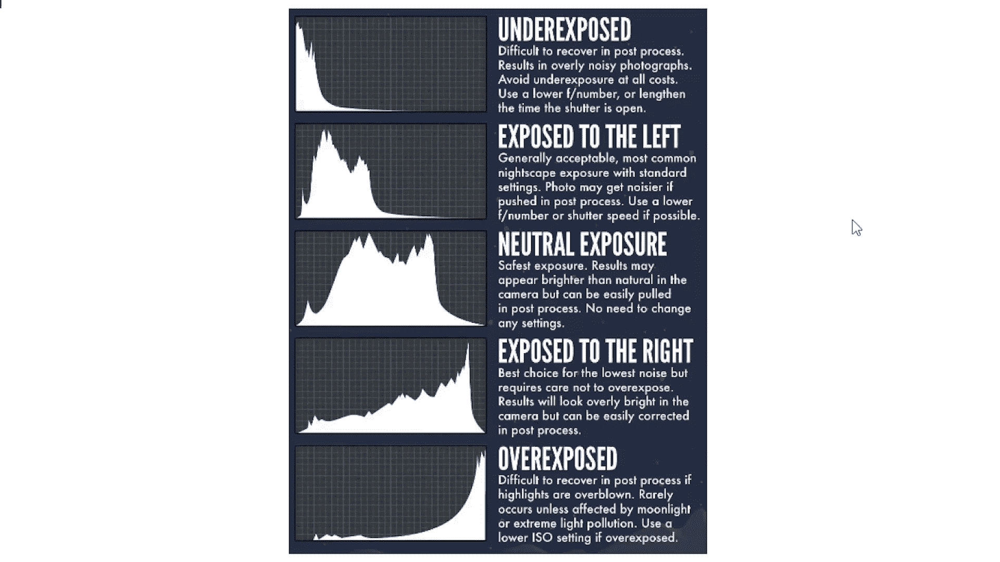

# Adobe Lightroom 从入门到专家照片编辑全攻略：34：29 - 光线与曝光基础 📸


在本节课中，我们将要学习 Lightroom 中的光线调整基础，重点掌握曝光滑块的作用，以及如何通过直方图判断图片是否曝光正确。我们会用大白话把欠曝、过曝和正常曝光讲清楚，让初学者也能快速上手后期修图。

首先，我们来聊聊为什么光线是照片编辑的第一站。在 Lightroom 里，当你打开一张图片准备修图时，最先要处理的往往就是整体亮度。不管你是用手机还是相机拍摄，有时候拍出来的照片会太暗或者太亮，这时候就得靠后期来补救了。

以下是光线调整中最核心的几个概念：

- **曝光（Exposure）**：决定照片整体明暗的核心参数。
- **欠曝（Underexposed）**：照片太暗，细节藏在阴影里。
- **过曝（Overexposed）**：照片太亮，高光部分全白，细节丢失。
- **直方图（Histogram）**：用来判断曝光是否合理的图表工具。

曝光是你拍照时最该关注的设置之一。简单来说，曝光决定了相机感光元件接收到多少光线。如果曝光不足，照片就会很暗；如果曝光过度，照片就会发白。在 Lightroom 里，曝光滑块就是用来事后补救的工具。

你可以把曝光滑块的作用理解为下面这样：

```
曝光调整 = 原始亮度 + 滑块数值
```

当你把滑块向右拖动，照片变亮；向左拖动，照片变暗。这就是后期修图中最基础的操作。

上一节我们介绍了 Lightroom 开发模块的基本界面，本节中我们来看看具体怎么调整光线。

现在，假设你拍了一张夜景或者室内照片，结果出来后发现画面一片漆黑，几乎看不清任何东西。这时候，欠曝就发生了。欠曝的照片通常会有以下特征：

- 主体人物隐藏在阴影中，面部特征模糊。
- 桥梁、水面等场景细节难以分辨。
- 天空的蓝色被暗淡的黑色取代。

如果你把这样一张照片当成最终成品，基本上没法发布，因为什么都看不见，这显然是一张失败的作品。

幸运的是，Lightroom 提供了后期编辑功能，让你有机会挽救欠曝的图片。你可以使用曝光滑块来提亮整体亮度，再结合下方的其他调整面板进一步优化光线。

不过，在开始修图之前，你还需要了解一个关键工具，那就是选择性调整。Lightroom 不仅能全局调整曝光，还能让你只修改照片的某一部分。

以下是常见的选择性调整工具：

- ** graduated filter（渐变滤镜）**：适合处理从上到下亮度渐变的区域，比如天空和地面。
- ** Radial filter（径向滤镜）**：适合在圆形或椭圆区域内做局部调整，例如照亮人物脸部。
- ** adjustment brush（调整笔刷）**：像画画一样，只在你刷过的地方改变曝光。

有了这些工具，你就不需要把整张照片都变亮或变暗，可以精准地控制哪里亮、哪里暗。

当你进入 Lightroom 的开发模块，右上角第一个映入眼帘的就是直方图。它是一个非常有帮助的工具，用来判断你的图片是否曝光正确，或者是否欠曝。

直方图的基本含义可以用这个简单的逻辑来理解：

```
直方图左侧 = 暗部像素分布
直方图右侧 = 亮部像素分布
直方图中间 = 中间调像素分布
```

通常直方图会显示颜色，不过在只讨论光线的时候，我们暂时把它当作白色图表来看。当你改变曝光时，直方图里的小形状也会随之变化。

如果直方图的白色条全部堆在左边，那就意味着你的照片严重欠曝。这时候，想要在后期把图片救回来会非常困难。

虽然 Lightroom 确实可以尝试修复欠曝照片，但这里有一个代价：如果你强行把一张黑照片拉亮，图片里会产生大量噪点，甚至出现色差。要想修出好效果，最好是原始文件是 RAW 格式，细节丰富，文件体积较大。

如果你的照片是 JPEG 格式，而且又是严重欠曝，那么勉强修图很可能会让画面更糟，噪点和色差会一起出现，最终毁掉照片。

除了欠曝，我们也要了解过曝的情况。过曝就像有人把手电筒直射你的眼睛，照片亮得让人睁不开眼，基本上就毁了。

特别是当你直接对着太阳拍摄时，没有特殊的相机设置，照片几乎必定会过曝。这时候，即使是后期高手也很难完全挽救，更何况是刚开始学习的新手。

所以，最稳妥的做法就是拍摄时尽量避免这两个极端：不要太暗，也不要太亮。如果拍出来的效果不理想，不妨重新拍一遍，而不是指望后期能做奇迹。

在实际拍摄中，不同类型的照片对曝光的要求也不一样。比如夜景照片，你其实不想把图片完全曝光，因为你要捕捉星星和月亮。这时候，适度的欠曝是可以接受的，只要不是那种一片漆黑的糟糕欠曝。

理想的状态是让直方图稍微偏向中间，介于欠曝和正确曝光之间。这种曝光对于人像或风景照来说是最安全的，也能让你在后期对色彩和细节有更多控制权。主体通常靠近相机，能够清晰可见，而且几乎不用担心噪点问题。即使出现了一点点噪点，也很容易去除。

如果直方图偏向右侧，这属于介于最差和最好之间的情况。比如晴天拍摄蓝天，照片不是完全过曝，而是曝光得比较合理，这时候你可以用后期编辑进一步增强光线。

下面是几种常见场景的曝光建议：

- **夜景拍摄**：适度欠曝，保留星星和月亮的亮度，后期可适当加暗天空。
- **人像与风景**：追求正确曝光，主体清晰，细节丰富，后期控制空间最大。
- **晴天蓝天**：略微偏右但不过曝，后期可微调光线。
- **直接对太阳拍摄**：极易过曝，应尽量避免。

综上所述，最佳的曝光设置取决于你拍摄的是什么类型的图片。不要过度纠结于那三种中间状态，最重要的是避免严重欠曝和严重过曝。如果你是新手，建议多观察直方图，争取在拍摄时就拿到一张亮度合适的原片。

现在我们知道了光线在照片里大概是什么样子，接下来可以回头去看看颜色的问题了。而我们需要避免在设置颜色时出现的错误，我将在下一课中和你继续分享。



在本节课中，我们一起学习了 Lightroom 中的光线基础知识，重点掌握了曝光滑块的作用，了解了欠曝和过曝的表现，学会了如何通过直方图判断曝光是否合理，并了解了不同拍摄场景下的曝光选择。希望这些内容能帮助你在后期修图时更加得心应手。
