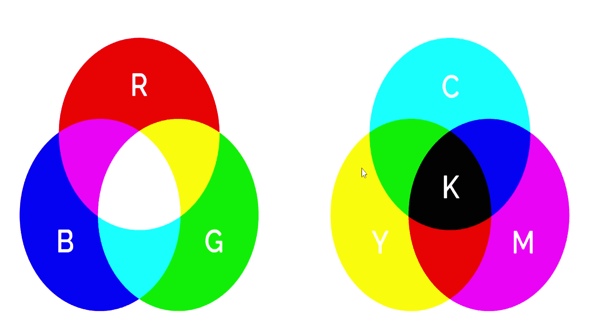

# Complete Adobe Lightroom Megacourse： Beginner to Expert Photo Editing part1：30：颜色 🎨

在本节课中我们将要学习关于颜色的基础知识。我们会聊聊传统绘画里的原色和数码摄影里的原色有什么区别，还会了解RGB和CMYK这两种颜色模式在Lightroom里是怎么工作的。最后我们会通过一个实际的例子，看看什么叫过度饱和，以及它为什么会破坏一张照片的细节和氛围。这部分内容对后续的色彩调整非常重要。现在我们正式开始。

在进入具体的软件操作之前，我们需要先搞清楚颜色是怎么分类的。你可以把颜色想象成做蛋糕的原材料。假设你经营一家小蛋糕店，蛋糕都是你自己烤的。在传统的美术课上，老师告诉我们的三原色是红色、黄色和蓝色。你可以把它们看作是制作蛋糕时用到的面粉、鸡蛋和糖，是最基本的材料。

但数码世界不一样。在数码摄影和数码图像里，三原色变成了红色、绿色和蓝色。我们可以用代码来表示这个关系：

`数字原色 = 红色 + 绿色 + 蓝色`

也就是RGB。这是所有数字图像的核心。照片里的每一个像素，都是由红色、绿色和蓝色不同比例的光混合而成的。

以下是传统原色和数字原色的主要区别：
- 传统原色：红色、黄色、蓝色，用于绘画和颜料混合。
- 数字原色：红色、绿色、蓝色，用于屏幕显示和数码摄影。

了解了屏幕上的颜色之后，我们再看看如果要把照片打印出来，颜色模式会发生什么变化。

如果你想把数码照片打印出来，就好比把蛋糕装进盒子里包装起来。这时候不能再用RGB了，需要换成另一种颜色模式，叫做CMYK。原文里把它写成SMYK，但其实是指青色、品红色、黄色和黑色。这里有个小细节，黑色用K表示，是因为B已经被蓝色（Blue）占用了。我们可以用代码表示：

`印刷颜色 = 青色 + 品红色 + 黄色 + 黑色`

在Lightroom里，如果你想把照片做成照片书或者单张打印，通常需要在打印面板里把RGB数值转换成CMYK数值。在Photoshop里也是类似的操作，你可以在数值设置里把颜色模式从RGB改为CMYK。大多数情况下，这个转换过程是自动完成的，你不需要手动去算每一个颜色的数值。

以下是你在编辑时需要记住的几点：
- 屏幕显示使用RGB，也就是红绿蓝。
- 打印输出使用CMYK，也就是青品黄黑。
- 你在Lightroom里看到的调整面板，全是基于RGB的。

颜色模式搞清楚了，接下来我们来看一个实际的图片例子，聊聊什么叫过度饱和。

下面这张图片颜色非常鲜艳，但是仔细看就会发现问题。在后期处理的时候，有人把饱和度调得太高了，导致图片出现了过度饱和的情况。饱和度指的是颜色的强烈程度。现在这张照片里的红色、绿色和蓝色都太强烈了，结果就是丢失了细节。比如模特的裙子，原本应该有纹理和褶皱，现在看起来就像一张贴在身上的白纸，绿色的部分也失去了层次感。

当你把颜色强度调得太高，照片就不自然了，看起来很假。大多数人看到这种图片，第一反应就是觉得这是一张质量差的照片，眼睛会直接移开，不会想要多看两眼。

过度饱和会带来以下后果：
- 图片细节丢失，比如衣服的纹理看不清了。
- 颜色看起来不自然，像是贴上去的。
- 观看者会觉得照片质量差，失去观看兴趣。

这时候你可能会问，那是不是不能调饱和度了？其实不是，关键在于分清饱和度和自然度。

这里需要区分两个概念。一个是饱和度，一个是自然度，英文里有时候叫Vibrance。饱和度的能力比较强，可以把颜色调得非常非常烈，容易导致过度饱和。自然度就温和一些，它不会让颜色变得那么夸张。在Lightroom里，饱和度滑块出现在HSL面板里，也出现在基础面板的存在度部分。

以下是两者的简单对比：
- 饱和度：调节范围大，容易让颜色过度强烈，导致细节丢失。
- 自然度：调节比较柔和，适合在不破坏细节的前提下提升色彩。

那调好了颜色之后，到底对一张照片意味着什么呢？我们来看颜色和氛围的关系。

颜色在照片里扮演着非常重要的角色，它决定了照片的氛围。现在这张图片里有鲜艳的绿色和红色，看起来给人一种温暖的感觉，像是春天或者夏天的场景，整体氛围比较友好。但是如果换一下颜色，比如把裙子换成蓝色，或者画面里加入更多橙色，观众的感受就会完全不同。

可以说，颜色决定了照片的基调。无论你花了多少时间去调整对焦、焦距或者其他设置，如果颜色过度饱和，照片就会被毁掉。所以在使用饱和度滑块和自然度滑块的时候，你一定要仔细观察，让两者保持平衡，既不能丢失细节，也要让照片保持高质量。

使用饱和度时建议遵循以下原则：
- 不要把饱和度调到导致细节消失的程度。
- 在饱和度和自然度之间找到平衡点。
- 优先保证照片看起来自然，而不是颜色越鲜艳越好。

好了，关于颜色的基础内容我们就聊到这里。

本节课中我们一起学习了颜色的基本概念。我们知道了传统绘画的三原色是红黄蓝，而数码图像使用的是红绿蓝，也就是RGB。打印的时候则需要用到CMYK，也就是青品黄黑。我们还通过一个实例了解了什么是过度饱和，以及过度饱和怎么会破坏照片的细节和自然感。最后我们区分了饱和度和自然度，并讨论了颜色对照片氛围的影响。下一节课我们将会学习关于细节的调整，我会在下一节课见。

