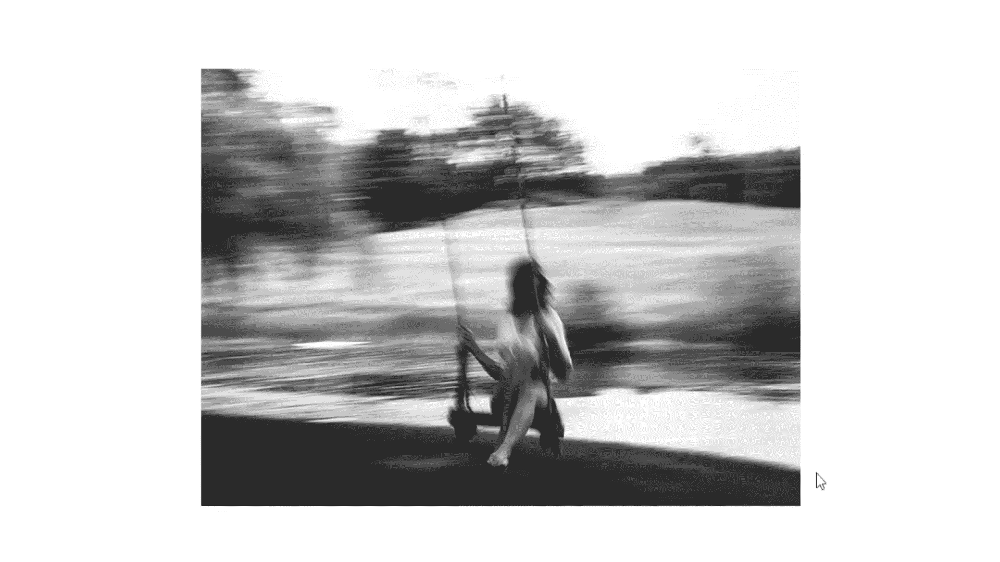

📸 Complete Adobe Lightroom Megacourse：Beginner to Expert Photo Editing：Part 1 P36 第31课：细节 Detail 🔍

在本节课中，我们将一起学习关于照片细节的核心知识。细节是摄影后期处理中非常重要的一环，它直接决定观众第一眼看到照片时，能不能快速明白拍摄主体是什么。无论你是刚接触 Adobe Lightroom 的新手，还是已经有一定编辑经验的朋友，这一节都会用大白话把细节的作用讲清楚，让你明白为什么有些照片一看就舒服，而有些照片却让人费劲才能看懂。

了解了细节的基本概念之后，我们先来看看细节到底在照片中扮演什么角色。

细节在照片中的核心作用

细节是照片的灵魂，它决定了观众能否在第一时间识别出图像里的内容。在 Lightroom 中，细节通常通过锐度和清晰度来体现，如果没有足够的细节，照片就会显得模糊不清，观众很难快速明白拍摄者想表达什么。

以下是细节的核心公式：

```text
照片细节 = 锐度 + 清晰度 + 边缘轮廓
```

换句话说，细节越高，照片里的线条就越分明，物体的纹理就越容易被人眼捕捉到。对人类来说，快速识别所见之物是建立联系的基础，如果照片连基本的细节都没有，观众很难与图片产生情感上的连接。

接下来我们具体看看，当照片缺少细节时，观众的观看体验会发生什么变化。

没有细节时照片会是什么样子

当一张照片缺乏细节时，观众的眼睛不会立刻落在重点上，反而需要花更多时间去猜测图片里到底是什么。比如同一张花的照片，左边清晰的版本能让人一眼认出是花，而右边模糊的版本则需要观众仔细看很久，才能意识到原来这也是花。

以下是缺乏细节对观看体验的影响：

- 左图细节清晰，观众能立即识别出拍摄主体是花朵。
- 右图细节丢失，观众需要花费较长时间才能意识到这其实是同一张花的照片。
- 如果观众一开始就不知道这是花，可能会盯着图片看很久，直到突然明白这些是花。

很多时候，照片会因为相机移动、对焦不准或其他原因而变得严重失真，这时候观众很难确切地分辨出画面里展示的内容到底是什么。这时候即使主体和拍摄对象没有变化，因为缺少了必要的细节，整张图片的可读性就大打折扣。

模糊不仅仅是技术失误，有时候也可以用来营造艺术效果，我们下面来看看。

模糊图片带来的问题

很多时候，照片会因为相机在拍摄时轻微移动，或者对焦没有对准，导致画面变得模糊不清。这时候图片里的主体和拍摄对象可能并没有变化，但因为缺少了必要的细节，观众很难快速识别出具体的拍摄对象是什么。

以下是模糊图片的典型表现：

- 画面看起来像是相机在拍摄时轻微移动了一下。
- 原本清晰的主体变得模糊不清，边缘轮廓不再分明。
- 观众第一眼看到图片时，很难快速识别出具体的拍摄对象是什么。

除了艺术风格，模糊还会直接影响拍摄主体的轮廓表现，这一点非常重要。

模糊在特定风格中的应用

模糊并不总是错误的，有时候摄影师会刻意使用模糊来营造某种特定的艺术风格。不过，这种刻意的模糊需要有明确的意图，而不是单纯因为拍摄时对焦失败。

比如微距摄影，就是一种典型的利用模糊来突出主体的风格：

```text
微距摄影效果 = 主体对焦清晰 + 背景区域模糊
```

通过调整相机设置，让画面中只有一个物体保持清晰对焦，而其他背景部分被模糊处理，就可以拍出这种看起来很专业的微距照片效果。

但是，如果你原本想拍摄微距照片，却因为技术原因没有保留住图片细节，导致整张照片都模糊不清，那么这就不是一种风格选择，而是拍摄失败。这时候观众无法从照片中看出这是花，也无法看清花内部的细节，照片的质量就会受到很大影响。这时候你也不能说这是故意追求某种美学的模糊效果，因为很明显这就是相机对焦失败的结果，而且我们失去了本可以捕捉到的重要细节。

模糊对主体轮廓的影响

无论图片是因为模糊而失去了细节，还是因为过度锐化而显得不自然，都会对拍摄主体的轮廓产生很大的影响。模糊会让主体的边缘变得模糊不清，而过度锐化则会让边缘出现不自然的白边或黑边，两者都会破坏照片的整体质感。

不过，模糊本身也可以用于特定的编辑风格，关键在于你使用的是哪种模糊。

以下是几种常见的模糊类型及其效果：

- 运动模糊：当被摄对象在运动时产生的模糊，例如拍摄秋千上的人，因为人在摆动，摄影师刻意制造了运动模糊效果，为图片增添了动态的氛围感。
- 微距模糊：即使拍摄时某部分并未模糊，也可以在后期添加模糊效果，营造出微距拍摄的视觉感受。

运动模糊是一种被广泛使用且很受欢迎的风格，有时候适当的模糊可以让照片看起来更好看。不过要注意的是，高级的运动模糊通常需要在更专业的软件中才能实现，这里只是举个例子，说明有时候模糊是可以接受的，有时候则需要谨慎使用。

有了这些认知，我们再来看看模糊和锐度是如何配合使用的。

模糊与锐度的结合使用



在某些情况下，我们需要使用模糊来创造微距效果，即使原始照片中那部分并不是模糊的，也可以在后期添加这种效果，让照片看起来像微距拍摄一样。这时候模糊就是对我们有利的工具。

总结来说，模糊可以用来增强图片的艺术感，而锐度则用来把观众的注意力引向拍摄的主体。两者的合理搭配，能让照片呈现出更好的视觉效果。

本节课的核心内容就讲到这里，最后简单预告一下下一节课会讲什么。

下一课预告

在下一节课中，我们将学习如何把前面讲到的三个原则结合起来，制作出一张质量不错的照片。

本节课总结

本节课中，我们一起学习了细节在照片中的重要作用，了解了没有细节时照片会呈现出什么样子，探讨了模糊在特定风格中的应用，以及模糊与锐度如何共同影响主体轮廓和观众的视觉体验。希望这些内容能帮助你更好地理解 Lightroom 中细节处理的基础知识。

