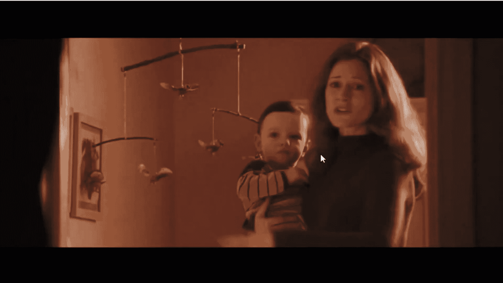
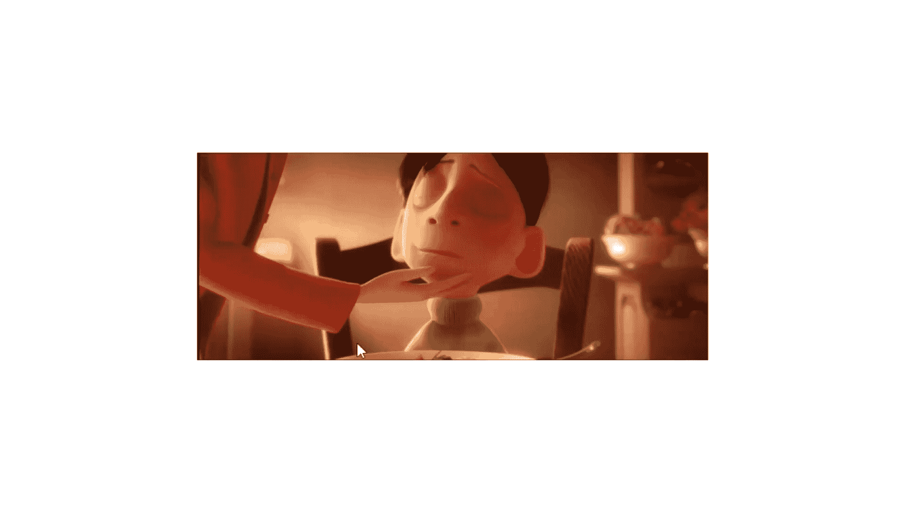

# 🎨 Complete Adobe Lightroom Megacourse：Beginner to Expert Photo Editing：33：色彩与情绪（Moods）


在本节课中，我们将一起学习如何在 Adobe Lightroom 中通过色彩来塑造照片的情绪氛围。每张照片都在讲述一个故事，而这个故事是通过图片所表达的氛围来传递的。无论你是初学者还是有一定基础，掌握色彩与情绪的关系，都是后期处理中非常重要的一环。我们会先认识每种颜色分别代表什么样的感受，然后结合电影中的实际例子来看看导演是如何用颜色来引导观众情绪的，最后回到 Lightroom 里，学习怎么用白平衡、色分级、阴影和饱和度等工具，让你的照片传达出你想要的那种氛围。

## 📚 第一节：为什么氛围很重要，色彩是起点

首先，我们要明白，在 Lightroom 里编辑照片时，最需要记住的一点就是氛围的营造。

很多新手只关注照片是否清晰、曝光是否准确，却容易忽略照片到底想表达什么样的感觉。其实，照片里的每一个细节都在说话，而决定说话语气的，正是那层笼罩在画面上的氛围。而营造氛围，最直接的方法就是从色彩入手。不管你是做色分级，还是改变某些颜色的色相，你选择的颜色都会直接影响观众的第一反应。为了让大家更直观地理解，这里有一个简单的色彩逻辑供你参考。

以下是常见颜色与情绪的对应关系，你可以把它当作调色时的参考表：

```
绿色 → 希望 / 生存 / 大自然 / 安全感
黄色 → 创造力 / 背叛 / 危险 / 评判 / 嫉妒
紫色 → 纯真 / 美 / 女性气质 / 时尚 / 梦境感
蓝色 → 平静 / 冷寂 / 孤独 / 幻想 / 悲伤
白色 → 无情感 / 中立 / 医院感 / 恐惧感（需配合其他颜色）
红色 → 激情 / 爱 / 暴力 / 愤怒 / 权力
橙色 → 温暖 / 活力 / 幽默 / 绝望 / 无尽旅程
粉色 → 孩子气 / 纯真浪漫 / 童年回忆
```

有了这个参考表之后，我们就可以逐个颜色来看看它们在实际画面里是怎么起作用的。

## 🟢 第二节：绿色——希望与生存的双面性

当我们想到绿色，脑海里首先浮现的通常是植物、树叶、草地，还有大自然。当你置身于一片绿色的草地或者森林里，内心往往会感到平静、安全，仿佛有一种美好的能量在包围着你。所以在照片中使用绿色，通常可以表达希望和积极的情绪。不过，绿色也有另一面，它可以用来表现生存，甚至是一种艰难的、负面的生存状态。这是因为人脑对同一种颜色会有正面和负面两种解读，最终取决于照片里具体展示了什么内容。作为编辑者，你完全可以利用绿色来引导观看者的情绪。

为了让你更容易理解，下面举两个具体的例子，看看同一种颜色在不同场景下会产生什么不同效果。

以下是两种截然不同的应用场景：

- 如果照片里是一个孩子在花丛中奔跑，给画面加上绿色的色分级，就能表现出一种希望和美好的氛围。
- 如果照片里是僵尸追逐逃跑的人，再加上同样的绿色，就能表现出生存危机和紧张感。

绿色我们就聊到这里，接下来我们来看看黄色是怎么发挥作用的。

## 🟡 第三节：黄色——创造力与危险并存

黄色在色轮上被标注为创造力、天然、不受影响等含义。但从实际效果来看，黄色也经常被用来表现背叛、危险、评判、嫉妒或者恐惧。具体呈现出哪一种，还是要看照片里的主体是什么。另外，在色彩心理学里，暖色调整体营造出友好、热情的环境，而冷色调则容易给人一种死寂、悲伤的感觉。黄色属于暖色，所以在某些情况下，它也可以传递友好和邀请的氛围，但这完全取决于你的拍摄对象想要表达什么。

以下是黄色在电影和摄影中常见的几种含义：

- 创造力与天然感
- 背叛、危险、评判、嫉妒
- 充满活力的氛围
- 友好且具有吸引力的情绪

说完黄色，我们继续往色轮里看，接下来是紫色。

## 🟣 第四节：紫色——纯真、梦境与自我表达

紫色通常让人联想到纯真、美、女性气质和时尚。不过，更准确地说，紫色在画面中更多是一种表现主义的色彩，能够营造出梦幻般的氛围。在后续的课程中，我们会重点分享一位摄影师 Brandon Woelfel 的风格，他非常喜欢在照片里使用紫色、品红色，以及青色和蓝绿色，你会看到这些颜色如何迅速改变一张照片的整体情绪。

以下是紫色能够带来的典型情绪：

- 纯真与美感
- 女性气质与时尚感
- 表现主义的艺术氛围
- 梦幻般的画面基调

紫色是暖色调里比较特别的存在，接下来我们来看看冷色调的代表——蓝色。

## 🔵 第五节：蓝色——平静、孤独与悲伤

蓝色代表平静、冷寂、孤立、幻想，同时也强烈关联着悲伤和冷酷的现实。在电影里，如果一个角色伤心地对着镜子，画面通常会带上一层蓝色调。之所以这样处理，是因为场景设计者希望观众能与画面产生共鸣，感受到角色内心的悲伤。蓝色是一种非常有力量的情绪引导色，使用时要根据你想要表达的故事来决定。

以下是蓝色在画面中常见的作用：

- 营造平静与冷寂的氛围
- 强调孤独与孤立感
- 表现幻想或冷酷的现实
- 引导观众产生悲伤情绪

蓝色说完了，我们再看看一个看似没有感情的颜色——白色。

## ⚪ 第六节：白色——无情感与中立的陷阱

白色在色彩心理学里基本上代表没有情感，一切都被中和了。想像一下走进医院，到处都是白色，但因为有护士和病人在走动，你并不会觉得空虚。可是，如果你走进同一个医院，却一个人也没有，周围只有白墙、白床、白桌子，这种全白的环境反而会让人感到恐惧，因为你无法与周围纯白的东西建立任何情感联系。所以在使用白色时，你通常需要把它和另一种颜色搭配使用，这样才不会让画面显得空洞或令人不安。

以下是白色在画面中的特点：

- 基本上没有情感色彩
- 营造中立和平淡的基调
- 容易让人产生空虚或恐惧感
- 建议始终与其他颜色搭配使用

单独认识每种颜色之后，我们再来看看这些颜色在具体电影场景里是怎么组合使用的。

## 🎬 第七节：电影中的色彩实战案例

光说理论不够，我们需要看看真实的电影是怎么运用这些颜色来表达情绪的。下面我们会分别分析红色、橙色、黄色、绿色、蓝色、紫色和粉色在经典场景里的表现，帮助你把颜色含义和实际画面对应起来。

以下是几种主要颜色在电影中的具体应用示例：

- 红色：代表激情、爱与情感，但也代表暴力、愤怒和权力。比如《星球大战》里反派常带有红色调，机器人变坏时也会带红色光晕。如果场景里出现红色警报灯，观众会立刻意识到危险即将发生。
- 橙色：代表温暖、活力和幽默，但也可能表现绝望或无尽的旅程。比如一个孤军奋战的士兵，画面加上橙色调，观众就能理解他此刻可能感到绝望。
- 黄色：代表嫉妒、背叛、评判，也能营造充满活力的氛围。比如娜塔莉·波特曼身穿黄色衣服陷入沉思，画面暗示她可能在想嫉妒、背叛或要背叛别人的事，同时黄色为场景带来了所需的能量感。
- 绿色：代表生存或希望。比如闪回片段里女王被谋杀，她喘着粗气逃跑，画面用绿色来表现她拼命求生的样子，观众会为她揪心，期待她能活下来。这里的绿色强调的是生存，而不是希望或新生。
- 蓝色：在摄影和电影中非常常见，尤其是科幻片，用来表现冷酷苦涩的现实。比如一个悲伤的角色在夜店里，画面变成蓝色，观众就会知道他并不开心，而是感到孤独。如果换成红色调，观众就会觉得他在享受派对，心情很好。
- 紫色：常用于表现主义，比如歌剧、舞台或歌手演唱时，紫色会出现以展现自我表达，并增强这种情绪氛围。
- 粉色：更偏向于孩子气的氛围，常用来表现纯真的、带有童年感的浪漫。比如歌手 Melanie Martinez 在音乐视频和服装里大量使用粉色，就是为了营造这种童年恋爱的感觉。

单看单个颜色的例子可能还不够直观，接下来我们看看两部大家熟悉的电影是怎么把冷暖色调结合起来讲故事的。

## 🎥 第八节：冷暖色调的对比——《哈利·波特》与《料理鼠王》

大家都看过《哈利·波特》，在那段父母被谋杀的闪回片段里，画面中母亲还活着，哈利也在旁边。你会注意到画面上有一层橙红色的叠加，这在表现一段温暖的回忆，那时候他们还在一起，都还活着。但如果看闪回的另一部分，母亲已经去世了，画面就会变成蓝色和冷色调，表现悲伤的场景。这时候你应该感到难过，因为母亲死了，Harry 再也没有母亲了。这种蓝色调非常适合角色哭泣的场景，让观众明白他们不是高兴的泪水，而是真正的悲伤。

接着我们再看另一个经典例子，来自《料理鼠王》里美食评论家尝菜的场景。

在这个场景里，评论家所处的环境是冷色调的，因为他是个严肃的角色，不开玩笑，对工作非常认真，而且如果食物不好他绝不会留情。但当他尝到食物并陷入回忆时，画面会切换到他母亲过去为他做同样的菜的温暖记忆。这时候出现了暖色调，也就是橙红色，表明这是一个美好的回忆，他非常怀念那些时光。在这个场景里，他因为吃到了好食物而感到开心，母亲正在爱抚他，母亲通过为他做最爱的菜来表达爱。这就是冷暖色调如何共同塑造情绪的典型示例。

看完电影中的例子，我们再回到摄影和 Lightroom 里，看看这些色调在实际照片编辑中是怎么运用的。



## 🛠️ 第九节：Lightroom 基础面板里的色温与情绪

回到摄影领域，这些色调也同样适用。当你打开 Lightroom 的基本面板，首先看到的就是白平衡里的色温滑块。如果不做任何调整，这就是你的原始照片。你可以把画面调得更暖，也可以调得更冷，而这会直接影响照片的氛围。当画面偏暖时，你通常想表现一种友好、亲切的感觉；而当画面偏冷时，你可能想表现一种安静、悲伤或者科幻的感觉。这一切完全取决于你通过色分级想要传达什么样的情绪。如果你想让一张人像照片不仅仅是人像，比如想把它用在闪回片段或某个特定项目里，完全可以利用图片的色温来塑造特定的氛围。

以下是色温调整对情绪的常见影响：

```
色温偏暖 → 友好、亲切、欢迎的氛围
色温偏冷 → 安静、悲伤、科幻感的氛围
```

除了普通的冷暖调，还有一种颜色在后期处理里非常特别，那就是霓虹色。

## 🌈 第十节：霓虹色与亮色——抓住观众的眼球

霓虹色有一个很有意思的特点，不管场景是什么，不管拍摄对象在做什么，霓虹色都会不由自主地吸引人们的目光。想象一下一部无聊的电影，突然出现一个霓虹场景，你的眼睛会立刻被吸引过去。同样地，当你在手机里刷图片，看到一张霓虹色的照片，你也会忍不住停下来看看是什么。这就是为什么霓虹色或者亮色非常适合用来吸引注意力。不过在饱和度处理上，你不想过度，否则颜色会太刺眼，反而让人不舒服。

以下是使用霓虹色和亮色时的注意事项：

- 霓虹色能瞬间抓住观众视线
- 适合用于需要突出重点的画面
- 饱和度不要调得过高，避免视觉刺激过强



说完亮色，我们再来看看另一种完全不同的风格——黑白图像。

## ⚫ 第十一节：黑白图像——平淡与戏剧性的结合

黑白图像给人一种比较平淡的感觉。黑白电影虽然有故事情节，但画面本身不会特别吸引眼睛，观众更多关注的是人物对话和剧情推进。但在摄影里，当你把一张照片变成黑白，并且增强细节时，你其实是在讲述一个故事，呈现一种罕见的戏剧性影像。比如你拍摄一位老妇人的人像，转成黑白之后，把她的皱纹和疲惫的眼睛处理得更明显，你就是在用图片讲述一个关于岁月和生活的故事。

以下是黑白摄影在情绪表达上的特点：

- 画面基调较为平淡
- 更侧重于故事性和细节表现
- 适合展现戏剧性和深刻的情感
- 常用于人像、纪实等需要讲故事的场景

黑白风格讲究克制，而接下来的青橙调则正好相反，它讲究张力和兴奋感。

## 🟢🟠 第十二节：青橙调——科幻与超级英雄片的兴奋感

在科幻片或超级英雄电影中，经常会出现大量青色和橙色的搭配。这两种颜色并不是我们在日常生活中常见的自然颜色，所以通常需要通过后期制作才能实现。青橙调能制造出一种兴奋感，正好契合科幻或超级英雄片的氛围，让观众对接下来会发生什么、这个角色会经历什么感到期待，而这种色分级风格正是实现这种效果的关键。

以下是青橙调在视觉叙事中的作用：

- 青色与橙色并非常见自然色，需后期合成
- 制造兴奋感和视觉张力
- 非常适合科幻片和超级英雄片
- 引导观众对剧情发展产生期待

如果你不想要那么兴奋，而是想要更写实、更悬疑的感觉，那就要来看看写实色彩和强阴影的运用了。

## 🌑 第十三节：写实色彩与强阴影——制造神秘与悬疑

写实色彩看起来像是真实世界的样子，但如果画面里有大量强烈的阴影，效果就会完全不同。当我们在照片里降低阴影时，就会呈现出一种戏剧性的外观，而戏剧感通常用于讲故事的图片。就像我们在黑白图像里提到的，通过加深阴影，你可以让图片变得神秘，让观众想知道发生了什么，这个人经历了什么，接下来会怎么样。比如电影《月光男孩》里的某个场景，就运用了写实色彩和较重的阴影，这表明故事里有很多事情在发生，这个角色内心也有很多复杂的情绪。所以，阴影不一定非要非常重，但适当的阴影能营造出可疑和神秘的氛围，一切还是要取决于你想通过图片表达什么。

以下是强阴影在图片中能带来的情绪效果：

- 降低阴影能增加戏剧性
- 适合用于讲故事的图片
- 通过加深阴影营造神秘感
- 引导观众思考人物背景和剧情走向
- 常用于悬疑、严肃题材的摄影作品

除了强阴影，还有一种风格走的是完全相反的路线，那就是平淡、多颗粒且低饱和的色调。

## 📷 第十四节：平淡色调与颗粒感——怀旧与短暂体验

有些照片或者电影，画面看起来很平淡，上面有很多颗粒，颜色也比较去饱和。这种着色方式会让图片显得有些生机缺失，只展现一个短暂的瞬间。正因为缺乏能吸引眼睛的元素，这种图片通常不会在你脑海里留存太久。但它非常适合用来表现某种特定的体验，同时也会让你的图片看起来带有怀旧感。比如如果你要拍一台旧式收音机，就可以用这种平淡无色的质感，来唤起观众对过去的回忆。如果你看过某些节奏缓慢、画面较暗的电影，就会明白这种色分级是如何增强叙事方式的。

以下是平淡低饱和色调的适用场景：

- 画面平淡，带有颗粒感
- 颜色较为去饱和
- 营造生机缺失或短暂瞬间的感觉
- 适合表现怀旧体验和特定氛围
- 不易在观众脑海中长久留存，但适合特定叙事需求

现在我们已经了解了各种颜色和风格是如何影响图片情绪的，最后我们来总结一下本节课的核心内容。

## 📝 结尾总结

本节课中，我们一起学习了色彩如何在 Lightroom 以及电影摄影中塑造图片的情绪氛围。我们认识了绿色、黄色、紫色、蓝色、白色、红色、橙色和粉色等不同颜色分别代表什么样的感受，并通过《哈利·波特》和《料理鼠王》等电影案例，看到了冷暖色调如何共同讲述故事。回到 Lightroom 实际操作，我们学习了如何用白平衡色温调整营造友好或悲伤的氛围，如何用霓虹色吸引注意力，如何用黑白图像增强戏剧性，如何用青橙调制造兴奋感，以及如何用强阴影和平淡色调来表现神秘与怀旧。在接下来的课程中，我们将继续学习如何把这些风格和色彩运用到自己的照片里，让图片精准地传达你想要表达的情绪。
