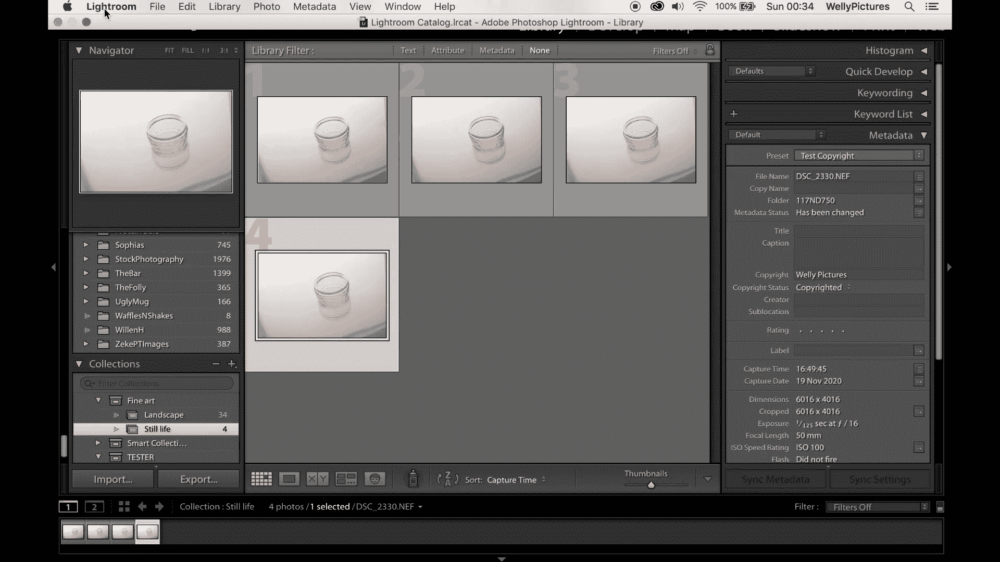
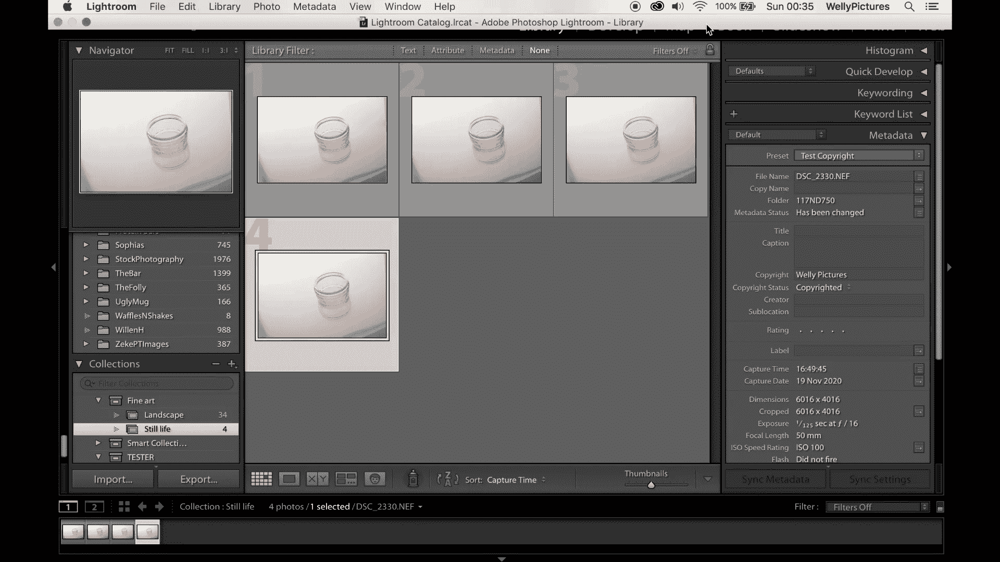
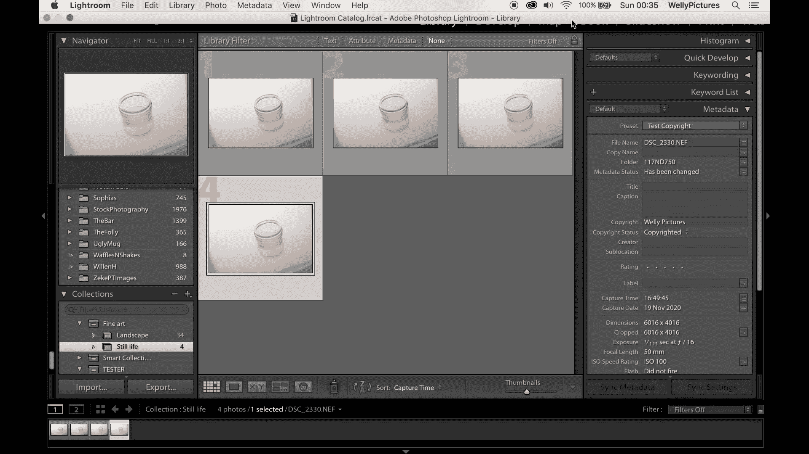
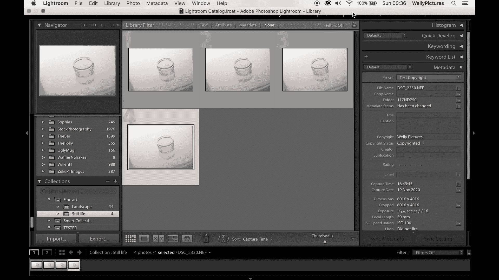
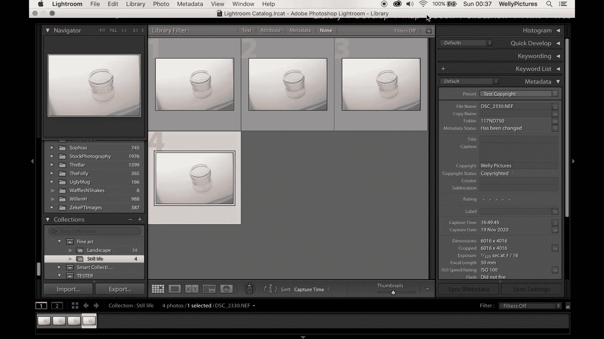
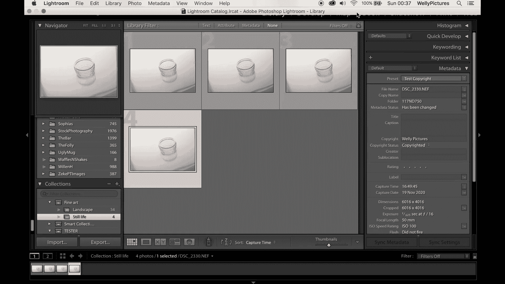

# Adobe Lightroom 从入门到精通教程：第39章：移动端模块简介 📱


## 课程概述

在本节课中，我们将一起学习 Adobe Lightroom 的移动端模块。这部分内容主要介绍如何把手机和 Lightroom 的编辑流程结合起来使用。你将了解云存储的基本概念，学会在不同设备之间切换编辑工作，还会看到如何用手机拍摄更高质量的照片。无论你是在家里使用电脑，还是在外出时只带着手机，这节课都会告诉你怎样让 Lightroom 在各种设备上都能正常工作，让你的照片编辑不再受限于某一台机器。





## 什么是 Lightroom 移动端模块


本节我们先来看看 Lightroom 移动端模块具体包含什么。这是一个让你在手机上也能完成照片编辑的功能区域，它和桌面版本相互配合，能够帮助你把手机上的拍摄和编辑融入到自己的日常工作流里。以下是本节课将要讨论的几个核心内容：

- 使用 Creative Cloud 提供的云存储空间
- 在手机应用中给照片添加标签
- 在不同设备之间编辑同一张照片
- 用手机拍摄 RAW 格式照片
- 在桌面端、网页版和移动端之间切换工作

通过这些内容，你会对整个移动端编辑流程有一个整体的认识，知道在实际操作中可以从哪里入手。


## 使用 Creative Cloud 云存储

首先我们来聊聊云存储。当你开始使用 Lightroom 经典版和全新的 Lightroom 版本时，Creative Cloud 会为你提供一定的云端存储空间，这意味着你可以把自己的照片上传到云端，然后在任何设备上打开和编辑。具体来说，你大概可以获得 20 吉字节的存储额度，用来保存上传的图片。你可以直接在手机应用里给照片打标签，然后在其他设备上继续编辑，这种跨设备的工作方式非常方便。以下是云存储能帮你做的几件事：

- 把本地照片上传到 Creative Cloud 云端
- 从移动端应用为图片添加标签和分类
- 在任意设备上继续编辑已上传的照片
- 避免照片只存储在单一设备中


理解云存储的作用，是你学好 Lightroom 移动端模块的第一步。


核心概念可以用下面的代码块简单表示：


```
Creative Cloud 云存储配置：
- 存储额度：20 GB
- 同步账号：Adobe ID
- 可用设备：桌面端、网页版、移动端
```




## 在任何设备上使用 Lightroom 网页版


接下来我们说说 Lightroom 的网页版。除了在电脑上安装桌面版本，你还可以通过浏览器打开 Lightroom 网页版，这意味着无论你在哪里，只要能上网，就能启动 Lightroom 进行编辑。即使你正在使用一台不是自己电脑的笔记本，也没有安装桌面版的 Lightroom，也可以通过网页版完成操作。这种方式打破了设备限制，让你在出差、旅行或者使用公共电脑时，依然可以处理照片。

你可以把 Lightroom 网页版看作是一个随时可用的编辑入口，不需要额外安装软件，直接登录账号就能看到你的云端照片库。


## 在手机端修复过曝照片




本节我们将看看如何在手机应用里修复过曝的照片。过曝是指拍摄时进光太多，导致画面太亮、细节丢失的情况。在 Lightroom 移动端应用中，你可以通过调整曝光、高光和阴影等参数，把过曝的照片修复回来。这样你就不用等回到电脑前才能处理照片，手机就能完成基础修复工作。


以下是移动端修复过曝照片的主要思路：

- 打开手机端 Lightroom 应用
- 选择过曝的图片进入编辑界面
- 降低曝光和高光数值，恢复亮部细节
- 调整阴影和对比度，让照片看起来更自然


这个技能对于经常在外拍摄的摄影师来说非常实用。




## 用手机拍摄 RAW 格式照片


除了编辑，拍摄时的格式选择也很重要。大多数手机默认拍摄的是 JPG 格式，这种格式文件小，但画质信息相对较少。如果你在手机上拍摄 RAW 格式照片，然后在移动设备上进行编辑，就能得到更高质量的图片，因为 RAW 保留了更多的原始画质数据。你完全可以在手机设置里把默认格式从 JPG 改成 RAW，这样拍出来的照片更适合后期编辑。

图片质量的关系可以用下面的公式简单表示：

图片质量：RAW > JPG

RAW 格式占用的存储空间更大，但换取的是更好的编辑空间和更高的画质保真度，建议在需要精细修图时优先选择 RAW。


## 在手机、桌面端与网页版之间切换


最后一部分我们来看看如何在不同设备之间流畅切换。你可以用云存储作为桥梁，在一个地方编辑一张照片，然后把它传到另一个地方继续修改。比如，你在 Lightroom CC 桌面版里创建了一些预设，这些预设之后也可以应用到你手机上拍摄的照片中。这种工作方式让你不必绑定在某一台设备上，可以根据当时的情况灵活选择使用桌面端、网页版还是移动端。


以下是跨设备工作流的几个关键点：


- 在一台设备上编辑照片，云端自动同步
- 在另一台设备上打开同一张照片继续编辑
- 将 Lightroom CC 中制作的预设应用到手机照片
- 桌面端、网页版和移动端共享同一个照片库




掌握这些技巧后，你就能随时随地用 Lightroom 处理照片，不再受设备限制。




## 课程总结


本节课中，我们一起学习了 Lightroom 移动端模块的基本内容。我们介绍了 Creative Cloud 提供的 20 吉字节云存储空间，学会了如何上传图片、添加标签以及在不同设备之间编辑照片。我们还了解了 Lightroom 网页版的使用方法，知道即使在没有安装桌面版的电脑上也能编辑照片。此外，我们讨论了在手机端修复过曝照片的方法，以及拍摄 RAW 格式照片来提升画质的重要性。最后，我们探讨了如何在手机、桌面端和网页版之间切换工作流，并复用桌面端制作的预设。希望这些内容能帮助你更好地利用 Lightroom CC 的各个部分，享受跨设备照片编辑的便利。

