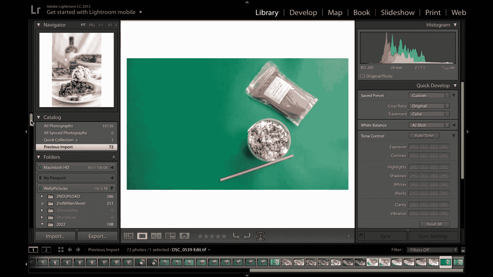
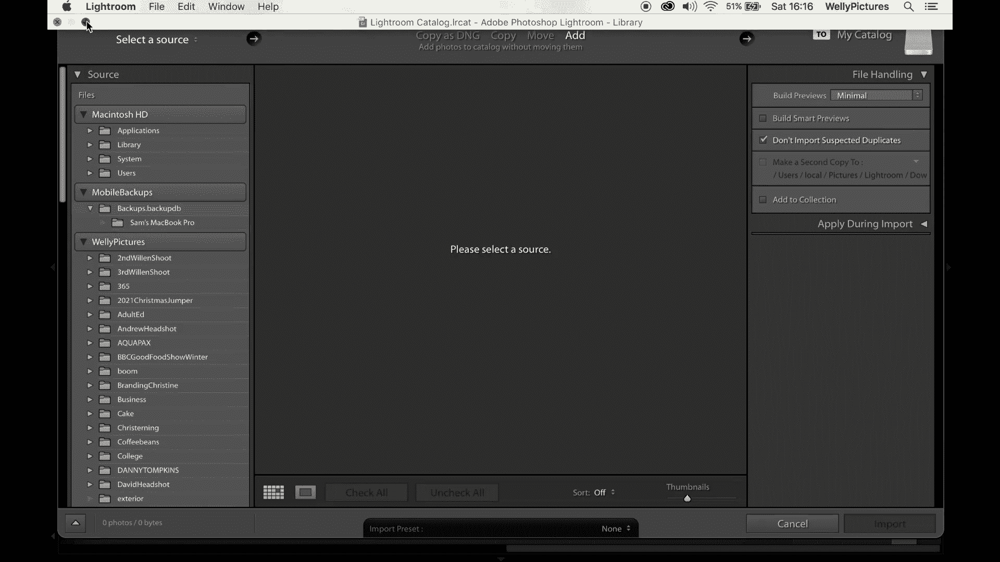
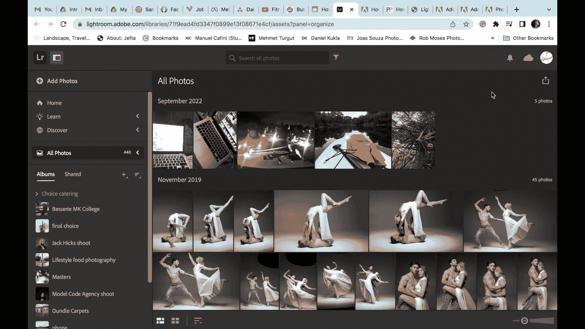

# Complete Adobe Lightroom Megacourse：Beginner to Expert Photo Editing：35：Understanding Cloud Storage ☁️



在本节课中我们将要学习 Lightroom 里的云存储是怎么回事。我会把 Lightroom Classic 和 Lightroom CC 的区别讲清楚，告诉你 Adobe Creative Cloud 和 Google Drive 分别提供多少免费空间，还会演示手机怎么把照片自动传到云端，以及在手机端怎么设置同步。最后我们会看看如何用 Adobe Sensei 快速找到想要的图片。不管你是刚接触 Lightroom 还是已经在用，这些内容都能帮你把照片保存得更安全、找起来更方便。




Lightroom Classic 是很多人最早接触的桌面版本，它的保存逻辑比较传统。当你进入库模块导入图片时，通常需要自己决定把照片存在哪里，比如笔记本电脑本地、桌面文件夹、下载文件夹、文档文件夹，或者外接移动硬盘。这些备份都是分开存放的，你需要自己管理文件路径和查找方式。虽然这种方式已经使用了一段时间，而且确实很实用，但它的局限在于照片和设备绑定，换一台电脑就不太方便继续编辑了。


接下来我们来看看 Lightroom CC 带来的云存储选项。选择 Lightroom CC 意味着你可以使用 Adobe 提供的云存储空间，并且还能使用 Adobe Sensei 和 AI 技术来辅助搜索图片。这不仅能让你更容易找到自己的照片，也能让不同设备之间更轻松地共享图库。


以下是两种常见云存储服务的容量对比：

```
Adobe Creative Cloud 免费容量 = 20 GB
Google Drive 免费容量 = 30 GB
```

如果你发现空间不够用，这些服务都支持购买更多容量，只要达到一定的使用阈值，就可以随时扩充，不受限于你选择的是哪种存储形式。


云存储主要分为几种类型，了解它们有助于你更好地保护照片隐私：


- 公有云：非结构化的数据集合，任何人都可以访问，适合公开分享。
- 私有云：主要用于公司或个人，不希望过多共享数据，访问权限受限。
- GDPR 私人数据：涉及你个人的隐私信息，属于私有范畴，防止他人共享你的资料。
- 混合云：同时包含私有云和公有云，两者结合，既保护隐私又方便共享。

因为有了这些不同类型的云存储，你就可以根据自己的需求，决定如何保存和管理 Lightroom 里的图片。


云存储的核心优势在于跨设备同步。你可以在手机上打开 Lightroom App，点击顶部的云图标，然后选择同步和备份。这样每次在手机上拍摄的照片，都会自动上传到云端并保存。手机拍摄的图片通常是 DNG 格式，拍完之后你可以在手机相册里看到它们，但可能不会立刻出现在网页版 Lightroom 的对应区域，需要等待同步完成。同步完成后，这些图片就会出现在你通过网页启动的 Lightroom 平台里，这意味着你在手机上拍的照片，不用导入也能在电脑上继续编辑。


手机拍摄到云端再同步到桌面端的逻辑可以用下面这个简单公式表示：

```
手机拍摄 (DNG) → 云端备份 → Lightroom 网页端 / 桌面端同步
```

这个同步功能不仅限于 Lightroom，Photoshop 以及其他 Adobe 程序也可以直接把文件保存到云端存储空间里。这样一来，你的手机、笔记本电脑都能访问同一组图片，图片可以在设备之间来回传输，非常方便。


以下是手机端 Lightroom App 中三个常用的同步设置选项：

- 使用蜂窝数据同步：开启后可以随时自动同步，如果不想消耗流量，可以关闭这个选项。
- 仅下载智能预览：生成低分辨率的智能预览图片，减小文件体积，方便在手机上查看，但不占用太多空间。
- 充电时防止设备休眠：设备充电时不进入休眠状态，这样即使不在使用，照片也能继续在后台同步到云端。

通过这三个选项，你可以根据自己的网络环境和使用习惯，灵活管理手机照片上传到网页版 Lightroom 或桌面版 Lightroom 的过程。




除了存储和同步，云存储还能帮你更好地整理和查找图片。当你拍摄的照片越来越多，可能会有多个图库或相册，有时候不容易快速找到某张特定的照片。这时候可以借助 Adobe Sensei 搜索选项，通过内容识别来定位图片，而不需要逐个文件夹翻找。云存储让这个过程变得更简单，因为所有设备上的图片都在同一个云端空间里。


举个实际的例子，我刚才在手机上拍了一张咖啡杯的照片，这张图片已经通过移动应用备份并同步到了我的图片选择里。你可以在手机上看到它，稍等片刻后，它也会出现在网页版 Lightroom 的对应区域。这就是云存储在不同设备之间协作的方式：在一台设备上拍照，自动上传到云端，然后在其他设备上直接使用。


本节课中我们一起学习了 Lightroom CC 的云存储工作原理，对比了 Google Drive 和 Adobe Creative Cloud 的免费容量，了解了公有云、私有云和混合云的基本区别，演示了手机端如何自动备份并同步 DNG 格式图片，并介绍了三个实用的移动端同步设置。希望这些内容能帮你把照片保存得更安全，也能让你在不同设备之间更方便地找到和编辑图片。

