Complete Adobe Lightroom Megacourse： Beginner to Expert Photo Editing：42：在电脑和手机上使用相同的预设 📱💻

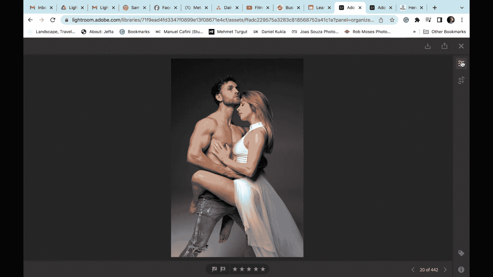

在本节课中我们将要学习如何在电脑版Adobe Lightroom中创建预设，并让这些预设自动同步到手机端Lightroom应用中。很多初学者发现，在电脑上调好参数后，手机上还要重新调一遍，非常浪费时间。其实Adobe Lightroom提供了云端同步功能，一旦你在桌面端保存了自己的预设，它就会通过Adobe账号同步到你的移动设备。这样你在手机上打开相册，就能直接套用电脑上刚刚创建的效果，无需重复操作。下面我们就一步步来看看具体怎么操作。

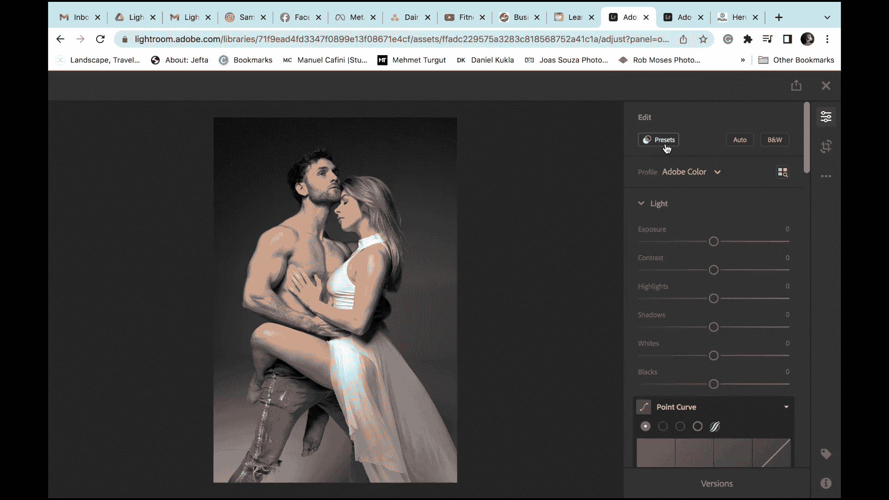

首先我们要明白，预设同步的核心原理是什么，这样后面操作才不会迷路。

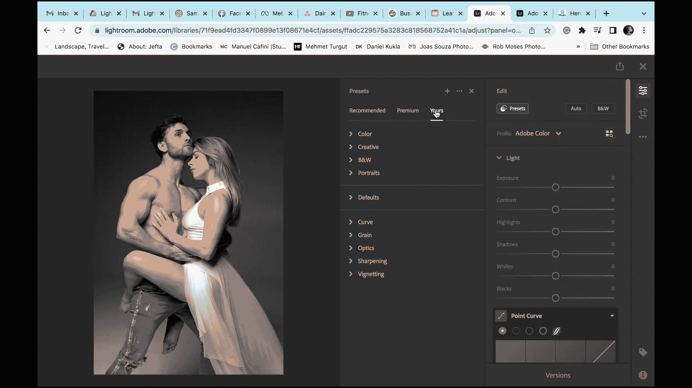

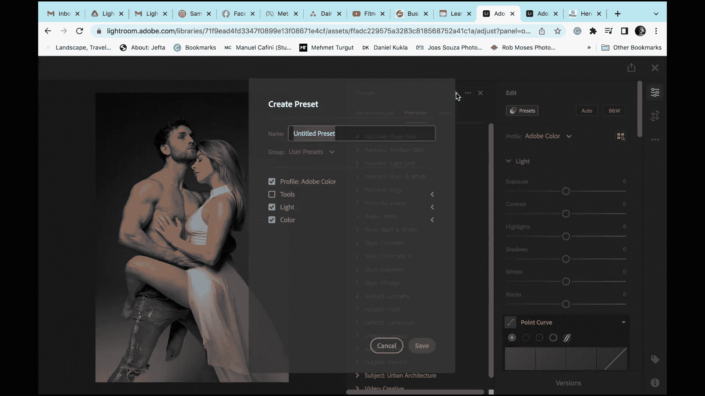

```
电脑端 Lightroom 中创建预设
        ↓ (Adobe 云端自动同步)
手机端 Lightroom App 自动接收预设
        ↓
在任意手机照片上一键应用
```

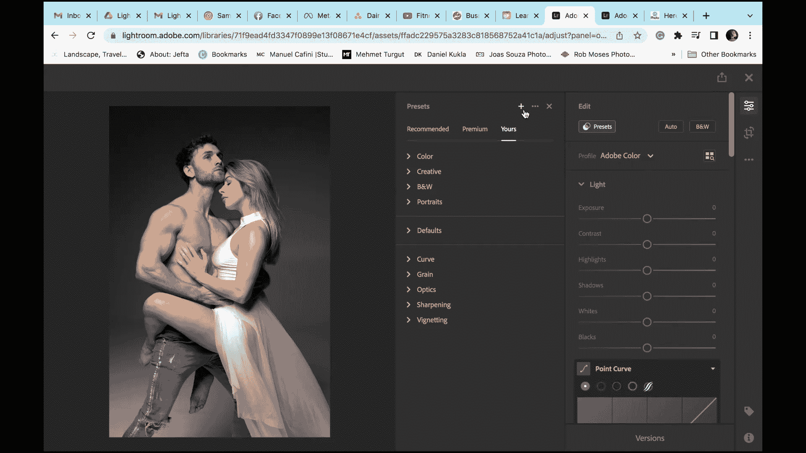

当你在电脑版Lightroom里编辑照片时，所有的调整参数都可以保存成一个预设文件。这个预设不是只存在本地硬盘里，而是会上传到Adobe的云服务器。只要你的手机Lightroom登录的是同一个Adobe账号，这个预设就会自动出现在手机端的预设列表里。这意味着你在电脑上花了十分钟调出来的色调，手机上一秒钟就能用到别的照片上。这是一个非常实用的工作流，尤其适合需要在多设备之间切换编辑的摄影爱好者。

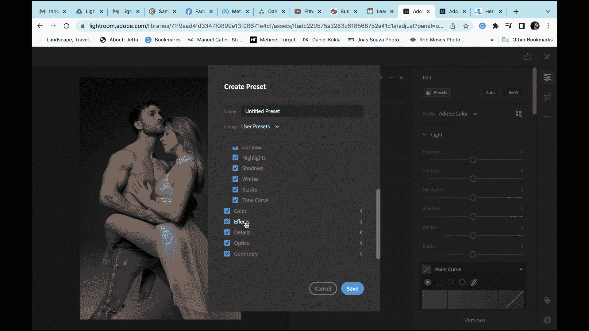

上一节我们介绍了预设同步的基本思路，本节中我们来看看如何在电脑端找到预设管理入口。

打开你的Adobe Lightroom桌面版程序，确保已经登录了Adobe账号。界面左侧或右侧通常会有“预设”标签页，点击进入后，你会看到系统自带的预设分类。这里是你管理所有预设的中心区域，无论是自带的还是你自己新建的，都会在这里显示。

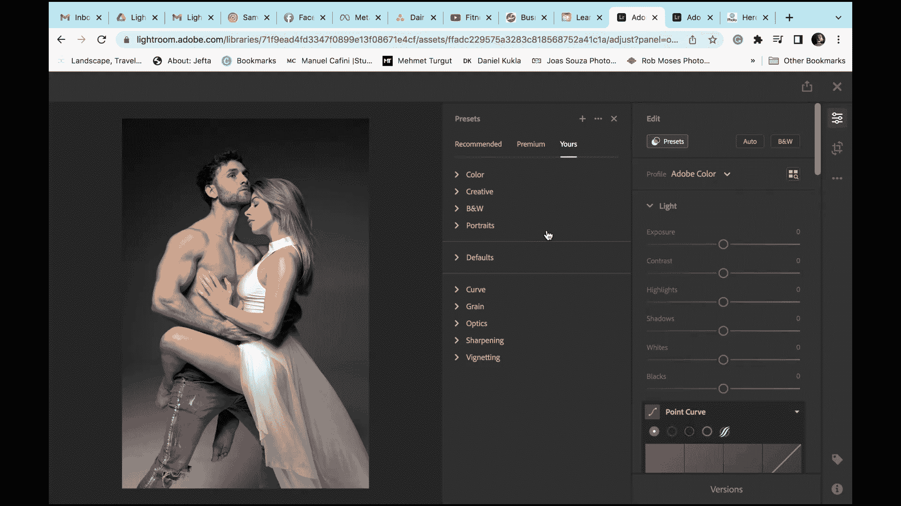

以下是你在预设标签页中会看到的主要分类：
- 推荐预设：Adobe根据你的编辑习惯推荐的效果。
- 高级预设：需要付费订阅才能使用的专业预设。
- 你的预设：你自己创建并保存的个人预设组。

在电脑端找到预设入口之后，我们需要确认手机端是否已经接收到了云端的照片和预设。

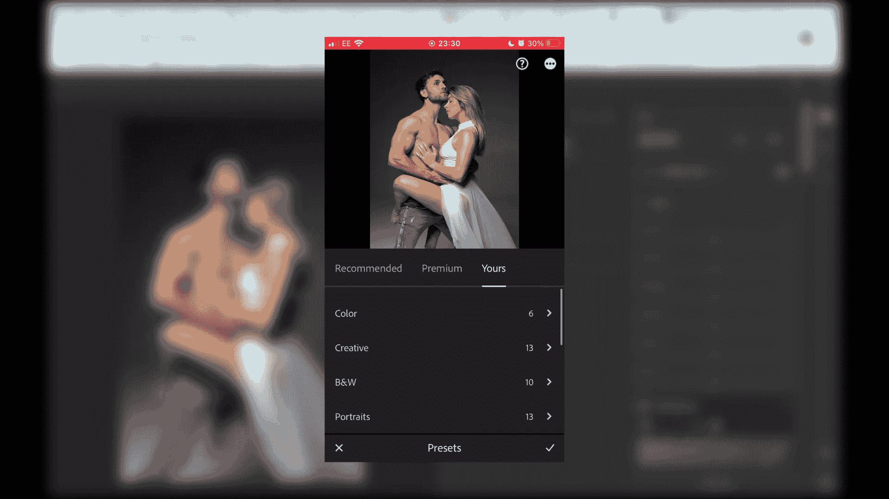

拿起你的手机，打开Lightroom移动版应用。进入主界面后，你应该能看到和电脑端一致的相册列表。如果你在电脑上刚刚编辑过一张照片，手机端通常也会在短时间内显示这张同步过来的图片。这就是云端同步在起作用，你不需要手动传图，Adobe会自动把设备间的编辑状态保持一致。

上一节我们确认了手机端可以看到云端照片，本节中我们来看看如何在电脑上亲手制作一个预设。

选中一张你想要编辑的照片，进入编辑模式。我们先不要着急保存预设，而是先把这张照片调出你想要的效果。比如调高高光部分，让模特身上的灯光更有质感；适当增加对比度，让画面层次更分明；调整白色点，看看整体亮度是否合适。背景部分可以保持较暗的色调，这样主体会更突出。

然后进行颜色增强。你可以把牛仔裤的蓝色调得更突出，也可以稍微调整头发颜色。如果加入黄色和橙色，要注意不要加太多，否则皮肤会显得不自然，呈现出奇怪的橙色调。最后可以适当提高清晰度，让细节更锐利。

完成这些调整后，你只需要保留实际使用过的面板，把没用到的面板折叠起来，这样在保存预设时不会带入冗余参数。比如你只用了光线、颜色和效果这三项，就只保留这三项打开，其余的全部关闭。

创建预设时，建议只保留以下已使用的调整项：
- 光线面板：高光、对比度、白点等
- 颜色面板：色调混合、饱和度等
- 效果面板：清晰度、去雾等

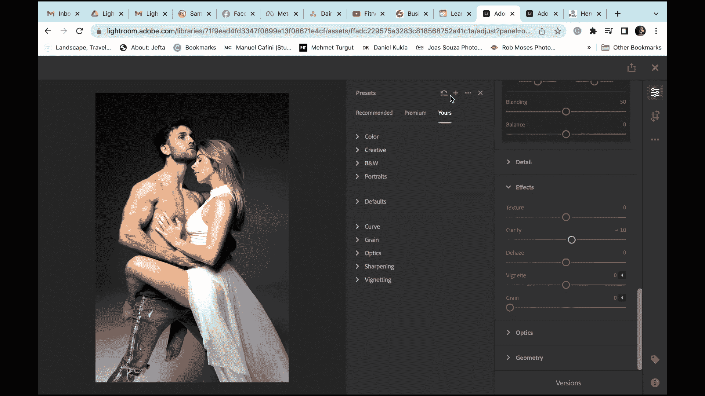

调整完成并整理好面板后，接下来就是把这些参数保存成可重复使用的预设了。

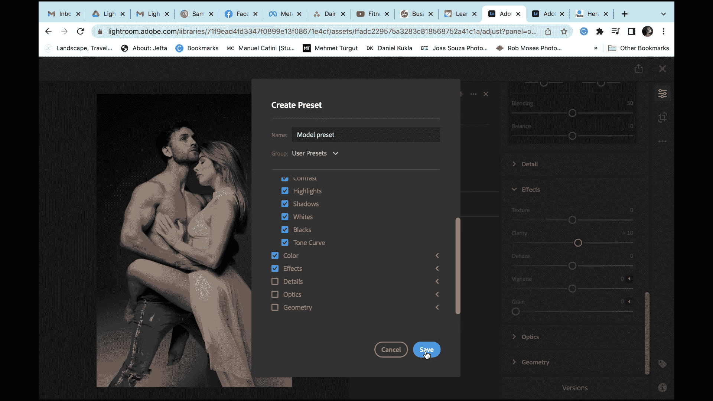

点击预设面板上的加号按钮，弹出新建预设对话框。给你的预设起个容易记住的名字，比如“模特预设”。把它放入“你的预设”分组，方便以后查找。在保存选项中，只勾选你实际修改过的项目，比如光线、颜色和效果，不需要勾选细节、光学或几何面板，因为你在这次编辑中并没有动它们。确认无误后点击保存。

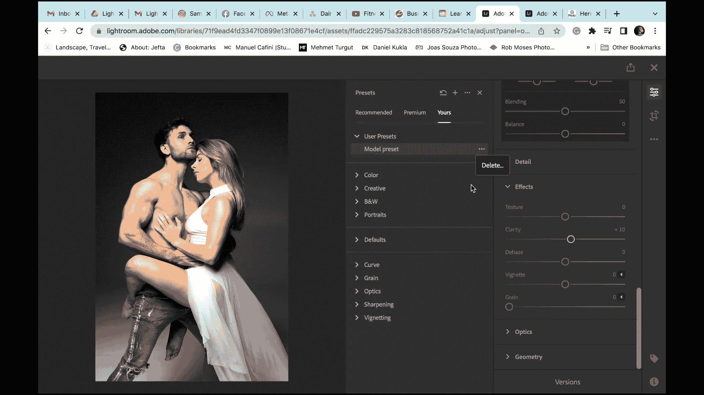

保存完成后，你的预设就会出现在“你的预设”列表里，名字就是你刚刚设定的“模特预设”。如果你以后不想要这个预设，也可以随时删除。

电脑端预设保存好了，现在我们要去手机端验证它是否已经自动同步过来。

打开手机上的Lightroom应用，选择一张和电脑上不同的照片，这样可以避免混淆。进入编辑界面后，切换到“你的预设”分类。你应该能看到刚才在电脑上创建的“模特预设”已经出现在列表中。点击它，手机照片就会立刻套用电脑上相同的光线、颜色和效果参数。整个过程不需要你在手机上重新拖动滑块，一切都是自动完成的。

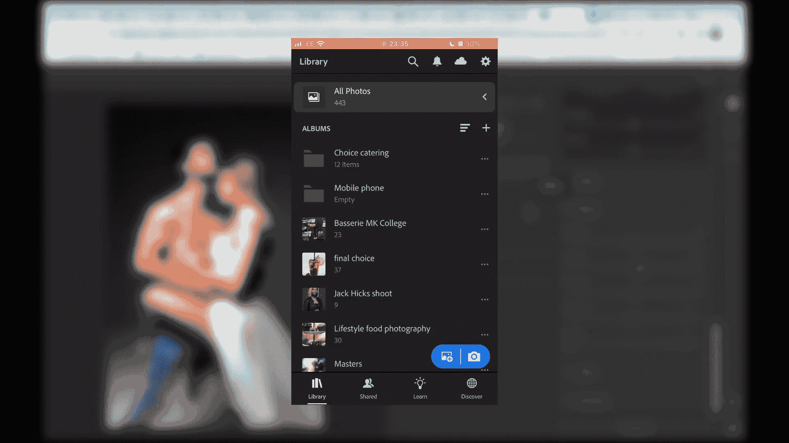

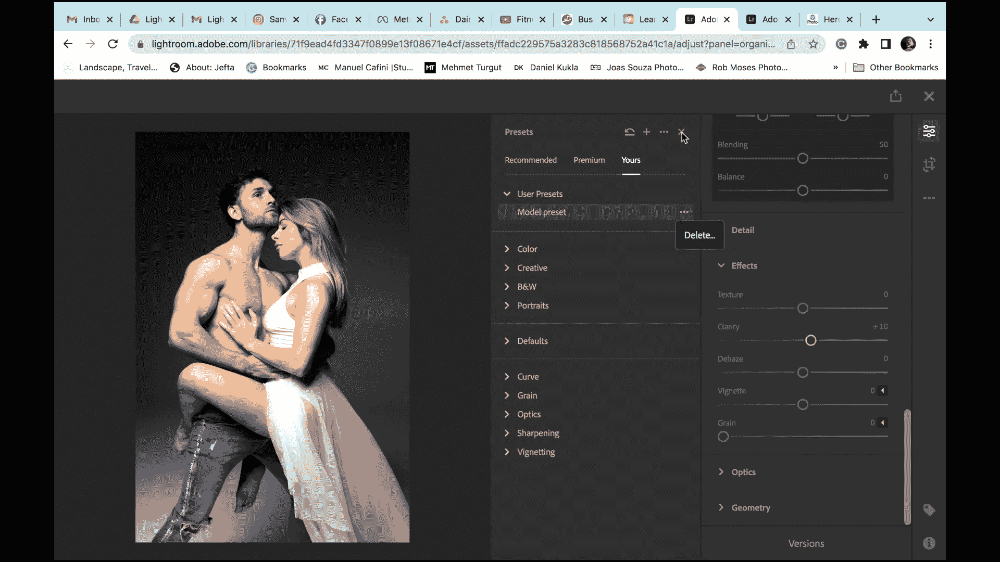

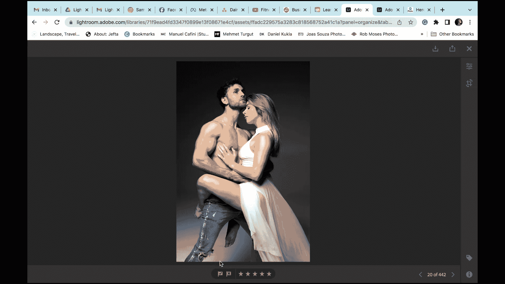

预设在手机端应用成功后，为了方便下次找到这张已经编辑过的照片，我们可以给它加个标记。

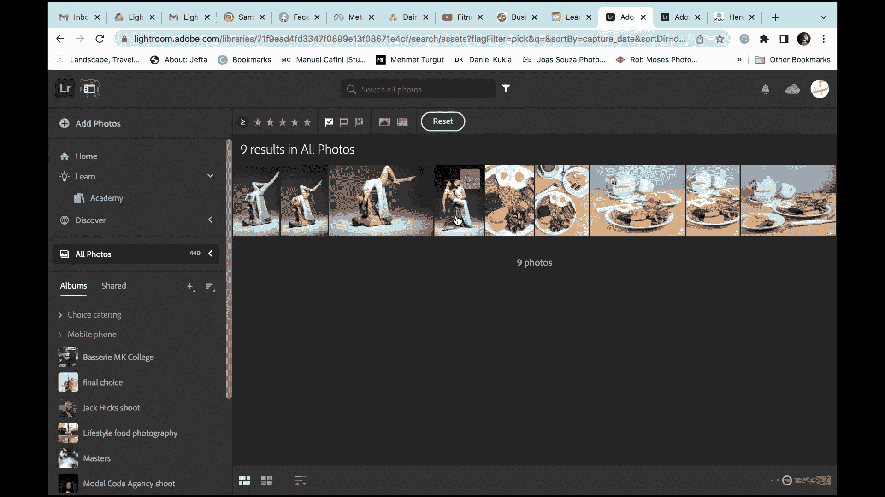

回到手机图库界面，选中刚才编辑过的照片，给它打上旗帜标记或者添加勾选标记。这样当你以后打开Lightroom手机版，想要快速找到这张已经应用了“模特预设”的图片，就可以通过筛选功能直接定位，而不需要在几百张照片里一个个翻找。

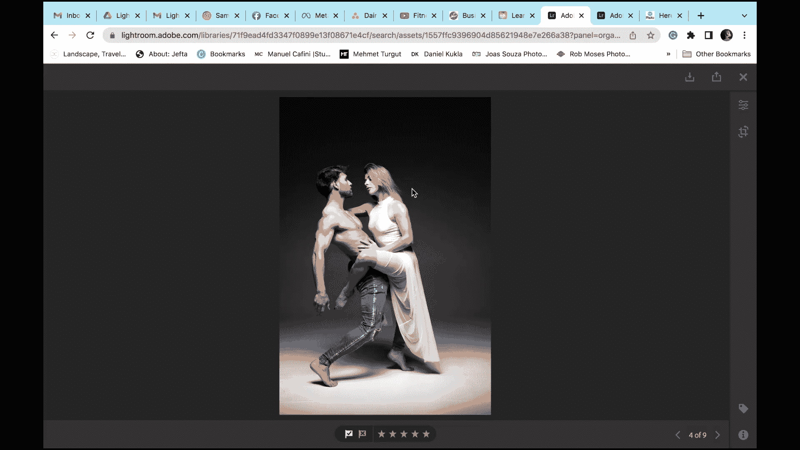

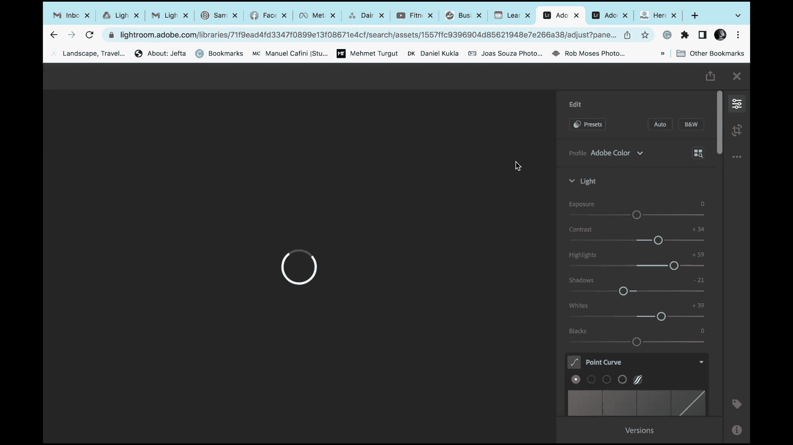

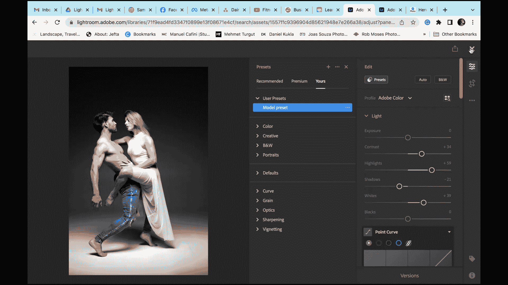

最后一步是确认两端的编辑状态是否真正保持一致。

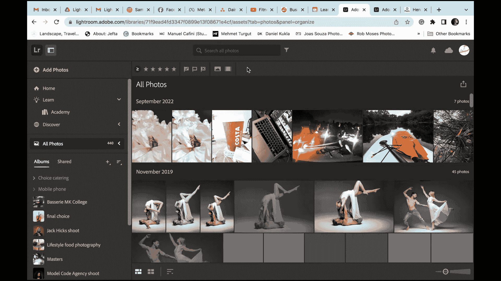

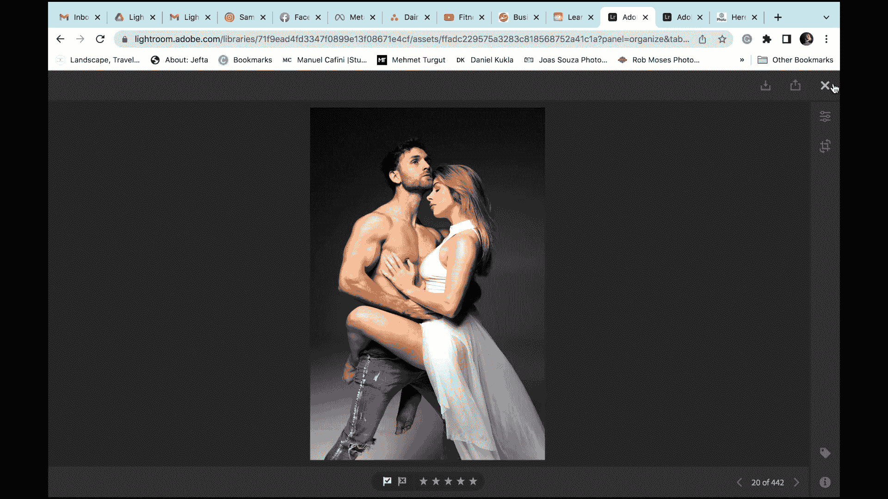

回到电脑端Lightroom，找到刚才编辑过的那张照片，重置它的编辑参数，看看是否还能恢复原状。如果同步正常，手机端那张应用了预设的照片应该保持不变，而电脑端重置后的照片会恢复原貌。这时候你可以刷新一下界面，确保云端数据已经完全更新。

通过这个实验，你会发现：在电脑桌面版Lightroom里建立好的预设，会自动同步到手机端，然后你可以直接在手机照片上使用。同一个预设可以被应用到多张图片上，极大地提高了批量编辑的效率。

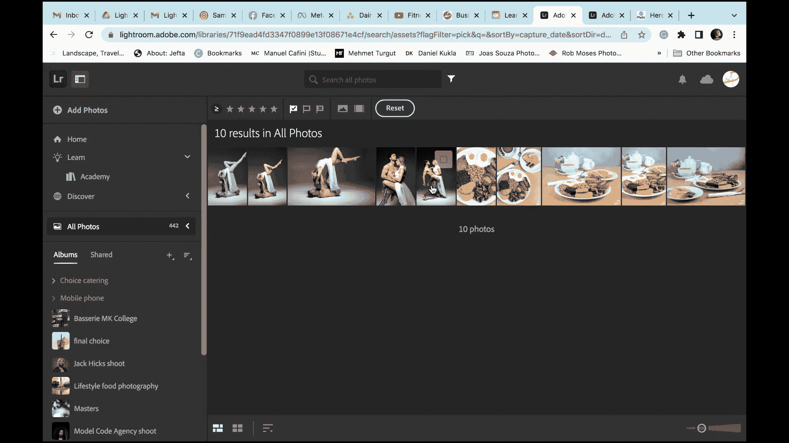

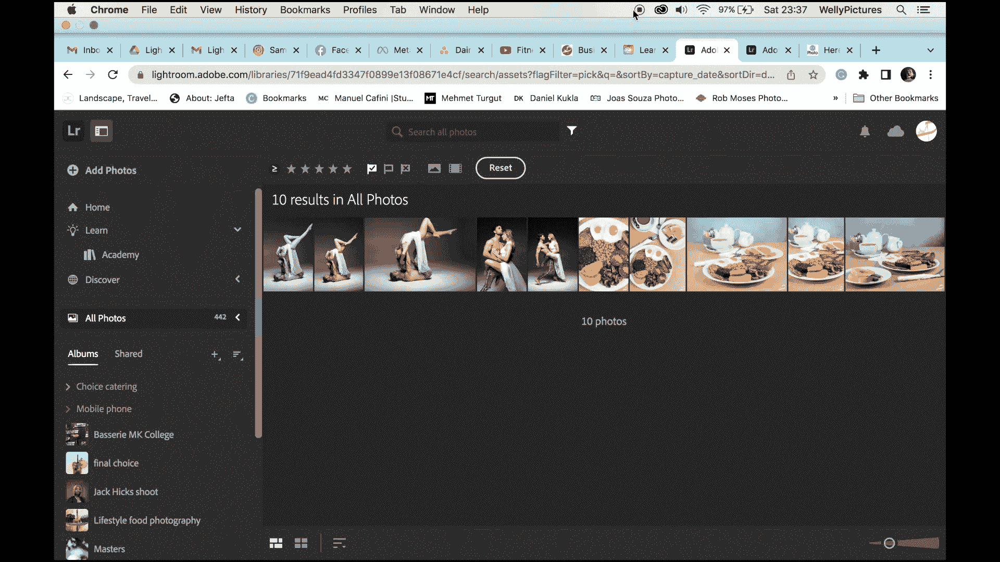

本节课中我们一起学习了如何在Adobe Lightroom电脑版中创建自定义预设，并让它通过云端自动同步到手机版Lightroom应用。我们先了解了预设同步的基本原理，然后在电脑端打开了预设标签页，认识了推荐预设、高级预设和你的预设这几个分类。接着我们在手机端确认了云端照片已经同步，并在电脑端通过调整光线、颜色和效果，亲手制作了一个名为“模特预设”的自定义预设。保存完成后，我们在手机端直接找到了这个预设并套用到另一张照片上，最后用旗帜标记方便查找，并验证了两端的同步状态。希望这个教程能帮你节省在多设备间重复调色的时间，让手机修图也能拥有电脑级别的便捷体验。

