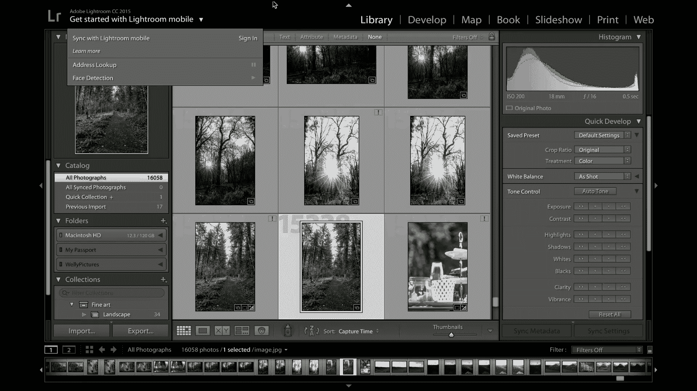
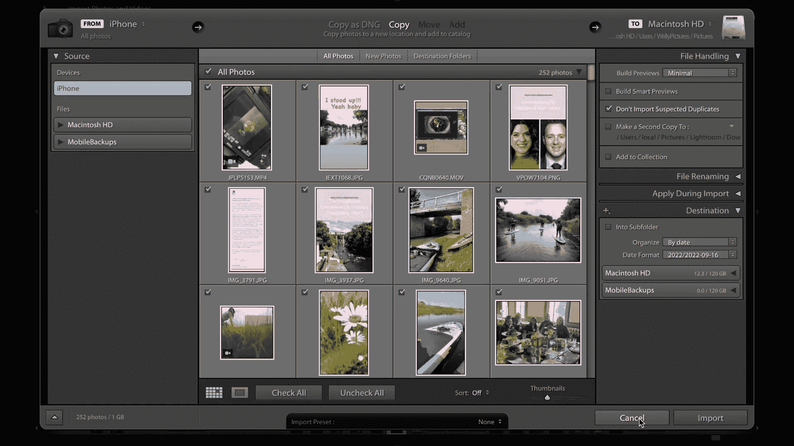
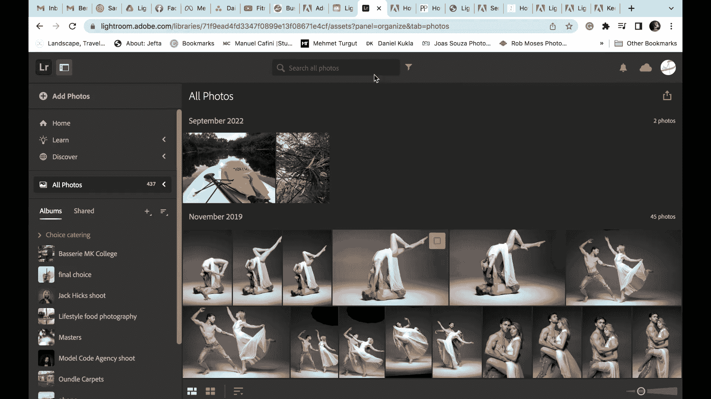
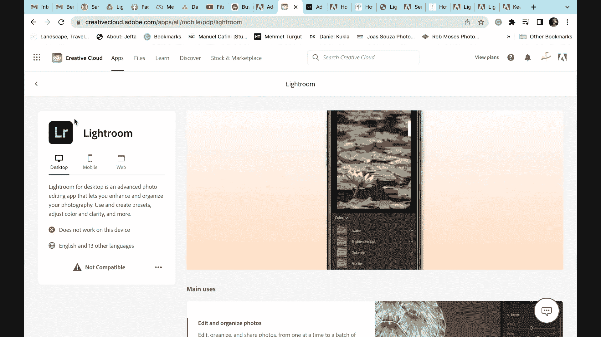
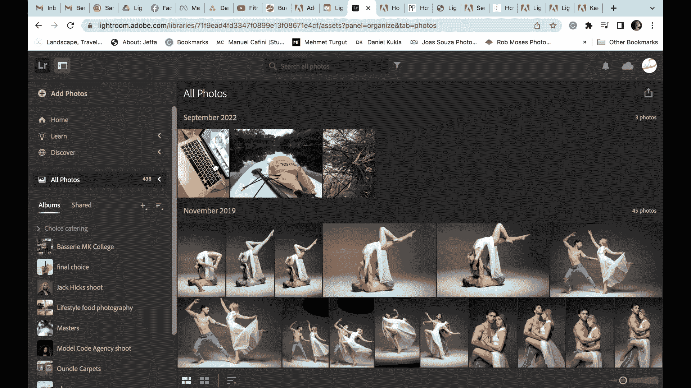
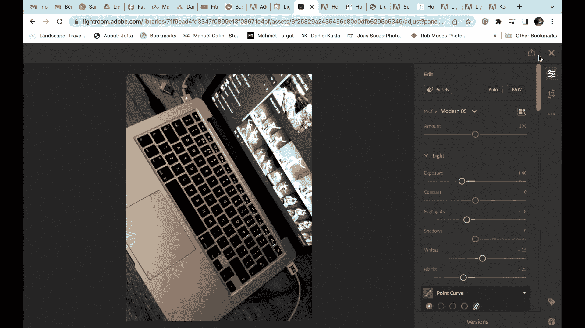
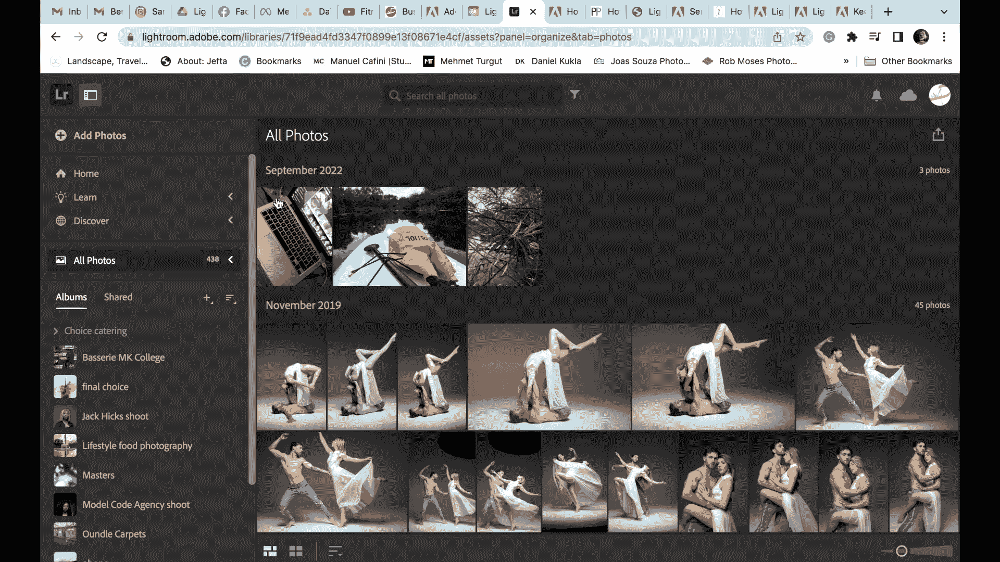
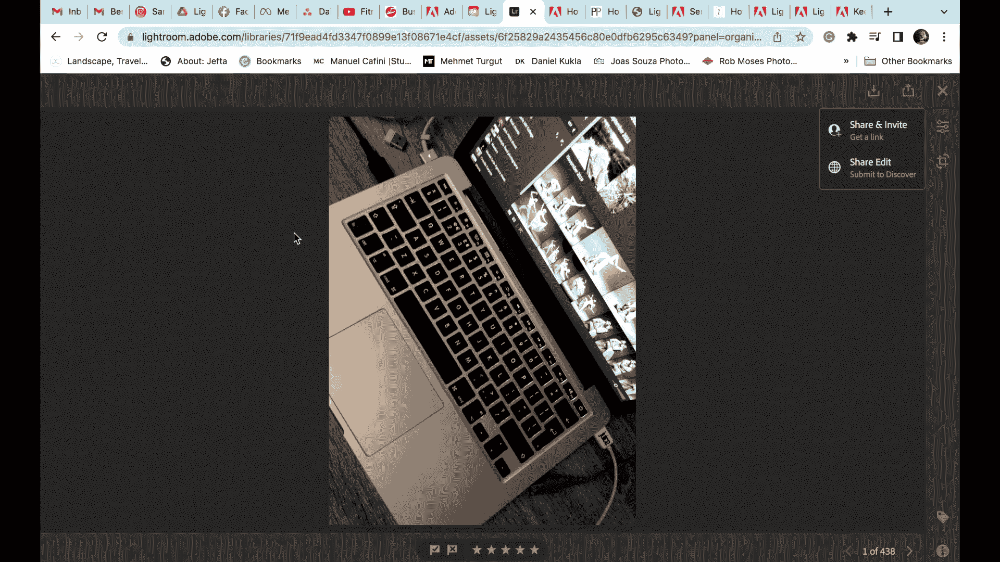

# 📸 Adobe Lightroom 从入门到精通照片编辑教程：第 43 章：同步移动端与桌面端 Lightroom

在本节课中，我们将学习如何把手机里的照片同步到电脑版 Lightroom，也会了解当自动同步没法使用时该怎么办。课程会演示从手机拍摄、同步到桌面、编辑完成后再同步回手机的完整流程，让你在不同设备之间自由编辑照片。无论你是在外出拍摄，还是在办公桌前处理图片，掌握这些方法都能让工作更加灵活。

---

## 43.1 理解 Lightroom 移动端同步功能

上一节我们介绍了 Lightroom 的基础界面和操作逻辑，本节中我们来看看移动端和桌面端是如何建立连接的。

Lightroom 的移动端同步功能，简单来说就是让你在手机上拍的照片能够出现在电脑上的 Lightroom 里。你只需要在手机和电脑上登录同一个 Adobe 账号，就能打通两边的图片库。同步状态有一个直观的判断依据，可以用下面这个公式来表示：

`同步状态 = 账号已登录且网络正常 ? "已连接" : "未连接"`

如果状态显示为已连接，说明手机和电脑之间的链接是正常的，你拍摄的任何照片都可以同步过来。如果图标变成灰色，就代表当前没有建立连接，可能是网络出了问题，或者账号没有正确登录。这个时候你就需要检查设置，或者尝试重新登录，把两边重新关联起来。

以下是判断同步是否正常的几种常见情况：

- 图标亮起或者显示为黑色，表示连接正常，可以使用同步功能
- 图标变成灰色，表示未连接，存在某种问题，无法自动同步照片

---

## 43.2 当自动同步失效时的备选方案

在上面我们讲过了自动同步的原理和状态判断，本节中我们来看看如果网络不给力，或者同步按钮变灰了该怎么办。

其实 Adobe 还提供了另一种导入方式，那就是通过 USB 数据线直接连接手机和电脑。这种方法不依赖云端同步，只要数据线插好了，就能把手机里的照片直接拿过来。当然，前提是你的电脑能够识别这台手机，并且你有权限访问手机的照片库。

以下是通过 USB 线导入照片的具体步骤：

- 用 USB 线把 iPhone 插到笔记本电脑上
- 在 Lightroom 桌面版里选择“导入”选项
- 系统会读取手机相册里的所有照片
- 把想要的图片导入到 Lightroom 里开始编辑

---

## 43.3 在手机上拍照并同步到桌面端

刚才我们讲完了通过 USB 导入照片，本节中我们来看看怎么直接用手机拍照，然后让照片出现在桌面端 Lightroom 里。

现在我们打开手机上的 Lightroom 应用，点击相机按钮，拍一张任意的照片。你可以拍摄帽子，也可以拍摄笔记本电脑，反正目的是演示拍摄动作，不一定非要把这张照片编辑出来。拍完之后，这张照片会保存在手机的 Lightroom 库里，并且会以 DNG 格式存储。DNG 是 Adobe 系列软件支持的一种图像格式，画质比较好，适合后期编辑。

接下来，你需要确保桌面端的 Lightroom 已经打开并且处于联网状态。稍微等待一会儿，或者手动刷新一下桌面端的 Lightroom 界面，你刚才在手机上拍的那张照片就会出现在桌面端的图片列表中。这时候，手机端和桌面端就完成了一次照片同步。你可以把这个过程理解为下面这个简单的工作流：

手机拍摄 → 保存为 DNG 格式 → 云端同步 → 桌面端显示

---

## 43.4 在桌面端编辑并同步回手机

上一节我们讲完了把手机照片同步到电脑，本节中我们来看看怎么在电脑上编辑，再把效果同步回手机。

当照片出现在桌面端 Lightroom 之后，你就可以像平时一样对它进行调整。比如可以套用色彩配置文件，调整曝光度，把画面调暗或调亮，调节高光和黑色等级，还可以稍微改变色温让画面更暖或更冷。这些调整都是在桌面端完成的，不需要再回到手机上操作。

编辑完成之后，桌面端的 Lightroom 会自动把修改后的结果同步到云端。再过一会儿，当你回到手机上的 Lightroom 应用，就会发现照片已经变成了编辑后的样子。这时候你就可以直接在手机上点击分享，把图片导出到相册，或者发送给朋友。

以下是桌面端常见的几种调整项：

- 色彩配置文件，用于快速改变照片整体风格
- 曝光度，用于控制画面整体明暗
- 高光，用于调整亮部细节
- 黑色等级，用于增加画面深度
- 色温，用于让画面偏暖或偏冷

---

## 43.5 编辑后照片的多种分享方式

刚才我们讲完了在桌面端编辑并同步回手机，本节中我们来看看编辑好的照片有哪些分享渠道。

一张照片在 Lightroom 里编辑完成之后，你其实有好几种办法把它分享出去。你不再被绑定在某一台设备上，无论你是用手机拍的，还是在电脑上改的，最终都可以选择最方便的方式把照片发出去。这种多设备协作的流程，就是 Lightroom 移动端和桌面端联用最大的好处。

以下是几种常见的分享途径：

- 通过手机应用直接分享到社交平台
- 导出到手机相册，然后像普通照片一样使用
- 通过 Lightroom 网页版下载或分享链接
- 在桌面端 Lightroom 里直接导出到电脑文件夹

---

## 总结

本节课中我们一起学习了如何把 Lightroom 移动端和桌面端同步起来，也了解了当云端同步出问题时，可以用 USB 数据线作为备选方案导入照片。我们演示了在手机上拍照、同步到电脑编辑，再把编辑结果同步回手机的完整流程，并且介绍了编辑完成后几种常见的分享方式。希望这些内容能帮助你在手机和电脑之间灵活地编辑和管理照片。
