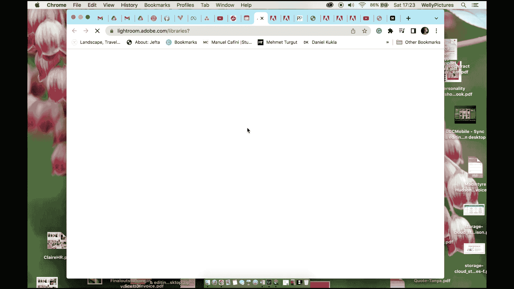
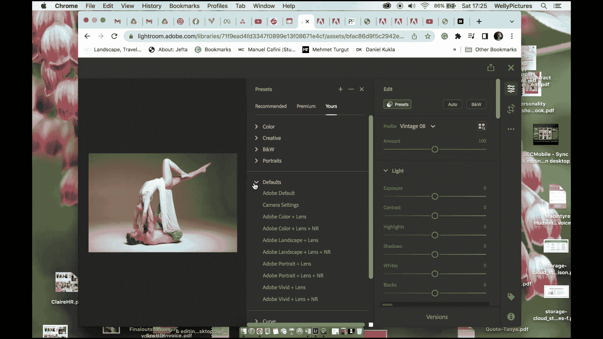
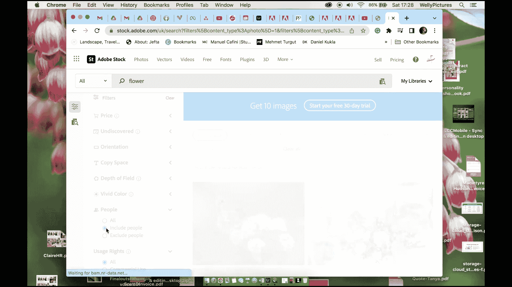
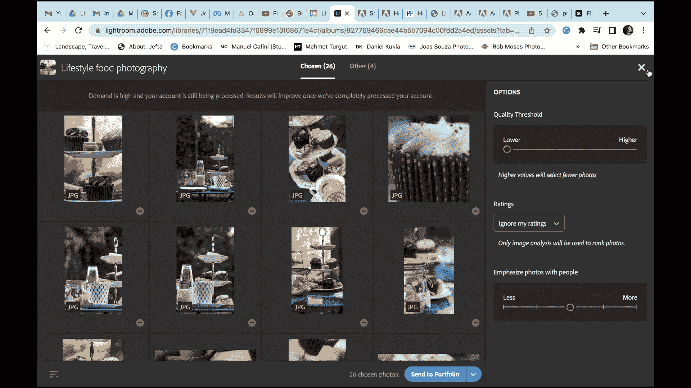
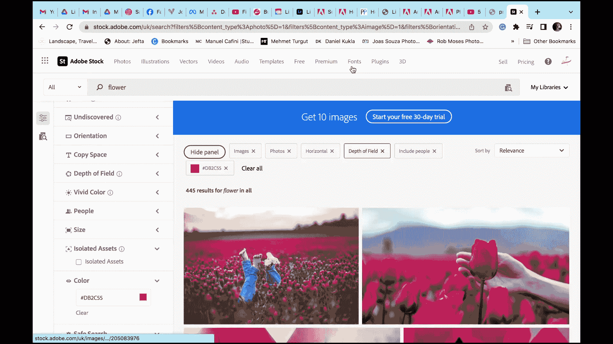
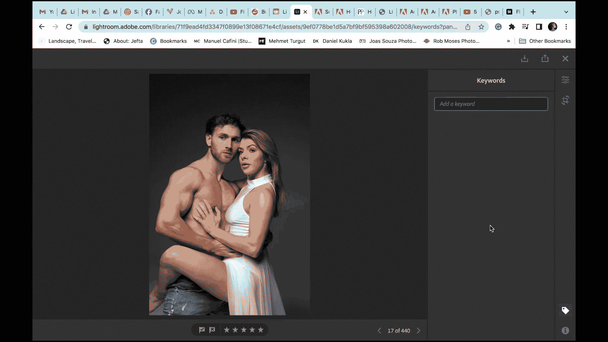
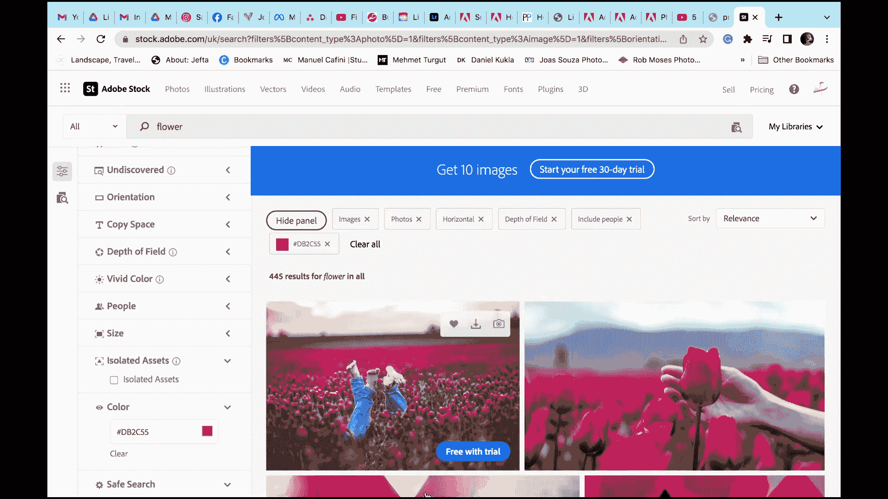
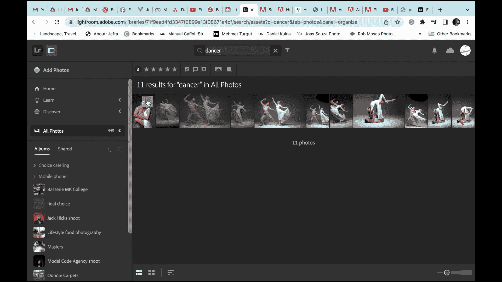
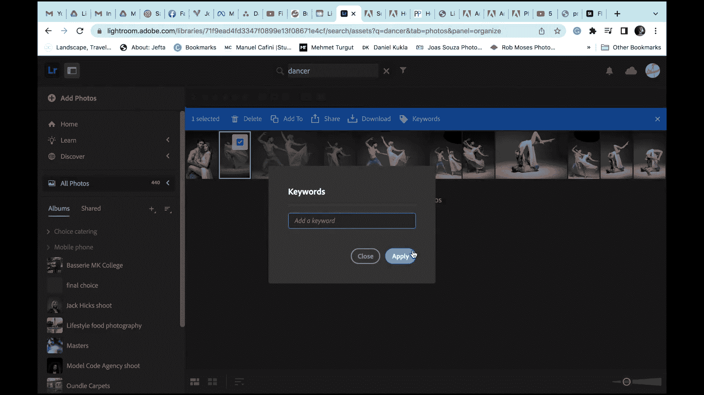
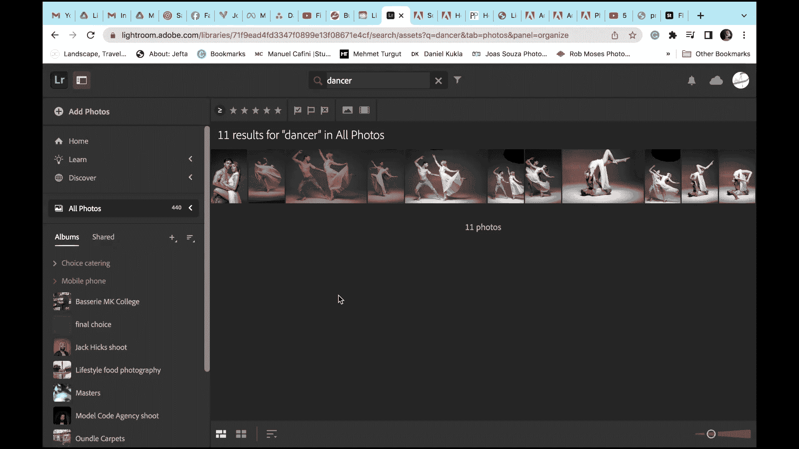

# 📷 Adobe Lightroom 从入门到精通：44：使用 Sensei 搜索 🔍

在本节课中，我们将要学习如何在 Adobe Lightroom 中使用 Sensei 搜索功能。Sensei 是 Adobe 的人工智能技术，它能帮助你更快地找到图片、挑选优质照片，并通过关键词整理图库。我们会先了解 Sensei 是什么，然后看看预设和教程面板，接着讲解两种搜索方式，再介绍如何从相册中挑选最佳照片，最后讲解如何给照片打标记、评分和添加关键词，方便日后检索。


## 什么是 Sensei



上一节我们介绍了 Lightroom 的基础编辑界面，本节中我们来看看支撑这些功能的核心技术。Sensei 简单来说，就是 Adobe 在 Lightroom 和 Photoshop 中使用的一种计算机辅助技术。它属于 Adobe 的创意板块，面向营销人员、数据分析师、广告商和商务专业人士。当我们使用 Lightroom 进行照片编辑时，也就进入了这个创意板块。Sensei 的作用是让照片编辑过程变得更简单，让我们在日常练习中能更快完成某些后期操作。

Sensei 的核心定义可以用以下方式概括：

```text
Sensei = Adobe 计算机辅助技术 + 图像内容识别 + 关键词标记 + 智能分类
```

无论你使用的是 Lightroom 桌面版、Lightroom CC 还是移动端，或者是通过网页版启动 Lightroom，Sensei 的功能基本是一样的。这意味着你不需要特别纠结使用哪个设备，搜索和编辑体验会保持一致。


## 预设与快速编辑



在了解了 Sensei 之后，我们来看看它如何帮助我们加快编辑速度。当你点击一张图片并进入编辑界面时，Lightroom 会提供大量现成的预设。这些预设是专门为人像摄影、风景摄影等不同场景准备的，你只需要点击一下，就可以直接应用到图片上，不需要手动调整曝光、高光等参数。

在网页版和手机端，你也能看到同样的预设选项。这让你不必在每张照片上花费太多时间去琢磨调色参数，直接挑选一个预设加上去，编辑就完成了。

如果你是第一次使用某个编辑工具，Lightroom 还会弹出一个蓝色的小教程区域，教你如何使用该功能。这个教程可以在启动界面和网页版中开启，目的都是让你的编辑工作流更加高效。

除了预设，你还能使用色彩分级、配置文件等额外元素，进一步简化编辑步骤。新手在使用新功能时，除了这些小教程，还可以进入 Adobe 云端的“学习”板块，那里有许多摄影师录制的教程，可以帮助你快速上手。


## 两种搜索方式



预设和教程帮助你编辑更快，而 Sensei 的另一个核心用途则是搜索功能。Sensei 搜索主要有两种使用方式。以下是这两种方式的具体介绍。

第一种方式是使用 Adobe Stock 搜索。你可以输入一个关键词，Adobe Stock 就会显示一系列相关图片供你选择。你也可以使用筛选器来缩小范围。比如，你可以只看图片而不看视频，只看照片而不看插图，只看横向构图，或者设置景深、鲜艳度、像素和兆像素大小。你还可以按颜色筛选，比如红色或粉红色。这样一来，你就能精准找到带有人物和花朵、具备景深效果的图片。找到合适的图片后，你可以下载并将其添加到自己的 Lightroom 中。这就是 Sensei 在帮你搜索和挑选图片时的一个应用场景。

第二种方式是在你自己的 Lightroom 云端图库中搜索。回到 Lightroom 的主页面，你可以看到所有上传的图片。在顶部的搜索框输入“花朵”，Sensei 就会找出图库中所有包含花朵的图片。这些图片可能拍摄于室外，也可能包含人物。因为所有上传的图片都保存在云端，所以搜索速度很快，而且结果非常准确。


## 从相册中挑选最佳照片

除了直接搜索关键词，你还可以从某个相册或合集中让 Sensei 帮你挑选最佳照片。以下是具体操作步骤。

1. 打开你想要处理的相册或合集。
2. 点击右上角的三个小点按钮。
3. 在弹出的菜单中，选择“选择最佳照片”或类似的选项。
4. Sensei 会扫描相册里的所有图片，并根据质量挑选出一部分。比如它可能会在 17 张图片中挑选出 13 张质量更好的图片。

你可以调整质量阈值来控制选出的照片数量。这里的质量阈值关系可以用下面这个简单公式表示：

```
选出照片数量 ∝ 质量阈值的倒数
阈值越高，筛选出的照片越少；
阈值越低，筛选出的照片越多。
```

如果你之前给照片打过星级评分，也可以使用自己的排名作为筛选依据。此外，你还可以让 Sensei 优先选择包含人物的照片。

筛选完成后，你可以将这些照片加入新相册、标记为精选、标记为拒绝、分享作品集，或者分享给其他人。如果你想找出质量不佳的照片，可以把阈值调低，让 Sensei 找出那些不太好的图片，然后统一处理。




## 使用标记与评分



当你查看单张照片时，可以在底部找到标记和评分选项。手机端也有相同的功能。以下是可用的标记方式。

- 选择旗帜：用对勾图标表示，表示你非常喜欢这张照片。
- 拒绝旗帜：用叉号图标表示，表示你不喜欢这张照片。
- 五星级评分：从一星到五星，用于给照片打质量分。

你可以边浏览边给照片打分。比如某张照片构图不错，就打五星；某张照片手被截断了，可能只打三星；某张照片光线奇怪，可能直接标记为拒绝。这样处理完后，你的图库里就有了清晰的优劣区分。


## 添加关键词帮助搜索

为了让 Sensei 更好地帮你找到图片，你可以给单张照片添加关键词。关键词的核心概念可以用以下代码块说明：

```text
关键词 = 能识别图片特征的单个词或短语
特征包括：拍摄内容 / 颜色属性 / 构图方向 / 拍摄场景
```





具体来说，关键词本质上是一个能描述图片内容的词。它可以与拍摄对象有关，也可以与颜色、构图、拍摄场景有关。比如一张照片是人像、黑白照片、人像构图或风景构图，都可以作为关键词。如果这张照片是在工作室拍摄的，你也可以添加“工作室摄影”作为关键词。

操作时，点击照片详情页的小点按钮，输入关键词，按回车确认。你可以添加多个关键词，比如“情侣”、“舞者”等。输入时，Lightroom 会给你提示相关的关键词选项，方便你快速选择。添加完成后，点击叉号关闭输入框。


## 使用筛选器查找图片

添加关键词后，你可以使用顶部的漏斗形筛选器来快速定位图片。以下是筛选器能帮你找到的图片类型。

- 五星级图片：显示你之前评为五星的照片。
- 精选照片：显示你标记为对勾的照片。
- 未标记照片：显示没有任何旗帜、评分或评论的照片。
- 拒绝照片：显示你标记为叉号的照片。

你可以根据需要开启或关闭这些筛选条件。比如只想看精选照片，就开启对勾筛选；只想看没处理过的照片，就开启未标记筛选。筛选器还能区分照片和视频，如果你没有上传视频，关闭视频选项后画面会更整洁。

当你在搜索框输入之前添加过的关键词，比如“舞者”，Sensei 就会在你的图库中找出所有带有该关键词的图片。这就是 Sensei 搜索在 Lightroom 内部图库中的作用，它能帮你整理图片，并在云端存储中快速找到特定类型的照片。






## 本节总结



本节课中，我们一起学习了 Adobe Lightroom 的 Sensei 搜索功能。我们了解了 Sensei 是 Adobe 的人工智能技术，能让编辑和搜索更高效。我们介绍了预设、蓝色教程面板和 Adobe 云端学习板块，帮助新手快速上手编辑。我们讲解了两种搜索方式，一种是通过 Adobe Stock 查找外部素材，另一种是在自己的云端图库中搜索关键词。我们还学习了如何从相册中挑选最佳照片，如何使用旗帜和五星级评分标记图片，以及如何添加关键词和使用筛选器快速定位照片。希望这些内容能帮助你更好地整理和搜索 Lightroom 中的图片。


