Adobe Lightroom 零基础到精通修图教程：第 1 部分 第 40 节：媒体库概览 📸


本节课中我们将要学习手机端 Lightroom CC 的媒体库界面。你会了解这个版本和 Lightroom Classic 有什么区别，如何导入照片，如何使用相机功能，以及如何整理和查看图片。我们还会介绍云端同步、筛选搜索、相册管理和社区功能。内容会用大白话讲解，适合初学者跟随学习。


手机端 Lightroom CC 是什么


我们在另一台设备上演示。在手机上，你可以安装我们之前提到的 Lightroom CC。这不是 Lightroom Classic。这是另一个版本的 Lightroom。如我们之前所说，这个版本不具备 Lightroom Classic 的所有功能，而 Lightroom Classic 也不具备 Lightroom CC 的所有功能。因此我们将浏览布局，看看这个版本提供了什么。

我强烈建议在手机上安装 Lightroom，因为有时候你只想快速修图而不想打开笔记本电脑。你可能想导出照片，或者去掉一个斑点，使用预设等操作。当这些功能在手机上时，操作会简单很多。现在我处于我的媒体库中。

了解版本区别后，下面我们进入具体的媒体库界面。


媒体库的界面与照片导入


这里是我所有照片的所在。你可以看到 Lightroom 会自动导入你所有的图片，如果你允许的话。我们来看看这里有什么，这是下载 Lightroom 后首先看到的内容。Lightroom 会询问你是否允许它从相册中获取所有图片并导入应用程序。如果你允许，你拍摄的每一张照片都会出现在这里。

右下角有两个蓝色选项。左边有一个选项，用于向“所有照片”添加照片，这是我当前所在的文件夹，你可以从相册或文件中添加。旁边有一个相机选项，你可以使用 Lightroom 拍照。

照片进入媒体库后，我们还可以使用自带相机直接拍摄。


使用相机拍摄与 DNG 格式


我们之前聊过 DNG 格式。使用 Lightroom 拍照时，你可以选择用相机拍摄，这样就是 DNG 格式，这样你的图片细节更多，还能做更多操作。相比 JPEG 等其他格式，你遇到的噪点会少得多。

我们可以用公式来表示：

```
噪点(DNG) < 噪点(JPEG)
```

所以如果我们进入这个相机功能，可以拍照。本节课我们只是快速概览，之后我们会逐一介绍它们的工作原理。

拍摄和导入照片之后，我们需要学习如何整理它们。


图片的分组与排序


然后在右上角，点击三个点可以看到一些选项。我可以选择分组。可以按年份、月份、日期、小时、标记照片、星级评分和文件类型分组，目前我选择的是无，也可以自动分组。

以下是分组的常见条件：

- 年份
- 月份
- 日期
- 小时
- 标记照片
- 星级评分
- 文件类型

如果点击月份，可以看到分成了 2021 年 6 月和 2021 年 7 月。现在我们回去点击无。

除此之外，我们可以按导入日期排序，进入后可以按导入日期、拍摄时间、修改日期、文件名和星级评分排序。这同样是为了排序，如果你想查找在特定时间段内拍摄的一批照片，这会很有帮助。

以下是排序的常见方式：

- 导入日期
- 拍摄时间
- 修改日期
- 文件名
- 星级评分

除了分组和排序，我们还可以调整照片的显示方式。


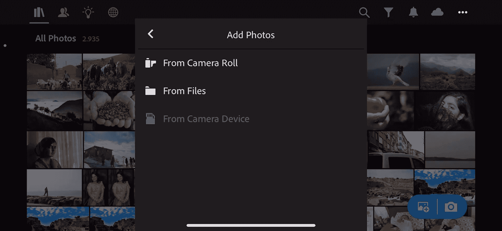

查看选项与信息显示


你还有视图选项。进入后可以看到文件类型、标记和评分、照片信息、EXIF 信息，还可以更改缩略图大小，设为小、中或大。

照片信息会弹出这些 Y 文本，告诉你使用了什么光圈、快门速度等等。所有标记和评分我目前都没有，所以没有显示任何内容。如果点击文件类型，它会告诉你是否是原始格式，但目前这些都不是原始格式。贡献者，我的图片没有，所以没有显示内容。

如果你不想要信息叠加，可以关闭滑块，我暂时保持开启。

查看设置调整好之后，我们还可以继续往库里添加新照片。


导入照片与外部设备


我们还有一个选项，可以再次从相册或文件中添加新照片。如果连接了外部驱动器，就像 Lightroom Classic 一样，你可以从该设备导入。这是这里的第三个选项，我现在没有插入任何设备，所以无法使用这个选项。

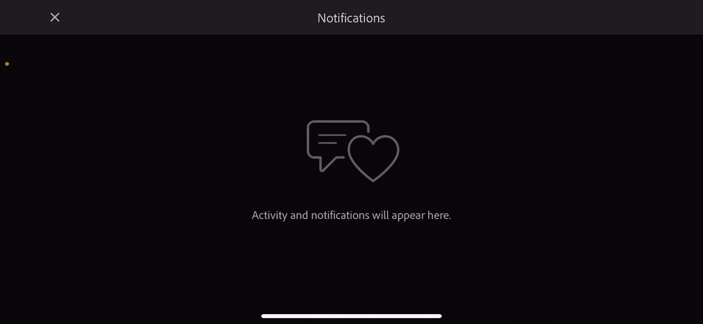

你也可以制作幻灯片，选择想要的照片，我们稍后会介绍。回去，这些就是你拥有的选项。

添加照片的方式了解之后，我们来看看 Lightroom CC 最核心的云端特性。


云端同步与存储设置


还要记住我们说过，Lightroom CC 是基于云的程序，这意味着我可以分享所有图片，将它们保存在云端或连接到 Adobe 账户。

我们可以用公式来表示云端程序的特点：

```
Lightroom CC = 云端存储 + 多设备同步
```

右上角三个点后面的下一个项目是云端，点击后会将所有图片上传到云端，并自动从相机导入。如果我不想这样，可以进入设置，做一些调整，比如只下载智能预览、防止休眠，或者不想使用蜂窝数据，它还会告诉我云端存储容量，我现在有 100 GB，相当不错。如果你不想同步，也可以暂停，这取决于你。我们先恢复，然后有一个通知标签，我现在没有任何通知，但我们会学习为什么这里会有这个。

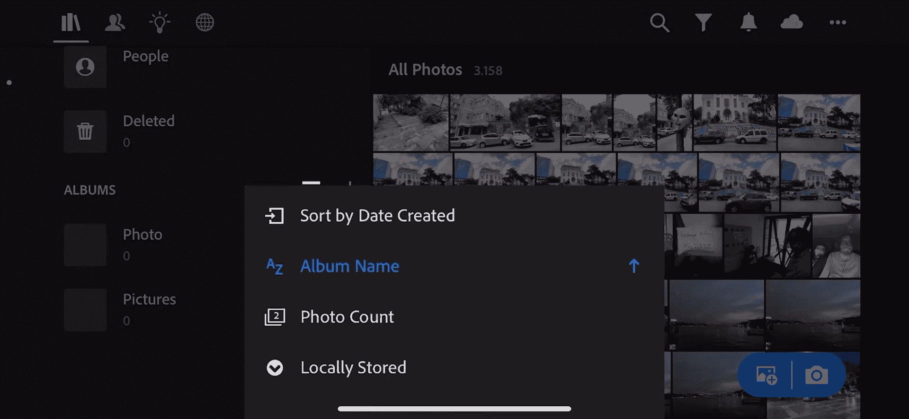

云端设置清楚之后，我们需要学习如何在海量照片中快速找到目标图片。


筛选、搜索与关键词


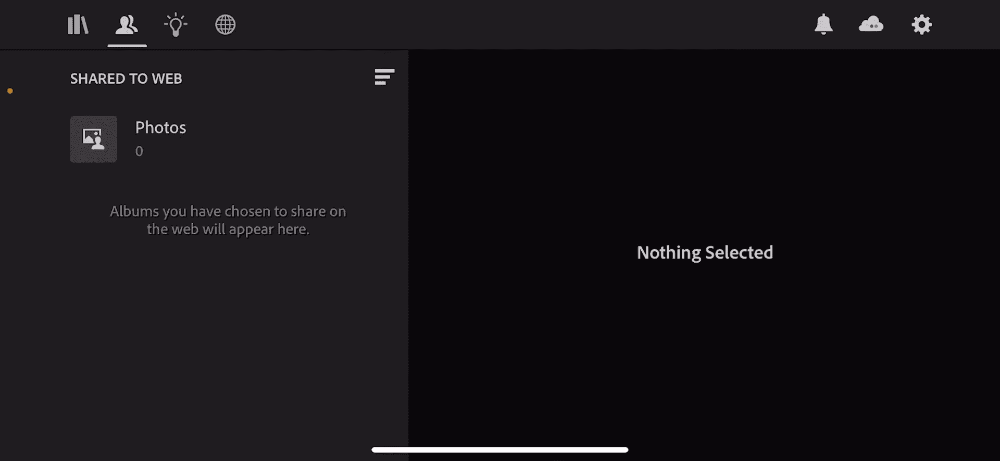

我们还有筛选选项，类似 Lightroom Classic，有类型、相机、人物，没有搜索结果，我没有添加任何人，地点会告诉我图片拍摄的地点，这些都在元数据中。

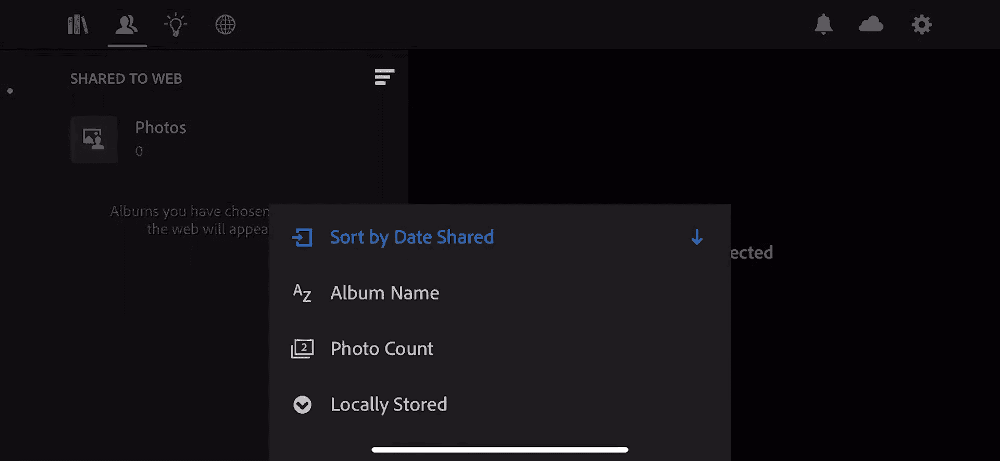

我们可以用公式来表示元数据：

```
元数据 = {相机, 光圈, 快门速度, ISO, 版权, 地点}
```

我们还有关键词，已编辑和未编辑的图片会显示在这里，也可以按星级筛选，然后是搜索栏，可以按位置或元数据搜索特定图片，也可以按相机或我给的关键词搜索。点击完成，现在我们不搜索。

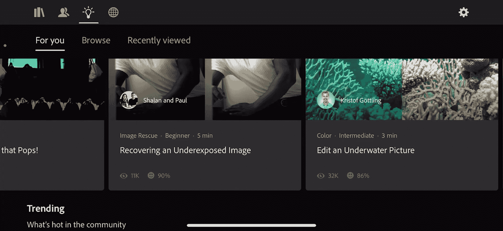

以下是常见的筛选维度：

- 类型
- 相机
- 人物
- 地点
- 已编辑 / 未编辑
- 星级

找到照片之后，我们可以将它们整理到相册或文件夹中。


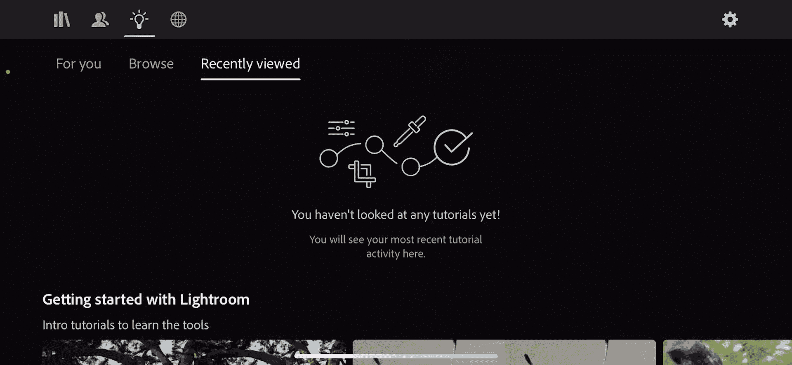

相册、文件夹与网页分享


然后左上角是媒体库，我打开它，有一堆媒体库，来自相机照片、最近添加、最近编辑、人物、已删除。

我也可以创建相册，有一个加号按钮，可以创建文件夹或相册，点击每一个，写个名字，然后点击完成，我就写 Photo，好了，完成，它会为我创建一个相册，然后我可以整理这些，但我现在只有两个。所以没什么可整理的。

书架图标旁边是共享到网页，但我没有分享任何内容，所以没有选中任何东西，你可以分享，我可以按日期、照片数量和其他内容排序。

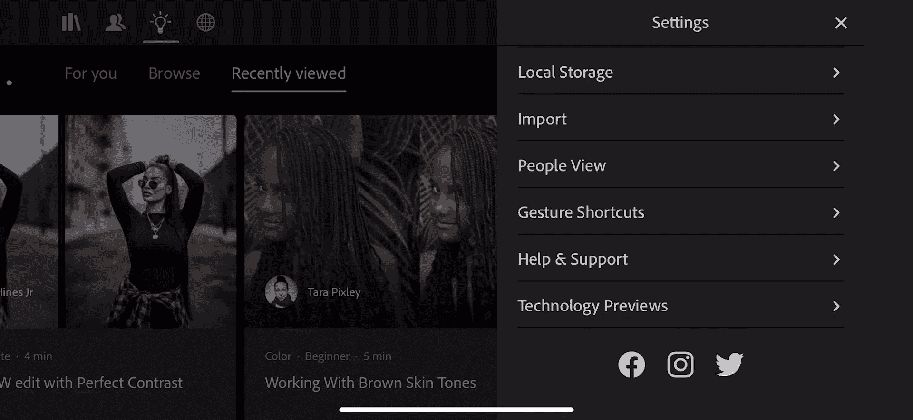

整理和分享之外，媒体库还提供了教程和社区功能。


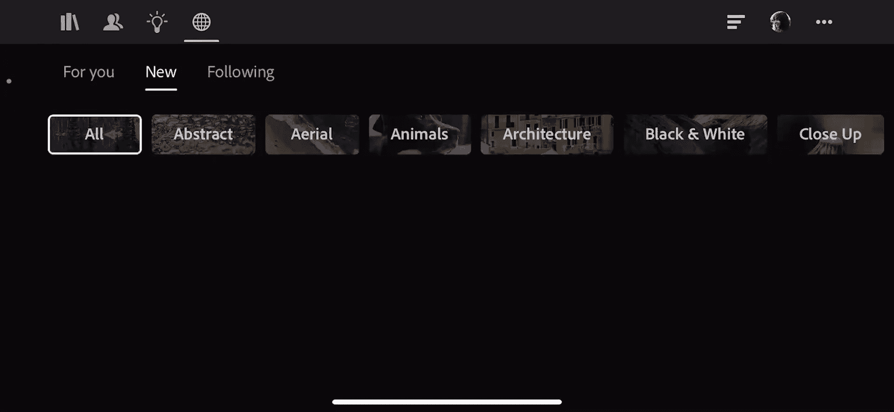

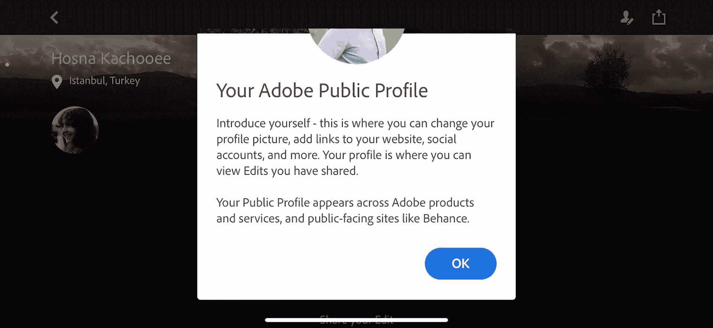

教程、社区与账户设置


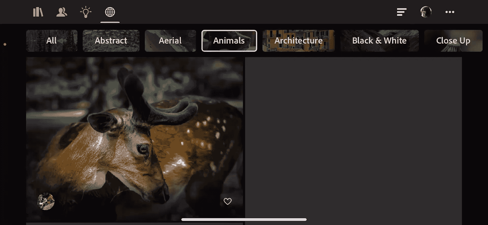

然后这里有一个教程，你可以学习更多 Lightroom CC 的功能，学习如何拍摄完美的室外人像，进行锐化、调整色调和色彩。下面还有其他人，这些是 Lightroom 教育团队制作的，但你也可以从其他创作者那里获得教程，不是官方的，但它们是社区中帮助他人的创作者。

还有社区热门，人们分享自己的东西，下面有分类，如果你是初学者，点击初学者，会得到一些容易跟随的教程。回去后有中级、高级、人像、风景等，你可以浏览喜欢的课程。还有最近查看，我还没看过任何教程。

顺便说一句，如果你有 Adobe 会员资格或订阅，就可以使用这些功能，你将可以访问所有这些内容，但如果你在手机上使用 Lightroom CC 免费版，则无法访问任何这些内容。这里也有设置，我的账户，可以登录或退出，还有 Lightroom 功能、更新、高级功能、云端存储、本地存储导入、人物视图、手势快捷方式、支持和其他社交媒体。

以下是设置中包含的常见项目：

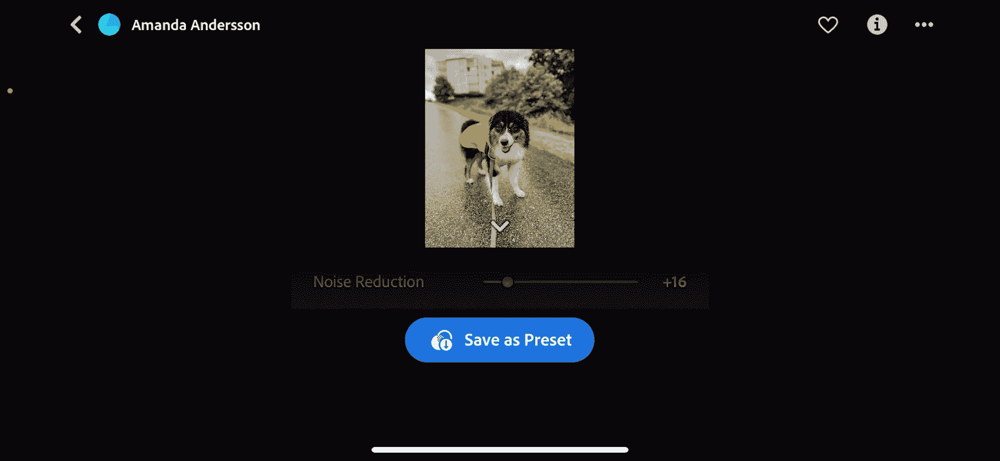

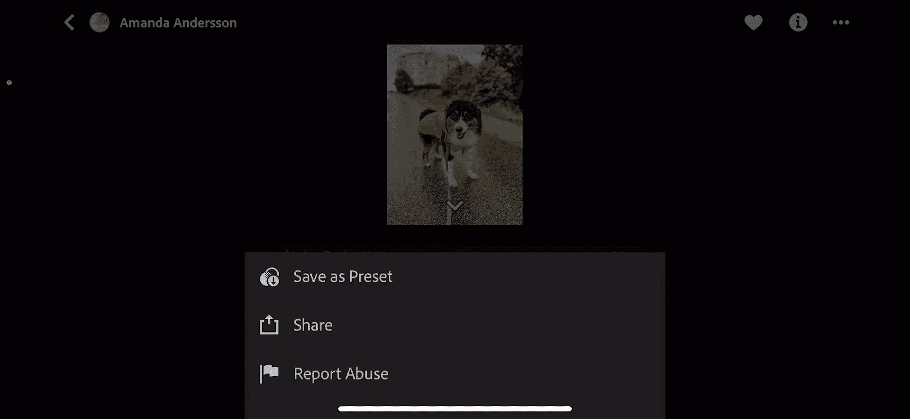

- 账户登录与退出
- Lightroom 功能与更新
- 高级功能
- 云端存储
- 本地存储导入
- 人物视图
- 手势快捷方式
- 支持与其他社交媒体

除了官方教程，还有一个专门面向 Lightroom 用户的社区。


Kme 社区与关注摄影师


最后，我们有一个，这是一个像 beeH 这样的在线社区，这是我的 Kme，这是一个像 Bee Hands 这样的社区，但是专门针对 Lightroom，这里我们可以看到人们在分享图片，我可以浏览不同分类。


他们可以点赞自己的图片，可以进入每一张，他们会告诉我做了哪些编辑。你可以看到一条线从原始图片经过每个调整，进入编辑。如果我喜欢这张图片，可以将其保存为预设。如果我很喜欢某人的编辑风格，可以将其保存为预设并用在自己的图片上。我们可以用代码来表示这个过程：

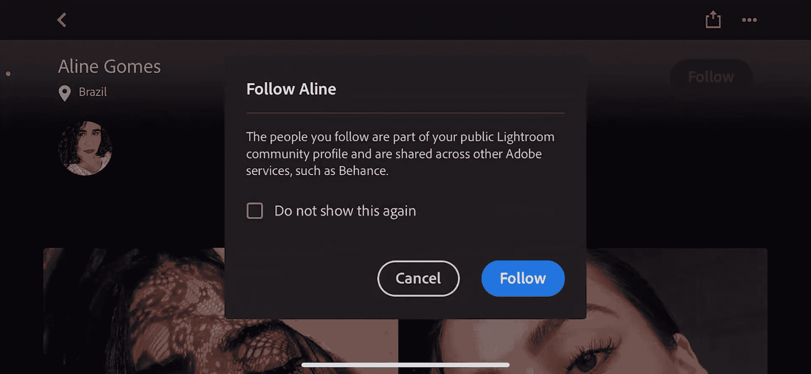

```
预设 = 保存(编辑操作序列)
```

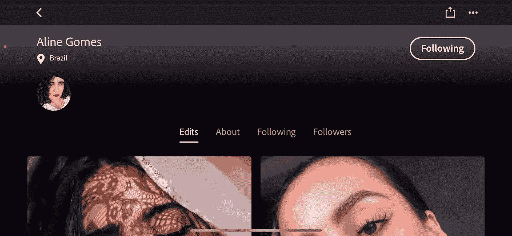

我可以在右上角点赞，有一个心形按钮，你可以保存为预设、举报、滥用或分享到其他平台。还有信息，告诉我们主题、使用的相机、光圈、ISO，还有版权信息，也就是我们聊过的元数据。回去。

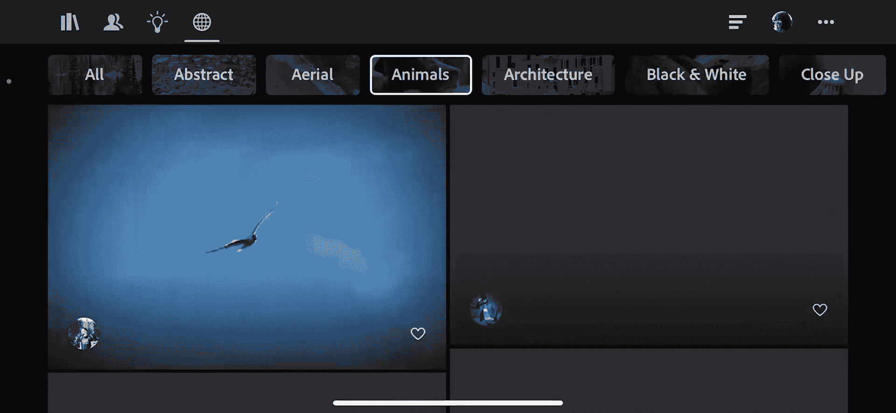

还有这些是新照片，我现在在新照片页面，可以点击为你，这些是为我挑选的，可能是热门内容，如果我真的喜欢某人的作品，可以关注他们。让我们进入这个人。如果我喜欢作品，可以点击关注。点击关注，现在她发布新作品时我会在页面看到。如果进入关注，现在屏幕上有她所有图片，因为她是我目前唯一关注的人。你可以再次进入新照片，在你感兴趣的不同领域发现其他摄影师。

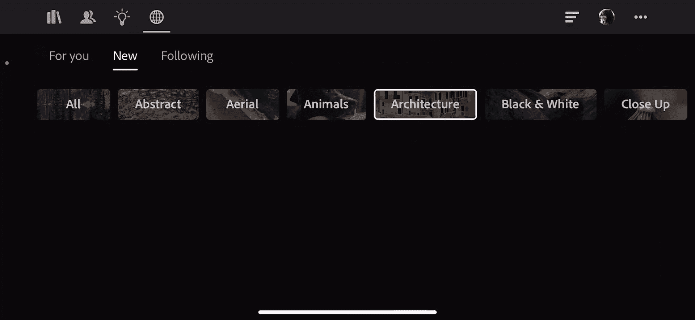

社区功能介绍完毕，我们来做一个总结。


总结与建议


这是一个很棒的程序，在导出和管理方面没有 Lightroom Classic 那么多选项，但它是一个相当不错的基于云的程序，允许你学习、分享和进步。

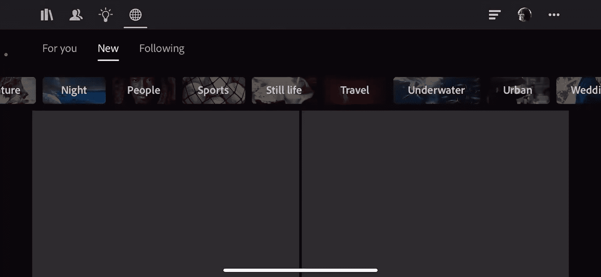

这就是为什么我建议在笔记本电脑或电脑上安装 Lightroom Classic，在手机或平板上安装 Lightroom CC，这样你就能获得两全其美的效果。再次，你可以搜索精选或新内容。这就是媒体库的工作方式。

本节课中我们一起学习了手机端 Lightroom CC 的媒体库概览，包括界面布局、照片导入、相机拍摄、分组排序、云端同步、筛选搜索、相册管理以及社区功能。下一节课我们将进入编辑，了解我们拥有什么以及可以使用什么来编辑图片。我们在那见。
