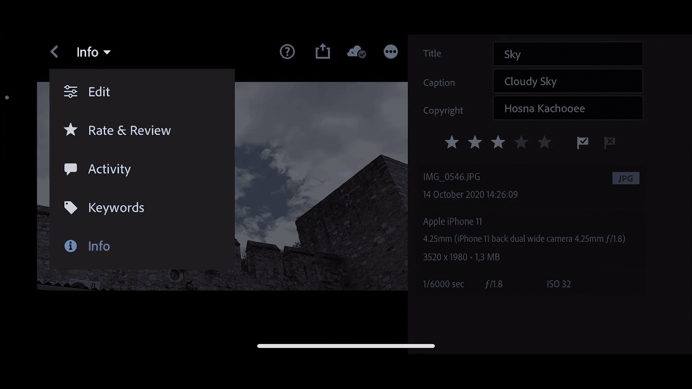
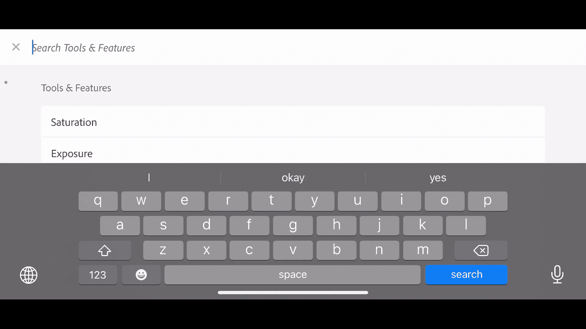
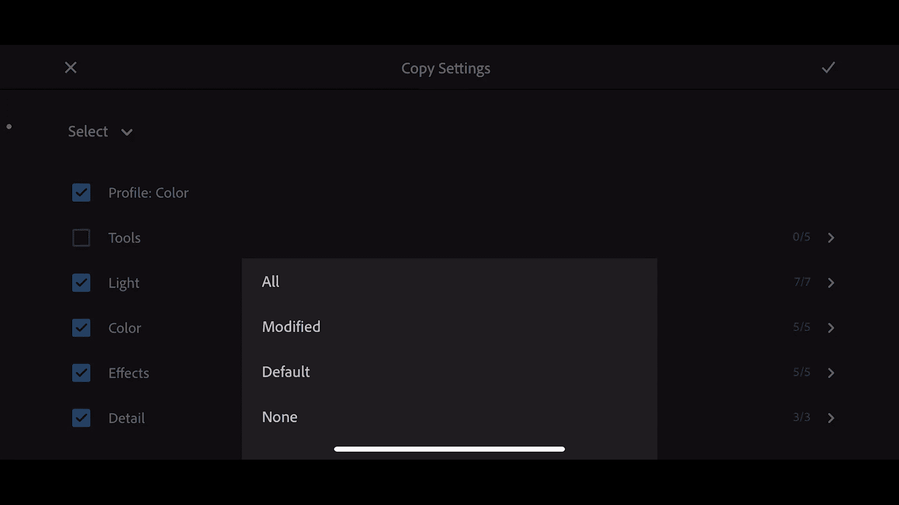

# Complete Adobe Lightroom Megacourse： Beginner to Expert Photo Editing part1：46：顶部开发选项 🖼️


在本节课中，我们将要学习 Adobe Lightroom 手机版顶部开发选项的具体用法。上一节我们已经介绍过了资料库模块的工作方式，也清楚 Lightroom CC 应用中各个部分的名称和功能是什么。现在我们要把重点放到图片编辑部分，看看在开发模块里，那些位于屏幕顶部的按钮和菜单具体能做什么。虽然内容看起来比较多，涉及到分享、导出、云同步和图片组织等不同方面，但只要你跟着步骤一步一步来，完全不用担心看不懂。我们会用大白话把每个按钮的作用都说清楚，让初学者也能快速上手。


首先，我们来看看如何从资料库进入编辑界面，以及手机上的屏幕布局长什么样。当你挑选好一张图片之后，就会进入 Develop 开发模块。桌面端和平板电脑上的布局会有所不同，而我们现在使用的是手机，所以看到的是手机端的界面。在屏幕左上角，有一个返回资料库的箭头按钮。点击它可以回到资料库，再次点击则会回到开发模块。箭头旁边是“编辑”选项，点击后会弹出一个下拉菜单，通过这个菜单你可以对图片进行评分和评价，查看该图片的活动记录，也能看到关键词和详细信息。这里的信息包括拍摄照片所用的相机、快门速度、光圈值等参数。现在这张图片还没有标题，也没有版权信息，但你可以在这里自行添加。比如给图片起个名字，填写说明文字，再加上版权所有者。你还可以给图片打星级评分，比如三颗星，或者给它加上旗标。另外，界面还会告诉你图片当前的格式，比如这张图就是 JPEG 格式，屏幕下方能看到 JPG 字样。除此之外，你还能查看拍摄日期、使用的镜头、图片尺寸、文件大小以及拍摄时使用的各种设置。如果你使用的是相机拍摄，这些信息会更加详细，包含相机名称、镜头型号、图片尺寸、文件大小和拍摄参数。


图片基本信息可以用下面这个结构来理解：

```
图片基本信息 = {
  相机型号,
  镜头型号,
  拍摄日期,
  图片尺寸,
  文件大小,
  快门速度,
  光圈值,
  图片格式
}
```




了解完这些基本信息之后，我们继续看看如何进入全屏模式，以及工具栏是如何显示和隐藏的。


接下来，我们来看看点击图片后会发生什么，以及如何让工具栏消失或重新出现。当你轻触图片一次，就会进入全屏模式。这时候屏幕上的所有工具和按钮都会消失，只剩下图片本身。如果你想再次编辑，只需要再次轻触图片，工具栏就会重新显示，包括右侧的所有工具条。这种设计是为了让你在查看照片时不会被多余的按钮干扰，需要编辑的时候再把界面叫出来，操作起来非常直接。


全屏模式的操作逻辑可以总结如下：

- 第一次轻触图片：进入全屏，隐藏工具栏
- 第二次轻触图片：退出全屏，显示工具栏




掌握了界面切换之后，我们再看看右上角那些用来查找和了解功能的按钮。


屏幕右上角有两个很实用的入口，一个是问号图标，一个是搜索栏，它们专门用来帮助新手快速理解 Lightroom 的各个面板。在右上角，你会看到一个问号图标。点击它以后，你可以搜索自己想了解的功能。比如，如果你不知道“饱和度”这个选项卡是干什么用的，点击问号后它会告诉你这个面板的作用，还能要求 Lightroom 为你演示。这对初学者特别友好，因为你可能还不清楚每个标签页具体负责什么，问号功能能帮你快速搞懂。和上一课提到的一样，Lightroom 为初学者和中级用户准备了很多教程，你可以跟着这些教程轻松学会使用这个应用。除了问号，右上角还有一个搜索栏，你可以直接搜索某个工具。比如搜索“修复”，就会出现修复画笔，这样你就能知道修复画笔具体能用来做什么。


右上角的辅助功能包括以下几点：

- 问号图标：搜索并查看各个面板的使用说明
- 搜索栏：直接查找特定工具，如修复画笔
- 新手教程：适合初学者和中级用户的指导课程


说完了如何查找功能，我们接着看看右上角用于分享和导出的选项。


问号图标旁边是导出选项，这是一个非常熟悉的图标，点击后可以进行分享操作。点击分享图标后，你可以把照片分享到不同的应用程序，比如 WhatsApp、Instagram、Telegram、Facebook 等等，甚至可以直接发短信给某个人。如果你想把照片上传到 Google Drive，或者通过电子邮件发送，同样需要先点击分享，系统会给你相关选项，并且会生成一个链接。你可以通过这个链接分享文件，任何人点击链接都能查看这张图片。除了普通分享，还有“邀请他人”的功能。邀请他人意味着其他人可以在 Lightroom 中查看你的图片，如果你欢迎他们，他们甚至可以帮你编辑图片。这就像是一个团队项目，比如你负责调整颜色，邀请的另一个人负责处理细节。在分享菜单下方，还有“打开方式”选项，你可以把照片在 Photoshop 或者 Lightroom Classic 中打开。不过需要注意的是，手机端无法直接打开 Lightroom Classic，因为 Lightroom Classic 没有移动版应用。只有在桌面端安装了 Lightroom Classic 才能进行此操作，所以在手机上这一项目前不可用。接着是“导出到相册”，会把图片导出到手机的相册里。还有“导出到文件”，这是另一个存储位置，你可以自己选择偏好的文件夹。比如你可以在文件里创建一个专门用于 Lightroom 导出的文件夹，这样所有导出的图片都会放在那个文件夹里，不用在相册里一个一个去找，非常整洁。此外还有“分享编辑”功能，可以把你的编辑结果分享到我们之前提到的社区里。在分享之前，你可以先做一些随机调整，比如提高对比度，然后再分享编辑，不过记得先应用这些更改。最后是“导出为”，这里你对图片格式和尺寸有更多控制权。如果你是为了特定用途而分享，就会想要使用“导出为”，并且你也可以选择想要保存的位置。


分享菜单里包含的主要选项如下：

- 分享图标：分享到 WhatsApp、Instagram、Telegram、Facebook 等社交媒体，或发短信
- 链接分享：生成链接，任何人点击即可查看图片
- 邀请他人：让其他人在 Lightroom 中查看或编辑图片，适合团队协作
- 打开方式：在 Photoshop 或 Lightroom Classic 中打开（仅限桌面端）
- 导出到相册：保存到手机相册
- 导出到文件：保存到自定义文件夹，方便整理
- 分享编辑：将编辑结果分享到社区
- 导出为：控制图片格式、尺寸和保存位置


说完了分享和导出，接下来我们看看屏幕上的云图标代表什么，以及它和会员服务有什么关系。


屏幕上有一个云朵图标，它的状态直接关系到你的图片是否正在上传和同步。如果你看到云图标旁边有三个点在不断出现和消失，那说明 Lightroom CC 正在同步你的图片，也就是在上传文件。之所以会出现这个加载状态，是因为你允许 Lightroom CC 同步图片。当你第一次安装 Lightroom 时，它会问你是否希望把所有图片导入 Lightroom，以及是否希望同步图片，你可以选择是的或者不是。如果你不想让同步进行，或者发现 Lightroom 运行变慢，可以暂停同步。进入选项后，你还能看到剩余存储空间有多少，是否允许使用蜂窝数据，是否下载智能预览，以及防止休眠等设置。这些都是关于同步和云存储的选项。需要注意的是，这些云存储和同步功能只有会员才能使用，也就是那些已经登录 Adobe 账号的用户。我们在上一课也提到过，社区、教程以及云存储和同步都是针对已登录账号的会员开放的。如果你没有 Adobe 账号，只是在使用 Lightroom CC 的免费版，虽然里面有很多选项，但并不是所有功能都能用。比如修复画笔和某些配置文件就需要会员权限。不过即使没有会员，你依然可以调整光线、调整颜色等基础操作，照样可以把照片处理好。有会员的话会获得更多好处，但没有会员也能让事情运转起来。


云同步和会员权限可以用下面这个结构来表示：

```
云同步状态 = 三个点加载动画（正在上传文件）
会员权限 = 已登录 Adobe 账号 → 解锁云存储、同步、修复画笔等
免费版限制 = 无法使用修复画笔、部分配置文件等高级功能
```


关于云同步和会员，需要了解的要点如下：

- 云同步：上传图片到云端，界面会显示加载点
- 暂停同步：适合 Lightroom 运行缓慢时使用
- 会员专属：云存储、同步、社区、教程、修复画笔等
- 免费版可用：基础光线和颜色调整


云图标旁边还有一个圆形的三个点按钮，我们再看看它能做什么。


点击那个圆形的三个点按钮，你可以对图片进行分类整理，也可以删除不需要的照片。在这里，你可以把图片添加到相册或合集里。假设你之前创建过一个叫“云朵季节”的相册或合集，就可以把这张图片加进去，这样所有天空有云的图片都会集中在同一个地方，管理起来更有条序。当然，如果你还没有创建相册，也可以先创建再添加。除了整理，你也可以直接删除图片。从 Lightroom 删除图片并不会删除你手机相册里的原始文件，所以不用担心丢失原片。当你点击删除时，系统会询问你是否确定，并且会提示这会从你的照片、相册和合集中移除。如果这张图片之前被加到某个相册里并分享过，删除后它就会从那个相册里消失。不过好在你有 60 天的时间来恢复被删除的图片，而且原始文件始终保留在你的相册里，随时可以找回来。


三个点菜单里的组织和删除功能包括：

- 添加到相册或合集：把相似图片归类管理，如“云朵季节”相册
- 删除图片：仅从 Lightroom 移除，原始文件保留，60 天内可恢复


整理完图片之后，我们来看看查看选项里的叠加层设置。


在三个点菜单下方，还有查看选项，这里主要控制画面上的叠加信息。点击查看选项后，你可以打开直方图，这是我们之前在 Lightroom Classic 里已经熟悉的工具。当然，你也可以选择显示图片信息。开启后，左上角会显示图片编号、是否为原图、图片名称、拍摄日期、拍摄时间、星级评分以及是否加了旗标。如果你想让画面更整洁，建议开启直方图，因为直方图对后续调整光线非常有帮助，所以我们先把直方图打开。说完了查看选项，接下来是“复制设置”功能。复制设置的意思是，如果你想把这一张图片上做的所有调整，应用到另一张图片上，就可以先复制这些设置。现在我们还没有做任何调整，所以所有选项都是未勾选状态。如果你点击确定，Lightroom 默认会为你选择一些设置，或者你可以选择不选任何项。但如果选了不选任何项，这个功能就没有意义了。所以我们选择全部选项，点击对勾后，设置就会被复制到剪贴板。之后你可以把这些设置应用到新图片上，这样就省去了重复编辑两张图片的时间，不需要花那么长时间去分别调整。不过要注意，要确保两张图片的内容相似，光线也要一致。不能一边是早上拍的明亮图片，一边是晚上拍的暗图片，因为针对明亮图片使用的设置，和针对夜间暗图片使用的设置会有很大区别。所以一定要确保图片内容相近，这样复制设置才有效。


复制设置的逻辑可以用下面这个公式来表示：

```
复制设置逻辑 = 当前图片调整参数 → 复制到剪贴板 → 应用到新图片
适用条件 = 两张图片光线和内容相似（避免明亮图与暗图混用）
```


查看选项和复制设置的关键点如下：



- 查看选项：开启直方图和图片信息叠加，查看编号、日期、星级等
- 复制设置：将当前图片的调整参数复制并应用到另一张图片
- 使用前提：两张图片内容和光线要相似，否则效果会差很远


好了，关于顶部开发选项我们就讲到这里，最后的工具栏部分将在下一课详细介绍。


本节课中，我们一起学习了 Adobe Lightroom 手机版顶部开发选项的主要内容。我们了解了如何进入开发模块、如何在手机端查看图片的元数据信息、如何使用全屏模式切换工具栏，以及右上角问号和搜索栏的帮助功能。接着，我们详细看过了分享与导出的各种选项，包括社交媒体分享、链接分享、邀请协作、在 Photoshop 中打开、导出到相册或文件，还有“导出为”的格式控制。随后，我们解释了云同步图标的含义、暂停同步的方法，以及会员和免费版在功能上的区别。最后，我们学习了如何通过三个点菜单组织图片到相册、如何安全删除并恢复图片，还掌握了查看选项中的直方图设置，以及复制设置节省编辑时间的技巧。希望这些内容能帮助你更好地上手 Lightroom 的编辑流程，下一课我们将继续探索工具栏的具体用法。

