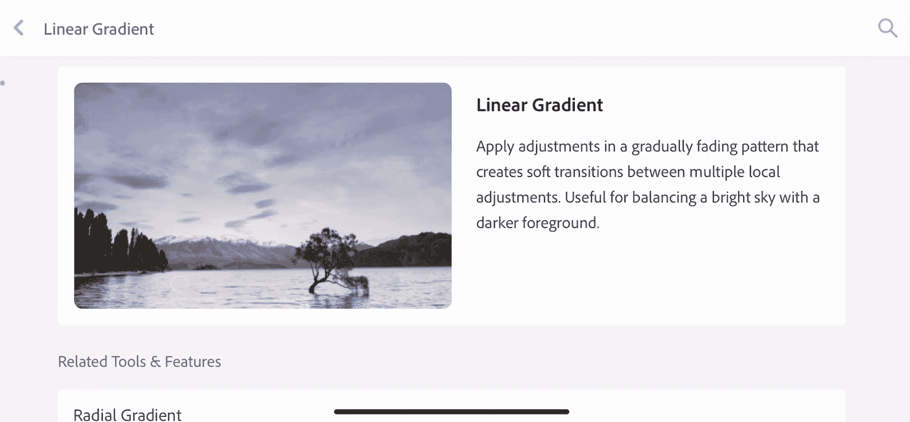

📷 Lightroom 选择性调整教程：047：选择性调整工具


在本节课中，我们将学习 Lightroom 移动端的选择性调整功能。在之前的内容里，我们已经了解过顶部选项的作用，也知道如何开启直方图，以及如何分享和同步图片。接下来，我们要把目光转到界面右侧的边栏，也就是编辑工具栏。这些工具是我们编辑照片时会用到的核心功能，其中一部分在 Lightroom Classic 桌面版里也有，所以你可能会觉得很熟悉。当然，也有些功能是桌面版没有的，不过它们的功能虽然不同，但大部分你都见过，只是布局和控制方式不太一样。既然你已经知道如何在 Lightroom Classic 里使用这些工具，那么在手机版上操作也不会觉得陌生。


## 右侧工具栏与调整画笔


接下来我们来看看右侧工具栏的具体内容。以下是右侧工具栏的主要组成部分。

- 调整画笔：界面右上角有一个带有虚线圆圈的图标，点击它就是调整画笔。请记住，这就是我们的调整画笔工具。
- 渐变滤镜：用于处理呈线条或梯度分布的区域。
- 放射性滤镜：用于处理圆形或椭圆形的区域。

简单来说，这些工具基本上涵盖了基础面板之前顶部面板中的所有内容。


## 创建选区与调整画笔参数


进入选择性调整模式后，如何开始制作选区呢？以下是具体操作步骤。

- 点击左上角的蓝色加号按钮，即可创建选区。
- 按下加号后，会出现三个选项：画笔、放射性滤镜和渐变滤镜。
- 选择画笔选项，可以更轻松地创建选区，并且对画笔有更多控制权。

画笔工具特别适合处理拍摄对象或图像中不对称的部分。比如拍摄对象不是四个角的建筑物，不是直线，也不是圆形或其他固定形状。假设你想要调整天空中的云朵，就无法用圆形或正方形/矩形来精确选区，这时候画笔就派上用场了。

选择画笔后，左下角会出现三个选项，再次说明如下。

- 第一个选项是画笔大小。按住该选项并上下移动，向上移动可以增大画笔，向下移动可以减小画笔，觉得大小合适时就停止。
- 第二个选项是羽化（feathering）。按住后默认值为零，调到百分之五十是比较理想的起始值，之后也可以根据需要更改。
- 第三个选项是画笔流量（flow），决定笔触的强度，具体取决于你要选取的内容。

核心参数可以用下面这个简单公式来表示：

```text
画笔参数 = { 大小(size), 羽化(feathering), 流量(flow) }
建议初始羽化值 = 50%
```

选好画笔参数后，就可以开始在想要调整的区域上进行涂抹了。随便选一个区域涂抹，就像在 Lightroom 课堂中演示的那样，此时就会创建一个点。你会看到一个蓝色菱形，这就是新建的点。如果想新建另一个点，需要退出当前点再重新进入，或者直接点击左上角的加号按钮。

此外，画笔工具还配有橡皮擦选项。点击橡皮擦可以擦除不想要的部分，但点本身不会改变。点只是用来保存已选区域。当再次点击加号创建新点时，就会出现两个点，想要回到旧点继续制作选区时，点击该点即可，之前的选区就会重新显示出来。

比如我们想为天空单独建立一个点，就涂抹天空区域。使用放射性滤镜和渐变滤镜处理不规则形状并不容易，但配合橡皮擦工具，也可以调整橡皮擦的大小和羽化程度。顺便提一下，可以用两个手指在图像上缩放，这样选区会更干净；用两个手指上下移动可以在图像中浏览。我先大致选一下天空，红色区域表示已选，非红色表示未选，选区时请记住这一点。这里只选了一小部分，显然实际操作需要花更多时间，这里只是为了教程演示快速选取。

好了，天空选区完成后，还可以为城堡或墙壁建立另一个选区。大致涂抹即可，因为会重叠之前的选区，可能会有点乱，但没关系。现在天空选区已经完成，天空颜色看起来比城堡亮，是因为城堡颜色较深，这与选区本身无关。

使用画笔工具可以创建任意多个点，完成选区后即可结束。还有垃圾桶选项，点击某个点后点击垃圾桶，该点就会被删除。


## 放射性滤镜的使用方法


接下来我们来看看放射性滤镜的具体操作。以下是放射性滤镜的使用步骤。

- 再次点击加号按钮，可以创建放射性滤镜或渐变滤镜。
- 先选择圆形图标，在图像任意位置点击一点，就会创建一个普通点。
- 之后可以移动周围的白色控制点来进行调整，或者按住某个点来直接创建选区。

放射性滤镜下方也有羽化选项，位于橡皮擦工具下面，可以调整边缘是平滑还是粗糙。此外，还有一个反转工具（invert tool），位于羽化工具下方。现在刚才的去饱和度只影响圆圈内部，再次点击反转工具后，就会影响圆圈外部。这是因为羽化值较高，如果降低羽化，效果会更明显，可以移动圆圈来改变位置。如果增加羽化，几乎看不出哪部分未去饱和。还有垃圾桶选项可以删除该选区。


## 渐变滤镜的使用方法


最后我们来看看渐变滤镜。以下是渐变滤镜的使用步骤。

- 渐变滤镜形状为方形，按住并按压来创建选区。
- 可以向任意方向移动选区，点击点后可以上下移动。
- 渐变滤镜只有删除选项和橡皮擦选项，也可以创建羽化和大小，并擦除不需要的部分。

为了让效果更明显，我们来调整曝光度，调整只会影响已处理的区域。双击可以重置设置，点击工具可以隐藏遮罩区域。这就是选区的工作原理。可以再创建一个，比如像这样。

这里可以调整羽化，现在我按住点，如果移到最顶端，就会移除所有羽化；增加到百分之百左右就是增加羽化。选区完成后没有直接调整羽化的选项，只能通过移动这一条来实现。渐变滤镜的最后一行，也就是第三行，上下移动用于控制羽化效果。点的操作方式相同，可以点击删除来移除。


## 三种工具的组合使用


回到放射性滤镜，也可以同时使用两个工具。方形符号代表渐变滤镜，圆形符号代表放射性滤镜，点击加号可以创建类似心形的选区，菱形符号代表画笔。可以同时使用全部三种工具来实现想要的效果，对于复杂图像非常有用。

先删除全部三个，重新演示。随便画一个地方，分别在不同区域使用每个工具。点击其中一个点后选择任意工具，比如把它改成粉色，再次点击该工具隐藏，回到圆形点，将其设为去饱和。我故意制造很大的变化让你能看清差别。再用画笔选项，设为冷色调。现在我已经用三个独立的选区完成了三组不同的调整。

在移动端应用中，虽然是在手机上操作，但仍然可以像在桌面端一样做很多事情。


## 保存与取消调整


调整完成后，如何保存或取消更改呢？以下是相关操作说明。

- 移动端 Lightroom CC 右下角有一个勾选按钮，点击即可保存更改。
- 如果不想保留这些调整，点击右上角的 X。
- 还有一个问号图标，可以了解更多工具信息，就像使用其他工具一样。

好了，点击确定，假设我已经完成。这就是如何使用选择性工具对图像的小部分进行调整。




## 课程总结


这些选择性调整工具非常实用，几乎每张照片都可能用到，尤其是当图像中有不同元素时，比如天空和城市、人脸和暗背景，或者其他任何内容。建议多加练习，学习如何利用它们获得优势。

本节课中我们一起学习了 Lightroom 移动端的选择性调整工具，包括画笔、放射性滤镜和渐变滤镜的使用方法，选区创建与羽化调整，以及如何保存或取消更改。下节课见。
