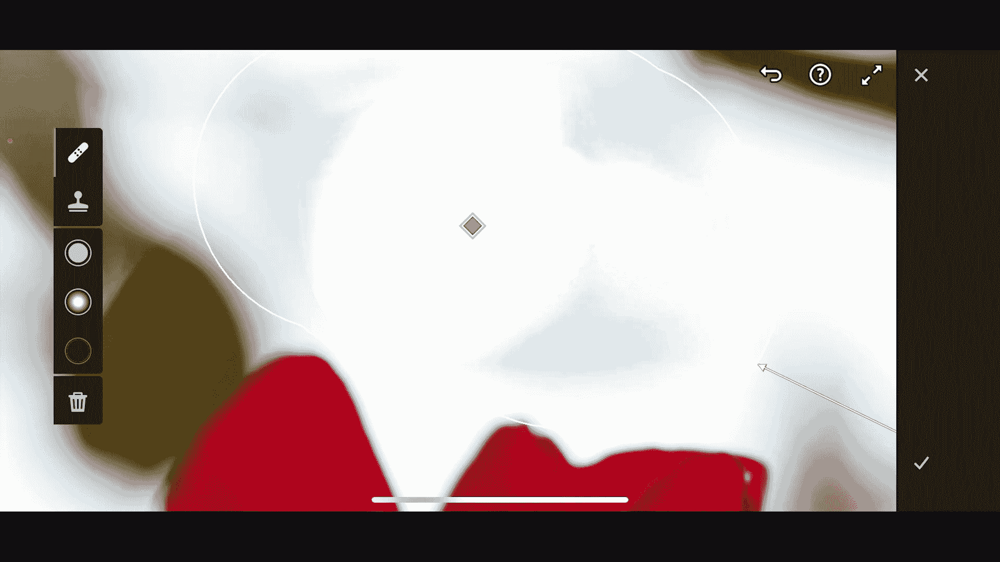
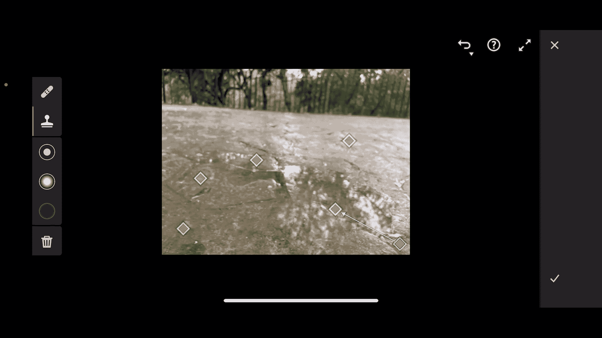

# Adobe Lightroom 从新手到专家：第48章：修复画笔与克隆工具 🖼️


在本节课中我们将要学习Lightroom中两个重要的去除工具，分别是修复画笔和克隆工具。我们会先了解修复画笔的位置和基本用法，再看看它怎么自动寻找修复区域，接着学习如何手动调整修复点，最后对比克隆工具的区别，并用人像示例演示实际操作，帮助你彻底掌握这两个功能。

上一节我们介绍了如何进行选择性调整，现在我们要把注意力转移到修复画笔上。修复画笔是Lightroom里专门用来去除画面中不想要物体的工具，它的图标看起来像一张创可贴，位于界面右上角选择性调整工具的正下方。

修复画笔顾名思义，就是帮你把图像中某些多余的部分修复掉。这里说的多余部分，通常就是照片里你并不希望出现的东西，比如背景里的杂物，或者皮肤上的小瑕疵。接下来我们就找一张示例图片来看看具体怎么操作。

为了方便演示，我选了一张青蛙的照片，准备用修复画笔去掉一些不需要的部分。首先我们要点击修复画笔，也就是那个创可贴图标。这里有个小知识点，在Lightroom Classic里曾经有个点除工具，你选中一个点，软件会自动寻找一个区域，然后你可以追踪那个区域，让修复后的部分融进画面里。

但在当前版本的Lightroom里，我们有两个不同的选项，一个是修复选项，另一个是克隆选项。克隆选项在Photoshop里也能找到，它的作用是把图像的一部分复制到另一个选中的部分上。我们先聊聊修复画笔，克隆工具稍后再讲。



当你点击修复画笔后，会出现几个可调节的参数。以下是修复画笔的主要参数：

- 画笔大小：按住并上下拖动来调整，决定你刷过区域的范围
- 羽化程度：上下拖动可以改变边缘的柔和程度，让修复后的部分更自然
- 不透明度：控制修复效果的可见程度，我们暂时保持在百分之百

核心概念可以用代码表示：

```
修复画笔 = 源区域 + 目标区域 + 自动融合
克隆工具 = 复制(源区域) → 粘贴(目标区域)
```

假设我们要去除背景里的一片叶子，觉得它不该出现在画面中。这时只需要按住鼠标在叶子上画一下，Lightroom就会自动为你寻找一个合适的源点。你只需要引导它找到正确的位置就行。不过刚才选的这张图可能不是最理想的示例，不过你已经明白大致意思了，我们换一张更合适的图来练习。

接下来我们用一张地上有落叶的图片来演示。回到修复画笔，放大图像，在想要处理的区域刷一下。效果看起来好多了。这时候Lightroom会要求你把源点放到一个阴影和颜色相似的区域。完成之后，你就创建了一个选择点。如果继续画，就会创建更多的点，数量没有限制。

你可以通过点击或拖拽来创建不同形状的选择区域。以下是常见的操作方式：

- 轻点一下：创建一个圆形选择区域
- 按住拖动：像画画一样自定义形状，比如正方形、爱心，或者任何你想去除区域的样子

修复画笔的好处在于，你随时可以回到之前创建的点，重新进入那个选择，做进一步的微调，然后再跳到下一个点重复同样的操作。如果看不清细节，可以用双指放大那部分，再使用修复画笔。

有时候画笔大小会太大，这时候需要把大小调小到合适的程度，调整一下羽化，这样就能做出更精确的选择。现在你可以看到，我已经做了好几个选择点，这就是修复画笔的基本用法。

当你选中一个区域，就像Lightroom Classic里的点除工具一样，软件会寻找一个在像素、颜色、阴影或光照方面相似的区域。同时，它也会给你选项，手动引导它找到正确的位置。很多时候软件自动选的位置不太对，你只需要按住拖动选择框，把引导源移动到合适的地方就行。

好了，修复画笔的内容先说到这里，接下来我们来看看克隆工具。顾名思义，克隆工具会克隆一个选择区域，并制作出另一个版本。

我现在已经切换到了克隆工具。假设我想克隆这片叶子，我就在上面刷一下，然后选一个区域作为克隆来源。这意味着它并没有修复那个部分，而是直接复制。我再重新做一次选择，把刚才选中的叶子拖到这里，现在图里就有两片叶子了。虽然选择不够干净，但暂时没关系，我们现在有两片叶子。



使用克隆工具时需要注意以下几点：

- 它不会进行修复处理，只是单纯复制
- 边缘容易出现补丁感，看起来不够自然
- 最好做精确的选择，避免后续需要修复
- 适合在光影和颜色相似的区域使用，这样融合效果更好

和选择性调整一样，你可以点击任意一个点，再点击删除图标把它删掉。你也可以随时回去调整，甚至更改来源位置。比如我希望新出来的叶子放在这里，就可以把叶子移到上面，现在就有一个克隆出来的叶子。但要注意，克隆工具不像修复画笔那样能自动融合边缘，边缘会比较明显，所以必须非常精确，并且只在光线颜色相近的地方使用，才能让效果看起来融合在一起。


讲完克隆工具，我们回到修复画笔，看看它在人像修图里的表现。修复画笔大多数情况下会用在人的脸上，也就是人像主体身上。

假设我们要去除脸上的一个痣。我会选择修复画笔，而不是克隆工具，因为我不想复制选中的区域，而是想把它去掉。选中修复画笔，也就是创可贴图标，做一个小小的选择，痣就消失了。可以再做几个，其他的痣也都不见了。现在模特的脸上没有痣了，效果看起来非常自然，没有补丁感，因为Lightroom会利用自己的后期处理算法，把选择区域和周围部分融合在一起。

修复画笔也可以用在较暗的区域，效果也不错，那个区域也被去掉了。但如果你要处理的是连在一起的部分，情况就会变得棘手。比如我想去除眉毛的一部分，调整画笔大小，刷过去之后，效果就不太好看了。甚至Lightroom自己都困惑了，它选中了眼睛，按下确定后，看起来非常糟糕，完全没有融合在一起。

这是因为我们选择的区域和想要保留的另一部分是连在一起的。眉毛本身就是连在一起的，如果你只想去掉一半，就会出现这种情况。因此使用修复画笔时，建议遵循以下原则：

- 适合处理独立的小瑕疵，比如痘痘、一些皱纹
- 不适合处理与你想保留的部分完全连在一起的区域

比如说，如果我想去除鼻孔，可以直接去掉，因为鼻孔本身就是一个独立的黑色小孔，不和其他东西连在一起。但如果真的去掉了，看照片的人会觉得奇怪，因为人通常是有鼻孔的，这个效果就不太合适了。

这就是修复画笔的全部用法，它在很多时候都非常实用。希望大家都学会了如何使用它，下节课见。


本节课中我们一起学习了Lightroom的修复画笔和克隆工具。我们了解了修复画笔的位置、参数设置、自动寻找源点的原理以及如何手动引导，还学习了克隆工具的复制原理、边缘处理注意事项，并通过人像示例掌握了在脸上去除瑕疵的实用技巧。希望这些内容能帮助你在后期修图中更灵活地去除画面中的多余部分。
