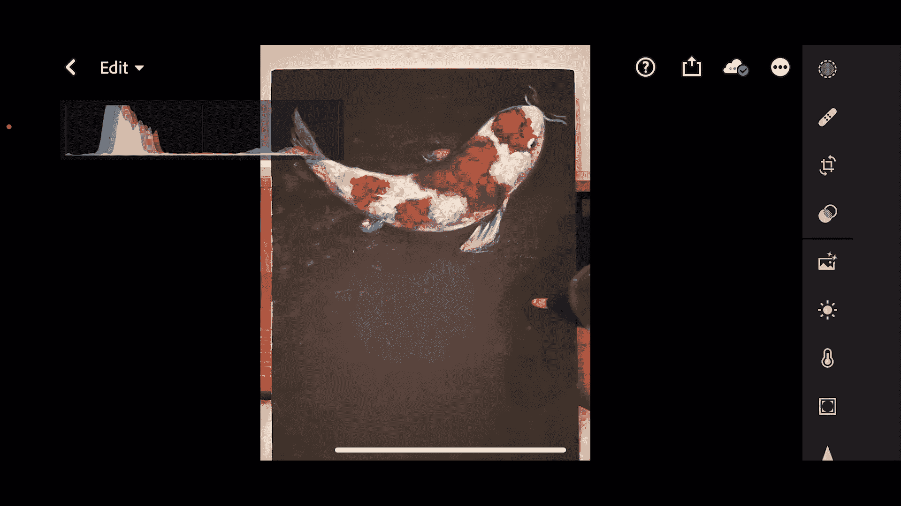
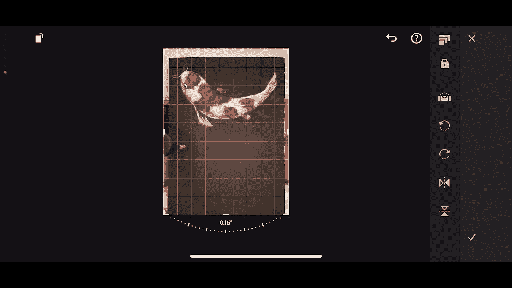
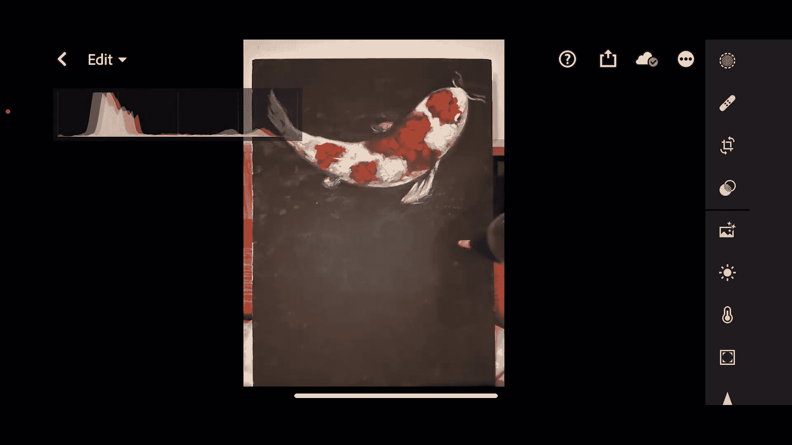
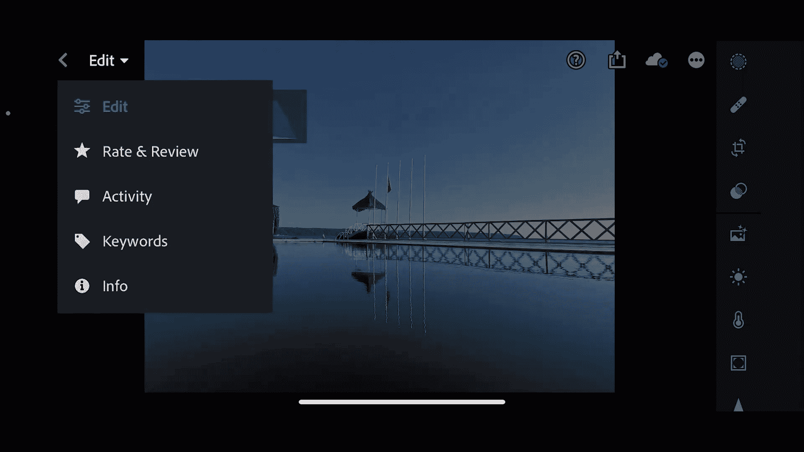
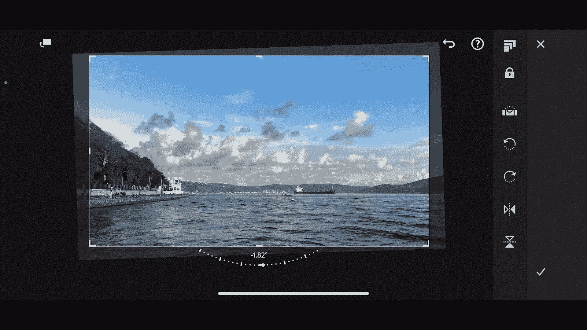
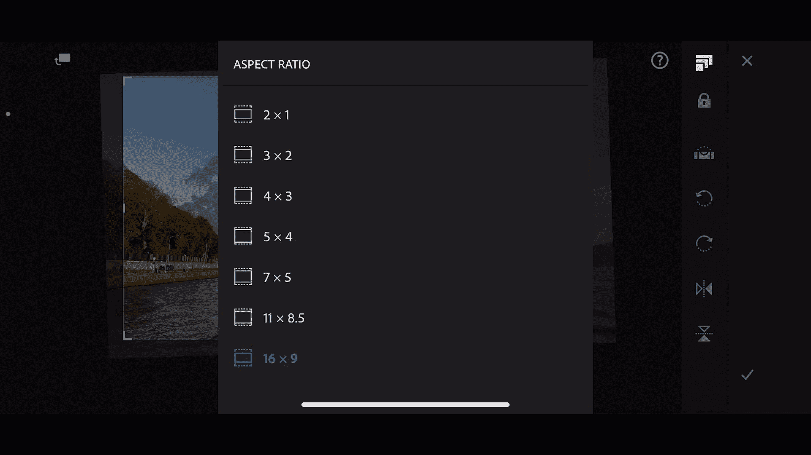
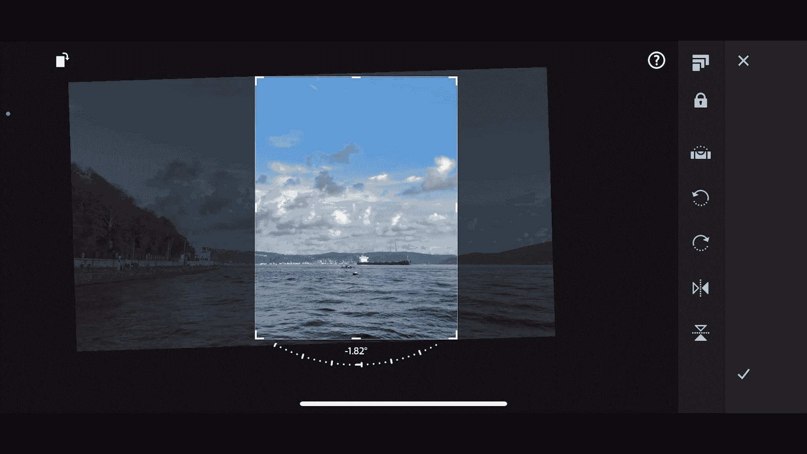

# Complete Adobe Lightroom Megacourse： Beginner to Expert Photo Editing：044：裁剪工具📐

## 课程概述

在本节课中，我们将学习Adobe Lightroom里的裁剪工具。裁剪是照片编辑中非常基础又非常重要的一步，它可以帮助你去除画面中不需要的部分，改变照片的构图，还可以把歪斜的地平线扶正。不管你是想把竖构图改成横构图，还是想要调整照片的宽高比例，裁剪工具都能派上用场。我们会一步步来看这个工具在界面上的位置，各个按钮的作用，以及如何在实际照片中应用它。准备好之后，我们就开始吧。

## 认识裁剪工具的位置

上一节我们介绍了修复画笔的使用方法，本节中我们来看看紧挨着修复画笔下方的裁剪工具。当你在Lightroom的右侧工具栏中使用过修复画笔去除照片上的痣或瑕疵后，你会发现修复画笔右侧出现了一个圆圈路径标记，这就是软件在记录你的修复操作。紧接着往下看，就是我们今天的主角——裁剪工具。

为了方便演示，我们需要挑选一张合适的示例照片。在实际操作中，建议选择主体清晰、边界分明的照片，这样裁剪起来会更省时间，不需要花太多精力去对准边缘。当然，如果你手头的照片比较复杂，也可以先用克隆工具处理一下，不过今天我们先不深入那个，只专注于裁剪本身。



## 裁剪面板的界面介绍

当你点击裁剪工具进入面板后，屏幕上会出现专门的裁剪控制区域。在图片的左上角，你会看到旋转选项，这里可以调整当前裁剪框的方向。现在我们的裁剪框是竖向的，如果你需要，也可以把它切换成横向的。在图片的下方，同样提供了向左右两侧旋转的按钮，如果你不小心调错了，双击任意一个旋转按钮就能恢复默认状态。

在面板的右上角，你可以找到撤销按钮，旁边还有一个问号图标，如果你在操作过程中卡住了，点击它可以查看帮助信息。

以下是裁剪面板中常见的几个基础控制位置：

- 左上角：旋转方向切换
- 下方：左右旋转按钮，双击可重置
- 右上角：撤销按钮与帮助问号

## 设置宽高比

接下来我们来看看裁剪工具中最核心的设置之一，也就是宽高比。在工具栏中，第一个选项就是宽高比设置。这个功能和其他Lightroom课程里讲的是一样的，你可以直接从软件提供的模板里选一个常用比例，也可以进入自定义模式，自己输入想要的宽度和高度数值。

举个例子，我可以选择8乘8，或者5乘11，这就是我自定义的尺寸。如果我选择原始比例，也就是3乘4，那这就是照片最初拍摄时的尺寸。当然，你也可以把它设成正方形，或者完全自定义成任何你想要的比例。

宽高比的计算公式如下：

```
宽高比 = 图片宽度 ÷ 图片高度
```

使用宽高比的目的是为了让画面看起来更平衡、更协调。如果你调整完后想要恢复，双击对应的比例选项就能重置。

以下是几种常见的宽高比选择方式：

- 软件内置模板：直接套用常见比例
- 自定义尺寸：手动输入宽和高
- 原始比例：保持相机拍摄时的原始3:2或3:4等比例
- 正方形：1:1的裁剪比例

## 锁定比例功能

在宽高比设置旁边，还有一个锁定按钮，这个功能非常关键。当你开启锁定后，裁剪框的宽度和高度就会被绑定在一起，你不能随意改变其中一个而不改变另一个，也就是说，原始图片的比例被锁定住了。

如果你不想改变原始图片的宽高比，只需要点击锁定按钮，锁上之后，你在宽高比列表里选择任何比例，系统都会维持原来的比例关系不变。

锁定状态可以用简单的逻辑来表示：



```
锁定 = true  →  宽高比固定，不能随意更改
锁定 = false →  可以自由调整宽度和高度
```



## 自动矫正与手动旋转



除了裁剪框本身，Lightroom还提供了自动矫正功能。当你点击矫正按钮一次，软件就会自动分析图片中的直线，比如地平线或建筑物的边缘，然后自己选一个角度来把照片扶正。

在实际操作中，你可能会看到角度从0度变成了16度，再点击一次就会回到0度。这是因为Lightroom检测到了画面中的直线，并自动选择了一个它认为最合适的角度。

除了自动矫正，你也可以手动旋转。旋转选项包括向左旋转和向右旋转，但需要注意，这里只能旋转图片，不能进行水平或垂直方向的翻转。如果你需要翻转照片，裁剪工具里是没有这个选项的。

以下是旋转与矫正的操作说明：

- 自动矫正：软件自动寻找直线并调整角度
- 手动向左旋转：逆时针旋转裁剪框
- 手动向右旋转：顺时针旋转裁剪框
- 翻转功能：裁剪工具不支持水平或垂直翻转



## 裁剪实战演示

现在我们来进行一次实际的裁剪演示。挑选一张含有明显直线的照片，比如一条笔直的地平线或墙角。如果你发现这条直线在照片里是歪的，那就正是使用裁剪工具的好时机。

点击自动矫正按钮，你会看到照片被扶正了，比如自动调整到了负2点61度。这时候画面里的直线就变笔直了。如果你想自己来验证，可以移动下方的角度滑块，这时候屏幕上会显示辅助引导线，你可以根据引导线，用自己的判断来把图片调整得更直。调整好之后，点击确定按钮，然后滚动鼠标回到原来的视图。



如果你想把横向的照片变成竖向的，也是可以做到的。当前的裁剪方向是横向，你不能直接“反转”过来，但可以选择其他比例，比如11乘8.5，然后点击左上角的旋转尺寸按钮。如果原来是横向，点击之后就会变成竖向，这样你就得到了一张竖构图的照片。

Lightroom的所有选项设计得都很简单，就像使用肥皂一样直观，目的是让普通用户也能轻松理解，并且快速上手操作。



## 完成调整与下一课预告

当你完成裁剪调整后，可以点击撤销按钮把刚才所有的操作都撤销掉，或者直接移动到下一步的调整工作流中。这就完成了Lightroom裁剪工具的全部使用方法。

本节课中，我们一起学习了如何找到裁剪工具、如何设置宽高比、如何锁定图片比例、如何使用自动矫正和手动旋转，还进行了一次完整的裁剪实战演示。在下一节课中，我们将继续学习Lightroom中的预设功能。

