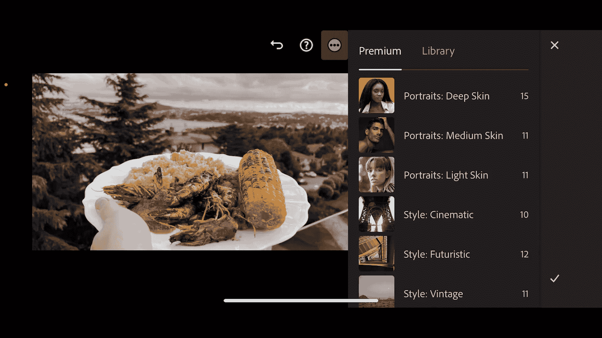
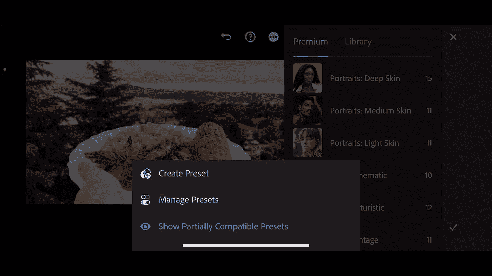
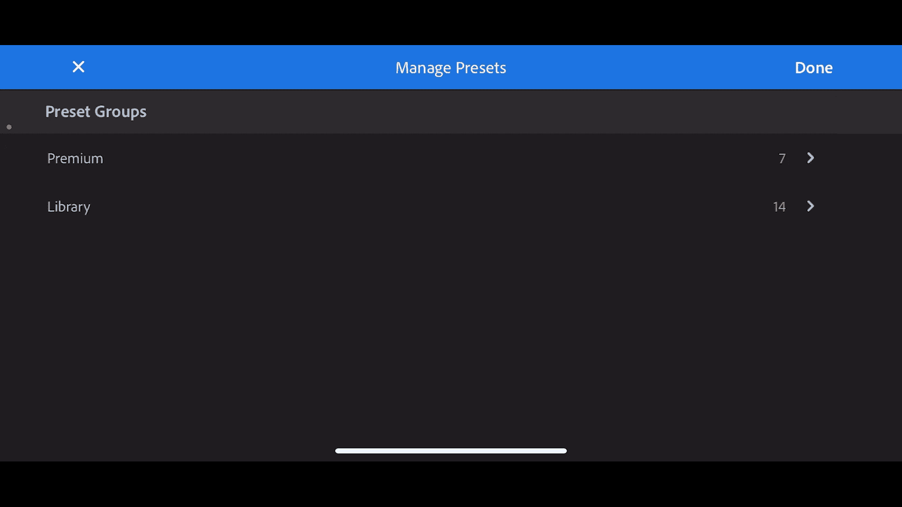
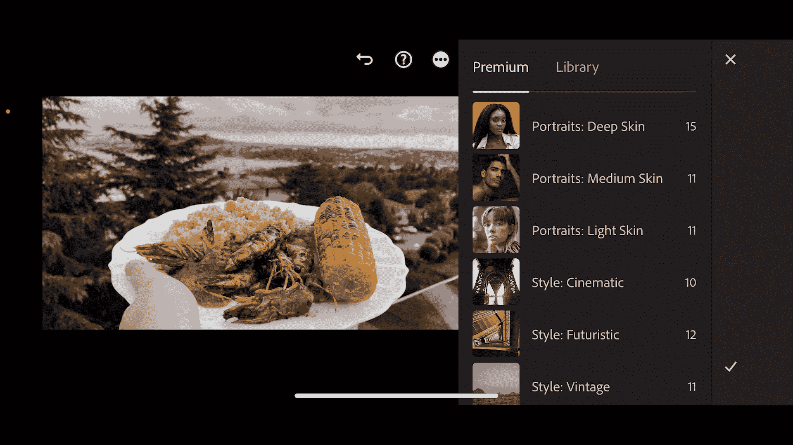
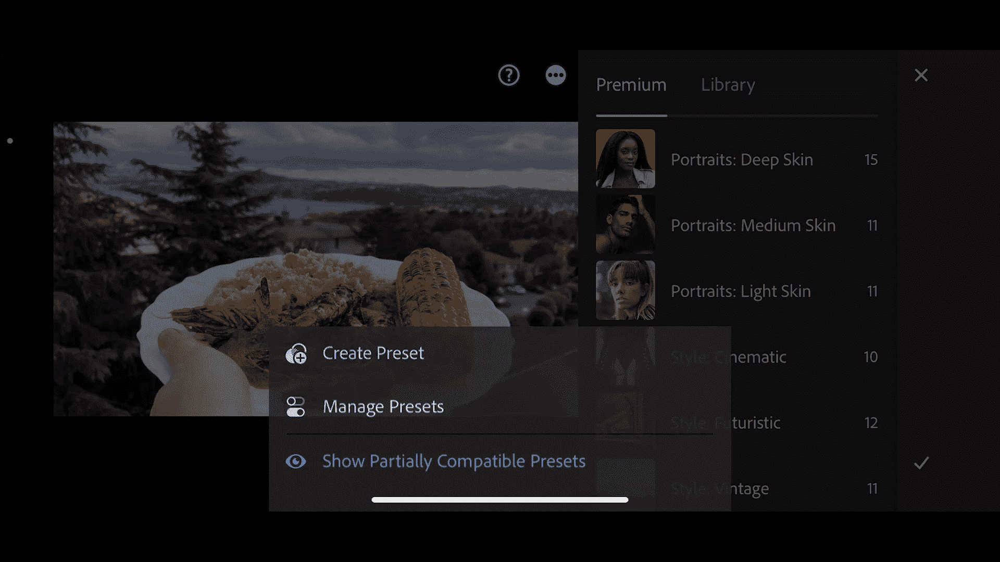
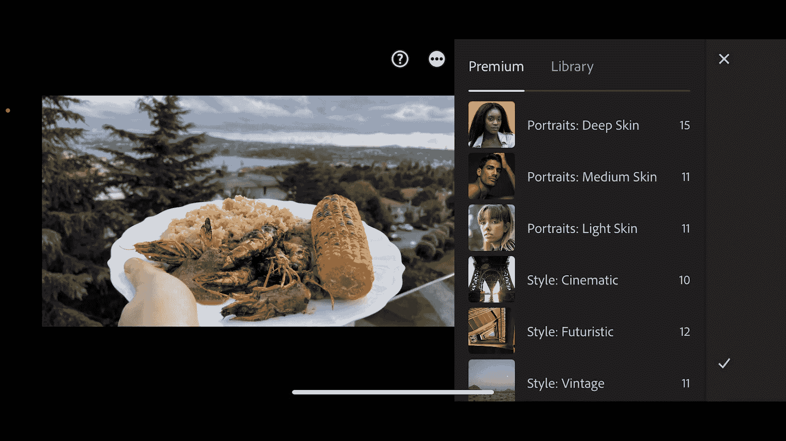

# Complete Adobe Lightroom Megacourse：Beginner to Expert Photo Editing：P50：预设与自动设置 🎨

在本节课中，我们将要学习Adobe Lightroom移动版中的预设功能以及自动设置功能。预设就像是一组预先保存好的调色参数，你只需点击一下，就可以把这些参数应用到你的照片上。自动设置则是让软件自动帮你分析图像并调整光线和颜色。我们会详细看看预设面板在哪里，不同种类的预设分别有什么效果，还有如何自己创建和管理预设。最后，我们也会尝试一下一键自动编辑的按钮，看看它能为我们带来什么样的效果。

和Lightroom桌面版类似，在Lightroom移动版里你也可以使用预设。

和我们在预设课程中提到过的那样，你可以从网上下载预设。

但是移动版的预设格式是`DNG`，而桌面版的预设格式是`XMP`。

`移动端预设格式 = DNG`

`桌面端预设格式 = XMP`

所以如果你要从网上下载预设，无论是从你喜欢的摄影师还是网红那里下载，都需要确认你获得的格式以及页面标题是专门为Lightroom移动版准备的。

因为移动版和桌面版使用的格式不同，如果你下载了桌面版的预设，那显然是无法在移动版上使用的。

在右侧工具栏中，裁剪工具的正下方，有两个圆圈，看起来有点像示意图，点击它。

这时候你就会进入预设面板。

`右侧工具栏 → 裁剪工具下方 → 两个圆圈图标 → 预设面板`

因为我已经登录了Adobe账号，所以我有两个选项，还拥有高级选项。

不过现在我处于资料库模式，这里的预设和桌面版的类似。

以下是一些基于色彩的预设，它们对图片产生的效果如下：

- 自然色
- 明亮色
- 高对比度
- 高对比度细节
- 柔光哑光

接下来我们看创意类预设。

创意类预设是为了营造特定风格而设计的，和我们在Lightroom桌面版中讨论过的风格类似。

以下是一些创意预设示例：

- 去饱和对比度，营造严肃氛围
- 冷光，营造悲伤严肃的氛围
- 土耳其红
- 有趣温暖的氛围
- 迷雾，褪色氛围
- 复古瞬间，复古感觉
- 温暖对比度，戏剧效果
- 平坦绿色，一种恐怖风格
- 强烈效果
- 红光哑光，另一种戏剧性闪回，温暖阴影
- 戏剧性温暖时刻，旧照片
- 褪色记忆
- 冷哑光，非常严肃和悲伤的场景
- 冷阴影和暖高光，对比悲伤戏剧氛围
- 温暖忧郁，悲伤戏剧氛围😔

这些之所以被称为创意预设，是因为它们非常适合用照片来表现某种情绪。

回到预设面板，我们在黑白类别下也有一些基础选项。

以下是黑白预设示例：

- 黑白风景
- 黑白高对比度
- 黑白冲击力
- 黑白低对比度
- 黑白平淡
- 黑白柔光
- 黑白红外线
- 黑白硒调色
- 黑白棕褐色
- 黑白分调

注意这里的预设和Lightroom桌面版中的一样。

接下来看人像预设，现在预设已经被分类好了。

人像预设希望让我们的图像看起来更好。

以下是人像预设的分类：

- 浅色皮肤
- 中等皮肤，不同温度
- 中等和深色皮肤
- 不同色调和温度，有很多选择

还有默认预设，就是你原本就有的，以及Adobe自带的一些。我个人不太经常使用这些。

回到主界面，我们还有曲线预设，这些只是用于色调曲线的一些随机预设。

以下是曲线预设示例：

- 交叉处理
- 平坦提升阴影
- 强S曲线

还有绿色预设😔：

- 浅绿色
- 中等绿色
- 重绿色

你可以放大查看背景中的小点，选择中等绿色，就能给图像增加绿色。如果你不想自己进面板调整，直接选择一个绿色预设的量就可以了。

还有光学预设，这是色差校正。

点击它，Lightroom会检测任何色差，并为你移除。

镜头校正会进行畸变校正，如果软件认为有必要的话。

你可以两者都选，这样Lightroom就能检测所有错误并用这些方法修复。

下一组是锐化预设，数值一样，有无、轻度、中度、重度，你们可以选择或者保持无。

最后一组预设也是同样的道理，只需选择你想要的数量即可。

以上这些是资料库里的预设。

如果你连接了Adobe账号，你会获得高级预设，会得到更多高级预设。

让我们看看高级预设，你会得到很多风格，和我们在Lightroom桌面版中拥有的类似。

我们有深色皮肤预设，它们可以适用于不同的肤色。

这是深色皮肤，所以深色肤色的用户可以任选。

回到人像，中等肤色，非常适合中等肤色的人群，你可以任选这些。

它们会对浅色皮肤主体起作用，还有一些为该肤色设计的基础预设，这样我们就不会遇到使用预设后，预设反而让主体皮肤变暗或变亮，破坏图像的问题。

我们还有风格预设，有电影风格，逐个查看，注意每个风格都有我们之前讨论过的那些颜色。

还有未来主义风格，追求更清晰鲜艳的效果，随你喜欢选。

回到复古风格，我们有一些复古外观，它们带点滤镜感，有一些色调和温度。

最后是主题旅行预设，非常适合旅行照片，选择非常多。

再次说明，如果我们点击那个三个圆点的圆形图标，如果我对图像做了调整，并且想把这些调整保存为模板，我就会创建一个预设。

`三个圆点图标 → 调整后的图像 → 保存为预设`

我们还有预设管理功能。进入这里，如果我们点击任意一个预设，可以删除它们，关闭它们，开启它们。

所以你会关闭那些很少使用的预设，让东西更有条理。

回到主界面。

好的，基础部分讲完了，然后我们可以点击对勾或X按钮。

我不想要任何树😔。

还有显示部分兼容预设的选项，这就是预设面板的工作方式，真的很简单。

Lightroom CC的布局是为了方便访问和轻松管理而设计的，不像Lightroom Classic那么复杂，但你会在手机上使用Lightroom CC进行快速编辑，同时又能进行不错的编辑，所以它不仅仅是你通常只能调整光线和颜色的照片编辑应用，你有更多选项，甚至可以加入社区，但布局更简单，模块都很容易找到，你不会在找每个部分时遇到困难。

就在我们刚才那个预设符号下方，有一个图片框，角落有闪亮的星星，这就是让Lightroom自动编辑图像的按钮。

`图片框+角落闪亮星星 = 自动编辑按钮`

你可以看到Lightroom已经使用了一些光度面板和色彩面板，或者是白平衡的设置。

因为我们打开了这些功能，所以光度面板、太阳和白平衡面板旁边有小白点。

如果我想要快速编辑，我就按一下这个按钮，Lightroom做得不错，光线充足，颜色鲜艳，元素清晰，然后按撤销就可以移除这些自动设置。

本节课中我们一起学习了Lightroom移动版的预设和自动设置。

我们知道了移动版预设使用`DNG`格式，桌面版使用`XMP`格式，下载时要注意格式匹配。

我们找到了预设面板的位置，浏览了色彩、创意、黑白、人像、曲线、绿色、光学、锐化等各类预设，也了解了高级账户能解锁更多风格。

我们学会了如何创建自己的预设，如何管理常用预设，最后尝试了一键自动编辑按钮。

下一节课我们将讲解其他面板，那些面板同样很简单，学起来很快，到时候见。

