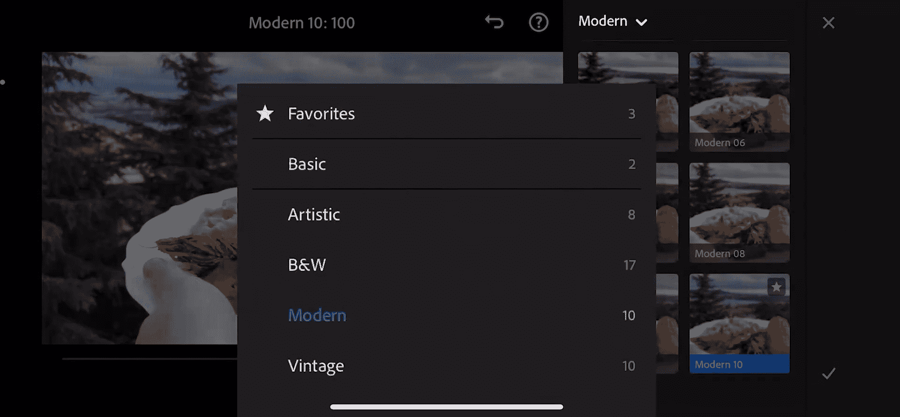
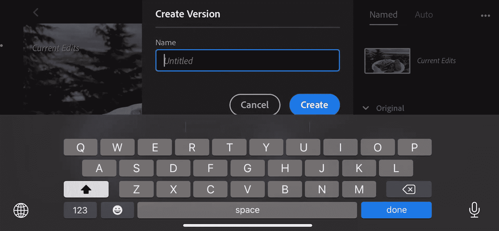

# 完整Adobe Lightroom大课程:51:46 调整面板 🖼️

## 本节课概述

在本节课中我们将要学习Adobe Lightroom CC中的调整面板。我们将逐一查看光线、白平衡、色彩混合器、色彩分级、效果、细节、光学、几何、配置文件以及历史记录等面板的功能，并了解如何使用这些工具来编辑照片。

## 进入开发面板

在上一节课中我们介绍了预设和自动设置，本节中我们来看看开发面板中的各个调整面板。

Lightroom CC中的调整面板分为几类，点击即可进入。这些分类包括光线、白平衡、效果、锐化、光学以及变换或几何。它们的基本工作原理与Lightroom Classic相同。我们只是简单过一遍，让你熟悉这些面板。

## 光线面板

让我们从这个太阳符号开始，这就是光线面板。

以下是光线面板中的主要设置：

- 曝光：控制图像的整体亮度，你可以向左或向右调整，点击即可重置。
- 对比度：调整明暗区域之间的差异。
- 高光：恢复或增强亮部细节。
- 阴影：调整暗部细节。
- 白点：设置最亮像素的阈值。
- 曲线：与Lightroom Classic中的色调曲线相同。你可以使用参数曲线，也可以创建点曲线，在曲线上添加点并自由调整。
- 通道：包括红色通道、绿色通道和蓝色通道。你可以使用下方的电平滑块，或点击曲线上的线条来调整每个部分。

曝光调整可以用简单的公式来理解：
```
最终亮度 = 原始亮度 × 曝光补偿系数
```

## 白平衡面板

光线面板介绍完毕，本节中我们来看看白平衡面板。

白平衡面板包含以下设置：

- 色温：调整图像的暖色或冷色色调。
- 色调：修正绿色品红偏色。
- 自然饱和度：智能提升低饱和度颜色。
- 饱和度：调整所有颜色的强度。

目前模式设置为自定义，你也可以点击自动，让Lightroom自动设置白平衡，同时也会调整图像中的颜色。你可以保持原样，或根据需要自定义。此外还有黑白选项，点击即可将图像转为黑白。

白平衡调整的基本逻辑：
```
色温偏移 = 目标色温 - 当前色温
```

你还可以使用吸管工具，在图像中选择一个中性颜色点，Lightroom会根据该颜色自动修正白平衡。操作完成后点击对勾确认。

## 色彩混合器面板

白平衡面板介绍完毕，本节中我们来看看旁边的色彩混合器面板。

色彩混合器面板，也就是HSL面板，包含以下功能：

- 色相：改变特定颜色的色调。
- 自然饱和度：调整该颜色的饱和度。
- 亮度：改变该颜色的明暗程度。

你可以选择图像中占比较大的颜色，分别调整其色相、自然饱和度和亮度。还有一个颜色选择器，可以点击图像中的任意颜色，比如蓝色，只调整那个蓝色。这类似于Lightroom Classic中的魔术工具：选择你不知道包含哪些颜色的任意颜色，按住该点并向左或向右移动手指，这就是调整颜色的方法。

使用完成后点击吸管工具关闭它，点击撤销返回之前状态，然后点击完成。

## 色彩分级面板

色彩混合器面板介绍完毕，本节中我们来看看色彩分级面板。

色彩分级面板包含三个圆圈，分别对应以下区域：

- 阴影色轮：为暗部区域着色，可调整色相和饱和度。
- 中间调色轮：为中间调区域着色，设置相同。
- 高光色轮：为亮部区域着色，设置相同。
- 全局色轮：对整个图像进行统一着色。

你还可以调整混合和平衡参数，控制色彩过渡的柔和程度。如果需要，可以全部重置。完成后点击完成。

## 效果面板

色彩分级面板介绍完毕，本节中我们来看看效果面板。

以下是效果面板中的选项：

- 纹理：增强中频细节。
- 清晰度：提升中间对比度。
- 去雾：去除或增加雾霾感。
- 蔓缩：添加图像边缘的暗角效果。
- 中点、羽化等参数：仅在添加蔓缩后才会启用。
- 颗粒：给图像添加胶片颗粒感。

这就是效果面板的工作方式。

## 细节面板

效果面板介绍完毕，本节中我们来看看细节面板。

细节面板主要包括以下功能：

- 锐化：增强边缘清晰度，只有启用锐化后相关效果才会显示。
- 降噪：减少亮度噪点。
- 色彩降噪：减少彩色噪点。

开启降噪后，下方的相关选项会自动启用。如果不需要，可以点击撤销恢复。

## 光学面板

细节面板介绍完毕，本节中我们来看看光学面板。

光学面板用于以下功能：

- 去除色差：自动消除镜头色差。
- 启用镜头校正：自动修正镜头变形。

在这个版本中，我们没有手动去除色差或扭曲图像的选项，只能让Lightroom自动完成。不过，我们可以在几何面板中实现一定的扭曲效果。

## 几何面板

光学面板介绍完毕，本节中我们来看看几何面板。

几何面板可用于透视校正，包含以下选项：

- 垂直：校正垂直线条。
- 水平：校正水平线条。
- 旋转：旋转图像。
- 长宽比：改变图像比例。
- 缩放：向内或向外缩放。
- X偏移：水平位移。
- Y偏移：垂直位移。

此外还有引导式自动、水平、垂直、完整等模式，这些在Lightroom Classic中也介绍过。还有一个限制裁剪选项。你可以给Lightroom两条线，让它自动矫正图像。操作时点击加号按钮，按住并创建两个点。如果当前图像没有直线，可以点击垃圾桶图标关闭该工具。



## 配置文件面板

几何面板介绍完毕，本节中我们来看看配置文件面板。

配置文件更多地关注颜色表现，包含以下分类：

- 艺术：色彩比较另类，但效果美观。
- 黑白：各种黑白风格。
- 现代：适合赶时间时使用的快速滤镜。
- 复古：怀旧风格配置文件。

右上角的星号用于将配置文件添加到收藏夹。图像下方有强度滑块，可选择强烈效果或轻微效果。完成后点击X或对勾。

## 历史记录面板

配置文件面板介绍完毕，本节中我们来看看历史记录面板。

当前编辑状态下，你可以返回原图，查看之前的所有版本。点击右上角的三个点，可以删除所有自动保存的版本。你也可以为特定版本命名，比如“去饱和度后”，然后它会出现在列表中。



## 从先前图像应用

历史记录面板介绍完毕，本节中我们来看看从先前图像应用功能。

如果你之前编辑过其他图像，可以将那些调整应用到当前图像。目前没有之前编辑的图像，所以这里为空。你也可以重置图像，这与之前返回原图的操作类似。这就是这些工具的使用方法。

## 本节课总结

本节课中我们一起学习了Adobe Lightroom CC的调整面板，包括光线、白平衡、色彩混合器、色彩分级、效果、细节、光学、几何、配置文件以及历史记录等核心模块。在下一节课中我们将学习如何使用Lightroom CC的相机功能，以及如何编辑图像并导出。

