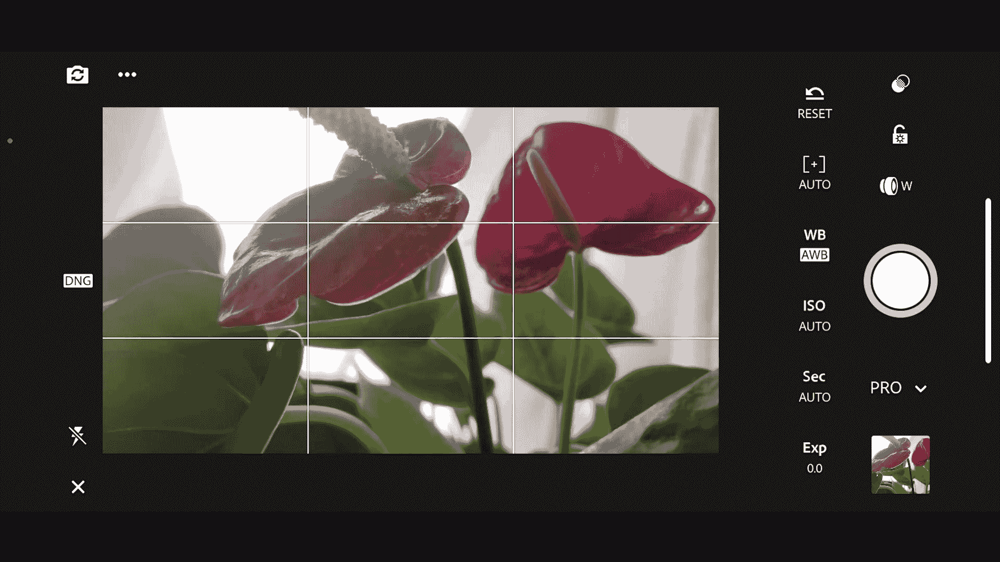

# 完整Adobe Lightroom全能课程：从新手到专家的照片编辑：第47课：手机相机功能详解 📷


在本节课中我们将要学习Lightroom手机版自带的相机功能。这个相机不仅仅是一个简单的拍照工具，它给你提供了快门速度、ISO和白平衡等更多拍摄选项，让你用手机也能拍出专业级别的照片。同时它支持Adobe的DNG原始格式，相当于手机版的RAW，拍出来的照片细节更丰富，后期编辑空间也更大。我们会从怎么打开相机开始，一直到拍照和预览，把所有常用按钮和设置都过一遍，让你以后拿起手机就能从容拍摄。

首先，我们要先进入Lightroom的相机界面。下面是具体操作步骤。

当你打开Lightroom后，默认停留在图库页面。左上角可以看到书架图标，说明现在处于图库模式。而在屏幕右下角，有一个相机形状的图标。点击它，你就会进入相机拍摄界面。今天这节课我以一朵花为例，来演示如何拍出一张好照片。这个相机模式既适合拍人像，也适合拍风景，功能相当全面，后面我们会逐一介绍。

进入相机之后，我们先来看看拍摄模式的选择。下面是可用的模式说明。

- 自动模式：适合不熟悉专业摄影的用户，Lightroom会自动调节所有设置，选项较少，避免工具太多造成干扰。
- 专业模式：适合有一定摄影基础的用户，提供更多手动调节选项，比如曝光、ISO、白平衡和对焦等。

右下角显示的HDR模式是指高动态范围模式。如果你选择自动模式，可用的选项会比较少，适合那些不太了解如何拍专业照片的人，所有复杂的参数可能会让人分心，这时候直接交给Lightroom自动处理就可以了。但如果你是想要更专业的掌控感，专业模式会给你更多自由，可以根据场景自己决定每一项参数。

模式确定好之后，我们需要决定照片保存成什么格式。下面是DNG和JPG的对比。

- DNG格式：文件体积较大，保留更多像素和细节，适合大尺寸打印、出版或制作画册，后期编辑空间最大。
- JPG格式：文件被压缩，体积更小，适合发布到社交媒体或各种平台分享，画质依然不错，但后期调整空间相对有限。

```
图片细节：DNG > JPG
文件体积：DNG > JPG
适合后期编辑：DNG ✅ / JPG ❌
```

DNG是Adobe的DNG格式，也就是Camera RAW功能。拍DNG照片相当于保留了原始数据，虽然占用空间较多，但是画质非常高清，细节非常丰富。如果你以后想要把照片打印出来，或者做成大尺寸的画册，建议一定要选DNG，这样才能把图片编辑到最大潜力。导出成其他格式时，这些细节依然可以保留。不过如果你只是想拍张照片发朋友圈或发到社交平台，选JPG就足够了。JPG虽然是压缩过的RAW版本，但依然是高质量照片，体积更小，传输和存储更高效。具体选哪个，完全取决于你拍照片的用途。

格式选好之后，相机界面上还有几个辅助工具，能帮你在拍摄前把环境准备好。下面是常用辅助功能的介绍。

- 退出按钮：位于左下角，用于退出相机界面返回图库。
- 闪光灯：可设为常开或自动。光线不足时开启，光线充足时可关闭或设为自动让Lightroom判断。
- 相机翻转：切换前置和后置摄像头，适合自拍或自拍人像。
- 三个点菜单：点击后出现更多选项，包括图片尺寸、计时器、网格水平仪、直方图和设置等。

在左下角，有个X按钮可以随时退出相机。旁边是闪光灯图标，你可以选择强制开启，也可以设成自动。闪光灯的作用是在光线不好的时候补光。现在我们拍摄环境光线还可以，不需要闪光灯，但如果你在昏暗的地方拍照，可以开启闪光灯，或者让Lightroom自动探测是否需要闪光灯。点击屏幕关闭闪光灯菜单之后，你还会看到DNG图标，用来切换保存格式，前面已经讲过了。再往上是相机翻转选项，如果你想拍自拍或自拍人像，就可以在这里把镜头翻过来。紧挨着的是三个点按钮，点开后会弹出一些新选项，我们下面会逐一说明。

三个点菜单里的选项非常实用，能让你在拍照前就确定构图和时机。下面是这几项的具体作用。

- 图片尺寸：可选16:9、正方形、4:3（Instagram比例）、3:2等，手机横放对应横向构图，竖放对应纵向构图。
- 计时器：提供2到10秒的倒计时，适合需要稳定机身或自己入镜的场景，使用前要先设置好其他参数。
- 网格与水平仪：帮助将主体居中，或者使用黄金比例构图，水平仪则用于判断画面是否水平，特别适合拍摄建筑、盒子、笔记本或街道等带有直线的场景。

尺寸选项现在默认是16:9，你也可以改成正方形，或者4:3比例，这正好是Instagram常用的比例。如果手机是横着放的，拍出来就是横图，想要竖图就把手机竖过来即可。计时器可以设2秒到10秒，Lightroom会在倒计时结束后拍摄，无论你之前做了什么调整，都会按设定好的参数来拍。所以用计时器前，记得先把曝光、快门和ISO等都调好。网格和水平仪适合想要精确构图的时候，比如把花朵放在画面中央，或者参考黄金比例。当前选的是第二种网格样式。水平仪会提示画面是否倾斜，拍花的时候可能用不上，因为花朵本身没有明显的直线参考，但拍建筑、电脑或街道时非常有帮助。用完记得把水平仪关掉，回到刚才的网格设置。

除了构图工具，相机界面上还有直方图和设置选项，可以帮你判断画面的光暗分布。下面是这两项的说明。

- 直方图：显示高光剪裁区域，也就是过曝接近纯白的部分，那些线条只是临时提示，不会保留在照片里。
- 设置：包括最大化屏幕亮度、地理标记照片（记录拍摄位置元数据，方便地图模块整理）、HDR范围（Pro模式下可保存未处理原片和处理后片）。

直方图上面那部分，现在显示的是高光剪裁提示，画面上会出现一些线条，指出哪些区域过曝成了纯白色。这些线条不是永久性的，只是实时检测，比如窗帘和阳光变化时，提示会随之移动。点击一次可以隐藏这些剪裁提示。在设置选项里，你可以把屏幕亮度调到最大，方便在室外拍摄时看清画面。地理标记功能会把拍摄位置写入照片元数据，如果你后续想用地图模块整理照片，这个功能很有用。HDR范围是在Pro模式下可用，可以同时保存未处理的原片和已经处理过的照片。目前我们只需要开启地理标记即可，其他选项暂时不必勾选。

格式和辅助工具都整理好了，接下来是真正影响照片效果的核心参数。我们从底部开始，先看曝光和快门速度。下面是这两个参数的详细说明。

- 曝光（EXP）：控制画面整体明暗，当前数值为0.0。向下调整会变暗，适合逆光场景；向上调整会变亮，但背景也会一起变亮，可能效果不好。双击曝光滑块可以重置回0。
- 快门速度：控制快门开合的时间。数值越高，快门速度越快，进光越少；数值越低，快门越慢，适合夜景星空或拍摄运动模糊。不熟悉时建议保持自动。

```
曝光变暗：曝光数值 < 0
曝光变亮：曝光数值 > 0
快门速度：数值越高 → 快门越快 → 进光越少
```

曝光滑块现在显示为0.0，也就是没有增减亮度。如果你把滑块向下拉，画面就会变暗，这在拍逆光照片时很有用。如果你向上拉，画面会变亮，但背景的曝光也会随之增加，有时候看起来并不美观。如果不想要任何调整，双击曝光选项就能把它重置回0，这和Lightroom桌面版的双击重置功能一样，非常方便。快门速度目前处于自动状态。如果你手动调节，向一侧移动就是在自己选快门速度。快门速度越高，快门开合就越快，比如现在调到180分之1秒，快门动作非常迅速。拍一张试试，照片是正常的，只是稍微有一点欠曝。如果把快门速度调慢，拍照过程会变得很慢，画面可能会变得很暗。慢快门主要用于夜晚拍摄星空，或者想要捕捉镜头模糊和运动模糊的效果。如果你不太了解快门速度该怎么选，完全可以保持自动，Lightroom通常能选出非常合适的数值。

快门速度设置完成后，接下来是ISO感光度和白平衡，这两个参数直接决定画面的噪点和色温。下面是具体介绍。

- ISO：控制相机传感器对光线的敏感度。ISO越高，敏感度越高，适合低光环境或夜景星空，但会引入较多噪点。光线充足时建议保持较低数值，例如100或更低。
- 白平衡：控制图像的色温。可选自动、白炽灯、日光、阴天，或者使用吸管工具点选中性表面（如窗帘或墙壁）让Lightroom自动计算最佳白平衡。

```
ISO 数值 ↑ → 传感器敏感度 ↑ → 噪点 ↑
白平衡：自动 / 白炽灯 / 日光 / 阴天 / 吸管工具
```

ISO决定传感器有多敏感。如果你在光线很暗的地方拍照，比如夜晚拍星空，就需要调高ISO，这样传感器才能捕捉到那些微小的星星和细微元素。但是如果当前环境光线已经足够，像现在拍花这种情况，就不需要把ISO调得太高，否则照片会出现很多噪点，画质下降。我通常会把ISO设为100，晴天的时候甚至可以更低。根据房间或室外的明暗程度，你需要相应调整快门速度和ISO。如果实在不知道从哪里开始，保持自动模式也是完全可以的。白平衡则是调整照片色温的。目前处于自动白平衡，Lightroom会自己选择。如果你在有很多黄色灯泡的房间里，可以选白炽灯模式，这样会把过多的暖色平衡掉。但现在房间里没有黄光，选这个模式画面会变蓝。日光模式适合在直射阳光下拍摄，但不要让阳光直接打进镜头，而是照在被摄对象上。阴天模式则是在外面阴天的时候使用，因为阴天的色温偏冷，Lightroom会适当增加暖色来平衡。最后还有一个吸管工具，你可以对准一块中性表面，比如背景的窗帘或墙壁，让Lightroom根据那个表面来设定最适合当前场景的白平衡。完成后点击确认，暂时我们先保持自动模式。

光线和色温都调整好了，最后要确定拍摄对象的清晰范围，以及使用哪个镜头。下面是对焦和镜头的说明。

- 对焦：自动对焦时点击屏幕任意位置，对应区域就会对焦；退出自动后可以使用手动对焦，决定哪部分清晰、哪部分模糊，绿色线条会指示当前对焦位置。
- 镜头：取决于你的手机硬件。多镜头手机可在超广角和广角之间切换，新机型选择更多，旧机型可能只有一个选项。

我们把镜头靠近一些花朵来演示对焦。目前处于自动对焦状态，你在屏幕上点击哪里，哪里就会对焦。如果退出自动模式，就可以使用手动对焦，比如只想让前面的那朵花清晰，而把背景弄模糊，都可以自己决定。绿色线条会显示当前对焦在哪个位置，拍摄时很有参考价值。刚开始可能不太容易看出细节，没关系，多拍几次就习惯了。拍照时你可以用两个手指在屏幕上进行缩放操作，就像用其他应用放大图片一样。如果想回到之前的状态，点击重置按钮即可，大部分情况下它会回到自动设置。关于镜头，这完全取决于你的手机配置。如果手机有多个摄像头，你可以在超广角和广角之间选择。更新的手机通常选项更多，旧手机可能只有广角一个选择，或者只有一个镜头可用。

在按下快门之前，还有几个细节设置可以帮你进一步掌控拍摄效果。下面是预设、锁定和补偿功能的介绍。

- 预设：右侧提供一些预设滤镜，但不建议在拍照阶段直接套用，除非你很赶时间只想快速出片。后期再添加预设或调整颜色，会有更多创作空间。
- 曝光锁定：开启后，无论你在屏幕上点击哪里，曝光亮度都会保持不变，适合锁定好光线后重新构图。
- 曝光补偿：手指按住屏幕上下滑动，可以在不切换模式的情况下微调曝光补偿，左侧会实时显示当前数值。

右侧有一组预设选项，你可以点击查看。不过我个人不太建议在拍照时直接加预设，因为这样会限制后期的创作空间。除非你非常赶时间，只想要一张颜色已经比较对的快照，否则建议先拍出原始照片，回到Lightroom编辑模块再慢慢添加预设或调整颜色。如果不想用任何预设，就选择那个带条纹的图标，表示无预设。另外还有一个锁定图标，开启后会锁定曝光，不管你在屏幕上点击哪个位置，画面的亮度都不会改变。关闭锁定后，你会发现点击不同区域时，光线会随之变化，因为Lightroom在自动模式下既会对焦，也会调整曝光。锁定曝光之后，你就保留了原来的亮度设置。最后是曝光补偿，用手指按住屏幕向上或向下滑动，左侧会显示当前的补偿数值，这样可以在不进入菜单的情况下快速微调亮度。使用完之后记得解锁，并把数值调回0。

所有参数都准备就绪之后，最后一步就是按下快门，拍出照片并查看效果。下面是拍照和预览的操作说明。

- 快门按钮：位于底部中央，点击即可拍摄一张照片。
- 模式切换：快门按钮下方可以切换不同的拍摄模式。
- 照片预览：最下方有一个方形区域，可以预览刚才拍摄的照片。

快门按钮就是用来拍照的，按下去就能完成一次拍摄。在快门按钮下方，是我们前面介绍过的不同拍摄模式，可以根据需要随时切换。最底部还有一个方形的预览区域，里面可以看到刚才拍摄的照片，方便你立刻检查效果。这就是使用Lightroom CC移动端拍摄照片的完整流程。在下一节课中，我们将会对拍摄好的照片进行编辑，然后分享到Lightroom社区。




本节课中我们一起学习了Lightroom手机相机的全部核心功能。我们介绍了如何进入相机界面，如何在HDR自动模式和专业模式之间选择，以及DNG和JPG两种图片格式的区别和适用场景。接着讲解了闪光灯、相机翻转、计时器、网格水平仪、直方图和设置等辅助工具的使用方法，然后重点说明了曝光、快门速度、ISO、白平衡和对焦等影响照片成像的关键参数，最后还提到了预设、曝光锁定、曝光补偿和镜头选择等实用技巧。掌握这些内容之后，你就可以用手机通过Lightroom拍出更专业、更可控的照片了。
